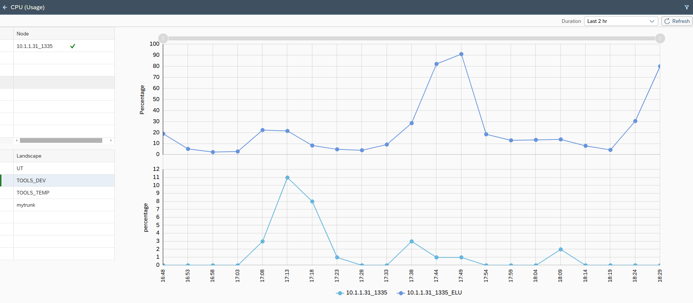

# CPU Usage

This chart shows the CPU utilization of nodes .

X-axis: time duration.

1.  Y-axis: percentage of CPU utilized.(Lower)

2.  Y-axis : percentage of Node's processing time utilized ELU(event loop utilisation).(Upper)

**Note: ELU graph present on top of cpu percentage graph will be common in all other screens and it will be useful for comparison**

Initially, it will show the CPU utilization of the landscape of the current logged in user.

If you select any particular node or landscape in the list, it will show the respected node_id or landscape CPU utilization. (**Note:** for the memory_usage chart and memory_available chart behavior is the same as the CPU usage chart).
