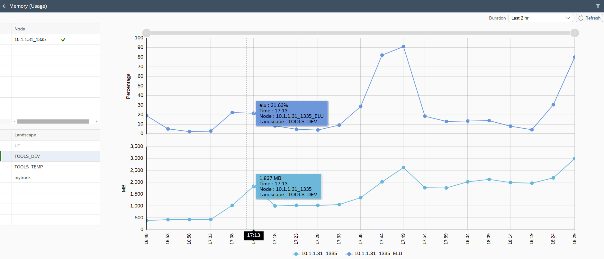

# Memory Usage (in MB)

This chart shows the memory utilization of nodes.

X-axis: time duration.

Y-axis: amount of memory utilized in (MB).

Initially, it will show the memory utilization of the landscape of the current logged in user.

