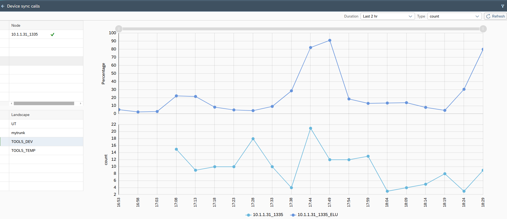

# Device Sync Calls

Initially shows the total number of device sync calls of the selected node and landscape.

X-axis: time duration

Y-axis: count of device sync calls

Selection of query time from type dropdown shows the total time taken by device sync calls of the selected node and landscape.

X-axis: time duration

Y-axis: time taken by device sync calls
