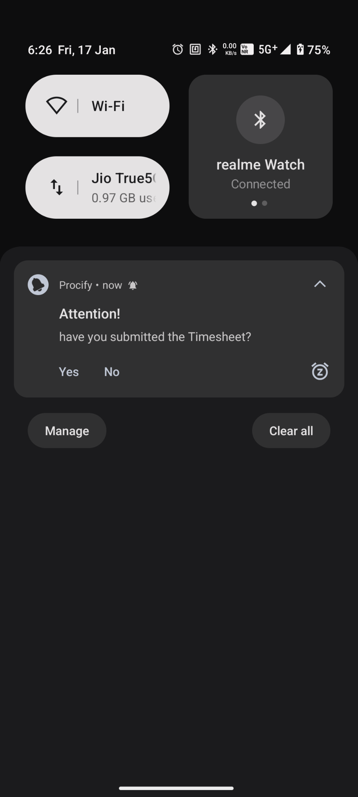

# Notification

Notification is an alert message like SMS, email and notification in an app. Notification can be sent whenever it is required. This will work similarly to an endpoint resolver (it can send notifications to multiple receivers). The notifications sharing service is done by a third-party service ([fcm](https://firebase.google.com/docs/cloud-messaging)) provider to clients. However, the data storage, the notification body, and the channel types are all configured by us.

The types of notifications we deal with are as follows:

- [Email](https://docs.google.com/document/d/1YsCkvdPJvCwz0jLLDGY-4dMjMwpHysPMFsI1nDaTv_4/edit#heading=h.j9tarcpppfew) notification

- SMS notification

- Application Notifications or Push Notification (fcm)

**To Send a notification,** the Notification template should be created first, Refer to this [Notification Modeler document](https://docs.google.com/document/d/1mbHMwbwSHXE5P1S5wWUfPtCyi3UdrLVQC6Fd5EtBPy0/edit?usp=sharing) to know more about modeling the notification template.

**Note on In-App/Push Notification Delivery:** In-app and push notifications are delivered only to users who have an active login session (i.e., a registered/active endpoint) at the time the notification is triggered. If a user is not logged in when a notification is generated, they will **not** receive it retroactively upon a later login — the notification is not queued or replayed for that user. This is intentional platform behavior, approved by both Framework and Application teams. Developers should account for this when designing workflows where a notification's relevance persists beyond a single session (e.g., by using entity-based flags/screens instead of relying solely on the notification queue for critical information the user must eventually see).

## 1.1.Notification API(addNotification)

addNotification is a transaction/eventContext API which can be used to trigger notifications to the users. This can be used to trigger SMS, EMAIL and push notifications for a given set of users with a specific template. addNotification should only be called on the server environment. This API will trigger a notification, it will add a notification to the queue, and it will be picked and processed based on the queue. So, use addNotification for triggering notifications which are not immediately required. Eg. the Status update, Report generated notification,...

Do not use for:

Triggering time critical notification which has to be sent immediately. Notification triggered with this API will be added to the queue and will be processed later based on queue/service availability. To trigger the notification immediately, use sendInstantNotification.

**Note:** After calling addNotification(), you need to call commitP() with the same transaction to ensure the notification is committed and the email is triggered.

addNotification(template, entObject?, userObject?, to_list?, cc_list?)

#### Template 

> Notification template ID should be provided for the template. A notification template can be created using [Notification Modeler](https://docs.google.com/document/u/0/d/1mbHMwbwSHXE5P1S5wWUfPtCyi3UdrLVQC6Fd5EtBPy0/edit).
>
> To know more about how the user object & the template are being mapped refer to [this](#13how-is-a-notification-template-and-user-object-mapped) section.

#### entObject

> An object is an entity object from which data can be used to replace the template variables.

#### userObject

> UserObject can be used to provide custom properties to the template which are not provided by the object. The same properties from entObject will be overridden by the userObject.

#### to_list

> to_list is an array of strings (user_id / mobile number/email id) to which the notification has to be sent. If none is provided the current env user will be taken. Email, mobile, and Endpoints of the user will be used from the user details with user_id. If email is disabled or the template is not present, all email IDs in the list will be ignored. If SMS is disabled or the template is not present, all mobile numbers in the list will be ignored. mobile number/email address / Push notification endpoint is pulled from the user ID. If the App is enabled, all the endpoints will get the push notification.

#### cc_list

> cc_list is only used for email.
>
> Example:

public async onCreateInvitation(event: EventContext)\{

this.txn.addNotification('invitation_template', null,\{user_name:this.first_name+" "+this.last_name\},\[this.user_id\])

\}

## 1.2.Instant Notification API

sendInstantNotification is an EventContext API which can be used to send notifications immediately. This can be used to send SMS, EMAIL and push notifications for a given set of users with a template. **sendInstantNotification** should only be called on the server environment(server-side callBack). This API will send a notification immediately. So, use sendInstantNotification for triggering notifications which are immediately required. Eg. OTP, Task Assignment,...

**Do not use:**

For triggering regular (non-urgent) notifications. For adding the notification to the queue to be sent, use addNotification

For tracking regular changes or logging. This is an expensive functionality.

**API:**

### sendInstantNotification(template, entObject?, usersObject?, to_list?, cc_list?)

#### Template 

> Notification template ID should be provided for the template. A notification template can be created using \{elink [Notification Modeler documentation](https://docs.google.com/document/d/1mbHMwbwSHXE5P1S5wWUfPtCyi3UdrLVQC6Fd5EtBPy0/edit?tab=t.0)\}.

#### entObject

> An object is an entity object from which data can be used to replace the template variables.

#### userObject

> UserObject can be used to provide custom properties to the template which are not provided by the object. The same properties from entObject will be overridden by the userObject.

#### to_list

> to_list is an array of strings (user_id / mobile number/email id) to which the notification has to be sent. If none is provided the current env user will be taken. Email, mobile, and Endpoints of the user will be used from the user details with user_id. If the email is disabled or the template is not present, all email IDs in the list will be ignored. If SMS is disabled or the template is not present, all mobile numbers in the list will be ignored. Mobile number/email address / Push notification endpoint is pulled from the user ID. If the App is enabled, all the endpoints will get the push notification.

#### cc_list

> cc_list is only used for email.

public async onCreateInvitation(event:EventContext)\{

this.txn.sendInstantNotification("reportComplete", null, \{reportid: "Age Report"\}, \["user101", "user104"\], \["user002"\]);

\}

## 1.3.How is a Notification Template and User Object mapped?

#### Sample Template

Dear \<%=customer_id%\>,\<br\>\<br\>

Your order is received with ID \<%=ref_id%\>. To track use the ID logistic id \<%=logistics_id%\>\<br\>Your invoice status is \<%=inv_status%\>.\<br\>

Your Vendor id is \<%=vendor_id%\>.\<br\>

\<% logistics_item.forEach(function(item)\{ %\>

item id \<%=item.logistics_item%\>, material description \<%=item.material_desc%\>.

\<% \}); %\>

#### JSON used to manipulate the above template

\{

"ref_id": "PO076699",

"s_object_type": "403",

"ref_date": "2019-03-15 05:30:00.0",

"s_tenant_id": "2",

"inv_status": "INV_PENDING",

"logistics_id": "030cc14a35ef32e4bb8c13d3bd4ada32",

"s_created_by": "21764",

"currency": "INR",

"s_status": "DL_CREATED",

"logistics_date": "2019-06-19 16:57:14.0",

"s_created_on": "2019-06-19 16:58:20.0",

"s_modified_on": "2019-06-19 16:58:20.0",

"vendor_id": "21764",

"customer_id": "UNDB",

"S_modified_by": "21764",

"remarks": "Delivery to warehouse",

"Logistics_transport": \[

\{

"s_tenant_id": "2",

"logistics_id": "030cc14a35ef32e4bb8c13d3bd4ada32",

"trans_plan_id": "7afe8297b44832548cd4659a9b4b73ee",

"s_created_by": "21764",

"s_created_on": "2019-06-19 16:58:20.0",

"s_modified_on": "2019-06-19 16:58:20.0",

"s_modified_by": "21764"

\}

\],

"logistics_item": \[

\{

"delivery_qty": "1",

"batch_id": "NO_BATCH",

"logistics_item": "c48f97d11d673eb1a41a8290639a5f47",

"s_tenant_id": "2",

"logistics_id": "030cc14a35ef32e4bb8c13d3bd4ada32",

"material_desc": "600MM WIND W/O REG IVR CF",

"s_created_by": "21764",

"order_qty": "170",

"s_created_on": "2019-06-19 16:58:19.0",

"stock_type": "SALE",

"s_modified_on": "2019-06-19 16:58:19.0",

"order_item": "125",

"material_id": "111015931W",

"s_modified_by": "21764",

"order_id": "PO076699",

"logistics_serial": \[\]

\}

\]

\}

#### After manipulation 

Dear **UNDB**,

Your order is received with ID **PO076699**. To track use the ID logistic id **030cc14a35ef32e4bb8c13d3bd4ada32**.

Your invoice status is **INV_PENDING**.

Your vendor ID is **21764**.

item id **c48f97d11d673eb1a41a8290639a5f47**, material description **600MM WIND W/O REG IVR CF.**

## 1.4. Action in Push notification

The **cordova.plugins.notification.local.schedule** function in Apache Cordova is part of the Local Notifications Plugin. This plugin allows you to schedule local notifications to be triggered at a specified time or after a certain delay.

### Setting Up the Local Notifications Plugin

Before using **cordova.plugins.notification.local.schedule,** you need to install the plugin:

1.  Install the local notifications plugin by running the following command in your Cordova project directory:

    1.  “cordova plugin add cordova-plugin-local-notifications”

2.  Once the plugin is installed, you can use **cordova.plugins.notification.local.schedule** to schedule a local notification.

> **Example:**
>
> cordova.plugins.notification.local.schedule(\{
>
> title: 'Attention!',
>
> text: 'have you submitted your Timesheet?',
>
> attachments: \[https://myapps.procifynow.com/p6/MyAppsPRC/index.html\],
>
> actions: \[
>
> \{ id: 'yes', title: 'Yes' \},
>
> \{ id: 'no', title: 'No' \}
>
> \]
>
> \});
>
> 

### Types of Actions:

The **Cordova Local Notifications Plugin** supports **two types of Actions**:

- **Button** actions

- **Input** actions

**Button Action**: Displays buttons within the notification, and the user can tap on them to trigger specific actions (e.g., "Reply," "Snooze").

Example: Adding a Button Action

cordova.plugins.notification.local.schedule(\{

id: 1,

title: 'New Notification',

text: 'You have a new message.',

actions: \[

\{

id: 'reply',

title: 'Reply' // Button label

\},

\{

id: 'snooze',

title: 'Snooze' // Another button label

\}

\],

trigger: \{ at: new Date(new Date().getTime() + 5000) \} // Notification triggers in 5 seconds

\});

**Input Action**: Displays an input field where the user can type a response directly in the notification, and upon submission, the input text is processed.

**Example: Adding an Input Action**

cordova.plugins.notification.local.schedule(\{

id: 2,

title: 'Input Required',

text: 'Please enter your message below:',

actions: \[

\{

id: 'input',

title: 'Submit', // Button label for submission

input: true // Indicate that this action is an input action

\}

\],

trigger: \{ at: new Date(new Date().getTime() + 5000) \} // Notification triggers in 5 seconds

\});

## 1.5.Scheduled Notification:

### How to create a scheduled notification;

To schedule a notification using the **addNotification** API, follow these steps:

1.  **Create the Notification Template:**

- The notification template is created through the [**Notification Modeler**](https://docs.google.com/document/d/1mbHMwbwSHXE5P1S5wWUfPtCyi3UdrLVQC6Fd5EtBPy0/edit?tab=t.0#heading=h.26in1rg) and usually contains details such as the title, body text, and any dynamic content like variables **(e.g., \{\{user_name\}\}, \{\{event_name\}\})**.

2.  **Use the templateId to schedule the notification:**

- Once the template is created, it gets a unique identifier **(templateId)**. You will use this **templateId** when calling the API to schedule the notification.

3.  **Make an API Call** to schedule the notification:

- **Call the addNotification API:** This API allows you to schedule a notification for a future time. You’ll need to specify parameters such as the message content, **cc_list, to_list.**

4.  **For recurring message notifications,**

- We first create a job in the **job definition screen** (job scheduler) and define the **cron expression** to specify the required time for sending the notification.

- Next, we create a **\<class_name\>.ts** file inside the scheduler folder, where we implement the **onExecute()** method as outlined in the attached document.([Job scheduler](https://docs.google.com/document/u/0/d/13JRDqm2YxZqUDc6v9l9LGl5ZE2qKCQMLOMnUfsKvivw/edit)) Within the **onExecute()** method, we call the **addNotification API** to send the notification.

- The **cron expression** determines the schedule for triggering the job at the specified intervals. Once the job is added to the scheduler, it will execute automatically at the defined times.

- In the scheduler, onExecute method, call **addNotificationAPI** with the template ID, objects, and the list of users / emails ID to whom the notification should be sent.
