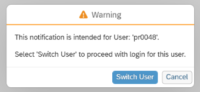
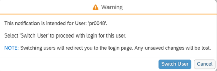
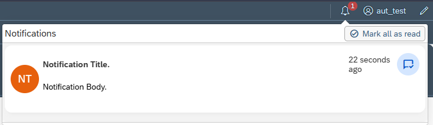

# How to Add Notification Callbacks

Notification callbacks let you attach files to outgoing emails. They are split into two layers: the Entity Callback (which triggers the notification) and the Notification Callback (which adds attachments). Follow the three steps below to set them up.

### Step 1: Register Callbacks in Notification Center

Open the Notification Center, select your template, and go to the Callbacks tab. Add a row for each callback method you want to call, and set the sequence number to control the order in which attachments are added to the email.

1.  Open Notification Center and select (or create) your notification template.

2.  Go to the Callbacks tab.

3.  Click Add and enter the callback method name (e.g. attachInvoice). This name must exactly match the method you write in the notification callback file.

4.  Set the sequence number. Callbacks run in ascending sequence order — seq 1 runs first, seq 2 runs second, and so on.

5.  Click More Info on the Callbacks tab to see the list of allowed attachment file types before uploading.

6.  Save the template.

### Step 2: Create the Notification Callback File

Create a TypeScript file in the notification folder of your app. The file name must match the template name. The class must extend KloNotification, and each method name must match what you registered in the Notification Center.

**File naming rule:**

- File location: src/\<App\>/notification/send_notif_attach.ts

- Class name: same as file name (send_notif_attach)

- Method names: exactly match what is set in Notification Center Callbacks tab

- Use this.entityObject to access the entity that triggered the notification

- Use this.userObject to access the Object passed while sending the notification

- Always guard with hasAttachmentP() before calling addAttachment — skip gracefully if not found

**General template:**

// File: src/\<App\>/notification/send_notif_attach.ts

import KloNotification from "kloBo/kloNotification/KloNotification";

export class send_notif_attach extends KloNotification \{

// Callback method name must match what is set in Notification Center

public async attachInvoice(): Promise\<void\> \{

let txn = this.txn;

let q = await txn.getQueryP('d_attach_store');

// Use entityObject to get the linked attachment ID

q.setProperty('id', this.entityObject.invoice_attach_id);

q.setLoadAll(true);

let results = await q.executeP();

if (!results \|\| results.length === 0) \{

this.warn('Attachment not found');

return; // skip gracefully, do not throw

\}

let attach = results\[0\].p_file;

if (!(await attach?.hasAttachmentP())) \{

this.warn('No file data on attachment record');

return;

\}

await this.addAttachment(attach);

this.info('Attachment added successfully');

\}

\}

### Step 3: Write the Entity Callback to Trigger the Notification

In the entity file, call sendInstantNotification or addNotification inside onCreate, onUpdate, or onDelete. Pass the template name and the entity object (this).

- sendInstantNotification — runs in the same transaction. If it fails, the entity save rolls back.

- addNotification — queued asynchronously. Entity save succeeds regardless; failures logged in ma_tenant_error_q.

// File: src/\<App\>/entity/d_order_subscription.ts

export class d_order_subscription extends KloEntity \{

public async onCreate(): Promise\<void\> \{

// For immediate transactional email (rolls back if it fails):

await this.txn.sendInstantNotification('send_notif_attach', this);

// OR — for async/queued email (entity save succeeds regardless):

// await this.txn.addNotification('notif_temp_2', this);

\}

\}

### Example: Test Case Setup (d_order_subscription with send_notif_attach)

The following is a working example based on the test case where d_order_subscription triggers sendInstantNotification with send_notif_attach. Two callbacks — attachInvoice (seq 1) and attachTerms (seq 2) — fetch files from d_attach_store and add them as attachments. Both method names must be registered in Notification Center before committing the file.

**What to set up in Notification Center first:**

- Template: send_notif_attach

- Entity: d_order_subscription, Object Type: -1 (BOL)

- Callback 1: method name = attachInvoice, sequence = 1

- Callback 2: method name = attachTerms, sequence = 2

**Notification callback file:**

**// File: src/\<App\>/notification/send_notif_attach.ts**

import KloNotification from "kloBo/kloNotification/KloNotification";

export class send_notif_attach extends KloNotification \{

// Callback 1 — registered as 'attachInvoice' at seq 1 in Notification Center

public async attachInvoice(): Promise\<void\> \{

let txn = this.txn;

let q = await txn.getQueryP('d_attach_store');

q.setProperty('file_name_1', 'invoice.pdf');

q.setLoadAll(true);

let results = await q.executeP();

for (let i = 0; i \< (results?.length \|\| 0); i++) \{

let attach = (results\[i\] as any).p_file;

if (!(await attach?.hasAttachmentP())) continue;

await this.addAttachment(attach);

\}

\}

// Callback 2 — registered as 'attachTerms' at seq 2 in Notification Center

public async attachTerms(): Promise\<void\> \{

let txn = this.txn;

let q = await txn.getQueryP('d_attach_store');

q.setProperty('file_name_1', 'terms.pdf');

q.setLoadAll(true);

let results = await q.executeP();

for (let i = 0; i \< (results?.length \|\| 0); i++) \{

let attach = (results\[i\] as any).p_file;

if (!(await attach?.hasAttachmentP())) continue;

await this.addAttachment(attach);

\}

\}

\}

Tip: Test locally using Private Node before committing. Add a debugger statement inside any callback method to inspect this.entityObject and this.userObject. Once validated, commit the file to public.

sendInstantNotification(written in server side callback) -\> triggers the notification callback if present -\> in the notification callback need to do addAttachment as shown in the examples above(attachments should already be present).

## 1.7. Multi-User Push Notification Handling (Switch User)

In shared or multi-user devices, an FCM push notification may be received on a device where multiple users are registered. When a user who is not the intended recipient clicks the notification, the system now detects the mismatch and prompts them to switch accounts.

### Switch User Behavior on click of Notification Tray: 

When a notification tray is clicked, the app checks whether the currently logged-in user matches the notification's target user:

- **If the users match** → the notification opens normally.

- **If the users don't match** → a **"Switch User"** warning dialog is displayed, showing:

  - The notification's intended user

  - A prompt to switch to that account

  - A warning if there are any unsaved changes (dirty objects) that will be lost on switching

  - If the user transaction has no dirty object:  
    > 

  - If the user transaction has any dirty object(s):  
    > 

- **If the intended user is in the background** (i.e. present at that device), then after clicking the “Switch User” button, it will redirect the user to the **login page**.

- **If the intended user is NOT in the background** (i.e. device clear-cache scenario), then after clicking the “Switch User” button, it will redirect the user to the **registration page**.

### Viewing Missed Notifications After Login: 

When the intended user logs back into the device, they can review all notifications that were received while they were inactive. These missed notifications are available in the **Notification Centre**, accessible via the **bell icon (🔔) at the top of the screen**. This ensures no notifications are lost, even if they were received when a different user was active on the device.

**NOTE:** After clearing the application data, the entries will be removed from the Notification Centre.

