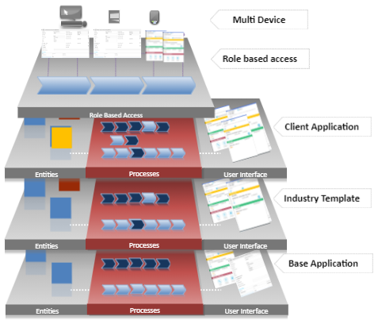

# Notification Modeler — Introduction

> Notification Modeler Guide

**Date of Issue: September 2023  
Training Version Number: 7.0  
Target Audience: Developers, Clients.**

**Copyright**
Copyright © 2023 Procify Innovations Pvt. Ltd. All rights reserved.

No part of this publication may be reproduced or transmitted in any form or purpose without the permission of **Procify Innovations Pvt. Ltd.** The information contained in this document might change based on new developments without prior notice.

**Disclaimer**
THESE MATERIALS ARE PROVIDED BY PROCIFY INNOVATIONS PVT LTD, ON AN "AS IS" BASIS, AND EXPRESSLY DISCLAIM ANY AND ALL WARRANTIES, EXPRESS OR APPLIED, INCLUDING WITHOUT LIMITATION WARRANTIES OF MERCHANTABILITY AND FITNESS FOR A PARTICULAR PURPOSE, CONCERNING THESE MATERIALS AND THE SERVICE, INFORMATION, TEXT, GRAPHICS, LINKS, OR ANY OTHER MATERIALS AND PRODUCTS CONTAINED HEREIN. IN NO EVENT SHALL PROCIFY INNOVATIONS PVT LTD BE LIABLE FOR ANY DIRECT, INDIRECT, SPECIAL, INCIDENTAL, CONSEQUENTIAL, OR PUNITIVE DAMAGES OF ANY KIND WHATSOEVER, INCLUDING WITHOUT LIMITATION LOST REVENUES OR LOST PROFITS, WHICH MAY RESULT FROM THE USE OF THESE MATERIALS OR INCLUDED SOFTWARE COMPONENTS.
