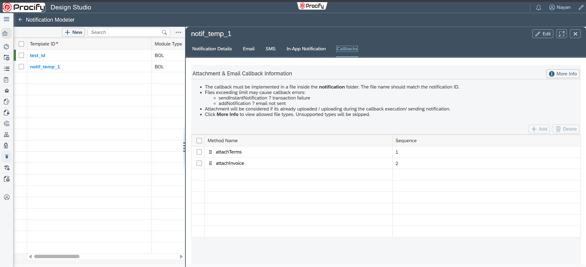

# Notification Modeler — Callbacks Tab

The Callbacks tab is available within a notification template in the Notification Editor. It allows you to register server-side callback methods that run when the notification is being processed, enabling you to attach files dynamically to outgoing emails. Each callback method is defined by a name and a sequence number that controls the order in which it is executed.

*Callbacks tab inside a notification template in Notification Editor*

**What you can do in the Callbacks Tab**

- View all registered callback methods for the template, listed in the execution sequence.

- Add a new callback by entering a method name. This name must match the method implemented in the notification callback file.

- Delete an existing callback by selecting it and clicking Delete.

- Reorder callbacks by dragging and dropping rows in edit mode. The sequence number determines the order in which methods run and the order attachments are added to the email.

- Click the More Info button to see the list of allowed attachment file types. Only files with allowed extensions will be attached to the email — others are silently skipped.

**Key Rules**

- The method name entered here must exactly match the method name written in the notification callback file, which extends KloNotification.

- Sequence numbers control both execution order and attachment order in the final email.

- Reordering is only possible in edit mode. Drag handles appear on each row when edit mode is active.

- Callbacks with disallowed file types are skipped gracefully without failing the notification.

For implementation details, code examples, and how to write the callback file, refer to the [***Notification Developer Guide**.*](https://docs.google.com/document/d/1EgcB93Ma9No261ymPwwxVipPJT-oKk9iS7OcwDdoSmY/edit?tab=t.0#heading=h.rtdrzsmtmr2m)
