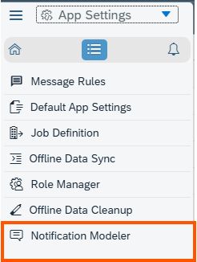

# Notification Modeler — Purpose of Notification Modeler

To create each notification we have to do manual entries in the **m_notification** (present in the database), but with the help of this tool, we can perform CRUD operations for Notification. This tool will help to create notifications conveniently. Notifications will be app-based (For each app, notifications will be there). There are 3 channel types **(EMAIL, SMS, APP)** that denote the type of notification, and for each channel type, we can maintain separate templates for notification.

