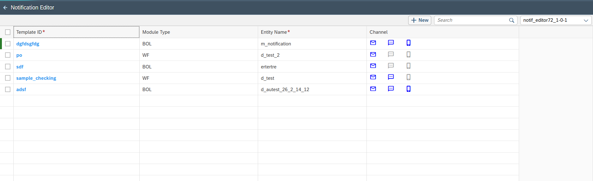
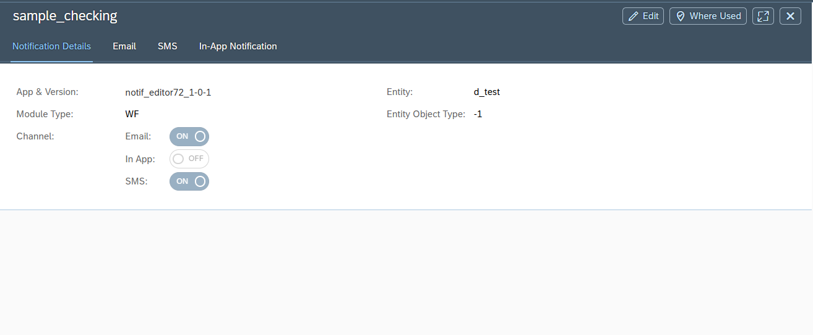

# Notification Modeler — Operating Notification Modeler

In the Editor, upon selecting any particular App, it will show the list of notifications that are listed for that app. For a template sample [*click here*](https://docs.google.com/document/d/1EgcB93Ma9No261ymPwwxVipPJT-oKk9iS7OcwDdoSmY/edit#heading=h.saxw0qcct26d).

Upon clicking on the notification template ID, a detailed screen will open where we can check the notification details.

In this detail section, users can perform CRUD operations on notifications.
