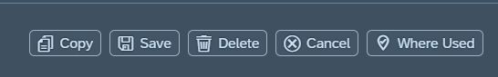
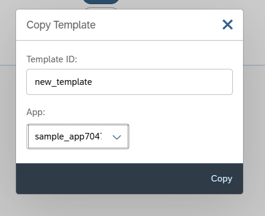

# Notification Modeler — Steps to use Notification Modeler

### 4.2.1. Create a Notification

[TABLE]

###  4.2.2. Edit a Notification

[TABLE]

### 4.2.3. Action Buttons

Notification Modeler comes with some additional features like **Copy, Save, Delete, Cancel** and **Where Used**.

"Where Used" will be visible only when the selected module type is Work flow.

With the click of the **copy** button, a similar type of popup will appear:

The user has to provide a new unique template ID and the app where the user wants to copy the notification. It will create a new notification in the app with the same details as the selected notification.

With the click of the **delete** button, it will delete the selected notification with a success message.

On clicking the **where used** button, the user will know to which workflow the notification belongs. If the notification doesn’t belong to any Workflow then the following message will appear:

If it belongs to a Workflow, the following message will be displayed:

### 4.2.4. Mapping Notification Template and User Object

#### Sample Template

Dear \<%=customer_id%\>,\<br\>\<br\>

Your order is received with ID \<%=ref_id%\>. To track use the ID logistic id \<%=logistics_id%\>\<br\>Your invoice status is \<%=inv_status%\>.\<br\>

Your Vendor id is \<%=vendor_id%\>.\<br\>

\<% logistics_item.forEach(function(item){ %\>

item id \<%=item.logistics_item%\>, material description \<%=item.material_desc%\>.

\<% }); %\>

#### 

#### 

#### 

#### JSON used to manipulate the above template

{

"ref_id": "PO076699",

"s_object_type": "403",

"ref_date": "2019-03-15 05:30:00.0",

"s_tenant_id": "2",

"inv_status": "INV_PENDING",

"logistics_id": "030cc14a35ef32e4bb8c13d3bd4ada32",

"s_created_by": "21764",

"currency": "INR",

"s_status": "DL_CREATED",

"logistics_date": "2019-06-19 16:57:14.0",

"s_created_on": "2019-06-19 16:58:20.0",

"s_modified_on": "2019-06-19 16:58:20.0",

"vendor_id": "21764",

"customer_id": "UNDB",

"S_modified_by": "21764",

"remarks": "Delivery to warehouse",

"Logistics_transport": \[

{

"s_tenant_id": "2",

"logistics_id": "030cc14a35ef32e4bb8c13d3bd4ada32",

"trans_plan_id": "7afe8297b44832548cd4659a9b4b73ee",

"s_created_by": "21764",

"s_created_on": "2019-06-19 16:58:20.0",

"s_modified_on": "2019-06-19 16:58:20.0",

"s_modified_by": "21764"

}

\],

"logistics_item": \[

{

"delivery_qty": "1",

"batch_id": "NO_BATCH",

"logistics_item": "c48f97d11d673eb1a41a8290639a5f47",

"s_tenant_id": "2",

"logistics_id": "030cc14a35ef32e4bb8c13d3bd4ada32",

"material_desc": "600MM WIND W/O REG IVR CF",

"s_created_by": "21764",

"order_qty": "170",

"s_created_on": "2019-06-19 16:58:19.0",

"stock_type": "SALE",

"s_modified_on": "2019-06-19 16:58:19.0",

"order_item": "125",

"material_id": "111015931W",

"s_modified_by": "21764",

"order_id": "PO076699",

"logistics_serial": \[\]

}

\]

}

#### After manipulation 

Dear **UNDB**,

Your order is received with ID **PO076699**. To track use the ID logistic id **030cc14a35ef32e4bb8c13d3bd4ada32**.

Your invoice status is **INV_PENDING**.

Your vendor ID is **21764**.

item id **c48f97d11d673eb1a41a8290639a5f47**, material description **600MM WIND W/O REG IVR CF.**
