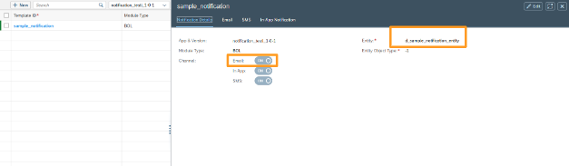
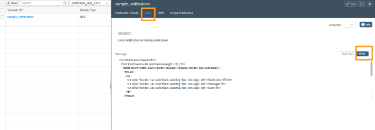
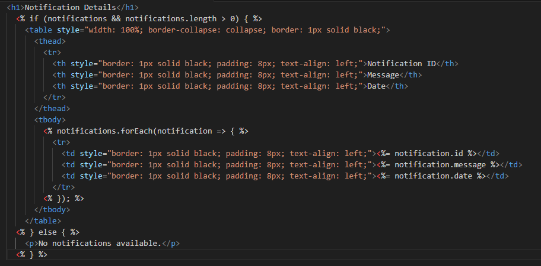
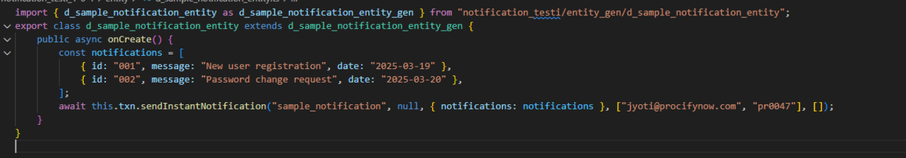
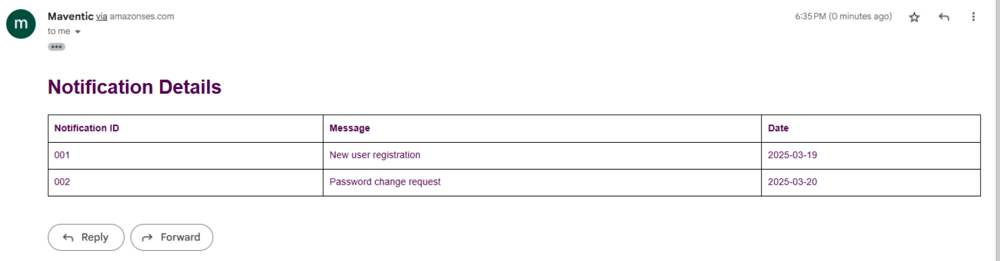

# Notification Modeler — Passing table in automail in Notification Modeler

Here’s a guide on how to use the Notification Modeler to send an email to users that includes a table with rows populated at runtime.

- Create a notification, activate the email toggle, and select an entity along with its corresponding object type.

- Next, go to the email tab and select the HTML option to add the template, as shown in the screenshot.

- Enter the subject and provide the HTML template as required, as shown below:

- In the entity callback, the data for the required fields can be passed as follows:

- You will receive the email notification as follows:

