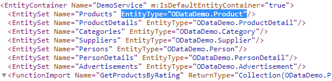

# Creating Entity

**Entity Name:** Entity name can be created as per the user’s requirement. Only Root entities are currently supported for OData.

**Service Name:** Maintain the service name exactly (case sensitive) as per the entity set. E.g.: [https://services.odata.org/V3/OData/OData.svc/Products](https://services.odata.org/V3/OData/OData.svc/Products) in this service **Products** is the service name. If you are using more than one service root refer here for more details. Set the network mode as ODATA.

**Note :**

1.  **(skip, if odata.type is not required by your service)** For creating and updating data, if your service needs **odata.type** in the body, maintain schema in config. The entity name should be the odata type case sensitive.

> Eg: For EntitySet Products ( [https://services.odata.org/V3/OData/OData.svc/Products](https://services.odata.org/V3/OData/OData.svc/Products) ) in this service root the Entity Name can be found in metadata. It will be in \<Schema.EntityName\> format.
>
> 

Thus, the entity name should be kept from this metadata as Product.

2.  Relations are not supported.
