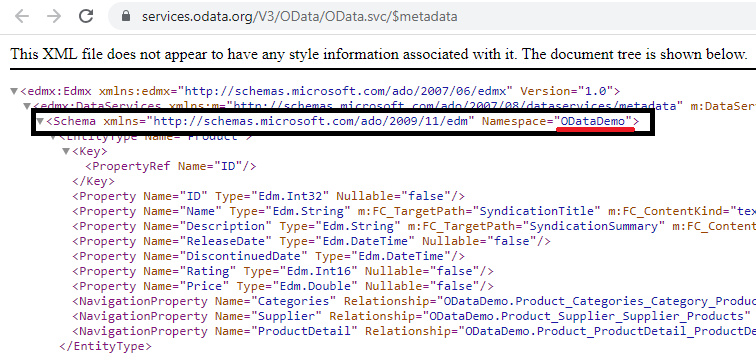

# Configuration

**Target location:** mm_klobroker_ext

As per your landscape configuration.

### landscape_id

Fill with your landscape ID.

## typeConfiguration Properties

### account_id

### Maintain account ID as

Value: “gateway_url”

### gateway_url

In gateway url maintain the oData service root.

**Example:**

oData Product List Url: [https://services.odata.org/V3/OData/OData.svc/Products](https://services.odata.org/V3/OData/OData.svc/Products)

The service root would be: [https://services.odata.org/V3/OData/OData.svc](https://services.odata.org/V3/OData/OData.svc)

**Note:**

Don’t leave a forward slash ‘/’ at the end.

In case you are using multiple service roots

Maintain the common part in gateway_url and place the remaining in entity \> service_name

Eg: you are using service root [https://services.odata.org/V3/OData/OData.svc/Products](https://services.odata.org/V3/OData/OData.svc) and [https://services.odata.org/V3/OData/Northwind.svc/Airports](https://services.odata.org/V3/OData/OData.svc), then maintain the gateway_url as [https://services.odata.org/V3/OData](https://services.odata.org/V3/OData/OData.svc) and in entity maintain the service_name as [OData.svc/Products](https://services.odata.org/V3/OData/OData.svc) and [Northwind.svc/Airports](https://services.odata.org/V3/OData/OData.svc) respectively.

### schema

This is an optional column. Some oData service needs the "odata.type": "oDataDemo.Products" in the body during creating and modifying the data. If your service needs this information for POST and PATCH then maintain the schema as per the oData metadata.

Eg: If your service root is [https://services.odata.org/V3/OData/OData.svc](https://services.odata.org/V3/OData/OData.svc) get the metadata from the [https://services.odata.org/V3/OData/OData.svc/\$metadata](https://services.odata.org/V3/OData/OData.svc/$metadata) and inside the metadata, find schema and namespace and fill here.

**Note:** If your service does not accept any key in the payload other than the columns, keep this column value as null. And the odata.type will not be added to the payload.

### endpoint_id

| value: ODATA This is to identify this service as an oData service for this landscape. |
|--------------------------------------------------------------------------------------------|

### auth_type

| value: None \| Basic The auth type column is used to maintain the authorisation protocol of the oData service. Currently, only authentication types of None and Basic are supported. **None:** No authentication is done in the requests.**Basic:** Basic authentication is added to the header. Basic authentication is based on user_name and password, so, user_id and password should be maintained for this auth type. |
|---------------------------------------------------------------------------------------------------------------------------------------------------------------------------------------------------------------------------------------------------------------------------------------------------------------------------------------------------------------------------------------------------------------------------------------|

### user_id

This is an optional field. If the auth_type is maintained as Basic, maintain the odata service user_name used for authentication.

### password

This is an optional field. If the auth_type is maintained as Basic, maintain the odata service password used for authentication.

### version

| value : v1 \| v2 \| v3 \| v4 |
|------------------------------|

oData runs on various versions, maintain your service’s version here. It will decide the interaction of the Klarion server with the oData service. This is present in your service root.

Eg: [https://services.odata.org/V3/OData/OData.svc](https://services.odata.org/V3/OData/OData.svc), in the mentioned oData service root

[https://services.odata.org/V3/OData/OData.svc](https://services.odata.org/V3/OData/OData.svc) . v3 denotes the version.

**Note:**

1.  Maintain version with lowerCase v

### configs

The configs are used to add any additional data to the header. Thus it is an array of objects with structure \{ "config_name": "\<key\>", "config_value": "\<value\>" \}.

For Eg: I need the API key in my header added as API-KEY, it should be maintained as

| \\{  "config_name": "API-KEY",  "config_value": "ASDFERNnsd234KKNFHRLJKA24jkHn234l23454"  \\} |
|---|

It will be reflected in my header as

| \\{  ...  "API-KEY": "ASDFERNnsd234KKNFHRLJKA24jkHn234l23454" ...  \\} |
|---|
