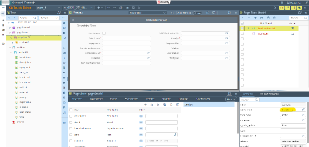

# Page Builder — Embedded section

By using this embedded section we can embed sections or containers from other pages to our current page.

**Note**: KloGuid and KloLink controls will be disabled when added inside the embedded subscreens. Also, the title, icon and actions provided for the embedded subscreen will not be rendered. Page layout type” flexible\_col” is not supported inside embedded section.

## 9.1. Embedded section Creation: {#9.1.-embedded-section-creation:}

To create an embedded page create a page Layout in the page where the section is embedded from. In our current page create an embedded section.

In the layout data of the embedded section provide the value below:

*  **flavor.pageId.pageContainerId** if it's a separate app.

* **pageId.pageContainerId**  if the embedding page is from the same app.

**Note:** Developers can pass supported navTo() properties from a parent screen to an embedded child screen. TN and NT parameters will be passed to child functions (such as onPageEnter() and onSectionEnter()) only when they are explicitly maintained in the embedded section's screenParameters configuration.

## 9.2. Embedded Config {#9.2.-embedded-config}

The properties available in the embedded config are listed below. Embedded config can be added from context menu of the embedded section

## 

| NAME | TYPE | DEFAULT VALUE | DESCRIPTION |
| :---- | :---- | :---- | :---- |
| **flavor** | string |         \- | App from which the page should be picked from. App is mandatory only if the app of the screen to be embedded and the app of the hosting page are different.  |
| **screenid** | string | \- | ID of the screen. **Mandatory** |
| **subscreenid** | string | \- | ID of the subscreen. **Mandatory.**  |
| **isTransactionShared** | boolean | false | If true, the hosting screen and the embedded screen will share the transaction. Else, transaction will be different for both the screens  |
| **isSharemode** | boolean | false | If true, the hosting screen and embedded screen will share the mode. When mode is set via the controller for the hosting screen, the same screen will be set to the embedded screen as well and vice-versa. Else, the mode will not be shared. When set to the hosting screen, the mode will not be set to the embedded screen.  |
| **tnmap** | Array\<JSON\> | \- | An array of JSON with the keys **fromtn** and **totn.** The value of the keys should be the transnode relation ID of the host screen and embedded screen respectively. The transnode of the embedded screen will be added as a child to the transnode of the hosting screen so that when setActive is called on the parent transnode, data will be set on child.  Example : \[{"fromtn": "no\_hdr\_list", "totn": "detail\_embedded"}\]  |
| **screenParameters** | [INavToData](https://docs.google.com/document/d/1wMtMSOABMX8lAFkWiKciuQDJNr2QGEXqH5PnIsK_THQ/edit?tab=t.0#heading=h.gaqwgr3yvtxk) |  | This property expects a JSON  the same as the navTo parameters. All the navTo parameters can be passed here. Flavor, Screen ID, subscreen ID, isTransactionShared, isSharemode and tnmap can also be passed as key-value pair here instead of separate properties.  |

## 9.3 Screenshots {#9.3-screenshots}

## **Hosting Screen:** {#hosting-screen:}

##

**Config Properties Provided:** 

* ***tnmap*****:** \[{"fromtn": "no\_hdr\_list", "totn": "detail\_embedded"}\]  
* ***subscreenid*****:** pageArea01  
* ***screenid*****:** s\_0021\_27\_10\_\_002 

  

  

  

  

**Embedded Screen:**

