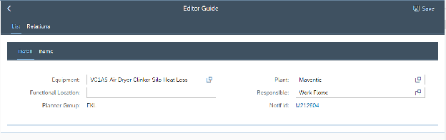

# Page Builder — Layout Combinations

## 13.1. Stack with Object page: {#13.1.-stack-with-object-page:}

### 

### 

## 13.2. Stack with Tab {#13.2.-stack-with-tab}

### 

### 

### 

### 

## 13.3. Stack with GOTO {#13.3.-stack-with-goto}

**Note:** goto will only work on mobile and tab. On a little scroll of the screen, the goto button will be visible.

## 

## 

## 

## 

## 

## 13.4. Stack with Splitter {#13.4.-stack-with-splitter}

## 13.5. Tab with stack {#13.5.-tab-with-stack}

		

## 

## 

## 

## 

## 13.6. Tab with object page {#13.6.-tab-with-object-page}

	

## 

## 

## 13.7. Tab with Splitter {#13.7.-tab-with-splitter}

## 

## 

## 

## 

## 13.8. Flexi column with Object page {#13.8.-flexi-column-with-object-page}

## 

## 

## 

## 

## 13.9. Flexi column with Stack {#13.9.-flexi-column-with-stack}

## 13.10. Flexi column with tab {#13.10.-flexi-column-with-tab}

### 

## 

## 

## 

## 

## 

## 

## 

## 13.11. Flexi column with splitter {#13.11.-flexi-column-with-splitter}

## 13.12. Object Page with tab {#13.12.-object-page-with-tab}

## 13.13. Splitter with tab {#13.13.-splitter-with-tab}

## 

## 

## 

## 13.14. Splitter with Object page {#13.14.-splitter-with-object-page}

### 

## 

## 13.15. Flexi column with Object page and Tab {#13.15.-flexi-column-with-object-page-and-tab}

## 

## 

## 

## 

## 13.16. Flexi Column with Object Page and Splitter {#13.16.-flexi-column-with-object-page-and-splitter}

###
