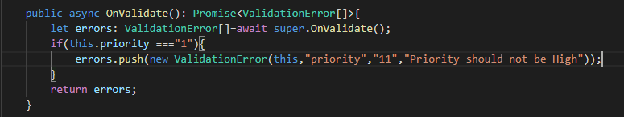

# Page Builder — Entity File

## 15.1. Hook Methods: {#15.1.-hook-methods:}

#### **onValidate:** {#onvalidate:}

If the transNode’s onarrive (in the transNode’s detail section) is provided as valid then, onValidate will be called during navigation.

#### **onAfterCreate:** {#onaftercreate:}

onAfterCreate method will be called once the new entity is created.

#### **onDelete:** {#ondelete:}

The onDelete method will be called once the entity is deleted.

## 15.2. Setter & Getter: {#15.2.-setter-&-getter:}

Setter function will be called once the entity property value is changed.

**Example:**

    public set  firstName(new\_value:string){

        if(new\_value \== this.firstName) return;

        this.name:string \= new\_value\+" "\+this.lastName;

        this.s("firstName",new\_value,"string",false,false);

    }

Getter function will be called whenever the entity property is getting read. 

**Example:**

    

    public get name():string{

        return this.Firstname \+" "\+this.lastName

    }
