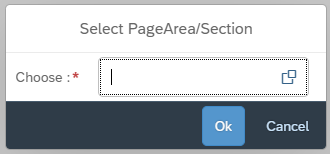

# Page Builder — Page Layout

PageLayout is the topmost layer embedded with the page. At runtime, only one pageLayout will be picked based on the device type. The detail of which pageLayout needs to be picked is maintained in the page’s properties (screencontainerdefault, screencontainerdesktop, screencontainermobile, screenontainertab). If the property for a specific device type is not maintained then the default pageLayout will be rendered. 

**Example:** If the page is being loaded on the desktop, and the screencontainerdesktop property is not maintained (empty) then the pageLayout ID maintained in the screencontainerdefault property will be rendered.

* [Layouting](#12.0.-layouting) can be also possible using a pageLayout.   
* Supporting layouts are   
  * Grid Layout  
  * Default  
  * Dialog  
  * Fit To Area  
  * Flexible Column (Deprecated, Use Two Column Pagelayout Instead)  
  * Horizontal Splitter  
  * Object Page  
  * Stack  
  * Sticky  
  * Tab  
  * Tiles  
  * Vertical Splitter.   
  * Two Column  
* Layout will be maintained in the screetype property of the Page Layout.

## 4.1. Page Layout Creation: {#4.1.-page-layout-creation:}

**Step 1:** Right-click on the newly created page in the tree section. A menu context will open. Go to **new**.

**Step 2:** A newly created pagelayout will be added.

**Note** : We can rename it by a right click on the newly created layout and select  the  option **Rename** (ensure that  the new Id given should be unique among other layout Ids).

| Properties | Description |
| ----- | ----- |
| Description | Description of the Page Layout |
| docid | Id/text will be displayed along with the title(bindable) |
| enable\_goto | Deprecated |
| layoutsubscreen | Deprecated |
| goto\_sequence | Will determine the sequence of goto type. |
| screenid | Page ID of which the PageArea belongs. |
| screentype | Refer to the [Layout type](#12.0.-layouting) |
| subscreentype | Will display the type (Page Area, Page Layout, Section) |
| title | Title of the PageArea |

## 4.2. Assign PageArea/Section: {#4.2.-assign-pagearea/section:}

**Step 1:** Right-click on the page layout/ page Area  where you want to assign new PageArea/ Section, then click on **New**.

**Step 2:**  Now click on the **Assign** and from the value help, you can assign a new PageArea or Section from the suggested items or you can use search.

## 4.3. Context Menu: {#4.3.-context-menu:}

 Right-click by selecting the PageLayout to view the context menu.

| Menu Items | Description |
| :---- | :---- |
| Copy | On click, it will copy the pageLayout |
| Paste | On click, it will paste the copied item to the pageLayout |
| Rename | On click, it will display a popup to rename the pageLayout |
| Delete | On click, it will delete the pageLayout |
| New | **PageArea:** On Click, it will create a pageArea. **New Section:** On Click, it will create a section. **Embedded Section**: On click, it will create a new embedded section. **Config:** On Click, it will add a config for the selected PageLayout. **Assign:**  On click, it will open a popup to assign a new pagearea or section to it. |

**Note**: If we are adding config properties, the value of the properties should not be empty.
