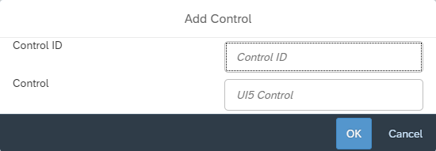

# Page Builder — Controls

Controls are used to define the appearance and behaviour parts of the section. 

Types of controls:

* Open UI5 controls

* Klo controls

## 7.1. kloControls {#7.1.-klocontrols}

[5.7 kloControls](https://docs.google.com/document/u/0/d/1IUy3WBQ5zoaCCJsu8a-WQ6A_HAxer2tUROu6nspY_ac/edit) contains all the information about the kloTouch controls.

### Class: {#class:}

The class field in the property section of the control describes the class of the control. 

### 

### ToolTip: {#tooltip:}

A tooltip is often used to specify extra information about the elements when the user moves the mouse pointer over an element.

Follow the following steps to use the tooltip for the screen title:

**Step 1:** Add two properties to the screen.

**Step 2:** Mark **isTitleTooltipRequired** as ‘true’ and provide value(as string) to **titleTooltip.**

Now when you hover on the title of the screen you will show the **titleTooltip** value.

Refer to this for more information [Tooltip for Screen Title](https://docs.google.com/document/u/0/d/1JVPpcMgoADg36MNjslleYBRl6S5IfpDa/edit)

### Label: {#label:}

The label field in the control’s property section is to set whether the label is needed for the control or not (specific for card and form type section).

### 

### Label for Card Layout:  {#label-for-card-layout:}

The card layout provides you with only one column. Hence, earlier there was no option to provide a label. But, since we are adding multiple controls in the same column, it is better to identify the control with the label. Now, with the provided property, it is possible to put labels on the controls inside the card layout.

**Step 1:** Add  the property **islabelForCardRequired** to the property subscreen and mark it as **‘true’.**

**Note:** If you have already added the label during the entity creation for that property, then that label will appear after adding the **islabelForCardRequired** as true. And if you haven’t added the label during the entity creation or you want to add another label then you can simply provide your text in the **‘label’** property.

### Create new control: {#create-new-control:}

In the tree section, we can drag and drop the controls from one section to another.

**OR**

Create a new control.  

Right-click on the section where the control needs to be added, click on **‘New’** and then click on ‘Controls’ to add a control for that section.

After clicking on **‘Controls’** below page will appear to add the control.

**Note**:

*  Control id should be unique under a section (Two controls / config /section toolbar can’t have same id)  
* Adding control without binding i.e. if dsrc or value field is empty, it will show a warning message.

###
