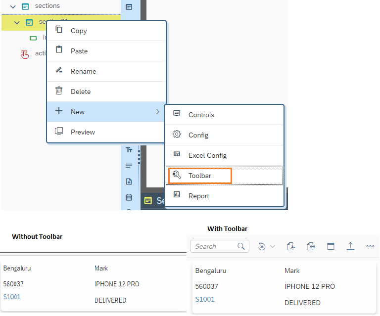

# kloToolbar

To add a kloToolbar, right-click on the section for which the toolbar needs to be added, and select add toolbar.

## 10.1. Section Toolbar Properties

| **Properties**        | **Type** | **Default Value**     | **Description**                                                                                                                            |
|-----------------------|----------|-----------------------|--------------------------------------------------------------------------------------------------------------------------------------------|
| title                 | string   | Table                 | Sets the display title on the KloSectionToolbar.                                                                 |
| showViewSettings      | boolean  | true                  | Sets the visibility of the viewsettings button.                                                                  |
| showDownloadPdf       | boolean  | true                  | Sets the visibility of the download pdf button.                                                                  |
| showDownloadExcel     | boolean  | true                  | Sets the visibility of the download Excel button.                                                                |
| showUpload            | boolean  | true                  | Sets the visibility of the upload button.                                                                        |
| showAdd               | boolean  | true                  | Sets the visibility of the add button.                                                                           |
| showFuzzy             | boolean  | true                  | Sets the visibility of the search bar.                                                                           |
| showDelete            | boolean  | true                  | Sets the visibility of the delete button.                                                                        |
| showMaximize          | boolean  | true                  | Sets the visibility of the maximise button.                                                                      |
| navTossOnAdd          | string   | “”                    | When a subscreen id is provided, clicking on the add button will redirect the user to that particular subscreen. |
| showReset             | boolean  | true                  | Set the visibility of the reset button.                                                                          |
| showAddWithObjectType | boolean  | true                  | Set the visibility of the addWithObjectType button.                                                              |
| showPivotModeller     | boolean  | true                  | Sets the visibility of the pivotmodeller button.                                                                 |
| showViewSelection     | boolean  | true                  | Sets the visibility of the viewSelection button.                                                                 |
| navTossOnAdd          | string   | Name of the subscreen | When a subscreen ID is provided, clicking on the add button will redirect the user to that particular subscreen. |
