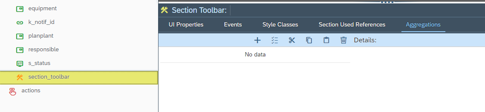
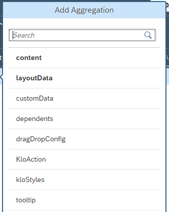
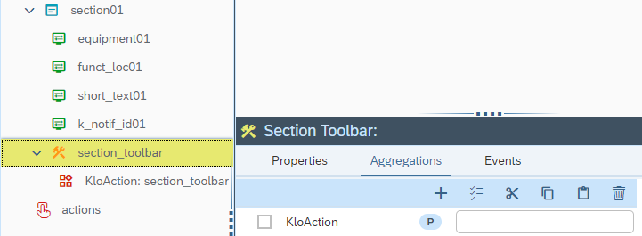
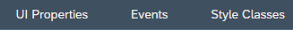

# Actions

## 11.1. Page Actions:

To add an action for the page, [<u>add an aggregation</u>](#add-new-aggregation) **“kloAction”** for the page. Once the kloAction is added, [<u>create a new button control</u>](#create-new-control) for the action. After adding a control add properties for that button control.

## 11.2. Section Actions:

Similar to page actions we can add actions to our sections. To add actions for our sections [<u>kloToolbar needs to be added</u>](#klotoolbar) for that section. After adding kloToolbar [<u>add an aggregation</u> <u>kloAction</u>](#add-new-aggregation) for the kloToolbar. After adding kloAction aggregation follow the same steps as [<u>page actions</u>](#page-actions).

On click of add button:

