# Layouting

## 12.1. Flexible_col (Deprecated, Use Two Column Pagelayout Instead):

All the page Area ID(s) provided in the page’s layout section will implement the master-detail-detail paradigm by displaying up to three pages (page Areas) in separate columns. For a Flexible column layout, only three columns will be rendered, if more than three layout containers are provided in the layout section it will take the first three layout containers/sections.

#### Configuration:

- For using the flexible column layout, select the screenType of a pageLayout as **flexi_column**.

- In the layout section of that pageLayout add the layouts.

- The setLayout() method was used in Flexible Column to define the layout width. As Flexible Column is now deprecated, it is recommended to use **setFirstColumnWidth()** in pagelayout type Two Column to configure column widths.

**Example:**

<u>Flexible_col one Column Expanded</u>

> 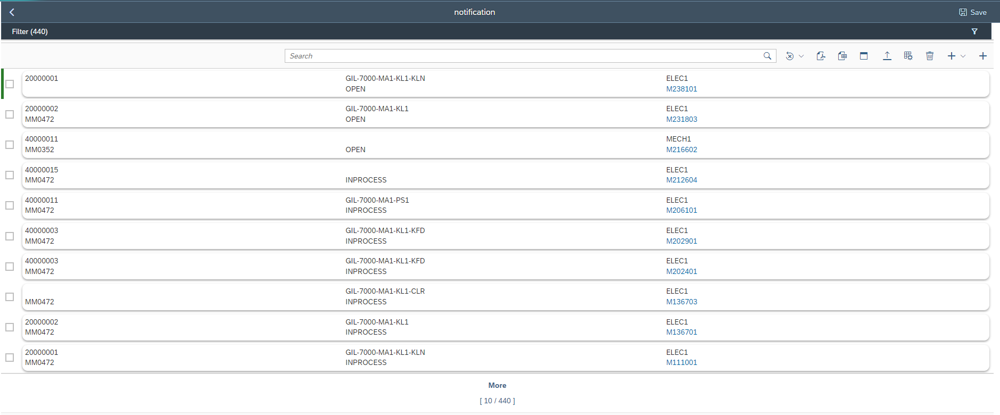

<u>Flexible_col two Column Expanded</u>

> 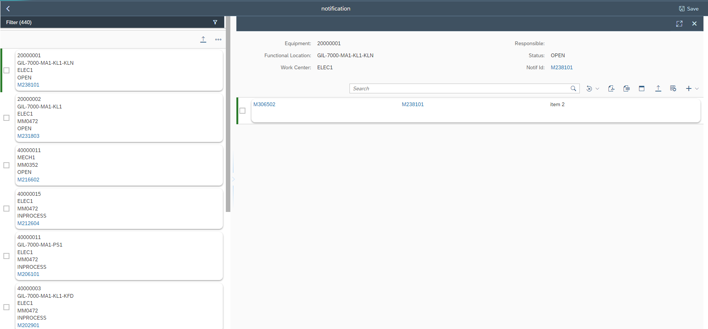

<u>Flexible_col three Column Expanded</u>

> 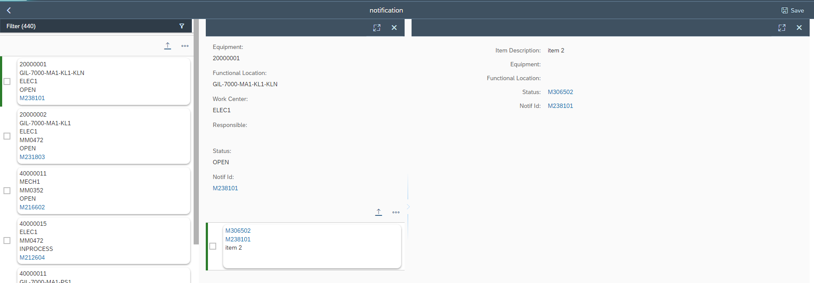

## 12.2 Two Column

It is similar to a flexible column. The only difference is that it can only implement the master-detail paradigm up to two pages only. And also unlike a flexible column it provides a horizontal splitter between the two pages..

#### Configuration:

- For using the two column layout, select the screenType of a pageLayout as **two_column**.

- Assign pages and sections.

- Use **setFirstColumnWidth()** to configure column widths.

<u>two_column one Column Expanded</u>

<u>  
</u>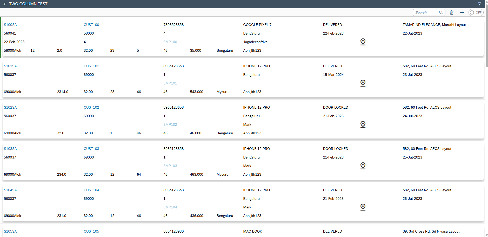

<u>two_column two Column Expanded</u>

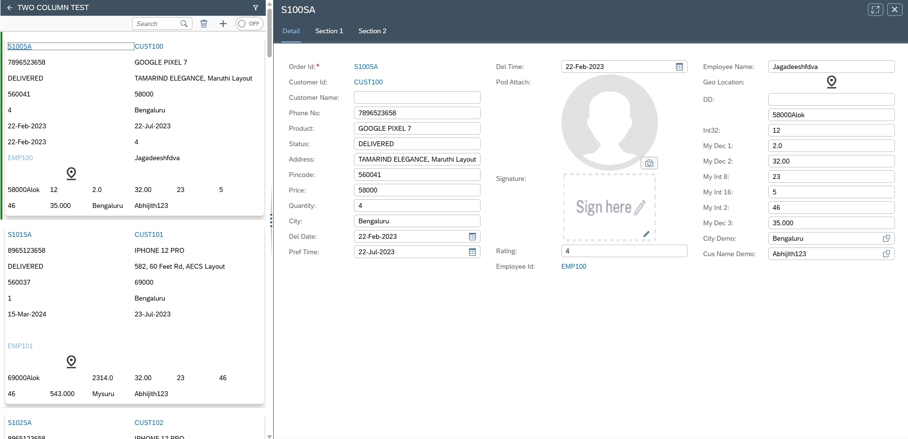

## 12.3. Stack

Stack is a layout structure where the required elements show up one by one on a particular action based on the given metadata.

#### Configuration:

- For using the stack layout, select the screenType of pageLayout / PageArea as stack.

**Example:**

We have a pageLayout of screentype stack:

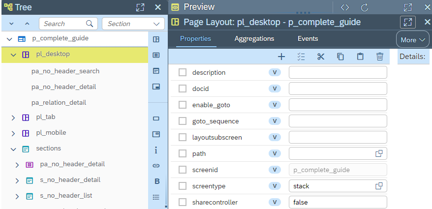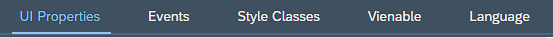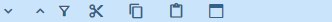

Stack will render only one layoutSubscreen at a time. As a default, the first layoutSubscreen is rendered.

> 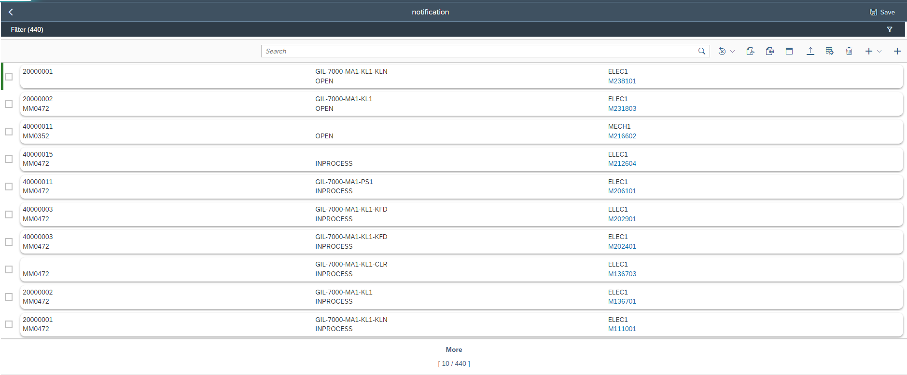

When it is navigated to the second layoutsubscreen it hides the first one & displays the pageArea it is navigated to.

> 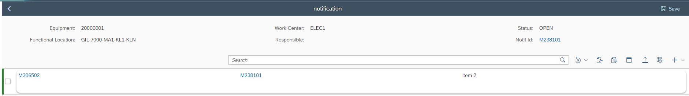

## 12.4. Tab

Tab Layout represents a collection of tabs with associated content. The number of tabs rendered will be equal to the number of section/section container ID(s) given in the layout Data section. The tab title will be taken from the section/page Area’s title property, the tab title will only be visible if the flags are maintained in the layout data section and the showTitle property is marked as true.

#### Configuration:

- For using the tab layout, select the screenType of pageLayout / PageArea as tab.

- In the detail section, mark the **showTitle** as **true**.

- After adding the showTitle as true, in the layout section. For the layouts added (pageArea / section ) add the property **showTitle** and **title**, provide the values.

> 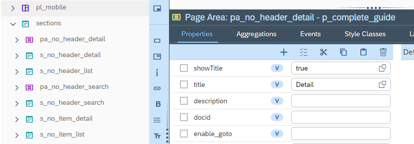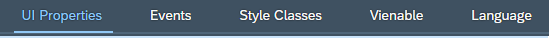

**Note:** selectedKey reflects the currently active tab/section — it is not a one-time "default tab" setting. If bound to a data field, the Tab control will always show whichever tab that field currently holds, and will keep showing it on subsequent loads/refreshes unless the field's value is explicitly reset. If the supplied key doesn't match any tab/section currently rendered, the control falls back to another available tab instead of forcing the configured one. To always land users on the same section regardless of prior state, drive it explicitly through navigation rather than relying on selectedKey alone.

### 12.4.1. Tab with section, subscreen and header

Now similar to the object page, it is possible in the tab also to create a header for title content and sections, subsections for block contents.

**<u>Configuration:</u>**

- Select the screenType of PageLayout / PageArea as the tab.

- Add the type of PageAreas / sections as header, section or subsection.

- 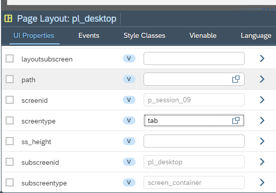

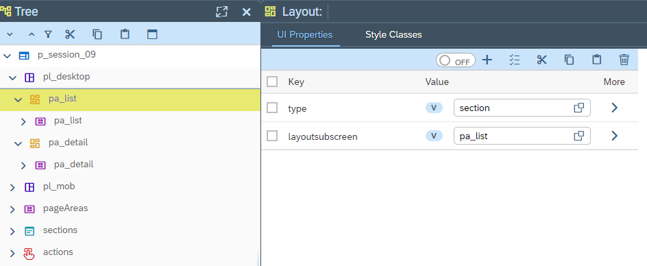

It will reflect on screen as:

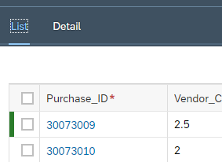

## 12.5. Object Page:

The object page layout is composed of a header (title and content), and blocks content that's wrapped in sections and subsections that structure the information.

#### Configuration:

- For using the Object Page Layout(OPL), select the screenType of pageLayout / PageArea as the object page.

- In the detail section of the pageLayout / pageArea add the respective types for the layouts. Types are given below:

  - Header

  - Section

  - Subsection.

> 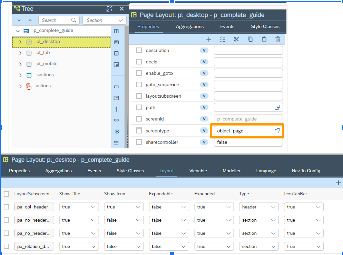

**Note:** If the object page layout needs to be rendered as an iconTabBar, mark the iconTabBar option as true in the layout section.

## 12.6. Hsplitter

All the section ID(s) provided in the page Area’s layout section field will be horizontally split into equal columns. The columns can be resizable.

#### Configuration:

- For using the hsplitter layout, select the screenType of pageLayout / PageArea as hsplitter.

- In the layout section of the pageLayout / pageArea add the layouts.

> 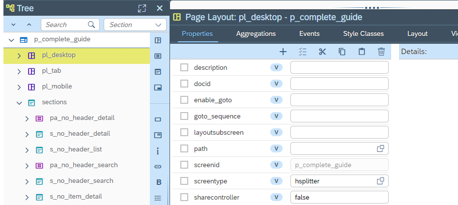

#### Examples:

> 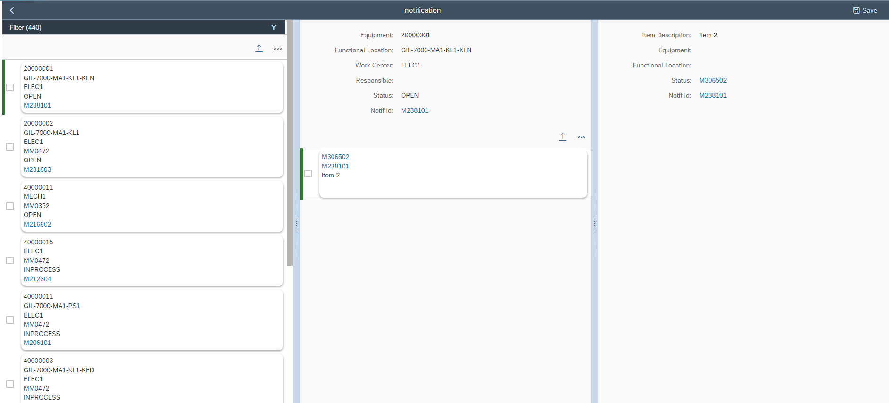

## 12.7. Vsplitter

All the section ID(s) provided in the page Area’s layout section field will be vertically split into equal columns. The columns can be resizable.

#### Configuration:

- For using the vsplitter layout, select the screenType of pageLayout / PageArea as vsplitter.

- In the layout section of the pageLayout / pageArea add the layouts.

#### Examples:

> 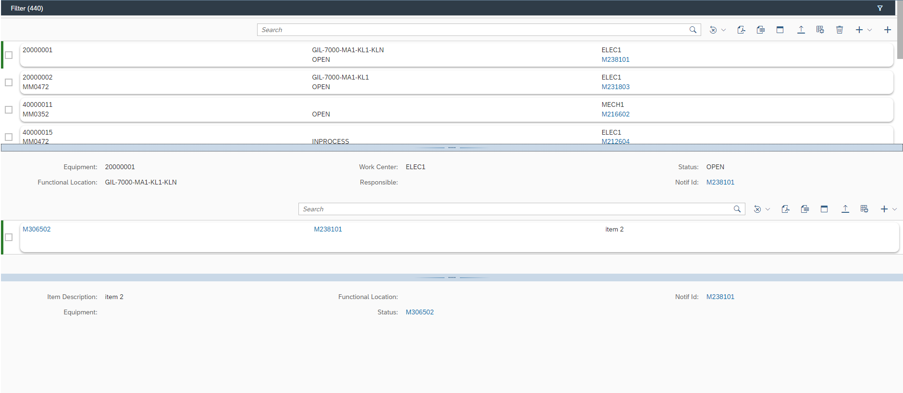

## 12.8. Default:

Default will section/pageArea provided in the layout will be rendered in a single page one by one.

**Note:** If screenType is not maintained it will consider it as a default.

#### **<u>Configuration</u>**:

> 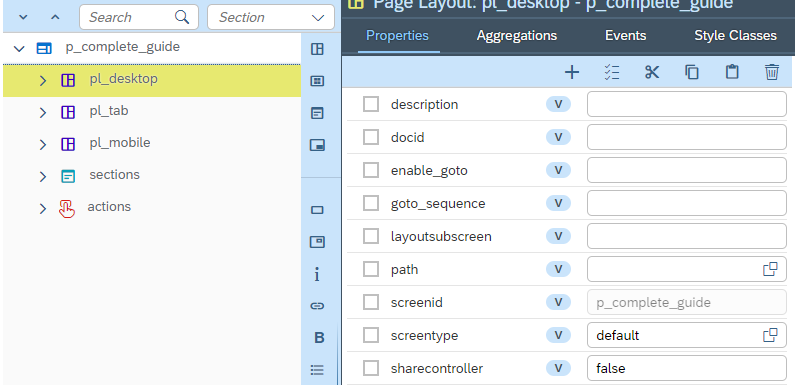

#### **<u>Examples</u>**:

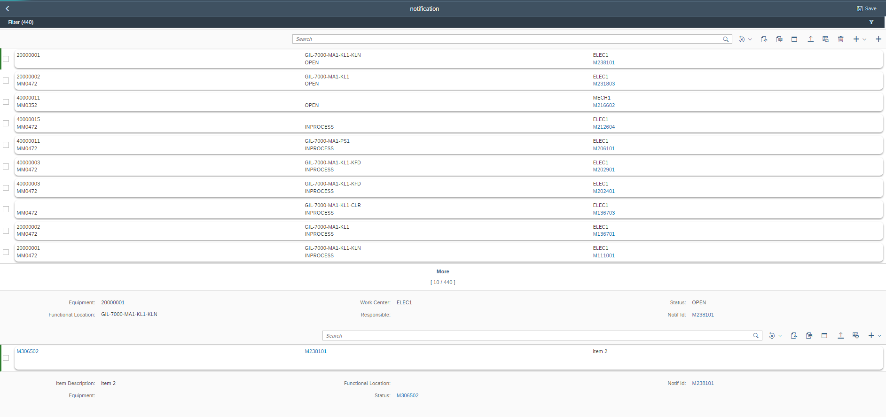

## 12.9. Grid Layout:

Page layout / page Area of type grid_layout / css grid is similar to the section type card / card list. In grid layout we have to provide the modeller details for the layout, the layout sections / PA will render accordingly

#### Configuration:

> 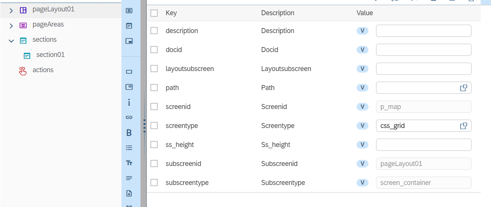

**Modeller Details**

Step 1: Preview the page Area / page layout

Step 2 : By selecting the PA / PL select the modeller tab in the detail section.

Step 3 : in the modeller click on the icon(refer the below image) to open the grid modeller

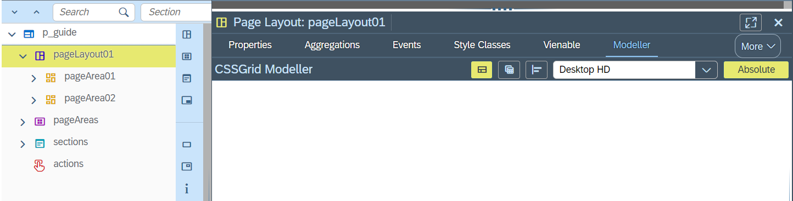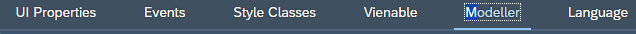

Step 4 : in the grid modeller popup provide the span details for the respective screen size

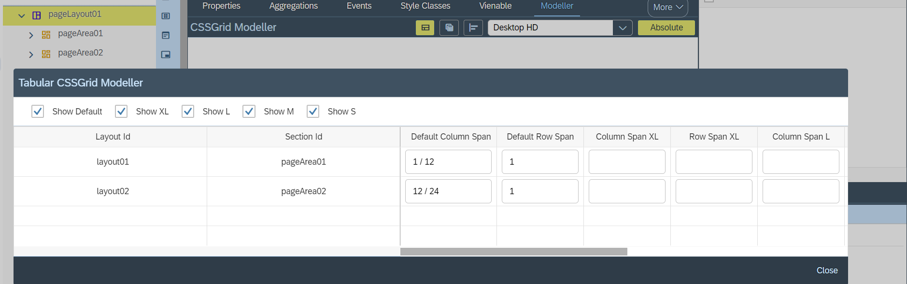

#### Examples:

In the below example we are having a two page area’s under the css grid type page layout, and we have provided the modeller configurations as below

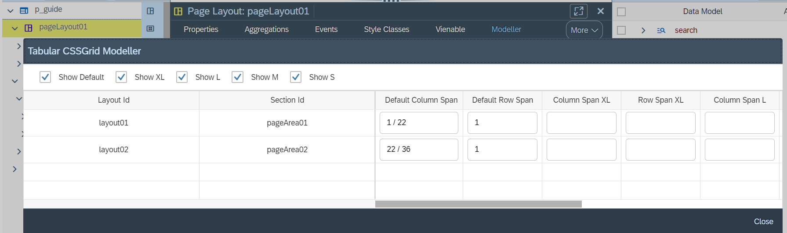

Based on the modeller data the page will be rendered as below

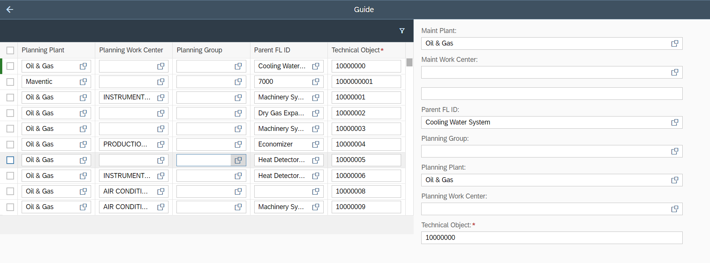

## 12.10. Dialog:

Using the Dialog type container we can render the sections / PA inside the popup / dialog

#### Configuration:

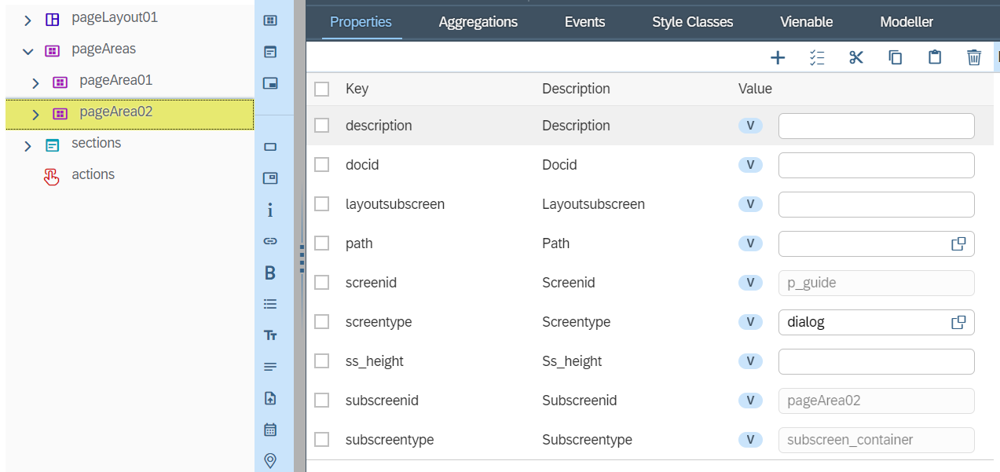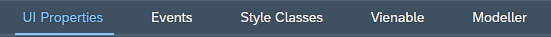

#### Footer Buttons:

If any footer button is needed for the dialog, add the kloAction control for the pageArea’s section toolbar.

#### API

To open the container as a dialog we have to use the below API

> 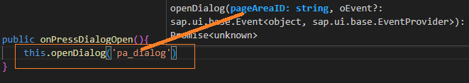
>
> To close the dialog container we have to use the below API
>
> 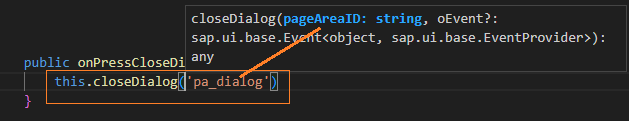

## 12.11. Tiles:

Page area of type Tile will clone the child section based on the number of the entities in entityset and display it as tiles. Refer [<u>tile</u>](https://docs.google.com/document/d/1IUy3WBQ5zoaCCJsu8a-WQ6A_HAxer2tUROu6nspY_ac/edit#heading=h.t7li91ljyzty) for more information

#### Configuration:

Step 1 : select the screen type as ‘tiles’ for the page area

Step 2 : select the path for the page area (path should to transnode type entityset)

Step 3 : Assign a section(section type which supports entity like form, card) for the pageArea

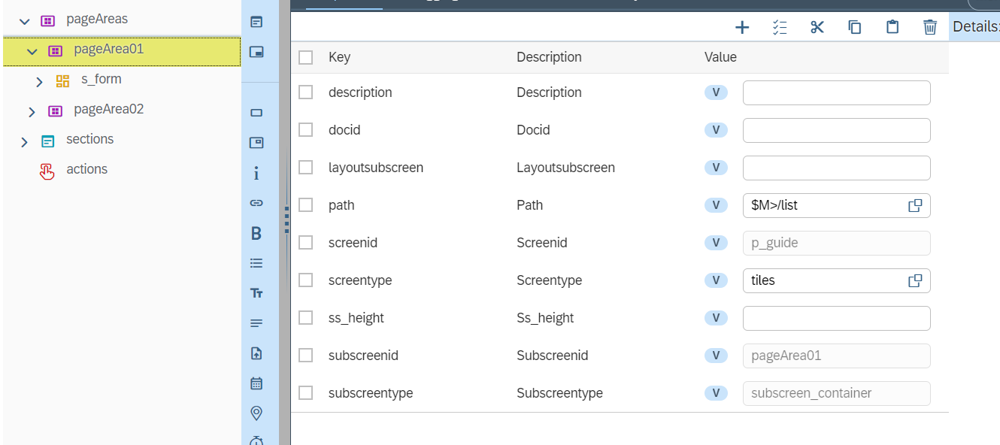

Examples:

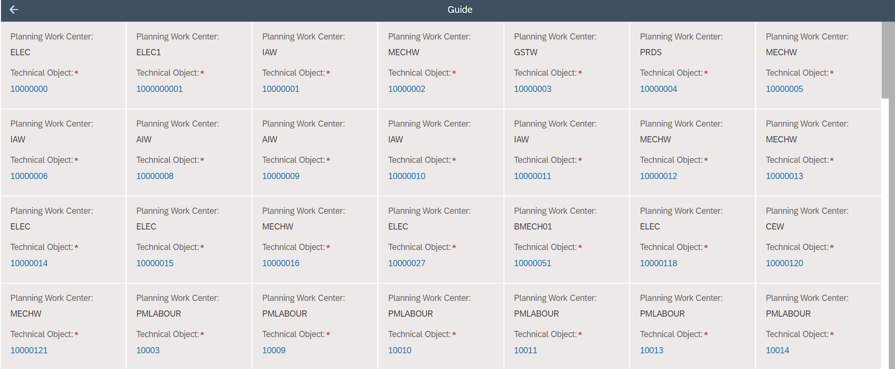

## 12.12. Auto_Default

Page Area with screentype as auto_default, it will work differently for desktop and mobile screens.

For **desktop**, screentype will be **Popup** and for **mobile** the same PageArea will be shown as **stack**.

#### Configuration:

- Select the screentype of pageArea as auto_default.

- Assign a section to the PageArea.

> 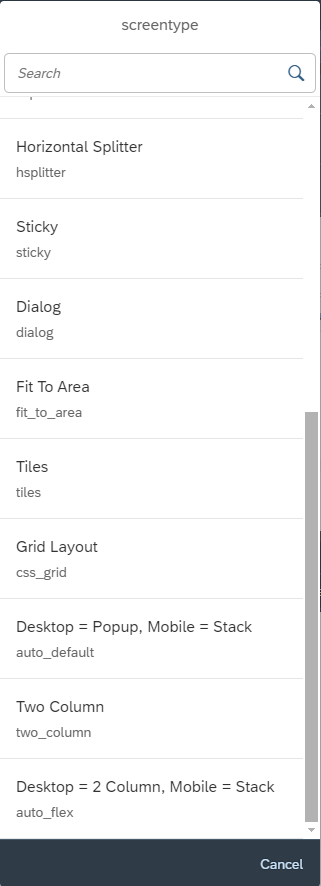

## 12.13. Auto_flex

Page Area with screentype as auto_flex, it will work differently for desktop and mobile screens.

For **desktop**, screentype will be **two_column** and for **mobile**, the same PageArea will be shown as **stack**.

#### Configuration:

- Select the screentype of pageArea as auto_flex.

- Assign a section to the PageArea.

> 
