# Layout Combinations

## 13.1. Stack with Object page:

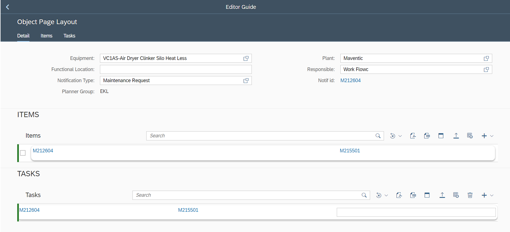

## 13.2. Stack with Tab

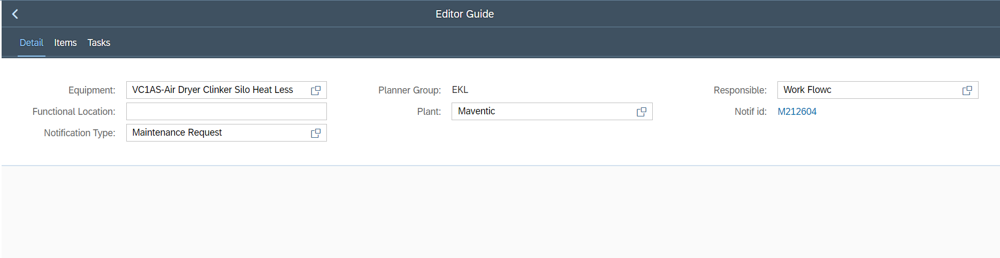

## 13.3. Stack with GOTO

**Note:** goto will only work on mobile and tab. On a little scroll of the screen, the goto button will be visible.

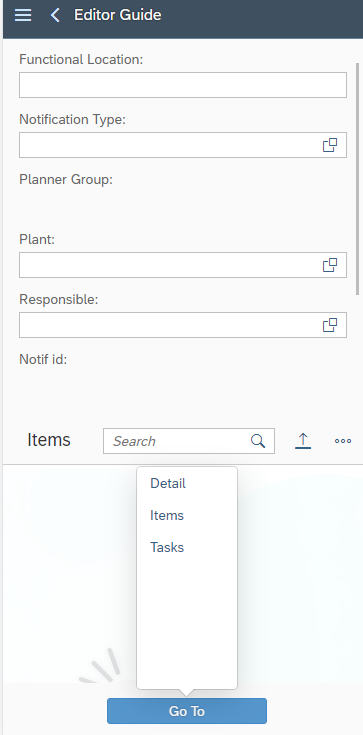

## 13.4. Stack with Splitter

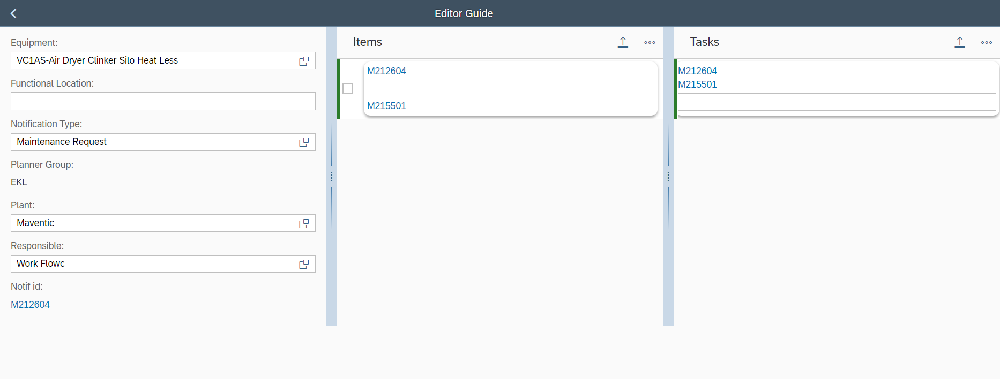

## 13.5. Tab with stack

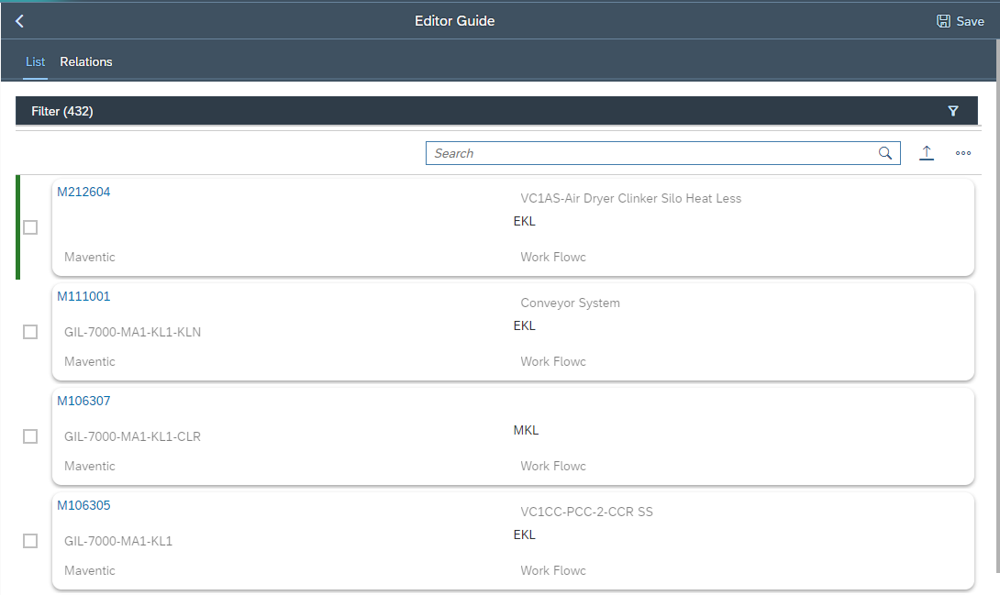

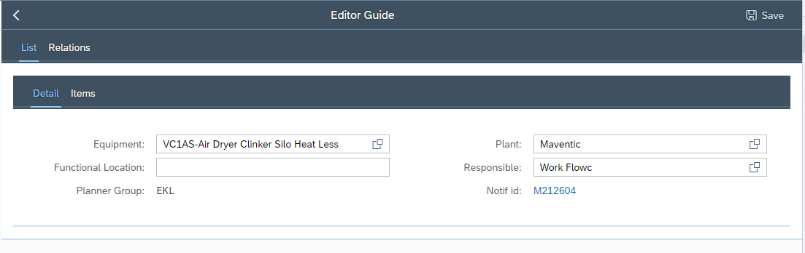

## 13.6. Tab with object page

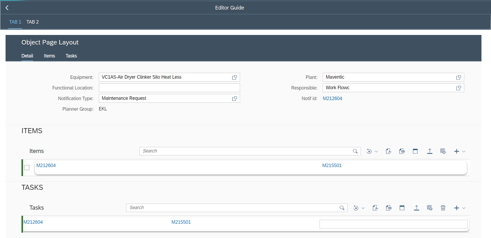

## 13.7. Tab with Splitter

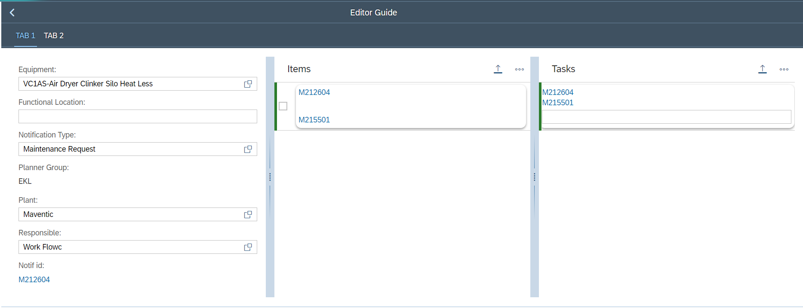

## 13.8. Flexi column with Object page

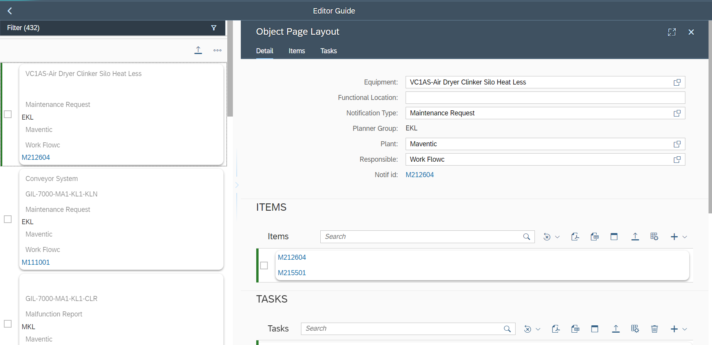

## 13.9. Flexi column with Stack

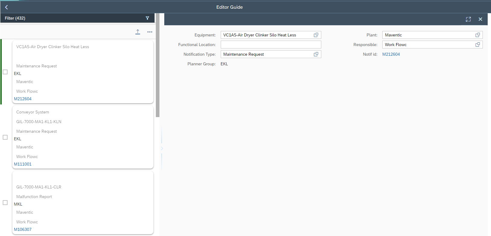

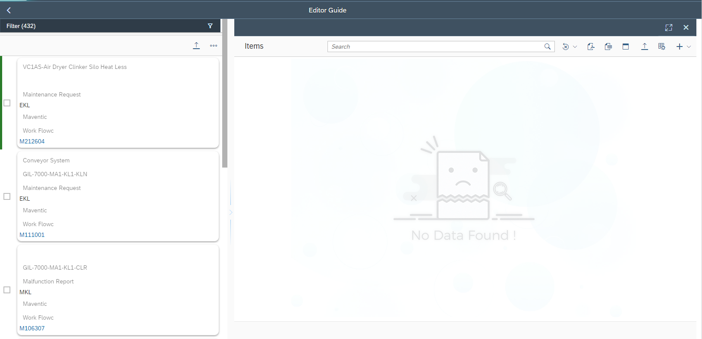

## 13.10. Flexi column with tab

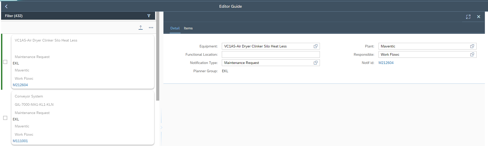

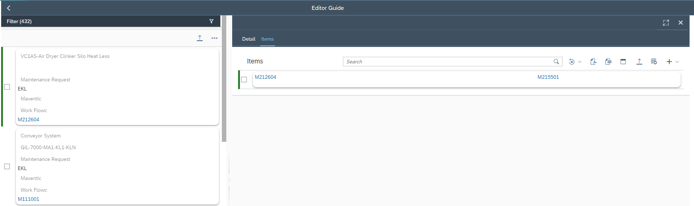

## 13.11. Flexi column with splitter

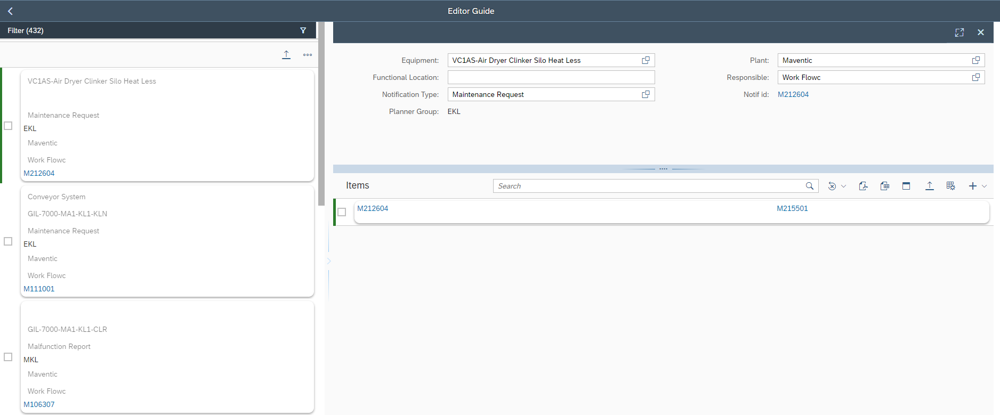

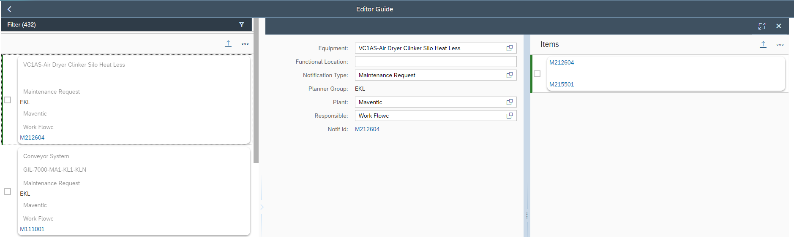

## 13.12. Object Page with tab

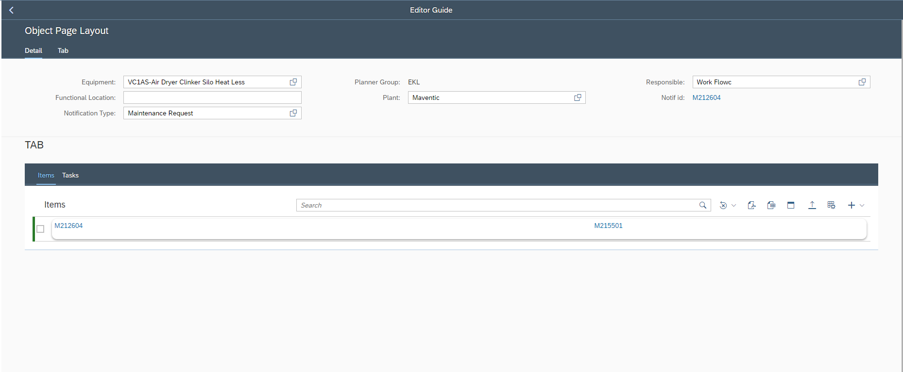

## 13.13. Splitter with tab

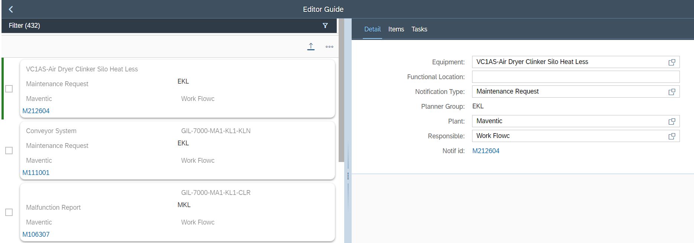

## 13.14. Splitter with Object page

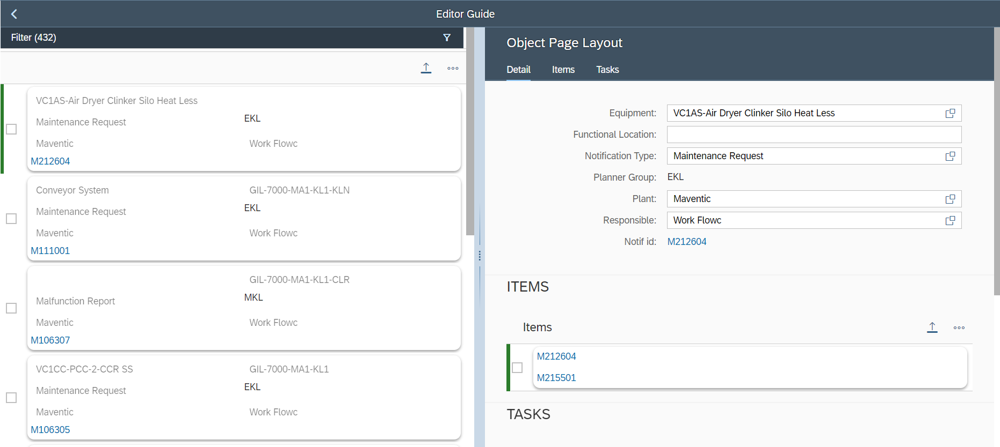

## 13.15. Flexi column with Object page and Tab

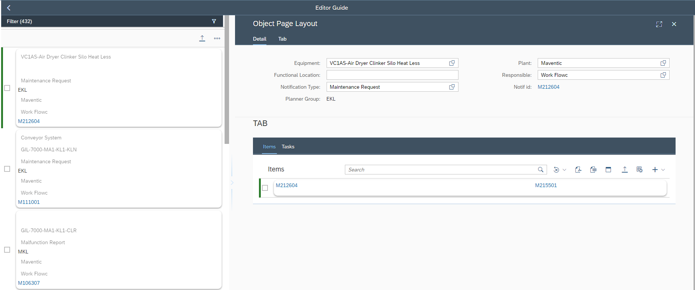

## 13.16. Flexi Column with Object Page and Splitter

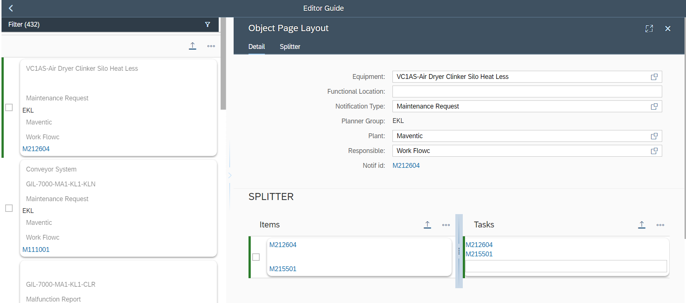
