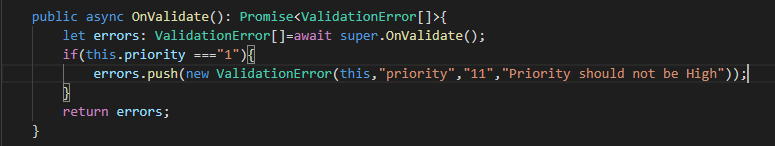

# Entity File

## 15.1. Hook Methods:

#### **onValidate:**

If the transNode’s onarrive (in the transNode’s detail section) is provided as valid then, onValidate will be called during navigation.

> 

#### **onAfterCreate:**

onAfterCreate method will be called once the new entity is created.

#### **onDelete:**

The onDelete method will be called once the entity is deleted.

## 15.2. Setter & Getter:

Setter function will be called once the entity property value is changed.

**Example:**

public set firstName(new_value:string){

if(new_value == this.firstName) return;

this.name:string = new_value+" "+this.lastName;

this.s("firstName",new_value,"string",false,false);

}

Getter function will be called whenever the entity property is getting read.

**Example:**

public get name():string{

return this.Firstname +" "+this.lastName

}
