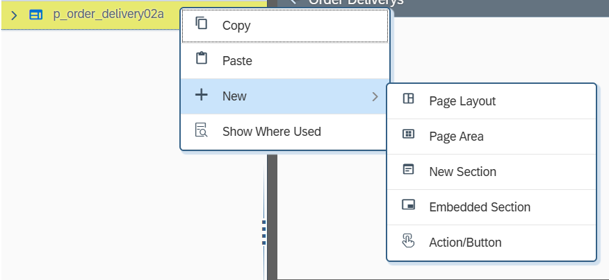
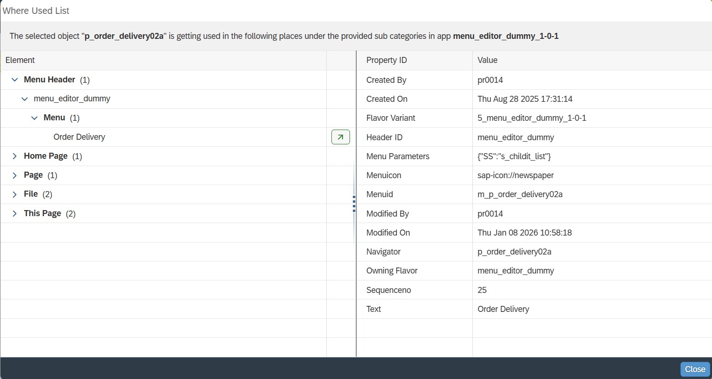

# Where used list

The **Where Used** list can be accessed from the **context menu** of the following elements:

- Page

- Page Area

- Section

- Transnode

To open the **Where Used** dialog:

1.  **Right-click** on the required element (Page, Page Area, Section, or Transnode).

2.  The **context menu** is displayed.

3.  Select **Show Where Used** from the menu.

4.  The **Where Used** dialog opens, displaying all references for the selected element.

When clicking on **Show Where Used** from the context menu, a **Where Used** dialog box opens. This dialog displays all references to the selected item within the current application.

#### Dialog Layout

The **Where Used** dialog is divided into two sections:

- **Left Panel (Tree View)  
  > ** Displays a hierarchical list of all references for the selected item.

- **Right Panel (Details View)  
  > ** Shows detailed information for the reference selected in the left panel.

Selecting an entry in the tree view updates the details shown in the right panel.

#### Supported Elements

The **Where Used** feature is available for the following elements:

- Pages

- Page Areas

- Sections

- Transnodes

#### Reference Checks by Element Type

- **Pages  
  > ** The system checks for references in:

  - Application menus

  - Home pages

  - Other pages (including embedded sections and tags)

  - Associated files (controllers, utils)

  - Navigation events within the current page (for example, navTo events)

- **Page Areas  
  > ** The system checks for references in:

  - Associated files(controllers, utils)

  - NavTo Events, layouts in other pages and the current page

- **Transnodes  
  > ** The system checks for references in:

  - Binded data paths

  - Associated files(controllers, utils)

### **Navigating to Referenced Objects**

The **Where Used** dialog allows direct navigation to referenced application objects.

In the **left tree section**, a **Navigate** button is displayed for application-level objects. When you click this button:

- A **new tab** opens automatically.

- The relevant **tool or editor** is loaded.

- The referenced object is **preselected and highlighted** in the opened tool.
