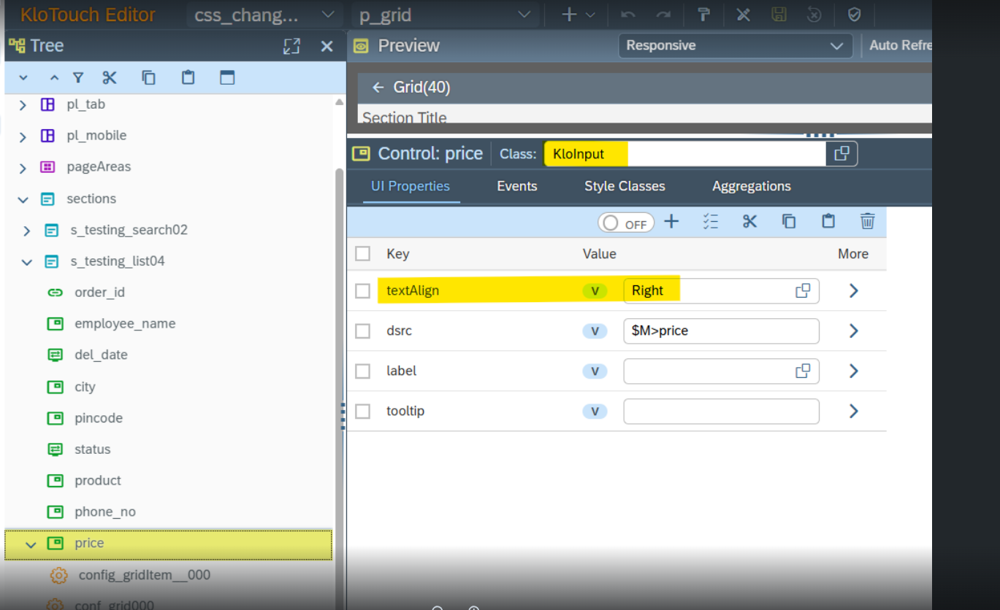
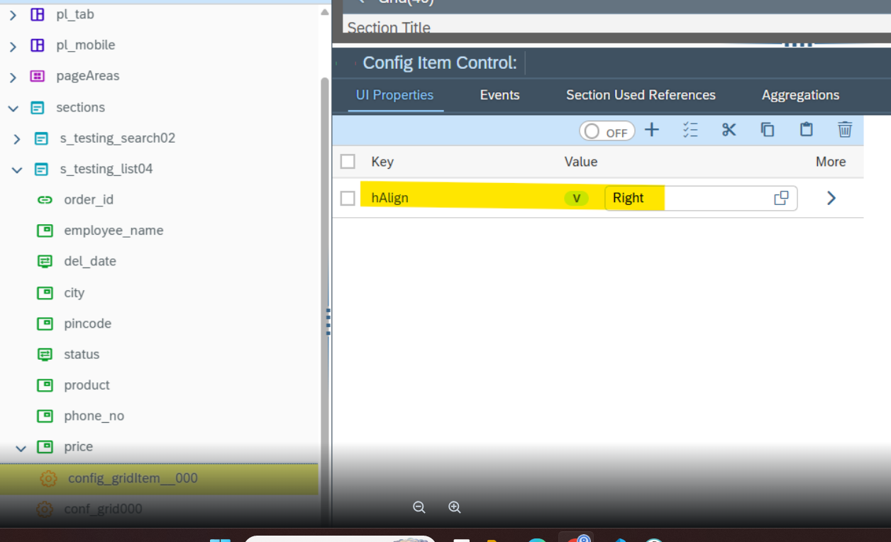

# Automatic Alignment Handling for Grid, Tree, and Auto Grid Sections

For **Grid**, **Tree**, and **Auto Grid** section types, the Builder automatically applies horizontal alignment (hAlign) and text align property based on the control type and its associated binding. So the column header and the control will be aligned as per the standards based on the domain and control type

#### Numeric Field Alignment

If a control is bound to a property whose domain type is **Integer** or **Decimal**, the Builder automatically adds the hAlign config property and textAlign control property with the value **Right**.

This automatic alignment is applied only when:

- The control is an input-based control.

- The control is bound to a property of domain type **Integer** or **Decimal**.

#### Alignment Updates on Control Changes

During updates, if:

- A control's value property or dsrc is modified, or

- A new binding is added to the control,

the Builder automatically detects the bound property and updates the alignment accordingly.

| Domain/data type                             | Data alignment | Header Alignment |
|----------------------------------------------|----------------|------------------|
| Boolean \[if control is checkbox or switch\] | Center         | Center           |
| Blob                                         | N/A            | N/A              |
| String                                       | Left           | Left             |
| Clob                                         | Left           | Left             |
| Date                                         | Left           | Left             |
| Decimal                                      | Right          | Right            |
| Integer(16)                                  | Right          | Right            |
| Integer(32)                                  | Right          | Right            |
| Integer(64)                                  | Right          | Right            |
| Integer(8)                                   | Right          | Right            |
| Timestamp                                    | Left           | Left             |

> 
>
> 

#### Control-Specific Alignment Rules

The following alignment rules are applied automatically:

| **Control Type**  | **hAlign Value** |
|-------------------|------------------|
| Switch, Check Box | Center           |
| Button, KloAction | Right            |

#### Auto Grid Behavior

For **Auto Grid** sections, automatic alignment is applied only in the **Desktop** view.

For the **Mobile** view, the default alignment behavior is retained and no automatic alignment adjustments are applied.
