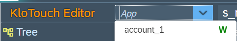
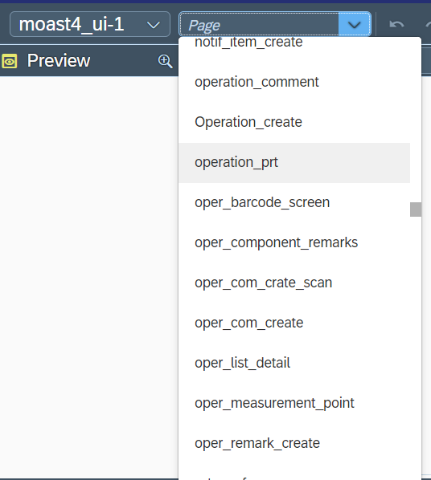
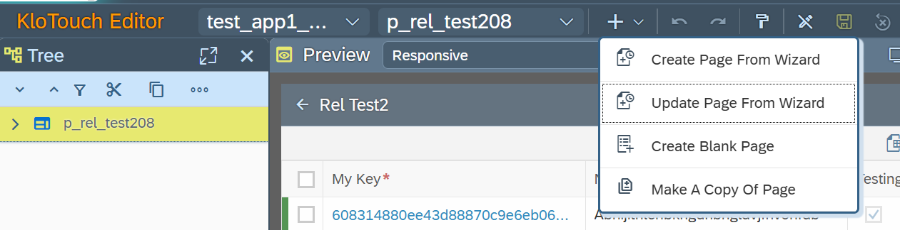
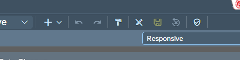
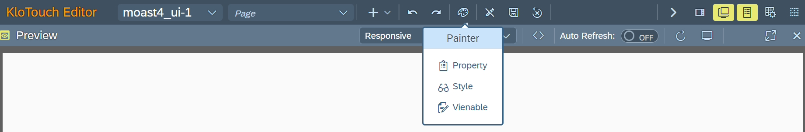
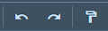
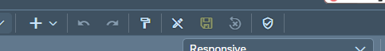
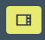
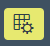
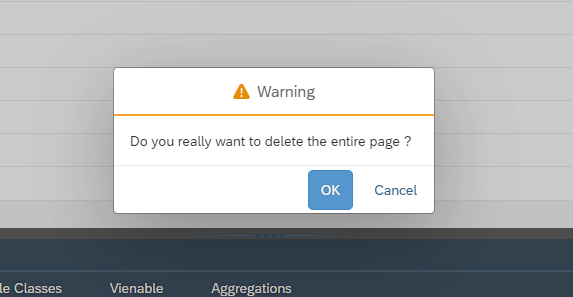

# Toolbar

## 1.1. App Selection

The App selection drop-down contains a list of apps that have been assigned to the user. By using the drop-down users can select the app on which they are going to work.

## 1.2. Page Selection

The page selection drop-down is used to select the page. The page dropdown will list all the pages available for the app that have been selected.

**Note**:This drop-down will be visible only when the app is selected.

> 

## 1.3. Create page

The Create Page has three parts:

- Create Blank Page

- Create a Page From Wizard

- Update Page From Wizard

- Make A Copy of Page

The Create page option is to [<u>create a new page</u>](#page-creation) for the selected app.

## 1.4. Undo and Redo

The undo option is to revert the changes that were made. The use of the redo option is to redo the changes that are undone.

## 1.5. Painter

The painter can be used to copy a property or style or vienable of one control to another/multiple controls.

 

**Step 1:** Select any control/section from the page tree section

**Step 2:** select the option from the painter

- Property - all the property details of the selected item will be copied

- Style - all the styles added to the selected item will be copied

- Vienable - all the vienable applied to the selected property will be copied

**Step 3:** Now select the control/section in the page tree to which the copied items should be pasted.

Note: With the painter option, we can apply the copied items to multiple elements, so once the items are pasted, **click on \`Esc\`**.

## 1.7. Save and Edit

The Save option is used to save the changes that are done.

**Note**:Save button will be visible only in edit mode.

The Edit option is used to make the kloEditor modifiable.

## 1.8 Read-Only and Cancel

The Read-Only and Cancel option is only visible in editable mode.

Clicking read-only mode locks the editor in making further changes.

On click of the cancel icon, any changes made in the editor that are not yet saved will be reverted.

## 1.9. Validate Page

This button will validate the page.

**Note**:It will be visible only in edit mode.

## 1.10. Section Toggle Buttons

Section toggle buttons are used to make the sections hide / visible. 

Each toggle button is described below:

|  | This is the tree button. This is used to show the hierarchy of the page sectionally. With a click of this button, it will hide the [<u>tree section</u>](#tree). However, if you click back it will show the tree section again.                 |
|------------------------------------------------------------------------------|--------------------------------------------------------------------------------------------------------------------------------------------------------------------------------------------------------------------------------------------------|
|      | This is the preview button. This shows a live view of the changes that have been made to the page. With a click of this button, the preview will disappear. However, on clicking it again the [<u>preview section</u>](#preview) will reappear.  |
|      | This is the Detail button. The detail section shows the details for the selected item in the tree (page hierarchy). On clicking this button the [<u>detail section</u>](#detail) will disappear. On clicking it again the section will reappear. |
|  | Page data model which is equivalent to the UI5 Model in the view. On clicking this button the section will disappear. On clicking it again the [<u>page data model</u>](#page-data-model-1) section will reappear.                               |
|      | This is the Reset Perspective button. As the name suggests, this is used to resize the section into its original position.                                                                                                                       |

## 1.11. Delete Page

To delete the page or screen, a shortcut key will only work, using **ALT + BCKSPC** .

It will display a confirmation dialog box, confirming to delete the entire page or to cancel the delete as shown below.

