# Editor Sections

Klotouch Editor is divided into **four** major sections, which are listed below.

- Tree

- Preview

- Detail

- Page Data Model

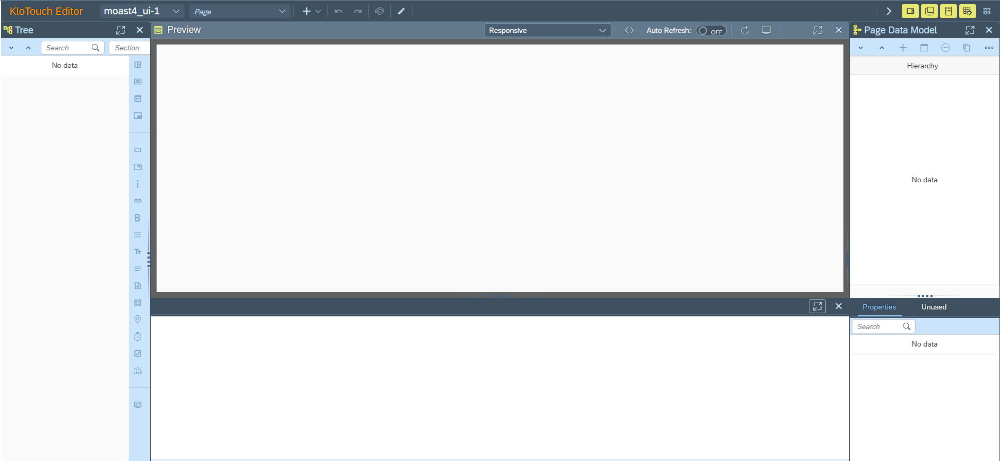

## 2.1. Tree

The tree section in the kloTouch editor contains the hierarchy of the page.

The tree will contain no data unless a page is created/selected from the toolbar.

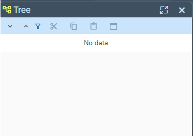

Once a page is created/selected it shall automatically reflect in the tree section.

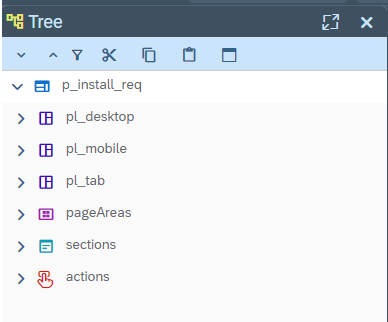

### 2.1.1 Expand All

Expand All option is to expand all the collapsed sections (sections, pageLayout, controls, pageArea, actions).

> 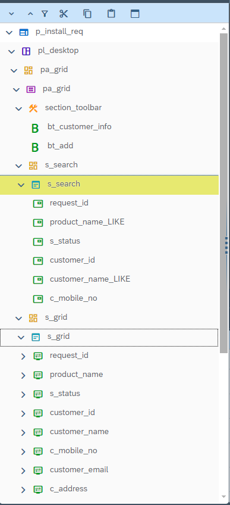

### 2.1.2. Collapse All

**Collapse All** option is to collapse all the expanded sections (sections, pageLayout, wcontrols, pageArea, actions).

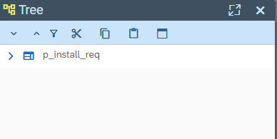

### 2.1.3. Filter

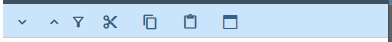

This filter button will open a popup as :

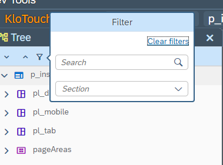

It will contain **fuzzy search**, **section drop-down** and **clear filter** option.

- The use of **fuzzy search** is to filter the items based on the Ids.

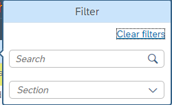

- **Section** dropdown is used to select and preview a particular section / pageArea of the page. This will filter the tree only for the selected section and its children.

> 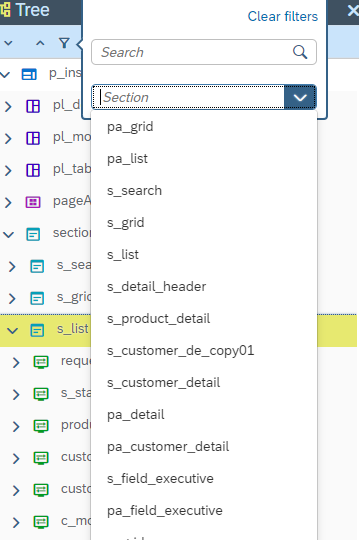

- **Clear filters** are used to clear the filters applied.

> 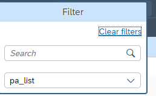

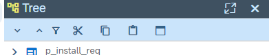

### 2.1.4. Cut, Copy and Paste

Using the cut copy-paste options, we are able to copy paste the controls/section /pageAreas.

**Note:** These buttons are inactive in read-only mode.

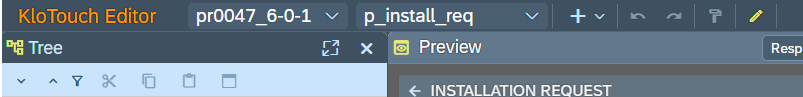

### 2.1.5. Create section

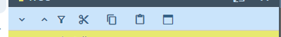

**The create section button** is used to create a section and to add required properties from a particular type of transnode.

Clicking on this button, it will open a popup :

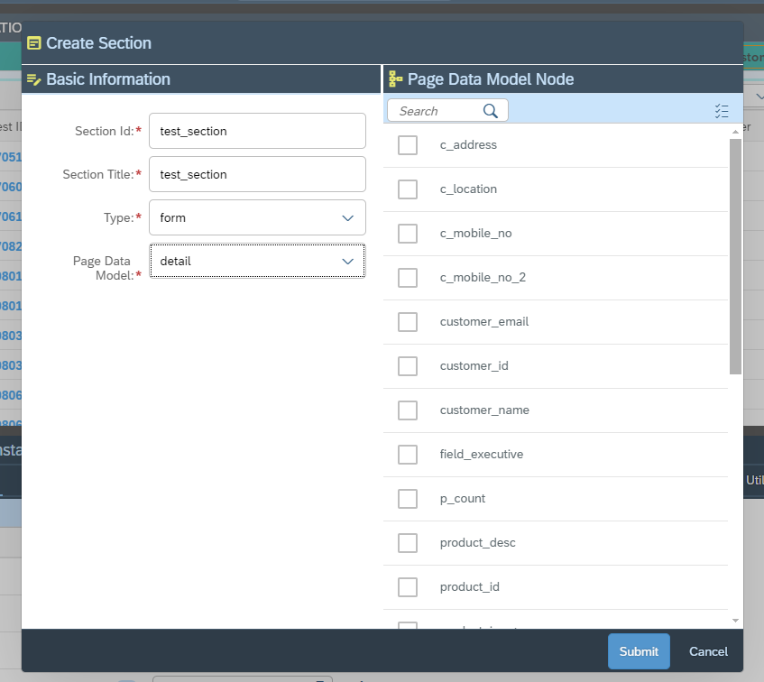

In the above popup, we need to mention section id, section title, section type and page data model with which the section is supposed to be binded.

After selecting the page data model, properties list will come in the Page Data Model Node section from where we can select the required properties.

**Note:** We can edit the section after creation from the Editor.

## 2.2. Preview

The **Preview** section is to preview the page before the final execution.

### 2.2.1. Preview In

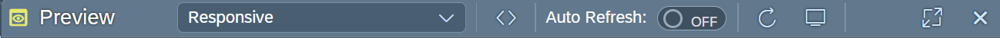

This is also known as the Preview type. The use of preview types is to see the look and feel of the same page on different types of devices. The devices that it can be viewed on are given below. Any new version of the device comes, likewise, it will be updated.

> 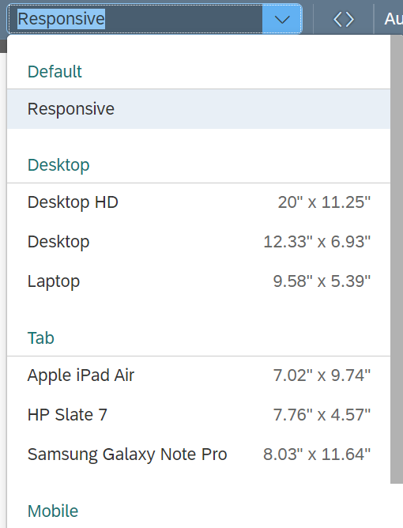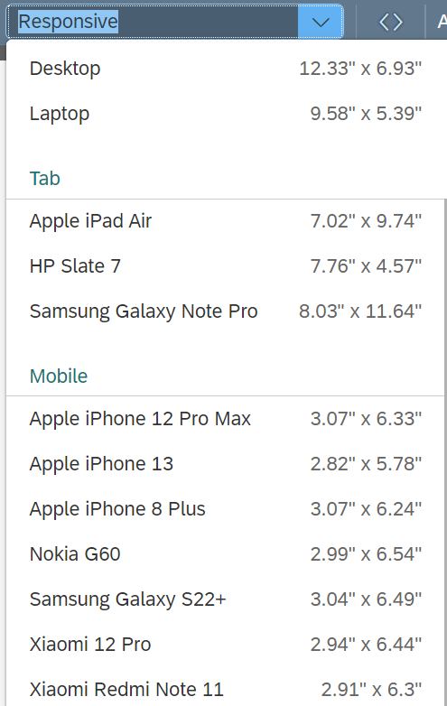

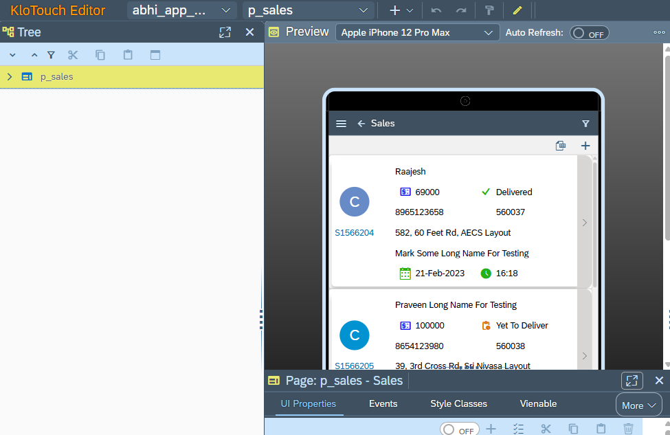

[<u>Preview samples</u>](#preview-samples)

### 2.2.1. Binding

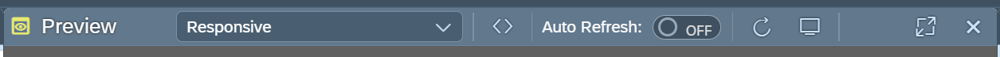

### 2.2.2. Auto Refresh

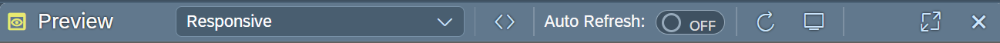

Usage of the auto-refresh button is to refresh the preview in design time i.e. if the auto-refresh is enabled whenever the user changes anything in the page’s metadata it will be previewed (auto-refreshed) automatically.

### 2.2.3. Preview/ Refresh

The usage of the preview or refresh button is to refresh the preview page to make the changes visible.

> 

### 2.2.4. Full preview

The full preview option is used to view the **page in full view**.

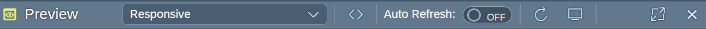

### 2.2.5. Full Screen and Close

The close option is to hide the preview section, to enable the preview section make use of the section [<u>toggle buttons</u>](#section-toggle-buttons)

| **Buttons**                                                                  | **Identity**                  |
|------------------------------------------------------------------------------|-------------------------------|
| 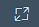 | To Expand to Full Screen.     |
| 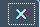 | To Close the Preview Section. |

### 2.2.6. DnD on Preview:

DnD on Preview is a drag-and-drop feature. It is an option to Drag and Drop properties and elements in multiple ways.

1)  **DnD from Unused to MainTree:**

**Step 1:** From the page data model, select the transnode, go to its unused property tab and drag the Property.

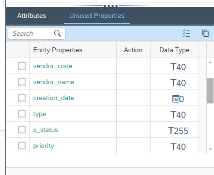

**Step 2:** Drop that Property to any section you want.

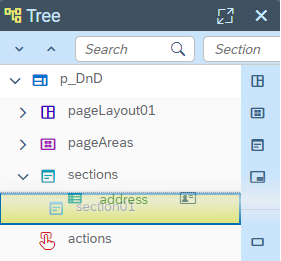

After preview, the newly added property will be shown on the screen.

2)  **DnD from MainTree to MainTree:**

> Users can Drag and Drop any main tree element across the tree.

**Step 1:** Drag an element from any section and Drop it into the different sections in the same tree.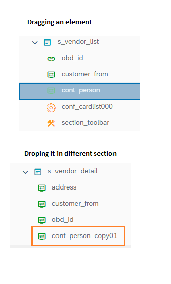

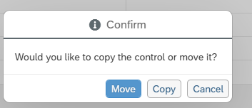

When an element is dragged and dropped between sections, a prompt appears asking whether to *Move* or *Copy* the element. Selecting *Move* removes the element from the source section and places it in the target section, while selecting *Copy* duplicates the element in the target section without affecting the source.

**Note:** The *Move* and *Copy* options are shown only when the drag-and-drop action occurs between two different sections.

## 2.3. Detail

Details of the item selected in the [<u>tree section</u>](#tree) will be shown in this detail section:

This depicts the name or ID of the item selected in the tree.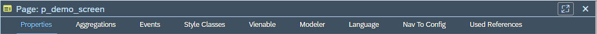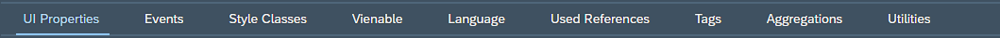

### 2.3.1. Properties

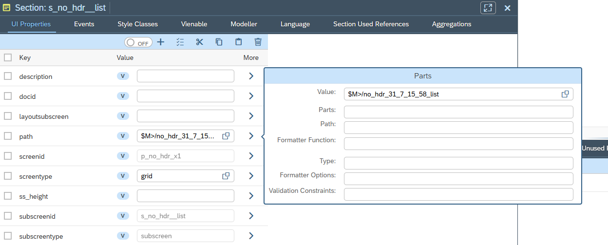The property tab in the detail section displays the properties that are added and options to add new properties that are associated with the selected item (page, pageArea, pageLayout, sections, controls).

[<u>Refer to this</u>](https://sdk.openui5.org/topic/91f0d8ab6f4d1014b6dd926db0e91070) to understand binding concepts.

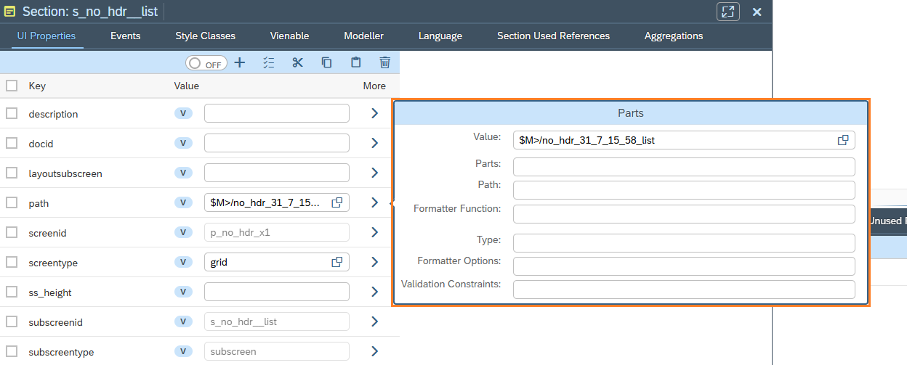

#### Value:

The value field will hold the value provided for the property.

#### Path:

In this path field, users can only bind with exactly one property or value. This can be used if there is only one property to bind.

#### Parts:

In this path field, users can bind multiple properties or values. This can be used if multiple values or properties need to be provided for binding.

**(Note**: If we are using formatter function, then it is mandatory to provide either parts or path value)

#### Formatter Functions

Controller function name (formatter function) can be given for the field.

#### Type:

In the type field, the user can provide the datatype for the control’s value.

#### Formatter Options:

Formatter options define how a value is formatted and displayed in the UI.

#### Validation Constraint:

Constraints are optional and define how an input value that is entered in the UI should look like. During parsing, the value is validated against these constraints. For example, an Integer type has a constraint for the maximum that is automatically validated when parsing the input values.

#### Add new Property:

- To add a new property, click on the add icon in the property section toolbar.

- On click of the add icon the properties associated with the control will be listed.

- Click on the property that needs to be added, it will be added to the control. Provide the property value for the newly added property.

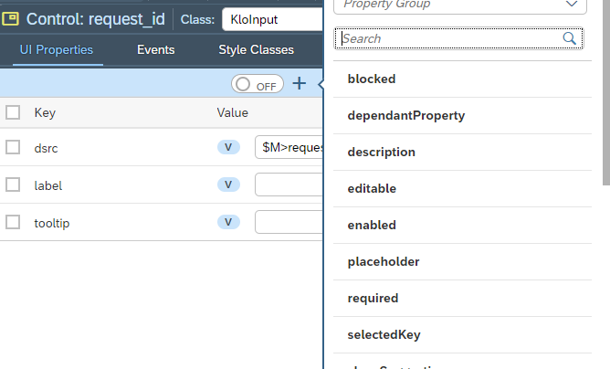

#### Property Group:

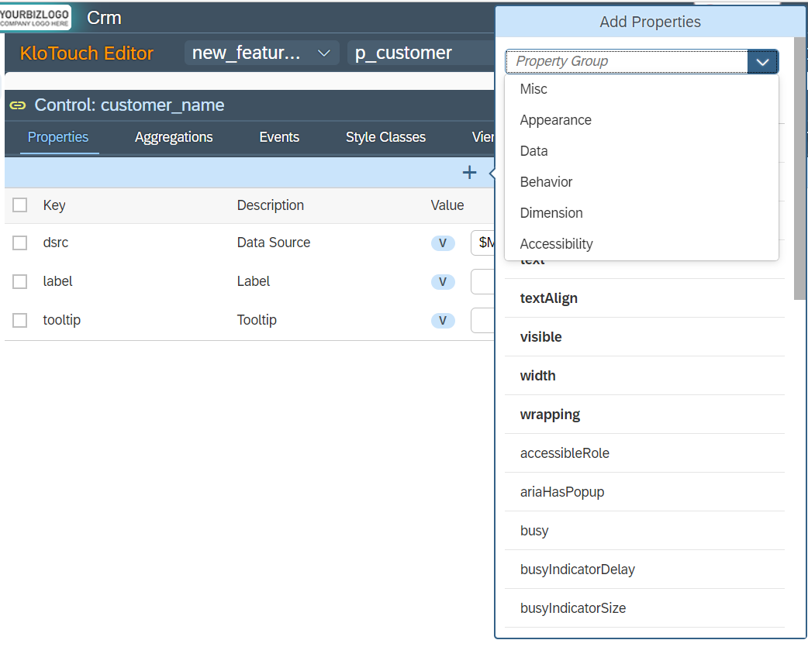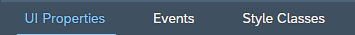

The Property group consists of the following:

| **Property Group** | **Details**                                                                                                                                                            |
|--------------------|------------------------------------------------------------------------------------------------------------------------------------------------------------------------|
| **Appearance**     | The appearance property group will filter the properties that are responsible for the appearance of the control. Example: visible, textAlign, wrapping, textDirection. |
| **Data**           | The data property group will filter the properties that are responsible for the binding values of the control. Example: value, src, text, href.                        |
| **Dimension**      | Dimension property group will filter the properties that are responsible for the dimensions of the control. Example: width, size, height.                              |
| **Behaviour**      | The behaviour property group will filter the properties that are responsible for the behaviour of a control. Example: editable, enabled.                               |
| **Misc**           | Properties other than the above-mentioned groups will come under Misc.                                                                                                 |

#### Select All/ None:

This option is used to select/unselect all the properties.

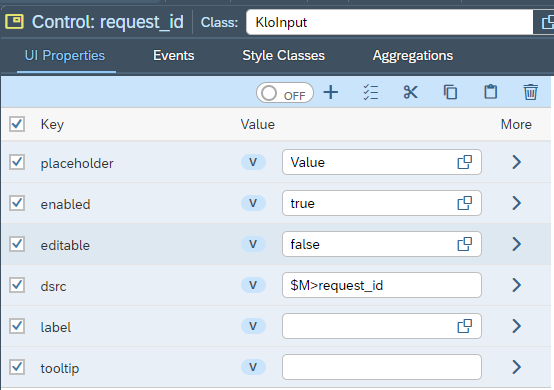

#### Cut:

This option is to cut and paste the property of one control to another control.

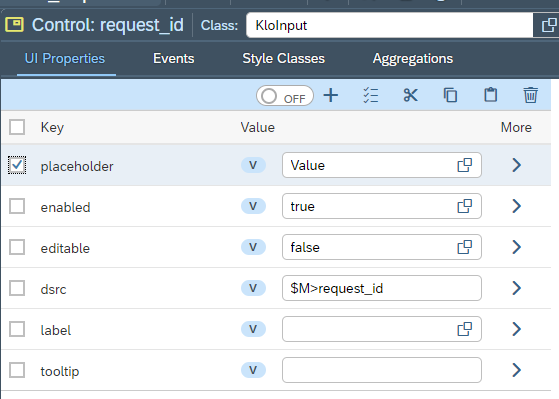

#### Copy and Paste:

The Copy and Paste options are used to copy/paste one or more properties from one control to another.

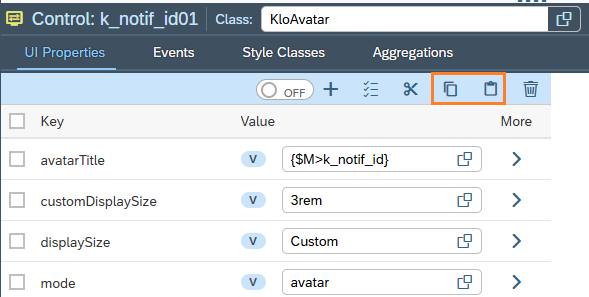

#### Delete Property:

To delete a property, select the property that needs to be deleted and click on the delete icon in the properties section toolbar.

> 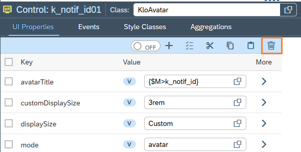

### 2.3.2. Aggregations

The Aggregations tab in the detail section displays the aggregations that are associated with the selected item (page, pageArea, sections, controls)

> 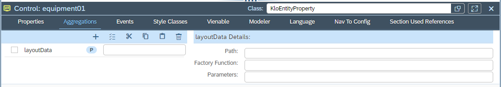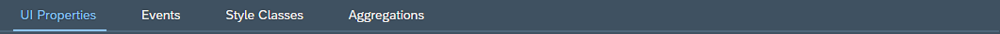

#### Path:

[<u>Binding Path</u>](https://openui5.hana.ondemand.com/topic/2888af49635949eca14fa326d04833b9) addresses the different properties and lists in a model and defines how a node in the hierarchical data tree can be found.

Examples: \$M\>/list, \$M\>/items

#### Add new Aggregation:

- To add a new aggregation click on the add icon in the aggregation section toolbar.

- On click of the add icon the aggregations associated with the control will be listed.

- Click on the aggregation that needs to be added, it will be added to the control.

> 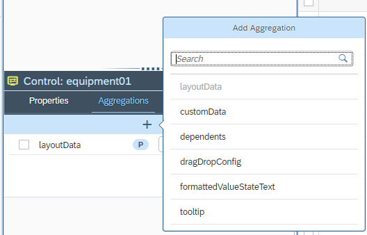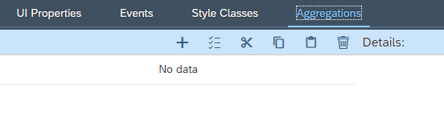

#### Select All/ None

This option is being used to select/unselect all the aggregations.

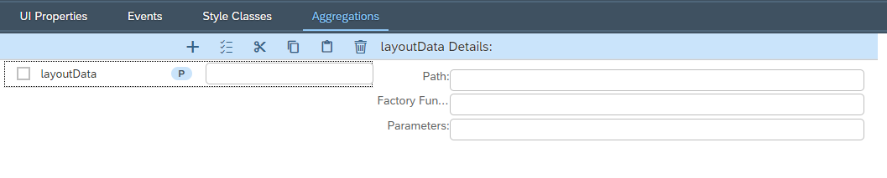

#### Cut

This option is to cut and paste the aggregations of one control into another control.

#### Copy and Paste

The Copy and paste options are being used to copy/paste one or more aggregations from one control to another.

#### Delete Aggregation:

For delete, select the aggregation that you want to delete. And click on the delete icon in the aggregation toolbar.

> 

### 2.3.3. Events

The Events tab in the detail section displays the events that are associated with the selected item (page, pageArea, sections, controls).

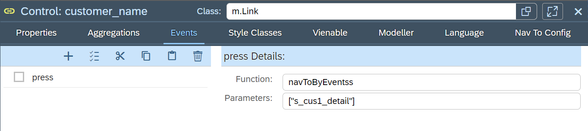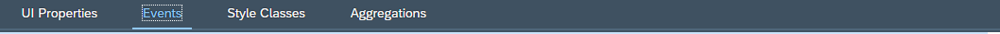

#### Functions

The controller function name should be given in the field, which will be called in case of the event.

**Example of Controller function:**

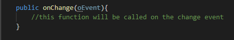

#### Parameters

The values passed in the field can be accessible in the function as a parameter.

#### Add new Event:

- To add a new event click on the add icon in the event section toolbar.

- On click of the add icon the events associated with the control will be listed.

- Click on the event that needs to be added, it will be added to the control/sections / pageArea.

> 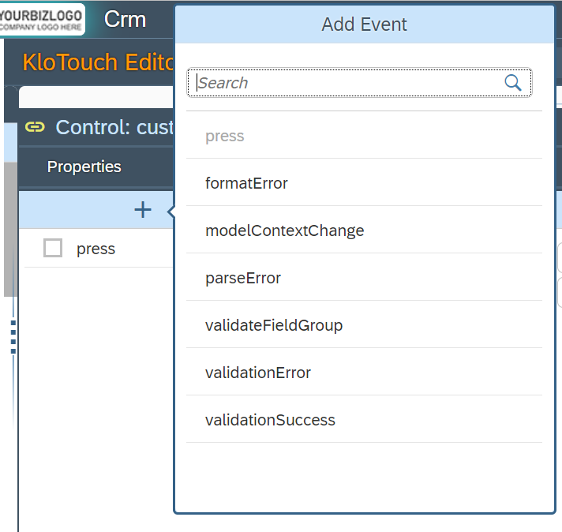

**Note**:

- If we are adding a new event then, it is necessary to add or select the **function name.**

- If we are adding a function from the vh as OpenDialog, it will show a popup with all the pageAreas to select,from which we want to navigate.

#### Select All/ None:

This option is being used to select/unselect all the events.

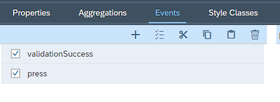

#### Cut:

This option is to cut and paste the event of one control to another control.

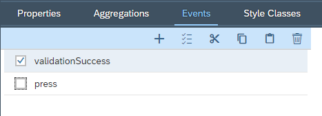

#### Copy and Paste:

Copy and paste options are being used to copy/paste one or more events from one control to another.

#### Delete Event:

To delete an event select the event and click on the delete button from the toolbar.

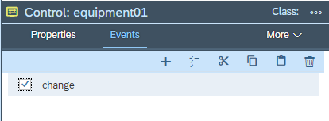

Events list on page

In the page-level events, we have an option to see the list of events added to this page.

**Step 1:** Select the page in the Page Builder page tree section

**Step 2:** Select the events tab in the page detail section

**Step 3:** enable the toggle button

Once it is enabled, all the events added to this page will be listed below

### **<u>Navigation Editor:</u>**

**NavTo** is a **kloController API** that is used for navigation across the application.

In the **Events** tab of the Page Builder, if we select **NavTo** as an event method, the below parameters will reflect for NavTo.

#### Parameters for Navigation

The following are the parameters for the navigation:

- **Target Page:** It is an F4 of the screens where **sections** of the current screen, related screen (screens created with related entities) and all the screens of the respected app are present.

> 

- **Section:** It is an F4 of all the pagelayouts, pageAreas and sections of the target page.

> 

- **Tags:** It shows all the TagIDs maintained in the target screen.

- **Mode:** It is a dropdown for different screen modes.

> 

- **App Data:** It is a field where the application can send any data while navigating to the target screen.

- **Page Data Model:** It is a F4 of all the Data models of the target page.

> 

- **Active Index:** It accepts the index to which setActive will be called in the list.

> 

- **Page Data Model Map:** It is an array of JSON which expect SourceTransNode & TargetTransnode(i.e SourcetransNode data will be copied to TargetTransnode)

> 

- **Query Parameters:** It is for navigation by query([<u>navByQuery</u>](https://docs.google.com/document/d/15s1UXW12z034b8ymbnRojY6KcIj_X8FEoUTHB95ykMM/edit#heading=h.relbx1gapp9j)).

- **Share Mode:** This is for setting whether the mode will be shared after navigating between the source and target pages.

- **Share Model:** This is for setting whether the transaction will be shared after navigating between the source and target page.

> 

### 2.3.4. Style Classes

The Style Class tab in the detail section displays the quick styles that are available for the control/pageArea/sections. There are style classes that have already been added and there are options to add a new style class for the selected item (pageArea, sections, controls).

#### QuickAdd:

##### **Quick Add for Sections:**

Below is the list of quick adds available for specific section types:

| **Section types** | **Quick Adds** |
|-------------------|----------------|
| Card, card List   | Card styles    |
| Grid              | Grid styles    |

###### Card Styles:

###### Grid Styles:

##### **Quick Add for Controls:**

Below is the list of quick adds available for specific controls:

| **Controls**                                                                                              | **Quick Add**                                                                                     |
|-----------------------------------------------------------------------------------------------------------|---------------------------------------------------------------------------------------------------|
| Icon                                                                                                      | Font size, Text color                                                                             |
| Text, Label, Title, Link                                                                                  | Font size, Text color, Bold, Italic, Underline                                                    |
| Button, Switch, info label                                                                                | Font Size, Background color, Text Color, color combination, Bold, Italic, underline, border style |
| Input, TextArea, DatePicker, TimePicker, DateTimePicker, MultiCombobox, MultiInput, SearchField, comboBox | Font size, Text color, Bold, Italic, Underline, border style                                      |

###### Font Size:

> 

###### Text Colour:

> 

###### Bold:

###### Italic:

###### Underline:

###### Background color:

###### Color Combination:

###### Specific Style:

#### Category:

In this category field, we can choose the style category that needs to be applied to the selected item.

#### Style Class:

Class names should be provided for this field, which will be applied to the selected items. Style class works after selecting the category. In the below image, we have taken the border as our category. Hence, border options are seen in the StyleClass.

**Note**: The style class should not be empty.

**Format Rule:**

1.  **Always:** If the format rule is marked as always, it will always apply the style.

2.  **Text Contains:** If the format rule is marked as the text contains, it will apply the style if the value contains the one mentioned in the format value.

3.  **Formula:** If the format rule is marked as formula, it will apply the expression maintained in the format value field and based on the result set of the expression (result is expected to be true or false) the style class will be applied to that control

    1.  Example Format value for formula : {= \${\$M\>/temp/save}?true:false}

#### Format Value:

If the format rule is marked with text contain, then text will be taken from this format value field and it will be compared with the control’s value.

If the format rule is marked with a formula, then the expression will be taken from this format value field and based on the result set(the result should be expected to be true or false) of the expression, the style class will be set.

**Example Format value for formula** : {= \${\$M\>/temp/save}?true:false}

#### Full Row:

If the full row is marked as true, then the style class will be applied to the entire row, where the control is placed.

> 

**Note**:

1.  For tree screen type, full-row in style class will be applicable only when the section’s screen type is full row, it will not work for control for control type tree tables.

#### Add new Style Class:

- To add a new style class click on the add icon in the style class section toolbar.

- On clicking the add icon, a new entry will be created for the style class.

- Select the category and add the style class accordingly.

> 

#### Cut**<u>,</u>** copy, and paste:

For cut, copy, and paste you need to select the styleclass and then use the cut, copy, and paste accordingly. 

#### **<u>Delete</u>**

Select the StyleClass item you want to delete and then click on the delete icon from the toolbar. 

#### Grid Cell Coloring:

For adding css(background) to whole cell of grid section, user can do following:

1.  Add user defined class in control of grid section

2.  use :has Pseudo-class, and do required styling

> Example: as given below:
>
> td:has(.invAmountColorWholeCell) {
>
> background: \#0c8123;
>
> }
>
> 

### 2.3.5. Vienable

Vienable is the short form of visible and enable. The Vienable tab in the detail section displays the vienable dashboard and UI Auth for the page.

#### Toolbar:

##### **Page Entity:**

##### **Copy and paste:**

##### **Upload and Download Excel:**

##### **Role Info:**

##### **Status Info:**

##### Vienable toggle button Info:

#### 2.3.5(i). Vienable DashBoard:

#### Control ID:

The Control ID column displays the available controls on the page.

#### Entity:

The transNode of which the control is bound. If it is not marked as true, status and role-based vienable will not work.

#### Permission:

The permission of the entity in flavor on which control/element visibility will be decided for logged-in users.

- If permission is not filled by developer, then proceeds with with vienable calculation

- If permission is filled by developer, but filled permission not given for logged in user, then the current control/element will be hidden by skipping vienable calculation

- If permission is filled by developer, filled permission given for logged in user, then proceeds with with vienable calculation

#### Show As Label:

If the control is disabled, and the showAsLabel is marked as true then the disabled control will be rendered as a label.

#### Page Size(S, M, L, XL):

> 

The page sizes S, M, L, and XL define small, medium, large, and extra-large size page resolutions.

- If the control is marked as non-visible for page size S, then the control will be hidden for that particular resolution.

<!-- -->

- If the control is marked as disabled for page size S, then the control will be disabled for that particular resolution.

**Note:** The resolution will be considered based on the parent section’s resolution for control.

#### page Mode (Create, Edit, Display, Review):

There are four modes for a page: **Create, Edit, Display,** and **Review**. Among the page modes display will be the default mode. We can change the page modes based on the requirements.

> 

#### Role:

> 

Role-based vienable helps the control to be visible/enabled based on the current logged-in person’s role and object type of the bound entity. For this role-based configuration, [<u>KloTuner</u>](https://docs.google.com/document/u/0/d/1BVUWwrG0LOrlW_ngWyUItIW73_3bVXIwA0cPPdVjYVE/edit) is used.

For role-based vienable, config has to be maintained for the respective entity.  
If it is not maintained in the entity level, It will consider the role maintained in the app-level.

While configuring the config table, provide the **s_role_rollup** value as below:

| **Role**   | **s_role_up** |
|------------|---------------|
| Owner      | 10            |
| Supervisor | 20            |
| Reviewer   | 30            |
| Overlooker | 40            |

#### Status Group():

**Status:** open, approved, accepted, processed, rejected, completed.

Based on the s_status_group, s_status, and object type for that particular entity, we will be able to make the control visible/enabled. For status-based configuration, [<u>Klotuner</u>](https://docs.google.com/document/u/0/d/1BVUWwrG0LOrlW_ngWyUItIW73_3bVXIwA0cPPdVjYVE/edit) is used.

**Note:** Similar to role-based vienable, status-based vienable status configs have to be maintained for the entity.

#### Result:

In the result column, we can see the final result of how the controls will be rendered, for the selected page mode, selected role, and selected status group.

The yellow background in the column header represents the selection of the column.

> 

##### 2.3.5(ii). **UI Auth:**

#### Element Id:

It is the control ID of the control.

#### Object Type:

For this object type, UI Auth will be applied.

#### Role:

For this role, the UI Auth will be applied.

#### Status:

For this status, UI Auth will be applied.

#### Mode:

For this mode, UI Auth will be applied.

#### Mode Value:

This will determine the control’s visibility / enableness.

#### Add new UI Auth:

- To add a new UI Auth click on the add icon in the toolbar of the UI Auth section. On click of the add icon, a popup will be displayed.

- In the popup select the control for which UI Auth needs to be applied.

- Select the role, mode, object type, and status after selecting press OK. A new entry will be added in the UI Auth section.

> 

#### Vienable Runtime precedence:

If all the vienable sections (screen size, screen mode, role, status) are maintained for control, below will be the flow of the section it will take into consideration.

### 2.3.6. Modeller

The Modeller tab in the detail section displays the modeller only if the modeller is available for the selected section type.

A modeller is generally used for modelling the sections.

**Note**: The modeller will load only if the particular section is visible in the preview section. To access the modeller of a section select that particular section in the tree section to preview that particular section.

#### Card & cardList Modeller:

WYSWYG (What You See What You Get)

Card WYSWYG allows the users to arrange/resize controls of the Card. The Card WYSWYG is available in the tab called “**Modeller”** of the kloTouch Editor if the section type is given as cardlist/card.

These are the following steps to use WYSWYG:

**Step 1:** Select the section (of type **“cardlist”** or **”card”**) or any child of the section (of type **“cardlist”** or **”card”**).

**Step 2:** Open the **“Modeller”** tab. Users can arrange/resize controls as required.

**Step 3:** For arranging the controls, the user can simply drag a control and drop it anywhere on the axis as per the requirement.

While doing the arrangement or resizing, if any other control exists in the same axis, red lines will be shown.

**Step 4:** For resizing the controls, Users can simply click on the controls and resize them as they want.

**Before resizing:**

**After resizing:**

**NOTE:** Users can select multiple controls(by holding the control) and “Make the same size” (Vertically/Horizontally).

**<u>Reveal Grid:</u>** With this button, one can enable and disable the gridlines.

**<u>Tabular Card Modeller:</u>** On clicking this button, a tabular card modeller will open where the user can manually provide a column/row span for the alignment of the card/cardList.

**<u>Alignment:</u>** Options for Alignment, space distribution, equal size:

**<u>Modeller Size:</u>** To make the card modeller screen size the selected item’s size one uses the modeller size (Tab, Desktop, etc) tab.(**This option has been disabled:** To use this, change the screen resolution from preview type)

**<u>Absolute/Relative:</u>** The absolute button will make the modeller as the previous version without additional features. On the other hand, the Relative button will set the modeller section as the newer version(5.7) with all the additional features.

The card is generally a css gridlayout and the cardlist is generally a list of css grid layouts.

| **ScreenSize** | **Spans available** |
|---------------------|---------------------|
| XL, L               | 36 column span      |
| M                   | 24 column span      |
| S                   | 12 column span      |

For more information about CSS grid layout [<u>click here</u>](https://developer.mozilla.org/en-US/docs/Web/CSS/CSS_Grid_Layout)

**Note:** if column span and row span are not maintained for a particular screen size then it will pick from the default span (if maintained). But if either of the one is maintained then it will pick both the values from that particular screen size.

**Note**: As the Page Area of type Dialog doesn’t have any direct assignment with any of the page Layouts, the Modeler/preview will not be available.This Modeling can be achieved by adding that particular section to any other page Area (which is assigned to any page Layout). Once the modelling is completed, reassign to the Dialog Page Area.

#### Grid Modeller:

Grid modeller is used to model the grid type section. Using this grid modeller we will be able to change the column width, we can assign filters, and sort for a particular column.

> 

#### Pivot Modeller:

There are two types of pivot modellers

- Design time

- Run time

**Note:** The difference between the design time and run time modeller is that the design time modeller cannot be modified by end users it is predefined by the developers.

The design time pivot can be set as the default view of the section by use of the ‘default report’ property of the section.

##### **Design Time Modeller :**

Design time pivot will be created by the developers which will be predefined, and cannot be modified by the end users.

Step 1: Select a section which is of type card list or grid type and then add the report

Step 2: Select the newly created record and click on the modeller to see the design time pivot modeller.

**Note:** For how to use it you can refer to this document [<u>Pivot Modeller</u>](https://docs.google.com/document/d/16XxVYkvZjA7KrOiXDopgcVzkJw59kis1X2iXp4Ku8wM/edit)

##### **Run Time Modeller:**

The pivot modeller is used to configure the grid and card list subscreen. You can customise the pivots and charts based on your preferences, using this modeller.

These are the following steps to enable the run time Pivot Modeller:

**Step 1:** Select a section which is a card list or grid type and then add a toolbar to that subscreen.

**Step 2:** Now in the toolbar detail, add two properties (**reportSelectionField and pivotModellerButton**) and mark these properties as true.

Once the above properties are added during the design time, the modeller button and view selection will appear in the toolbar of the table during runtime.

**Note:** For how to use it you can refer to this document [<u>Pivot Modeller</u>](https://docs.google.com/document/d/16XxVYkvZjA7KrOiXDopgcVzkJw59kis1X2iXp4Ku8wM/edit)

#### CSS Grid:

CSS grid is the screen container that can hold page areas or sections. Under CSS Grid, users can arrange subscreen controls in any way they want in any layout.

**Step 1:** Make the Page Layout or Page Area screen type as ‘**CSS Grid**’.

**Step 2:** Right-click on that page layout or page area and add the page layout data to it.

After assigning the page section or PageArea, the page layout or page Area will look like this.

**Step 3:** Now go to Modeller then click on ‘**Tabular card Modeller**’.

**Step 4:** Add row/column-span to align subscreens as you want.

### 2.3.7. Language

#### Language toolbar

<table>
<colgroup>
<col style="width: 32%" />
<col style="width: 67%" />
</colgroup>
<thead>
<tr class="header">
<th><strong>Components</strong></th>
<th><strong>Description</strong></th>
</tr>
<tr class="odd">
<th>
Language Dropdown

(Select Language)
</th>
<th>This will list all the available languages in the dropdown. On selection of a language a new column will be displayed with the selected languages.</th>
</tr>
<tr class="header">
<th>Editable Language</th>
<th>This will display all the selected languages from the language dropdown. Once the language is selected the language column will be editable.</th>
</tr>
<tr class="odd">
<th>Search</th>
<th>This will filter the grid rows of the text ID table.</th>
</tr>
<tr class="header">
<th>Add</th>
<th>To add a new item or entity to the Item grid table.</th>
</tr>
<tr class="odd">
<th>Translate</th>
<th>To translate all the selected items that have been added to the row of the table.</th>
</tr>
<tr class="header">
<th>Show/Hide References</th>
<th>It will hide/display the reference column. The reference column displays the destination where a particular textID has been placed.</th>
</tr>
</thead>
<tbody>
</tbody>
</table>

#### Add a new Entry

**Step 1 -Click on the Add Button**

To add a new entry/text click on the add button () on the Language toolbar.

A Dialog box will appear.

**Step 2 - Fill the Dialog box**

In the Dialog box we need to give a **TextID (Example: Header, Text, Caption, etc)** and choose a category from the category list. Then click on **OK**.

| **Category**            | **Description**                                                                                                             |
|-------------------------|-----------------------------------------------------------------------------------------------------------------------------|
| Text                    | This refers to normal text labels for any text that has been added in the editor.                                           |
| Tooltip                 | The tooltip helps in showcasing short descriptions about a particular entity or entry when the cursor is hovered over them. |
| Title                   | This represents the Normal title.                                                                                           |
| TextID                  | This represents the text ID.                                                                                                |
| Ghosttext (PlaceHolder) | This represents the texts in any kind of Input box.                                                                         |

Text will be added to the screen.

#### Editing the Languages:

Select the languages that need to be made editable in the language dropdown and in the editable languages dropdown, to make the column editable.

#### Translation:

**Step 1 - Select the Texts that are to be translated**

Select the items from the grid that need to be translated.

**Step 2 - Select the dropdown Editable Language**

Select the dropdown Editable Language (target Language) and choose the language to which you want the selected items to be changed.

**Note:** The source language will be English as default. Also here English is referred to as **en** and Hindi is referred to as **hi.**

**Step 3 - Translate the Language**

Click on the translate button to translate to the required language.

#### Reference:

Reference sections display where the text ID is being used. By default, the reference section will be hidden. To enable the reference section click on the reference button in the toolbar.

### 2.3.8. NavToConfig

**Coming Soon**

### 2.3.9. Used References

**Coming Soon**

### 2.3.10. Tags

#### Tag Id

Unique tag ID for the tag created

#### Target Page

On click of the Target page Value help, a selection popup will be displayed below

##### This Page

Will list all the PA, PL, and Sections of the current page, on selection, selected item will be populated

##### Relation Page

This will list all the relation pages which are associated with the leadEntity of the current page.

##### All Page

This will list all the pages available in the current app

##### **PL / PA / Section**

On click of the value help it will list all the page layouts, page area and sections of the selected page

##### **Mode**

Mode represents the page mode(Create, Edit, Delete, Review)

###### Share Mode

With the click of the share button, share mode is enabled, if the share mode is enabled the mode will be shared with the target pages.

Mode selection:

If any mode is selected from the dropdown then the selected mode will be applied to the target page.

##### **Page Data Model**

Page Data Model Vh will list the all the transcodes available in the target page

##### **Query Parameters**

Query parameters which need to be passed.

The query parameters will be applied to the advanced search of the target page transnode. (only if target page’s navByQuery is maintained)

##### Share Model

##### **App Data**

Application Data(AD) is received by the application as a parameter of the *onAppDataProcess* method

##### **Page Data Model Map**

Trasnode mapping-Transnode will be mapped from the source transnode to the target transnode.

In the page data model map, the source and target transnode can be mapped from the value help popup.

## 2.4. Page Data Model

##### **Node Types in TransNode:**

| **Type**                                                                     | **Description** |
|------------------------------------------------------------------------------|-----------------|
|  | Query           |
|  | Entity Set      |
|  | Entity          |
|   | Other           |

##### **Relations of selected TransNode:**

##### **Properties of selected TransNode:**

##### **TransNode Properties:**

> 

##### **Page Data Model(Expanded):**

> 

##### **The Hierarchy:**

> 

<table>
<colgroup>
<col style="width: 24%" />
<col style="width: 75%" />
</colgroup>
<thead>
<tr class="header">
<th><strong>Columns</strong></th>
<th><strong>Description</strong></th>
</tr>
<tr class="odd">
<th>Hierarchy</th>
<th>Displays the transNodes search, list and detail.</th>
</tr>
<tr class="header">
<th>Action</th>
<th></th>
</tr>
<tr class="odd">
<th>Entity/Query</th>
<th>Displays the entity name/query name of the transNode.</th>
</tr>
<tr class="header">
<th>Data Type</th>
<th>Displays the data type of the used properties.</th>
</tr>
<tr class="odd">
<th>Text ID</th>
<th>
Displays the textId of the used properties.

Each property has its specific text ID.
</th>
</tr>
<tr class="header">
<th>Width</th>
<th>To set the width of the entity property when it is rendered.</th>
</tr>
<tr class="odd">
<th>Link From</th>
<th>Displays which transNode it is folded from.</th>
</tr>
<tr class="header">
<th>Set Active If</th>
<th>Refer to <a href="#set_active_if"><u>Set_active_if</u></a></th>
</tr>
<tr class="odd">
<th>onArrive</th>
<th>Refer to <a href="#onarrive"><u>onArrive</u></a></th>
</tr>
<tr class="header">
<th>Grid Allowed</th>
<th>
Will display the grid configuration of the used properties.

</th>
</tr>
<tr class="odd">
<th>More</th>
<th></th>
</tr>
</thead>
<tbody>
</tbody>
</table>

#### Collapse all & Expand all:

Collapse all option is used to collapse all the expanded sections (sections, sections, controls, containers, actions).

Expand all options are used to expand all the collapsed sections(sections, controls, containers, actions).

> 

#### **Add Model Path:**

By using the add model path button we will be able to [<u>create a new model path</u>](#create-a-new-model-path) for the page.

#### **Model Path/TransNode:**

| **Properties**       | **Description**                                                                                                             |
|----------------------|-----------------------------------------------------------------------------------------------------------------------------|
| Entity               | This field will display the entity name that is associated with the transNode.                                              |
| Property Description | Displays the property description.                                                                                          |
| folded_from          | This field will display from where the path is folded.                                                                      |
| node_type            | [<u>Node Type</u>](#node-type) determines the type of the model path.                                                       |
| on_arrive            | Refer to [<u>onArrive</u>](#onarrive).                                                                                      |
| q_auto_update        | If this is marked as true, then any change in the transactional data will be automatically updated in the model.            |
| q_object_group       | The Object group mentioned here will be filtered for the particular query type.                                             |
| q_object_type        | The object type mentioned here will be filtered for the particular query type.                                              |
| q_pin                | **Coming Soon**                                                                                                             |
| q_saved_qur_action   | Refer to [<u>q_saved_qur_action</u>](#q_saved_qur_action)                                                                   |
| q_saved_qur_id       | This implicates the saved query ID which needs to be fired along with the search (if q_saved_qur_action is marked as fill). |
| relation             | This field displays the name of the transNode.                                                                              |
| screenid             | This field displays the page ID.                                                                                            |
| set_active_if        | Refer to [<u>Set_active_if</u>](#set_active_if)                                                                             |

#### **Node Type:**

1.  **Entity**: Entity defines a single entity (single row in a database table).

2.  **Entity Set**: An entity set is a set of entities (an entire table in a database).

3.  **Query**: Query which is associated with the entity.

4.  **Other**: Other types of transnode represent that the node is not associated with any entity. Its data can be bound from the controller.

#### **onArrive:**

1.  **Blank**: If the model path is marked as blank then the data will not be set to its folded path.

2.  **First**: If the model path is marked as first then the first index of its entityset(folded from) will be set.

3.  **History**: If the model path is marked as history then it records the active index of the entityset.

> For example: if the model path is marked as history, then each selection of entity will be recorded.

4.  **None**: If the model path is marked as none then the data will not be set for that path.

#### **Set_active_if**:

Set active is classified into three categories as listed below:

1.  **Always**: Always defines navigation without any pre-conditions except menu navigation.

2.  **Saved**: Saved means navigation is permitted only if there is no dirty object in the transaction. If dirty entities are found, the Save confirmation dialog comes to ask the user if he/she wants to save the changes, otherwise, navigation is cancelled.

3.  **Valid**: Valid is a default value. Valid means navigation is permitted if there are no dirty objects or dirty objects are in a valid state with no error. If dirty objects are there and in an error state, the errors are highlighted on the page for the user to correct before moving forward. If the mode path’s set_active_if is provided as “valid”, on time of navigation the [<u>onValidate function</u>](#onvalidate) (if the function is maintained in the \<entity_name\>.ts file) will be called.

Please refer to the below matrix for all combinations of set_active_if:

|                      |                                                   |                | **always**                    | **saved**      | **valid**     |
|----------------------|---------------------------------------------------|----------------|-------------------------------|----------------|---------------|
| **Within Screen**    | **Same index of entityset(tab selection change)** | **CREATE**     | No Validation, No Dirty Popup | No Dirty Popup | No Validation |
|                      |                                                   | **Not CREATE** | No Validation, No Dirty Popup | Dirty Popup    | Validation    |
|                      | **Different index of entityset**                  | **Any**        | No Validation, No Dirty Popup | Dirty Popup    | Validation    |
|                      | **Close Detail**                                  | **Any**        | No Validation, No Dirty Popup | Dirty Popup    | Validation    |
| **Different Screen** | **Through Manu**                                  | **Any**        | Dirty Popup                   | Dirty Popup    | Dirty Popup   |
|                      | **Through Link inside screen**                    | **Any**        | No Validation, No Dirty Popup | Dirty Popup    | Validation    |

#### **q_saved_qur_action:**

1.  **Execute:** Execute will autofire the query while rendering the page. This is set as the default value.

2.  **Fill:** If the q_saved_qur_action is marked as true then the “q_saved_qur_id” will be filled on search.

3.  **None:** None means it will take no action.

### Create a new Model path:

**Step 1 -Click on Add to include a new model path**

To add a new model path click on the add icon in the model tree toolbar section.

**Step 2 -Add Details in the popup**

On clicking the add icon a popup will be displayed. In the displayed popup provide the path name, select the [<u>type</u>](#node-type), select the entity/query ID, and click **Submit**.

In the above figure, we have created one search type model path or transnode and folded it to list and list to detail. Also, we have created one other type of transnode.

For adding properties, we can directly copy-paste from its unused properties to the respective binded section.

### Unused Relations:

Unused relations are the list of child entities available for the entity that is associated with the selected path. If the user wants to use one of the relations, it needs to be added from the action column to create new transnodes.

> 

<table>
<colgroup>
<col style="width: 100%" />
</colgroup>
<thead>
<tr class="header">
<th>
<strong>Step 1- Select Unused Relations</strong>

In the unused section, click on the plus button to move the unused relations to create new transnodes.

Fill and submit the path.
</th>
</tr>
<tr class="odd">
<th>
<strong>Step 2 - The transnodes will be reflected in the Model Path</strong>

For adding properties, we can directly copy -paste from its unused properties to the respective binded section.
</th>
</tr>
</thead>
<tbody>
</tbody>
</table>

**Note**: The transnode names should be unique.

It is better to add sub suffixes as **\_search**, **\_list** and **\_detail** for query, entityset and entity type of transnodes respectively.

### Used Properties:

We can edit some of the usage of any particular property from the tree section.

| **Properties**   | **Usage**                                                                                                                                                                                                                                              |
|------------------|--------------------------------------------------------------------------------------------------------------------------------------------------------------------------------------------------------------------------------------------------------|
| elementid        | Entity property id.                                                                                                                                                                                                                                    |
| entitypropertyid | This field will display the entityPropertyid.                                                                                                                                                                                                          |
| relation         | This field will display the TransNode of the entity property.                                                                                                                                                                                          |
| screenid         | This field displays the page ID.                                                                                                                                                                                                                       |
| base_control     | This field will display the ui5 control that has been assigned for this property. One can change the control of the property by using the value help. (Updating these fields will update at the property type level and impact across the application) |
| col_span         | Using this field we can assign the column span for the property.                                                                                                                                                                                       |
| has_filter       | If marked as true, the filter is available for the property column in the grid type section.                                                                                                                                                           |
| has_fuzzy        | If marked as true, fuzzy is available for the property column in the grid type section. Fuzzy indicates a search field.                                                                                                                                |
| has_groupby      | If marked as true, groupby is available for the property column in the grid type section.                                                                                                                                                              |
| has_sort         | If marked as true, sort is available for the property column in the grid type section. Sort indicates sorting in ascending and descending order.                                                                                                       |
| ismandatory      | This field displays whether the selected property is mandatory or not.                                                                                                                                                                                 |
| length           | This field displays the selected property’s datatype length which is assigned during property creation.                                                                                                                                                |
| max_value        | This field displays the selected property’s maximum value which is assigned during property creation.                                                                                                                                                  |
| min_value        | This field displays the selected property’s minimum value which is assigned during property creation.                                                                                                                                                  |
| r_domain         | The data type of the entity property.                                                                                                                                                                                                                  |
| row_span         | Using this field we can assign the row span for the property.                                                                                                                                                                                          |
| textid           | The value of this field will be displayed as a label in the case of the form type section.                                                                                                                                                             |
| vh_type          | It determines the VH type whether it should be combobox, f4, or autoComplete.                                                                                                                                                                          |
| width            | Using this field we can set the default width of the property.                                                                                                                                                                                         |

**<u>Note :</u>**

In case a user wants to change the property type of any property, they have to re-add the same property in their screen metadata using Page Builder (wherever applicable) from their transnode for reflecting the changes.

For ex:

This is the property type created by default using Data Studio:

Suppose the property type has been changed as per below:

To reflect the same changes in the application as well, please follow the mentioned steps:

**Step 1**: Open the screen metadata in the Page Builder. Now delete all occurrences of the changed property type’s property.

**Step 2**: Now drag and drop the same property from the transnode to the section.

### Default Page Data Models:

KloTouch module of Framework is providing default Page Data Models:

<table>
<colgroup>
<col style="width: 25%" />
<col style="width: 74%" />
</colgroup>
<thead>
<tr class="header">
<th><strong>Properties</strong></th>
<th><strong>Usage</strong></th>
</tr>
<tr class="odd">
<th>deviceInfo</th>
<th>
Indicates user’s device type with Boolean values for properties: desktop, tablet, phone

Example Binding: {= ${$M&gt;/deviceInfo/desktop} }

<ul>
<li><blockquote>

$M: Model

</blockquote></li>
<li><blockquote>

deviceInfo: Page Data Model

</blockquote></li>
<li><blockquote>

Desktop: Property

</blockquote></li>
</ul></th>
</tr>
<tr class="header">
<th>perm</th>
<th>
Contains all enabled permissions in app

Example Binding: {= ${$M&gt;/perm/d_sales=CR_ACC} }

<ul>
<li><blockquote>

$M: Model

</blockquote></li>
<li><blockquote>

perm: Page Data Model

</blockquote></li>
<li><blockquote>

d_sales=CR_ACC: Getter for Create permission enabled in entity d_sames which returns Boolean value

</blockquote></li>
</ul></th>
</tr>
<tr class="odd">
<th>env_user</th>
<th>
Contains all Env User Properties

Example Binding: {= ${$M&gt;/env_user/owning_bp} !== 'BP001' ? true : false }

<ul>
<li><blockquote>

$M: Model

</blockquote></li>
<li><blockquote>

env_user: Page Data Model

</blockquote></li>
<li><blockquote>

role: One of the properties of Env User

</blockquote></li>
</ul></th>
</tr>
<tr class="header">
<th>env_system</th>
<th>
Contains all System Data(transaction.$SYSTEM)

Properties

Example Binding: {= ${$M&gt;/env_system/roleID} !== 'DEVELOPER' ? true : false }

<ul>
<li><blockquote>

$M: Model

</blockquote></li>
<li><blockquote>

env_system: Page Data Model

</blockquote></li>
<li><blockquote>

role: One of the properties of System Data(transaction.$SYSTEM)

</blockquote></li>
</ul></th>
</tr>
</thead>
<tbody>
</tbody>
</table>
