# Page

The page refers to the single visible screen of the application. The page is the topmost layer of an application. It will be embedded with a pageLayout.

## 3.1. Page Creation:

<table>
<colgroup>
<col style="width: 100%" />
</colgroup>
<thead>
<tr class="header">
<th><h4 id="create-blank-page">Create Blank Page:</h4>

<strong>Step 1 - Select the Add icon to create a Blank Page</strong>

To create a new page click on the <strong>Add</strong> <mark><strong>icon</strong></mark> from the top toolbar. Three options will be shown, from those options select ‘<strong>Create Blank Page’</strong>. After selecting the option a popup will be displayed.

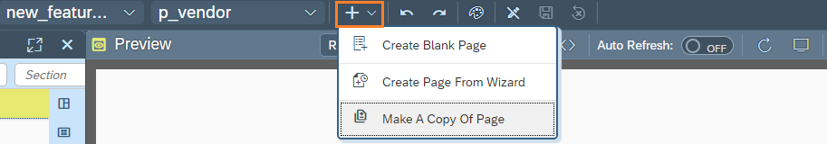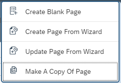
</th>
</tr>
<tr class="odd">
<th>
<strong>Step 2 - Fill the popup to create a new page</strong>

In the popup, provide the ID and name/title for the new page. After providing the details, click on the <strong>Submit</strong> button.

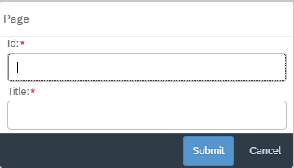
</th>
</tr>
</thead>
<tbody>
</tbody>
</table>

**Note:** Newly created pages will be updated in the database only after saving. To save click on the save icon at the top toolbar (right side of the edit action button).

<table>
<colgroup>
<col style="width: 29%" />
<col style="width: 70%" />
</colgroup>
<thead>
<tr class="header">
<th><strong>Properties</strong></th>
<th><strong>Usage</strong></th>
</tr>
<tr class="odd">
<th>Description</th>
<th>Description for the page.</th>
</tr>
<tr class="header">
<th>leadentity</th>
<th><strong>Coming Soon</strong></th>
</tr>
<tr class="odd">
<th>docid</th>
<th>The ID/text will be displayed along with the title (bindable).</th>
</tr>
<tr class="header">
<th>icon</th>
<th>If value is provided, the icon will be displayed in front of the title.</th>
</tr>
<tr class="odd">
<th>navbyquery</th>
<th>
In case user is navigating from a different page to the current page with passing the QP (Query Parameters) in navTo, then this field is mandatory to filter the data based on the query properties passed

Example:

<strong>{“sourcePath”: “search”}</strong>
</th>
</tr>
<tr class="header">
<th>navbykey</th>
<th>
In case user is navigating from a different page to the current page with passing the D (entity unique key) in navTo, then this field is mandatory to set that particular entity’s index as active.

Example:

<strong>{“sourcePath”: “list”}</strong>
</th>
</tr>
<tr class="odd">
<th>Pip enabled</th>
<th>If marked as true, picture-in-picture(PIP) mode will be enabled for the page.</th>
</tr>
<tr class="header">
<th>screencontainerdefault</th>
<th>Default page Layout ID for the page can be provided here.</th>
</tr>
<tr class="odd">
<th>screencontainerdesktop</th>
<th>The page layout ID for the desktop can be provided here.</th>
</tr>
<tr class="header">
<th>screencontainermobile</th>
<th>Page Layout ID for mobile can be provided here.</th>
</tr>
<tr class="odd">
<th>screencontainertab</th>
<th>Page Layout ID for the tab can be provided here</th>
</tr>
<tr class="header">
<th>screenid</th>
<th>Not an editable field, displays the page ID.</th>
</tr>
<tr class="odd">
<th>title</th>
<th>The page name will be filled here, it will be the title for the page.</th>
</tr>
</thead>
<tbody>
</tbody>
</table>

#### Create Page from Wizard:

<table>
<colgroup>
<col style="width: 100%" />
</colgroup>
<thead>
<tr class="header">
<th>
<strong>Step 1 - Select App and click on the Edit button</strong>

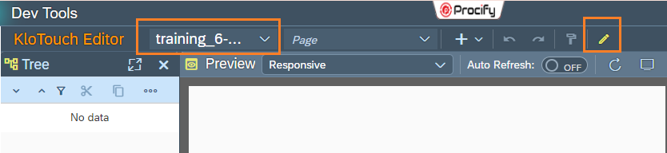

<strong>Step 2 - Page selection</strong>

Click on the add icon dropdown and select <strong>“Create a page from wizard”</strong>.

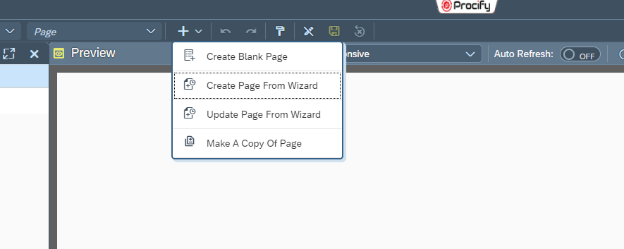
</th>
</tr>
<tr class="odd">
<th>
<strong>Step 2 - Provide page information</strong>

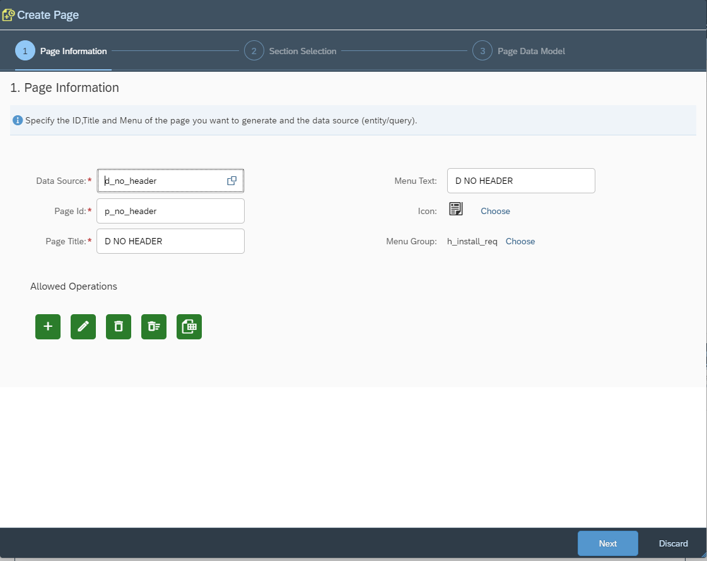

<ul>
<li><blockquote>

Once the wizard popup is displayed, provide the screen information.

</blockquote></li>
<li><blockquote>

Select the Data Source and check whether Page ID, Page Title, Menu Text, Icon, or Menu Group is pre filled or not. Page Id, Page Title &amp; Manu Text should be prefilled and will be Entity`s description or entity`s ID.

</blockquote></li>
<li><blockquote>

Select the Data source (entity or query) by clicking on the vh icon, and give page ID and Page title and Menu Information.

</blockquote></li>
<li><blockquote>

By default, the entity id will be Page Title.

</blockquote></li>
<li><blockquote>

Page Id should be unique in the particular app, if we are creating more than one pages with the same entity, the Page Id will be auto incremented by 01 as a suffix.

</blockquote></li>
<li><blockquote>

Menu Group will come from the app header.

</blockquote></li>
<li><blockquote>

We can provide a menu text and can select a group and icon to be displayed there from the <strong>Choose</strong> button . It will update the page to the selected menu group.

</blockquote></li>
<li><blockquote>

Menu Icon will come from Entity’s icon or default icon will come.

</blockquote></li>
<li><blockquote>

Also we can allow operations by clicking on the icons provided:

</blockquote></li>
</ul>

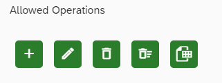

This shows the options to perform CRUD in the main entity.

These icons are for <strong>Add, Edit, Delete, Multi Delete, Download Excel</strong> operations respectively.

By default all these icons are selected. We can deselect them by simply clicking on the icons.

Click on <strong>Next</strong>.
</th>
</tr>
<tr class="header">
<th>
<strong>Step 3 - Select the required section, relation, type, template, position and actions.</strong>

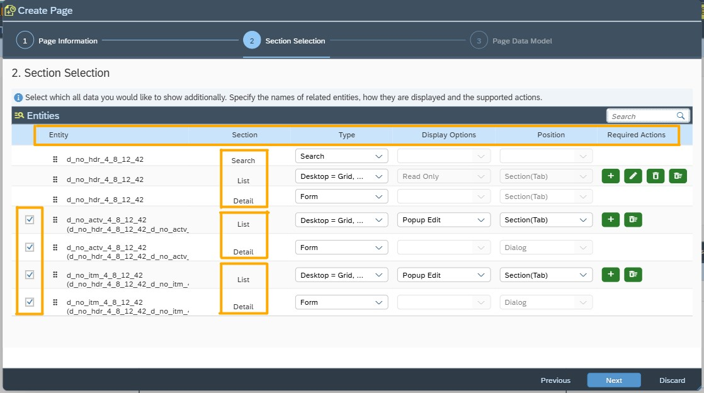

The screen is displaying different requirements to select for all section types of each relation.

<ul>
<li><blockquote>

<strong>Relation:</strong> It shows the return entity name along with the relationId of the entity.

</blockquote></li>
<li><blockquote>

<strong>Section:</strong> It shows the type of section of the corresponding relations.

</blockquote></li>
<li><blockquote>

<strong>Type:</strong> It shows the screentype of the section that will be created using the relationid.

</blockquote></li>
<li><blockquote>

<strong>Display options:</strong> It shows the different templates of the screentype. It depends on the Type selected for the section.

</blockquote></li>
<li><blockquote>

<strong>Position:</strong> It shows the position of the sections in the application. Eg: If a relation has the Position as dialog, then it will appear as a dialog whenever navigation happens to the section.

</blockquote></li>
<li><blockquote>

<strong>Required Actions:</strong> It shows the option to perform CRUD in the corresponding section created from the relation.

</blockquote></li>
</ul>
<ul>
<li><blockquote>

We can select the <strong>relation</strong> required from the checkboxes displayed on the left most of the screen.

</blockquote></li>
</ul>
<blockquote>

<strong>NOTE</strong>: A 1:1 relation can be added <strong>only as a Detail section</strong> and is supported with <strong>Form</strong> and <strong>Card</strong> screen types. The section can be placed as a <strong>Section or Subsection</strong> on the page.Template Id is supported as <strong>Read Only</strong> and <strong>Inline Editable</strong>

</blockquote>
<ul>
<li><blockquote>

Section <strong>type</strong> can be selected from the drop down for different sections (search, list and detail).

</blockquote></li>
</ul>
<blockquote>

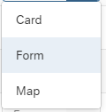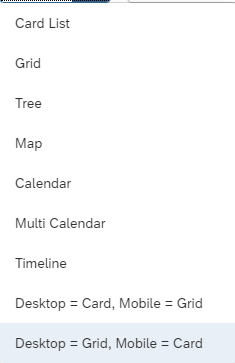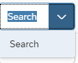

</blockquote>
<ul>
<li><blockquote>

For List type of section, we can edit the <strong>template</strong> from the dropdown (Read Only, Inline Edit or Popup Edit)

</blockquote></li>
<li><blockquote>

We can specify the <strong>position</strong> for sections as section(tab) or subscreen or dialog.

</blockquote></li>
<li><blockquote>

Actions can be provided to each section type by selecting the icons from <strong>required actions</strong>.(These are selected by default).

</blockquote></li>
</ul>
<ul>
<li><blockquote>

The relations have a DND (Drag-and-drop) feature, if we are changing the sequence then the sections will also be generated accordingly.

</blockquote></li>
<li><blockquote>

Template tab will not be there for wizard dialog.

</blockquote></li>
<li><blockquote>

The detail screen for all child entities will be opened in a popup.

</blockquote></li>
</ul>
<h5 id="template-types">Template types:</h5>

<strong>Read Only</strong>

<ul>
<li><blockquote>

It is non-editable.

</blockquote></li>
<li><blockquote>

We will get an edit button for the detail tab only, not for relation list tabs.

</blockquote></li>
</ul>
<blockquote>

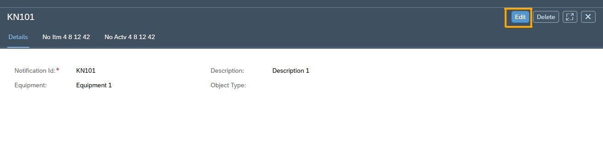

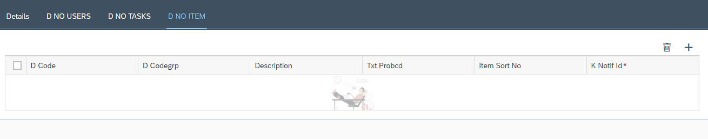

</blockquote>

<strong>Inline Edit</strong>

<ul>
<li><blockquote>

We will get the Edit button for the selected tab in the relation list.

</blockquote></li>
</ul>
<blockquote>

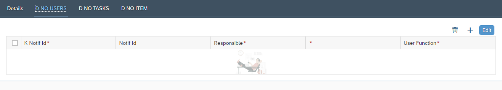

</blockquote>

<strong>Popup Edit</strong>

<ul>
<li><blockquote>

We will get an edit button in each row of data.

</blockquote></li>
</ul>
<blockquote>

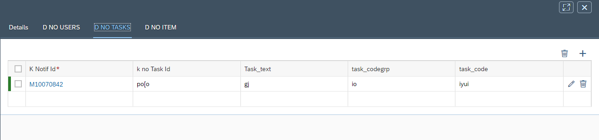

</blockquote>

Click on <strong>Next</strong> at the bottom of the screen.
</th>
</tr>
<tr class="odd">
<th>
<strong>Step 4 -</strong> <strong>Specify the availability of fields on screen</strong>

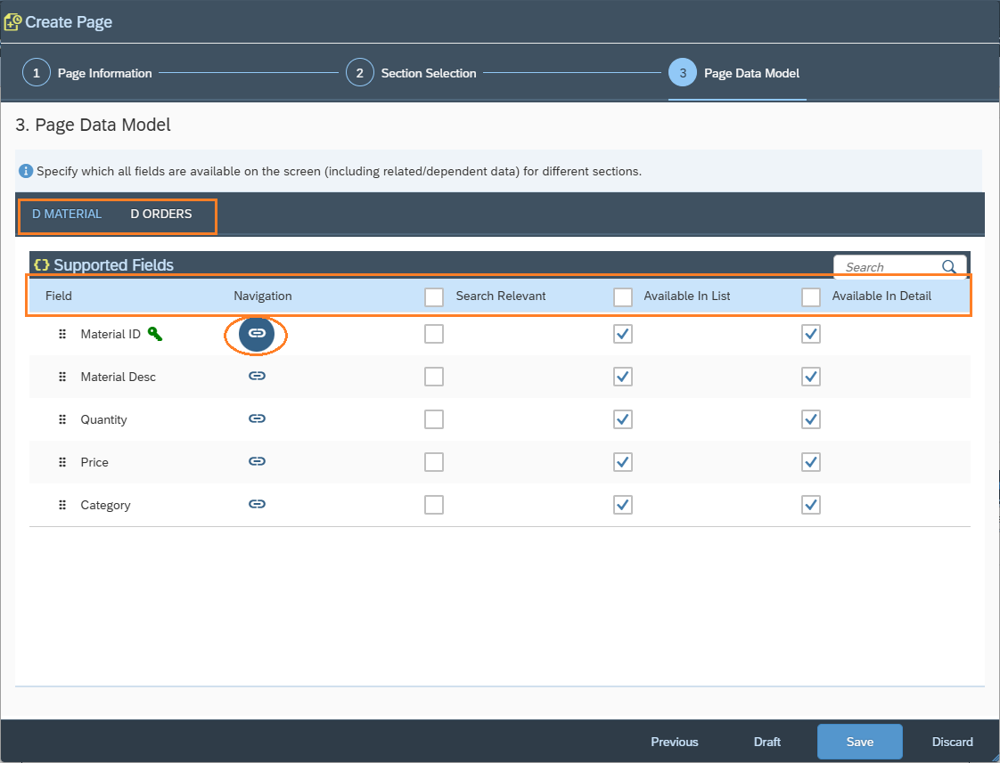

<ul>
<li><blockquote>

On navigating to the screen. all the properties of the lead entity &amp; the selected relations will appear. All the properties will be selected for the detail section(if Detail is selected) &amp; first 5 properties excluding the primary keys will be selected for the list(if List is selected).

</blockquote></li>
<li><blockquote>

Select the required properties for the transnodes. Here, availability of fields can be specified on screen by clicking on the respective checkboxes for different sections (<strong>Search</strong>, <strong>List</strong> and <strong>Detail</strong>).

</blockquote></li>
<li><blockquote>

On selecting the <strong>navigation</strong> icon, it will create a link for the property or field in the list to navigate to the detail section. (Only one can be selected.)

</blockquote></li>
<li><blockquote>

DND (Drag and Drop) features are available for the fields. The sequence will be arranged accordingly on the screen.

</blockquote></li>
<li><blockquote>

If we are selecting any property in the search, it will be automatically selected in list and detail.

</blockquote></li>
<li><blockquote>

If we are selecting any property in the list, it will be automatically selected in detail.

</blockquote></li>
<li><blockquote>

At least one primary key must be selected. (Selected by default)

</blockquote></li>
<li><blockquote>

Primary key selection is not mandatory in the search section.

</blockquote></li>
</ul>

<strong>NOTE</strong>: In the image, we have selected properties for <strong>d_no_header.</strong> In the same way you can select related entities (<strong>d_no_users,</strong> <strong>d_no_tasks, d_no_item</strong>) properties. To select properties for related entities, click on that entity and select its properties.

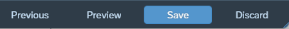

<ul>
<li><blockquote>

The buttons are to go back to the previous screen, save as draft, save, and for discarding the page created respectively.

</blockquote></li>
<li><blockquote>

On click of the <strong>save</strong> button, the page will be created and saved.

</blockquote></li>
</ul>
<blockquote>

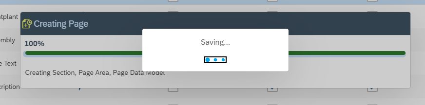

</blockquote>
<ul>
<li><blockquote>

On click of the <strong>Preview</strong> button, the page will be created but will not be saved.

</blockquote></li>
<li><blockquote>

On Click of the <strong>Discard</strong> button the page will not be created and dialog will be closed

</blockquote></li>
</ul>
<blockquote>

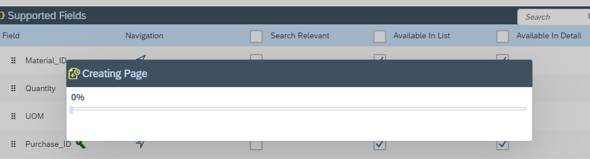

</blockquote>

Now after specifying all required fields, click on <strong>Save</strong> button. This will create and save a new page.
</th>
</tr>
<tr class="header">
<th><mark><strong>Note:</strong> For list nodes, at least one primary key needs to be selected.</mark></th>
</tr>
<tr class="odd">
<th></th>
</tr>
<tr class="header">
<th>
<strong>After clicking on save, the page created from wizard will look similar to the image below.</strong>

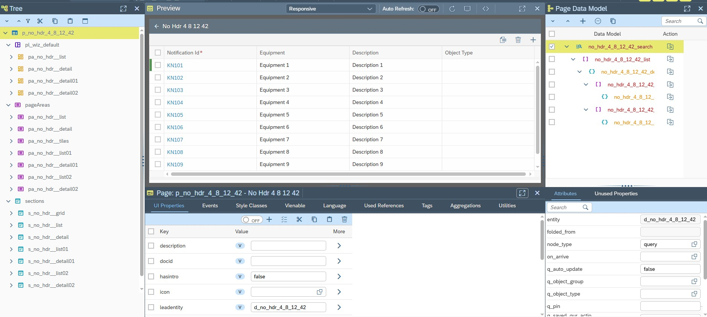

<strong>NOTE</strong>: Now we can do necessary changes from the Editor or can update the page from wizard also. The relation section name is taken from relation id ,hence the relation sections are created with similar name incremented by 01 as suffix

Refer to this <a href="https://docs.google.com/document/d/1Uj0M0WQenfsxFwpkVlFEjrwTofbn4OY4I_x_9YuFF6U/edit?usp=sharing"><u>document</u></a> for the tree hierarchy

In <strong>desktop</strong> view, the list screen will look like this as shown below:

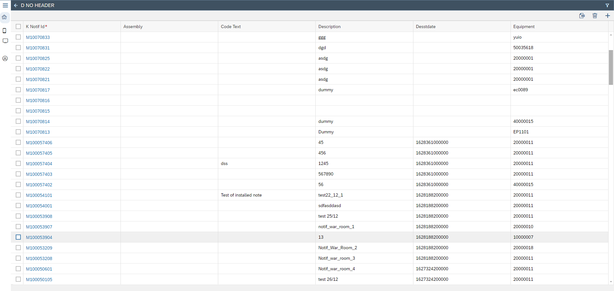

<strong>After navigating to detail:</strong>

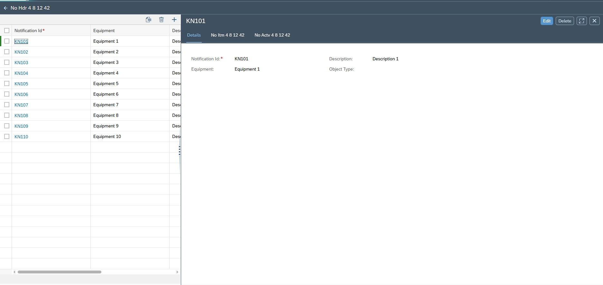

Screens will be created for <strong>mobile</strong> view also. It's PageArea screentype will be <strong>Tiles</strong> and section screenType will be <strong>card</strong> in mobile view:

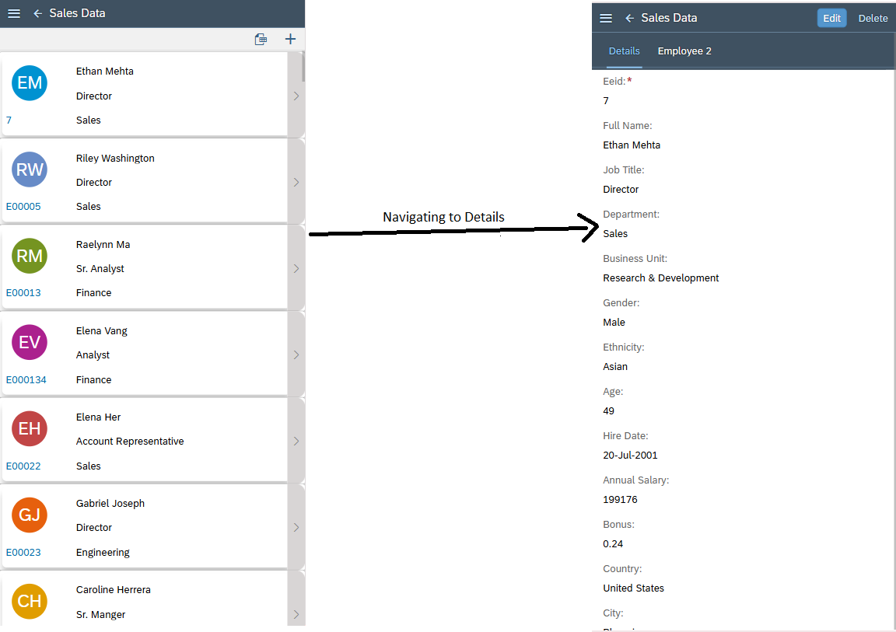

<h5 id="button-configurations-in-screen">Button Configurations in screen:</h5>
<ul>
<li><blockquote>

Buttons will be added separately for separate tabs and it will be based on the display options.

</blockquote></li>
</ul>
<blockquote>

</blockquote>
<ul>
<li><blockquote>

Buttons will appear at the top right corner.

</blockquote></li>
<li><blockquote>

Save and Cancel buttons will be visible only in edit mode.

</blockquote></li>
<li><blockquote>

If we want to switch between tabs without saving, it will show a popup.

</blockquote></li>
</ul>
<blockquote>

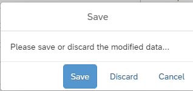

</blockquote>
<ul>
<li><blockquote>

Either edit or save button will be shown always.

</blockquote></li>
<li><blockquote>

Scroll will start after the edit and save buttons.

</blockquote></li>
<li><blockquote>

On selecting the multi delete button while page creation, it will allow you to select multiple items and delete at a time in the grid.

</blockquote></li>
</ul>
<blockquote>

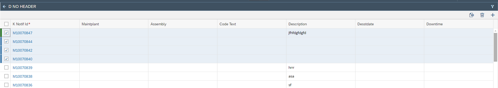

</blockquote>
<ul>
<li><blockquote>

If the multi select delete button is not selected, then the delete button will not be visible on the list type of section.

</blockquote></li>
</ul>
<h5 id="grid-behaviour-in-the-relation-transnode">Grid behaviour in the Relation Transnode</h5>
<ol type="1">
<li><blockquote>

On click of the link in the relation list, it opens up the Popup in the same mode as that of the screen mode.

</blockquote></li>
</ol>

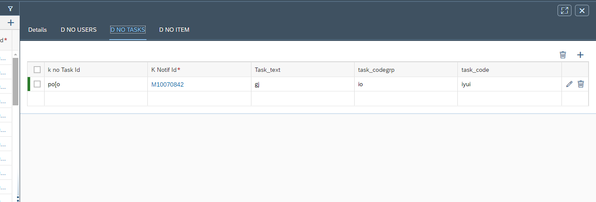

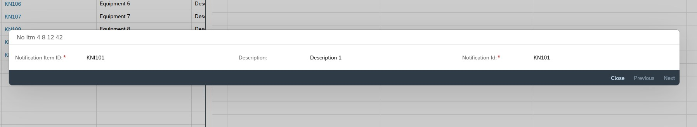

<ol start="2" type="1">
<li><ol type="a">
<li><blockquote>

On click of the <strong>PopupEdit</strong> button of the grid of type <strong>Popup Edit</strong> grid, opens up the popup in the edit mode if the current screen mode is not in either <strong>create</strong> mode or <strong>edit</strong> mode.The next and previous buttons can be used to see the next and previous items details.

</blockquote></li>
<li><blockquote>

With the click of the OK button, data modified will be saved and the popup will be closed.

</blockquote></li>
<li><blockquote>

On click of the Cancel button, the refreshTransnode api will be called which will call <strong>refreshP BOL API</strong> on the transnode data. (i.e., Changes will be reverted ) and the popup will be closed.

</blockquote></li>
</ol></li>
</ol>

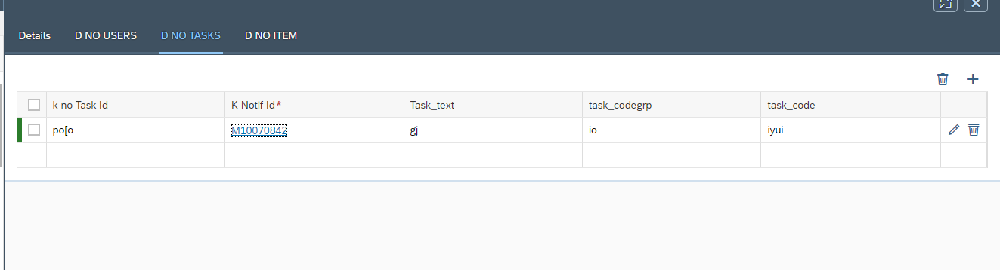

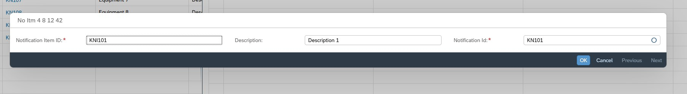

<ol start="3" type="1">
<li><ol type="a">
<li><blockquote>

On click of the Add button in the toolbar, the popup opens in the Create mode.

</blockquote></li>
<li><blockquote>

With a click of the OK button, data will not be saved, as the previous mode is in create mode.

</blockquote></li>
<li><blockquote>

On click of the Cancel button, the refrestTransnode api is called the refreshP BOL API on the transnode data and the popup will be closed.

</blockquote></li>
</ol></li>
</ol>

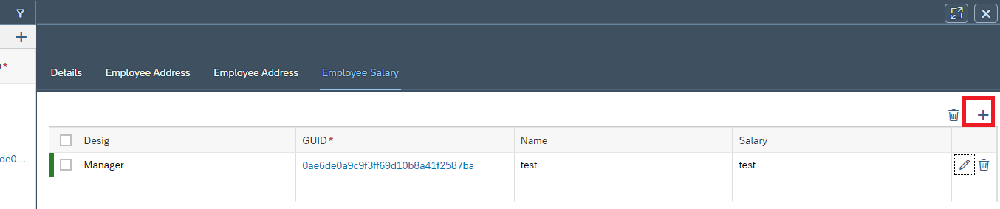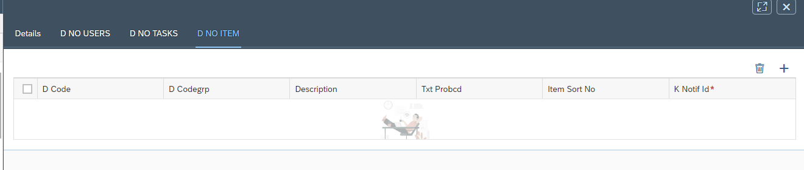

<h5 id="change-in-page-data-model-structure"><strong>Change in Page Data model Structure</strong></h5>
<ol type="1">
<li><blockquote>

Now in the <strong>Page Data Model</strong>, there is no option to move entity properties from unused to used and transnodes will come in the hierarchy of the respective folded path.

</blockquote></li>
</ol>
<blockquote>

<strong>Note:</strong> If a parent transnode is getting deleted, then its respective child will be deleted as well.

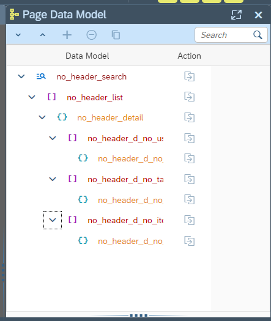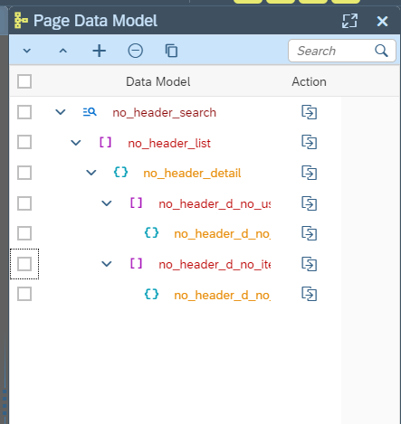

</blockquote>
<h5 id="tags-1">Tags</h5>

During wizard page creation, a default tag will be created to navigate to the detail page, this default tag can be used for deep link navigation.

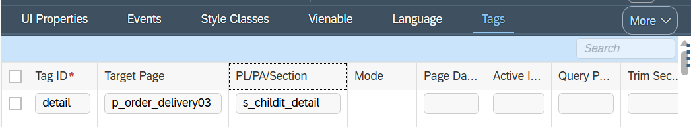

<h4 id="update-page-from-wizard">Update Page from Wizard: </h4>

Developers can modify the screen created from Wizard using the <strong>Update Page From Wizard</strong> option.

All the elements selected during the creation of the screen will be auto-selected in the <strong>Update Page From Wizard</strong>. Example: Sequencing, adding, delete of properties/sections/layouts can be done using <strong>Update Page From Wizard</strong>.

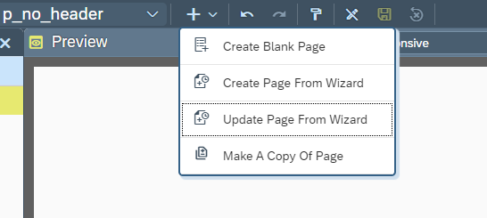

It will reopen the wizard popup with all provided screen information.

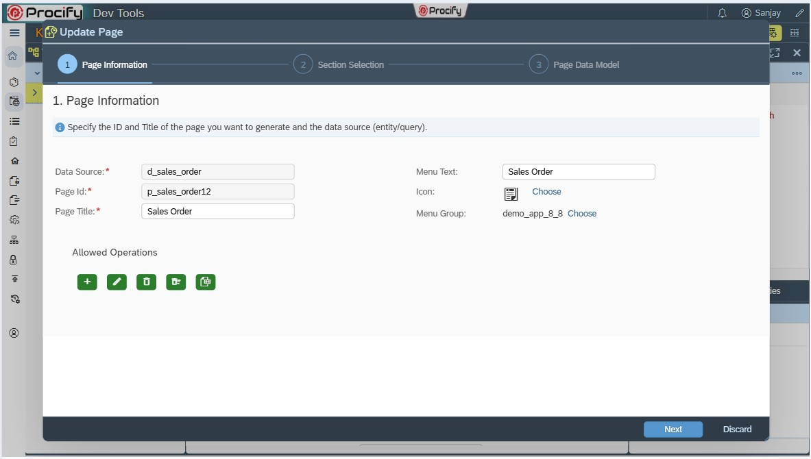

<h5 id="cardinality-update-when-screen-is-created-from-wizard">Cardinality update when screen is created from wizard</h5>
<ul>
<li><blockquote>

If we are creating a page from wizard and it has relations with any particular cardinality. After page creation, if we are changing its cardinality from Data Studio,it will not be reflected on the UI automatically.

</blockquote></li>
</ul>
<blockquote>

We have to delete the transnodes manually and have to create them again.

</blockquote>

For Example: If the user is creating a wizard with 1:n relation and after creation, the cardinality of the relation will be changed to 1::1 from the Data Studio and tries to update the page from wizard, before that the user have to delete the transnodes manually and have to recreate it again.
</th>
</tr>
</thead>
<tbody>
</tbody>
</table>

##### Deletion of a section or control

If we are deleting a section from Page Builder, it will be updated on wizard also:

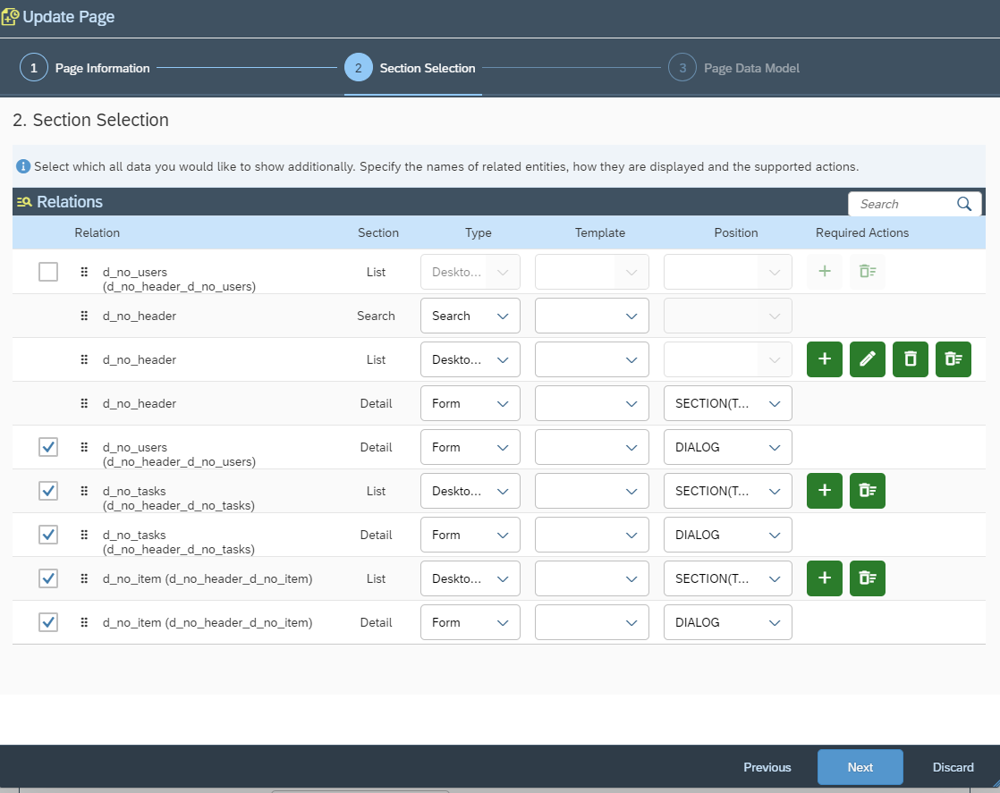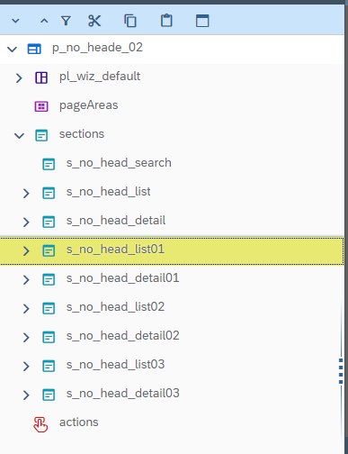

- In the same way it will work for other sections.

- If we delete any property from the Page Builder, it will be deselected from the wizard popup also.

- Anything we are changing from Page Builder, it will be reflected in the wizard popup.

- In the screen we are deleting data from the parent entity, then it will delete all the entries from the child entity also.

#### Make a copy of the page:

**Step 1:** Click on **‘Make a Copy of Page’**

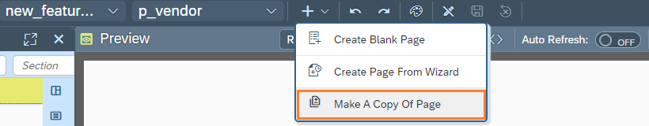

**Step 2:** After clicking on **‘Make a copy of page’** the below screen appears with all the details filled already. If you want then you can modify the detail as well.

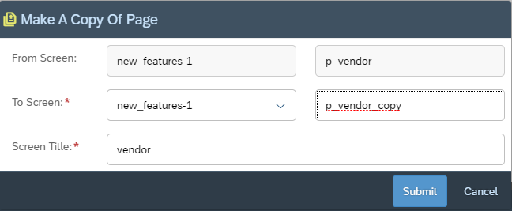

**Step 3:** Click on the submit button and the current page will be copied to the provided app.

**Note:** The above example was making a copy of a particular page in the same app.

What if we are copying a page in a different app and that app doesn’t have the associated entity?

If we are doing so then the Page Builder sends an alert message (“Entities/Queries are not found in the app. Do you still want to continue?”)

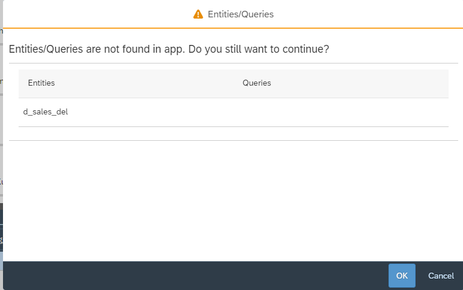

**Note:** If we click on **OK** then the particular screen will get copied in the target app without a pagedata model. And if the target app contains the associated entity then the screen will render with all data.

## 3.2. Context Menu

Right-click by selecting the page:

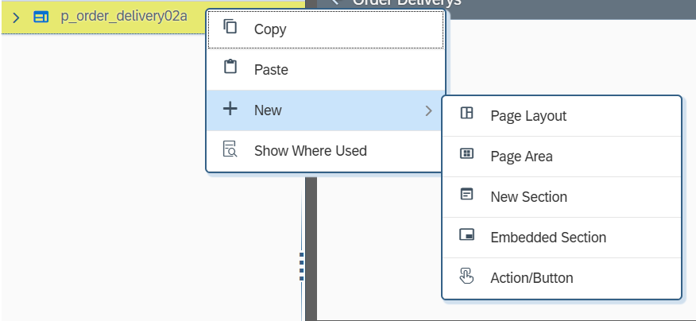

<table>
<colgroup>
<col style="width: 23%" />
<col style="width: 76%" />
</colgroup>
<thead>
<tr class="header">
<th><strong>Menu Items</strong></th>
<th><strong>Description</strong></th>
</tr>
<tr class="odd">
<th>Copy</th>
<th>On click, it will copy the Page.</th>
</tr>
<tr class="header">
<th>Paste</th>
<th>On click, it will paste the copied item to the page.</th>
</tr>
<tr class="odd">
<th>New</th>
<th>
<strong>PageLayout:</strong> On click, it will add a pageLayout to the page.

<strong>PageArea:</strong> On click, it will add a pageArea to the page.

<strong>New Section:</strong> On click, it will add a section to the page.

<strong>Embedded Section:</strong> On click, it will add an embedded section to the page.

<strong>Action:</strong> On click, it will add an action button to the page.
</th>
</tr>
<tr class="header">
<th>Show where used</th>
<th>On click, it will show the whereused list of the page</th>
</tr>
</thead>
<tbody>
</tbody>
</table>

#### Copy page

Copying a page is done when the user wants the same page with a different page id or doesn't want to make changes to the original screen.

Refer to this document to know how to use it [<u>Copy</u>](https://docs.google.com/document/d/1A33WmKgRPrkp9SRgiqhndGGll8r_O-6Q/edit#heading=h.gjdgxs) page
