# Page Area

The Page area is the next level in the page hierarchy after the Page Layout. Page areas are embedded with the pagelayout. The detail of the page Area that needs to be rendered for the page area will be maintained in the Page Layout’s Layout Data section.

As the page area also has [<u>layouting</u>](#layouting) types, supported layouting types are object page Layout, tab, goto, stack, grid layout, and splitter layout. Layout type will be maintained in the screetype property of the Page Layout.

## 5.1. Page Area Creation

<table>
<colgroup>
<col style="width: 100%" />
</colgroup>
<thead>
<tr class="header">
<th>
<strong>Step 1 - Add Page Area Control to Page</strong>

To add a new page Area, right-click on the page, and a context menu will appear. Go to the option New. You will find <strong>Page Area control</strong>.

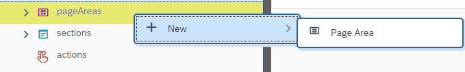

Click on it and a new page area will be added to your page.

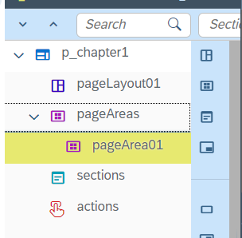

<strong>Note</strong> : We can rename it by a right click on the newly created pageArea and select the option <strong>Rename</strong> (ensure that the new Id given should be unique among other pageArea Ids).

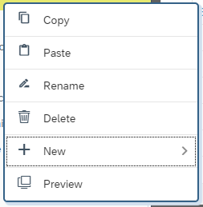
</th>
</tr>
<tr class="odd">
<th></th>
</tr>
<tr class="header">
<th>
<strong>Step 2 - Set the new Page Area</strong>

Right-click on the newly added page layout and a menu context will appear. Go to New and select the option <strong>Assign</strong>.

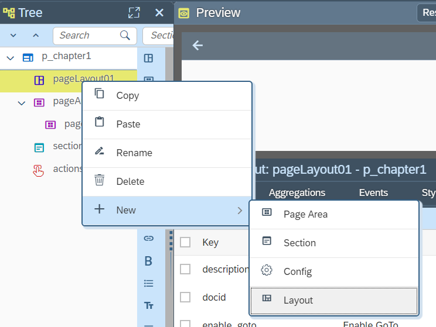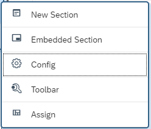
</th>
</tr>
<tr class="odd">
<th>
<strong>Step 3 - Select the Layout Section</strong>

A popup will appear when you click on the ValueHelp.

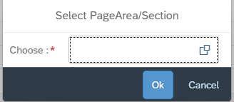
</th>
</tr>
<tr class="header">
<th>
<strong>Step 4 - Add the PageArea to your layout</strong>

Another popup will appear. Select the newly created pageArea from the popup as shown below:

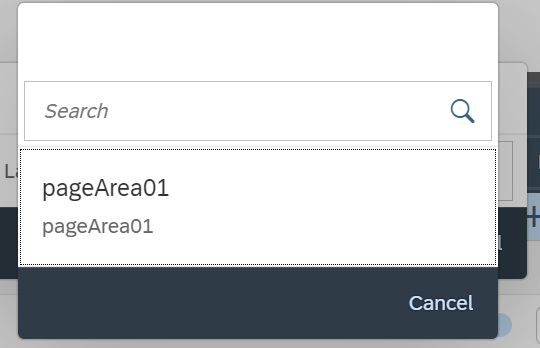

PageArea layout and the newly created page Area will be added to your layout.

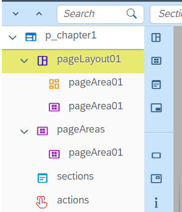

Under Page Area layout properties you can make the necessary changes required.

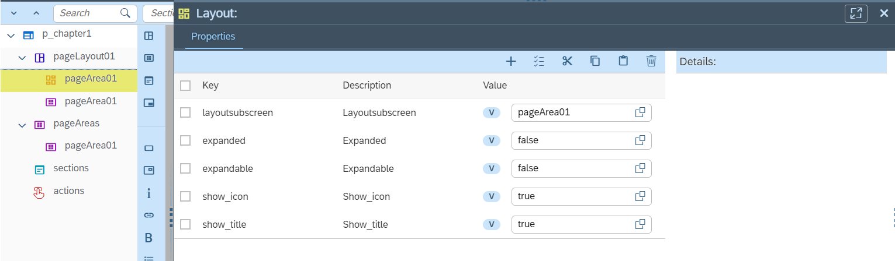
</th>
</tr>
</thead>
<tbody>
</tbody>
</table>

## 5.2. Assign PageArea/Section:

In the page area, we can assign the section/page area that needs to be rendered under the selected page area.

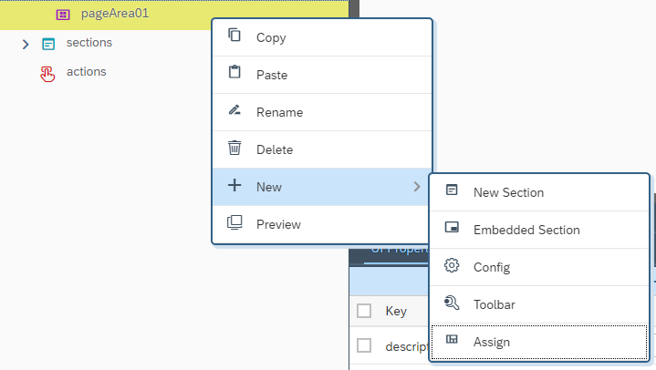

## 5.3. Context Menu:

Right-click by selecting the pageArea to view the context menu.

> 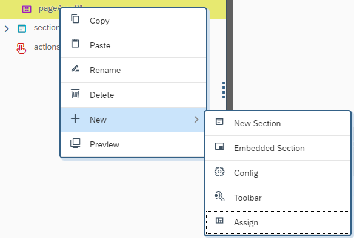

<table>
<colgroup>
<col style="width: 26%" />
<col style="width: 73%" />
</colgroup>
<thead>
<tr class="header">
<th><strong>Menu Items</strong></th>
<th><strong>Description</strong></th>
</tr>
<tr class="odd">
<th>Copy</th>
<th>On click, it will copy the pageArea</th>
</tr>
<tr class="header">
<th>Paste</th>
<th>On click, it will paste the copied item to the pageArea</th>
</tr>
<tr class="odd">
<th>Rename</th>
<th>On click, it will display a popup to rename the pageArea</th>
</tr>
<tr class="header">
<th>Delete</th>
<th>On Click it will delete the pageArea</th>
</tr>
<tr class="odd">
<th>New</th>
<th>
<strong>New Section:</strong> On Click it will create a new section.

<strong>Embedded Section</strong>: On click, it will create a new embedded section.

<strong>Config:</strong> On Click it will add a config for the selected pageArea

<strong>Toolbar:</strong> OnClick it will add a section_toolbar to the pageArea

<strong>Assign:</strong> On click, it will open a popup to assign a new section to it.
</th>
</tr>
<tr class="header">
<th>Preview</th>
<th>On click, it will preview the particular pageArea.</th>
</tr>
</thead>
<tbody>
</tbody>
</table>

**Note**: If we are adding config properties, the values of the properties should not be empty.
