# Sections

Sections are the building blocks of the pages. The page can have multiple sections, and the sections are embedded in a page Area. The detail of which section should be rendered for a page Area will be maintained in the page Area’s Layout data section.

## 6.1. Section Creation:

<table>
<colgroup>
<col style="width: 100%" />
</colgroup>
<thead>
<tr class="header">
<th>
<strong>Step 1 - Add a Page Section to the page</strong>

To add a new section, right-click on the page area, and a context menu will appear. Go to the option New. You will find <strong>Section control</strong>.

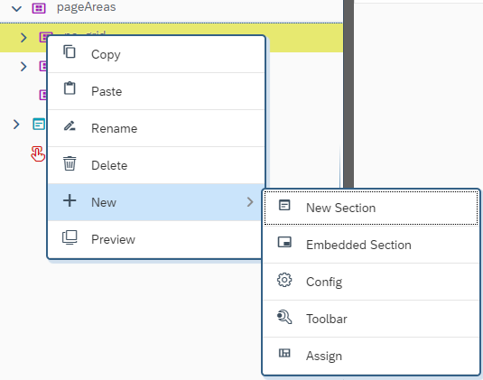
</th>
</tr>
<tr class="odd">
<th>
A section will be added to the page under the sections.

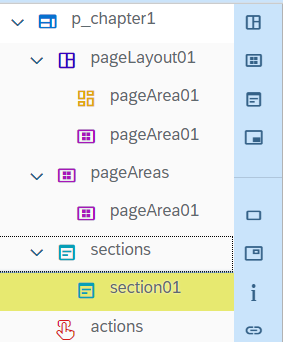

<strong>Note:</strong>We can rename it but make sure the new name should be unique

among other section Ids.

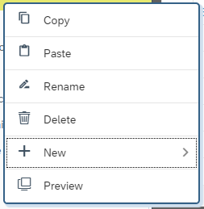
</th>
</tr>
<tr class="header">
<th>
<strong>Step 2 - Add a Section to the Page Area or to the Layout</strong>

After creating a section, add the section to the pageArea. Select the pageArea, then right-click, you will get a menu context, click on <strong>New,</strong> and then on <strong>Assign.</strong>

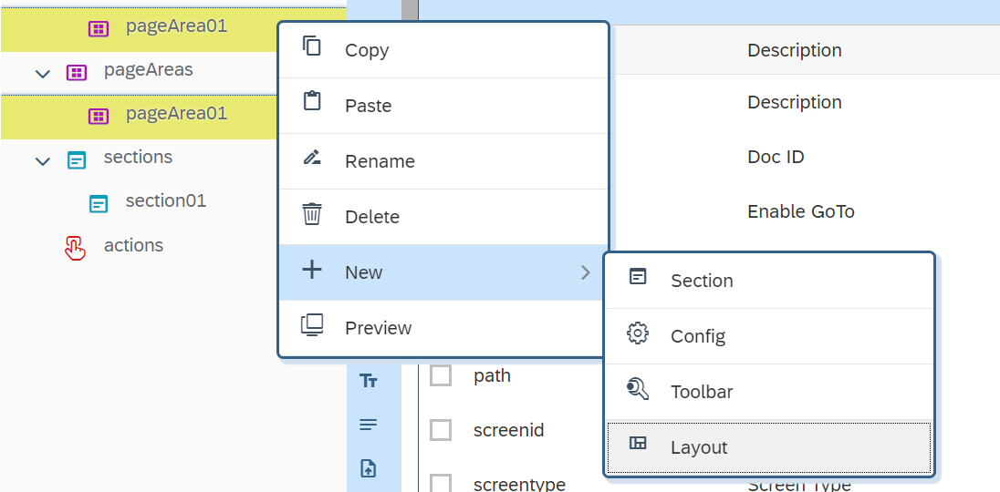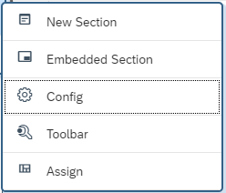
</th>
</tr>
<tr class="odd">
<th>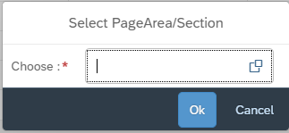</th>
</tr>
<tr class="header">
<th>
A popup will appear. Select our newly created section from the popup as shown:

Section layout will be added to your page area.
</th>
</tr>
</thead>
<tbody>
</tbody>
</table>

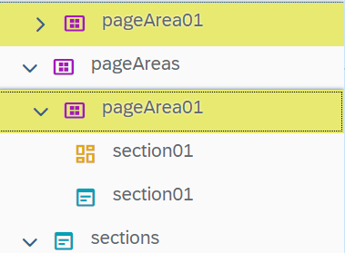

**Step 2:** A successful drag-and-drop section will be added to the page under the sections.

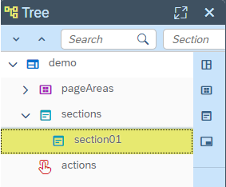

> **Note**: It will show a warning message on saving a section without a path.

## 6.2. Screentype

#### CardList

Screentype cardlist is generally a **sap.m.Table** with one column.

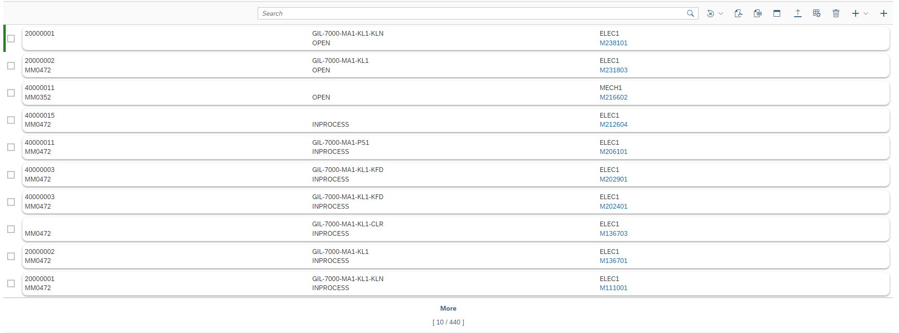

##### CardList Config

Config properties are used to set the behaviour of the cardList. Refer to this [<u>link</u>](https://sdk.openui5.org/1.102.7/#/api/sap.m.Table%23controlProperties) to learn more about cardlist config properties.

**<u>Adding config to a cardList section</u>**

**Step 1:** Right-click by selecting the cardlist section.

> 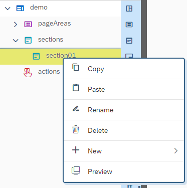

**Step 2:** Click New and select and click on Config.

> 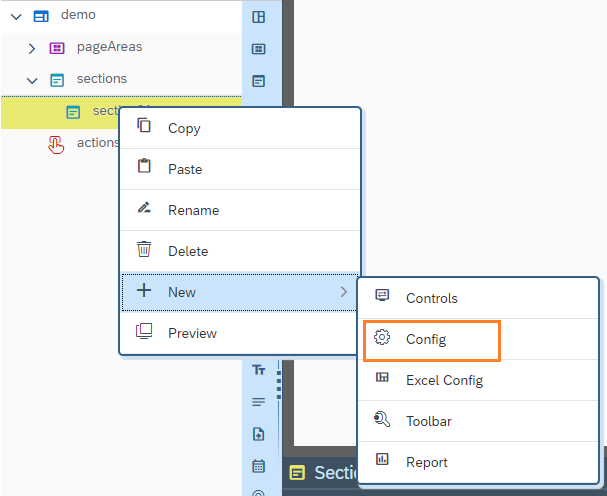

**Step 3:** CardList config will be added for the section.

> 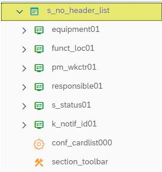

**Note**: If we are adding config properties, the value of the properties should not be empty.

#### Card:

A screen-type card is a single CSS grid that can hold a single entity.

**Note:**On adding checkbox type of control for card or cardlist screen type, dsrc property should not be maintained, otherwise it will show labels along with the checkbox.To bind with a data source, we can use the ‘selected’ property.

#### Map:

A screen-type map is used to display the locations on the map screen. For how to use it you can refer to this [<u>document</u>](https://docs.google.com/document/u/0/d/1IUy3WBQ5zoaCCJsu8a-WQ6A_HAxer2tUROu6nspY_ac/edit).

**Note:** for loading the map in full h[<u>kloControls 7.0</u>](https://docs.google.com/document/u/0/d/1IUy3WBQ5zoaCCJsu8a-WQ6A_HAxer2tUROu6nspY_ac/edit)eight, place the section inside the page area of type ‘fit to Area’, and also add the layout property ‘autoHeight’ as true.

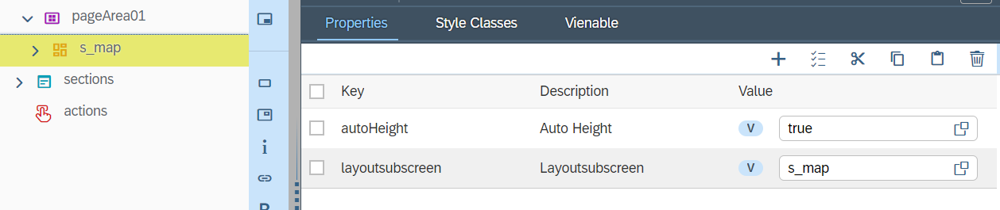

**<u>Adding config to a Map section:</u>**

Refer to the same steps as mentioned in the Cardlist or grid.

#### **Calendar<u>:</u>**

A calendar is a set of working and non-working days specified for a particular time interval. This includes holidays and special periods underlying the organisation’s calendar. For how to use it you can refer to this [<u>document</u>](https://docs.google.com/document/u/0/d/1IUy3WBQ5zoaCCJsu8a-WQ6A_HAxer2tUROu6nspY_ac/edit).

**<u>Adding config to Calendar section:</u>**

Refer to the same steps as mentioned in the Cardlist or grid.

#### Multi Calendar:

Displays rows with appointments for different entities (such as persons or teams) for the selected time interval. For how to use it you can refer to this [<u>document</u>](https://docs.google.com/document/u/0/d/1IUy3WBQ5zoaCCJsu8a-WQ6A_HAxer2tUROu6nspY_ac/edit).

**<u>Adding config to Multi Calendar section:</u>**

Refer to the same steps as mentioned in the Cardlist or grid.

#### Form

Screen Type form is generally a simple ui5 form.

**Note:** If you want to customise/configure form then with the following way we can do that:

**Step 1:** Add config to the form type section: click on the form type subscreen click on ‘**New**’ and then click on ‘**add config**’

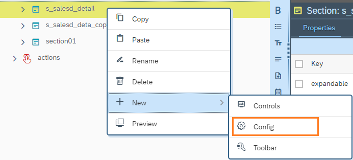**:**

In the Page Builder, the F4 value help for the **columnSpan** property displays options "All" and "None".

- **All**: Displays all available entries without filtering.

- **None**: No filtering criteria applied, showing all possible values.

**Step 2:** Now add the **‘density’** property to the **‘form config’.**

| **NAME**    | **TYPE** | **DEFAULT VALUE** | **DESCRIPTION**                                                                                       |
|-------------|----------|-------------------|-------------------------------------------------------------------------------------------------------|
| **density** | string   | default           | Specifies whether the form needs to be displayed in default or compact mode |

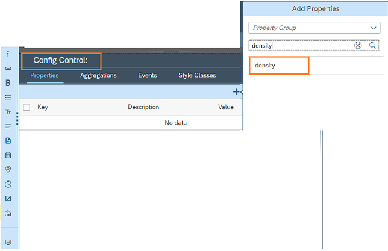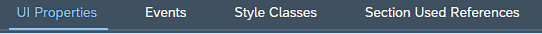

**Step 3:** Now add value to the property. It has two values: **compact** and **default**.

In **compact** mode, the labels take the entire column width and shift above the controls.

In **default** mode, the labels appear beside its control.

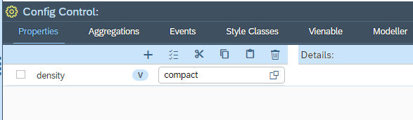

**Form in compact mode:**

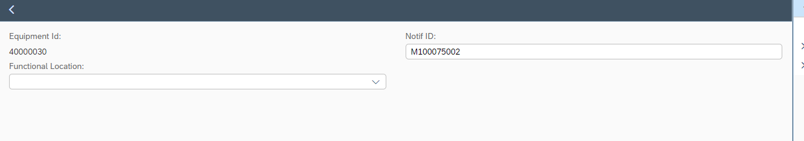

**Form in default mode:**

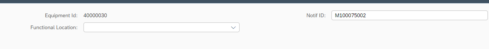

#### Grid

Screen Type grid is generally a **sap. ui.Table**.

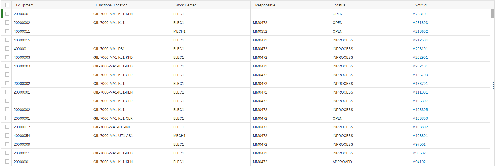

##### Grid Config

Config properties are used to set the behaviour of the grid. Refer to this [<u>link</u>](https://sdk.openui5.org/1.102.7/#/api/sap.ui.table.Table%23controlProperties) to learn more about grid config properties.

**Note**: If we are adding config properties, then the value of the properties should not be empty.

**<u>Adding config to a grid section</u>**

**Step 1:** Right-click by selecting the grid section.

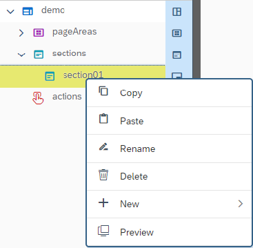

**Step 2:** Click New and select and click on Config.

> 

**Step 3:** Grid config will be added for the section.

> 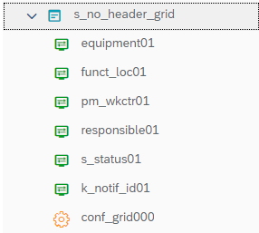

**Note**: If we are adding config properties, then the value of the properties should not be empty.

#### Timeline

A timeline is a screen type of section that is used for showing the timeline of any order/process. A common use case is to provide information about changes to an object, or events related to an object.

##### Timeline Config

Config properties are used to set the behaviour of the timeline. Refer below table to learn more about timeline config properties.

##### Add Config to a Timeline section

**Step 1:** Add config to the Timeline type section: Right-click on the timeline type subscreen then click on ‘**New**’ and then click on ‘**add config**’.

**Step 2:** Timeline config will be added for the section.

> 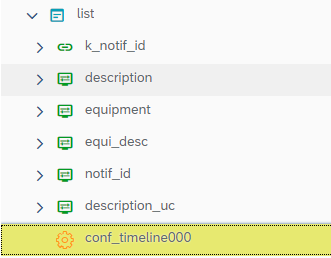config for

**Note**: If we are adding config properties, then the value of the properties should not be empty.

| **NAME**            | **TYPE** | **DEFAULT VALUE**                 | **DESCRIPTION**                                                                                  |
|---------------------|----------|-----------------------------------|--------------------------------------------------------------------------------------------------|
| **displayShape**    | string   | Circle                            | Specifies whether the shape of the timeline will be a circle or shape. |
| **displaySize**     | string   | XS                                | Specifies the size of the timeline.                                    |
| **backgroundColor** | string   | Accent6 | This property specifies the background color of the timeline.          |

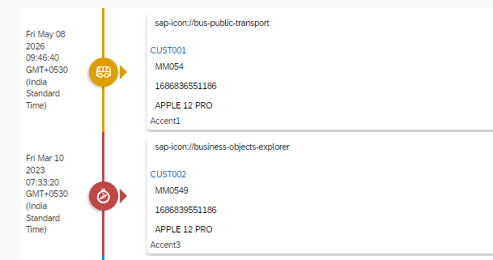

#### Tree

The Tree Screen Type is designed to represent hierarchical data in a structured manner. It allows users to visualize relationships between parent and child nodes, making it ideal for displaying nested information such as organisational charts, file systems, or any other hierarchical datasets.

**<u>Implementation:</u>**

##### Data Preparation:

To prepare the data for a Tree Screen Type, we will use a JSON format that represents the hierarchical structure. Here’s a sample JSON array:

\[{

"key_01": "value_1",

"key_02": "value_2",

"key_03": "value_3",

"child": \[{

"key_01": "value_11",

"key_02": "value_22",

"key_03": "value_33",

"child": \[{

"key_01": "value_111",

"key_02": "value_222",

"key_03": "value_333",

"child": \[{

"key_01": "value_1111",

"key_02": "value_2222",

"key_03": "value_3333",

}\]

}\]

}\]

}\]

**JSON Structure**

- Each object represents a node in the tree.

- The child array holds nested objects, representing the child nodes.

- Key names for child nodes are consistent with parent nodes, ensuring a clear relationship.

We will store the data in other type transnode.

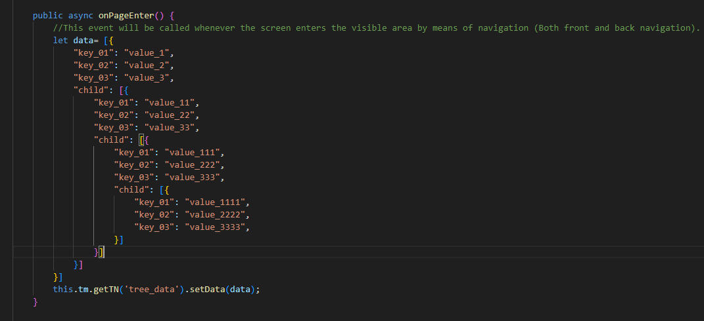

##### Screen:

Step 1:

Create one pageArea with screentype, fit_to_area and a section with screentype, tree.

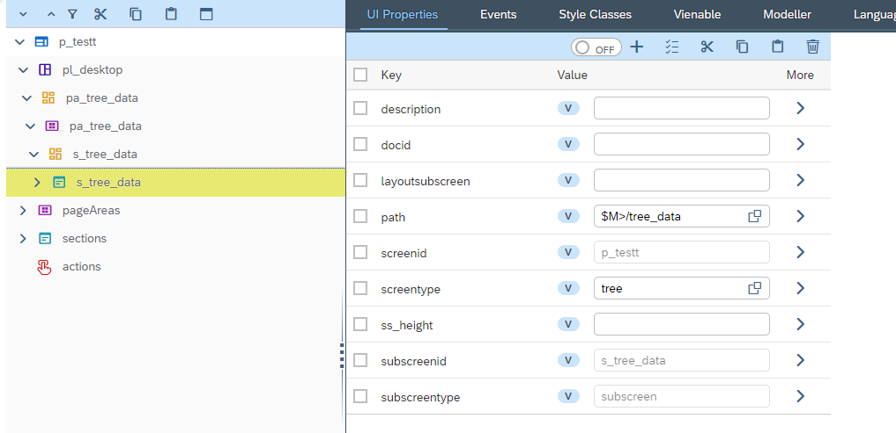

In the section layout, add one property autoHeight as true. This ensures that the section dynamically adjusts its height based on the content displayed.

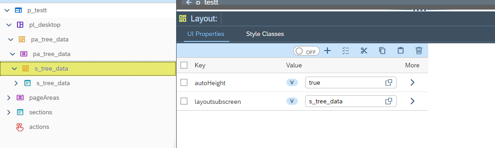

Step 2: Create an other type transnode.

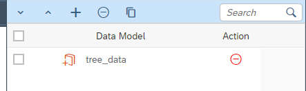

Step 3: Add Controls for Data Binding

- Create controls within the section for each key in your JSON data (key_01, key_02, key_03).

- Bind the section to the other type transnode that contains the hierarchical JSON data.

> 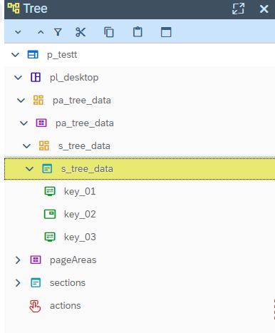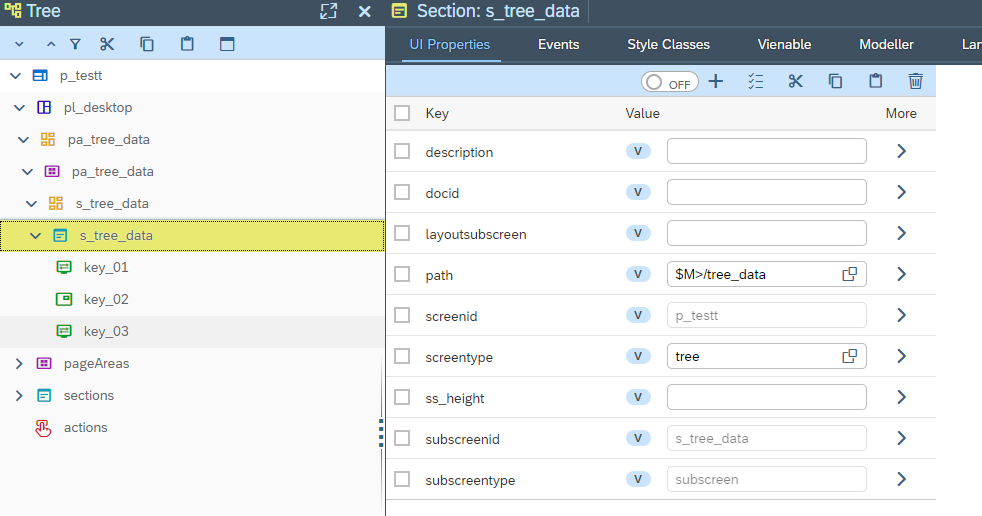

- Ensure that each control is correctly bound to the corresponding key in the JSON structure.

> 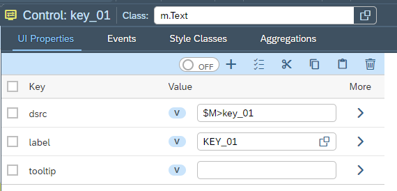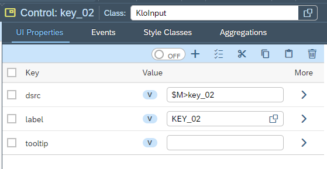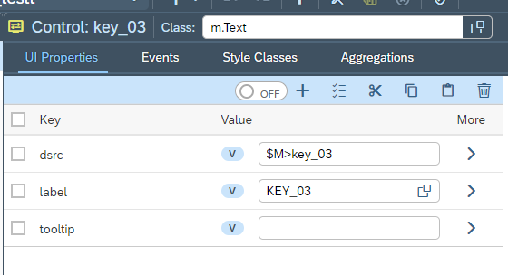

Now after previewing the screen,it will look like :

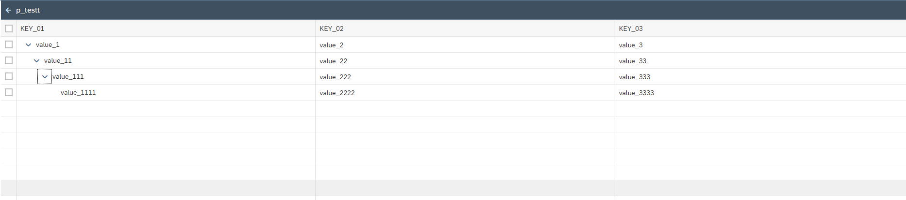

## 6.3. Context Menu:

Right-click by selecting the section.

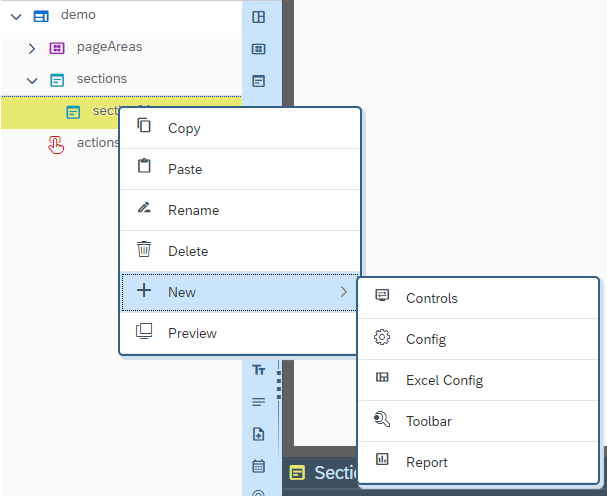

<table>
<colgroup>
<col style="width: 27%" />
<col style="width: 72%" />
</colgroup>
<thead>
<tr class="header">
<th><strong>Menu Items</strong></th>
<th><strong>Description</strong></th>
</tr>
<tr class="odd">
<th>Copy</th>
<th>On click it will copy the section</th>
</tr>
<tr class="header">
<th>Paste</th>
<th>On click it will paste the copied item to the section</th>
</tr>
<tr class="odd">
<th>Rename</th>
<th>On click it will display a popup to rename the section</th>
</tr>
<tr class="header">
<th>Delete</th>
<th>On Click it will delete the section</th>
</tr>
<tr class="odd">
<th>New</th>
<th>
<strong>Controls:</strong> on Click it will display a popup to add a new control

<strong>Config:</strong> on Click it will add a config for the selected section

<strong>Toolbar:</strong> onClick it will add a section_toolbar to the section

<strong>Excel Config:</strong> <a href="https://docs.google.com/document/d/1B-RpsA8P3mVDNlCEFm4aFFdRRper5QKg/edit"><u>KloSectionXlsx5.7</u></a>

<strong>Report:</strong>
</th>
</tr>
<tr class="header">
<th>Preview</th>
<th>On Click, it will preview the selected sections. In the Preview section of Page Builder</th>
</tr>
</thead>
<tbody>
</tbody>
</table>

**Note**: If we are adding config properties, the value of the properties should not be empty.

#### Copy Paste across tab

One can copy elements from a tab and paste them into another tab. Previously, this option was not available. Copy-paste across tabs will work only with different screens (in any app).

Refer to this document to know how to use it [<u>Copy-paste Across Tabs</u>](https://docs.google.com/document/d/1HkitaCZ7YWOGaFare6BIveCQfnWJNoRy/edit)

## 6.4 Section Events:

### 6.4.1 onSectionEnter

This event will be triggered on each navigation to the section where this event is registered. The event handler should be in controller and name of method should be specified in method field of added event in “Events” tab:

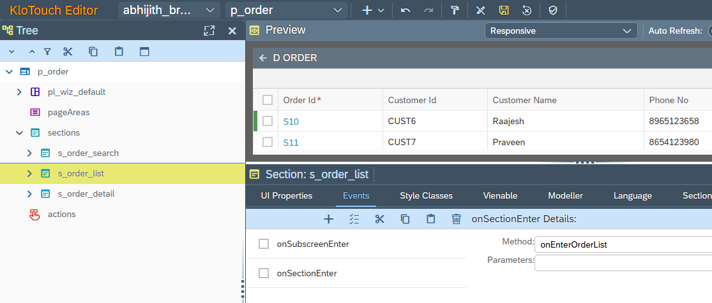

### 6.4.1 onSubscreenEnter

This event will be triggered on first navigation to the section where this event is registered. The event handler should be in controller and name of method should be specified in method field of added event in “Events” tab:

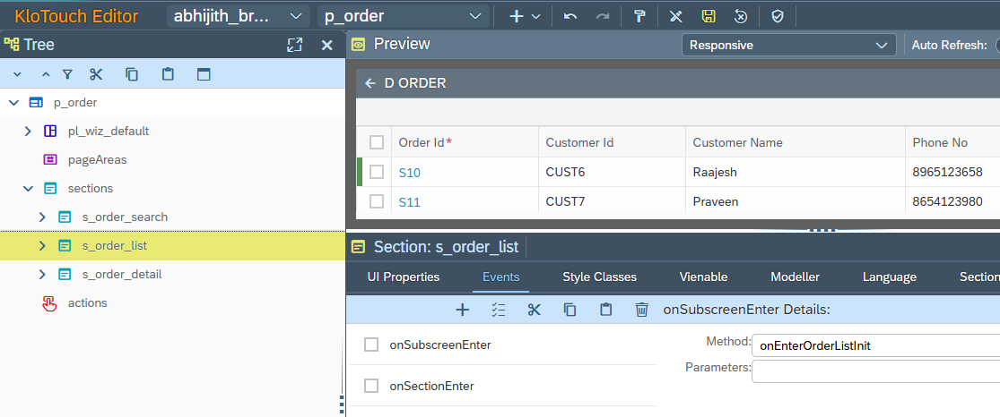
