# How to use Permission Designer

## 12.1. Navigation to Permission Designer

**Step 1:** Select the **Page Builder** menu header.

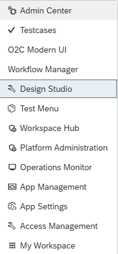

**Step 2:** Select the Permission Designer menu item.

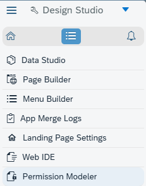

## 12.2. Permissions Master

### 12.2.1 Toolbar Options & List

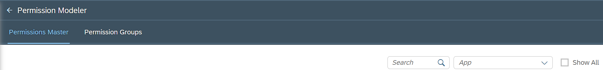

### 12.2.2. Fuzzy Search

Users can search for any particular valid value to filter the list data.

### 12.2.3.App

- Users can use this app combobox to select an app.

- It will list down the app which is assigned as DEVELOPER to the logged in user.

### 12.2.4. Show All & List

- By default, the list will show all the custom permissions.

- On click of showAll, it will show/hide all the crud permissions of the selected application in the list.

- **If showAll is checked**, then two new columns will be visible: **Entity** and **Permission Type**.

> **<u>Show All: Unchecked</u>**  
> 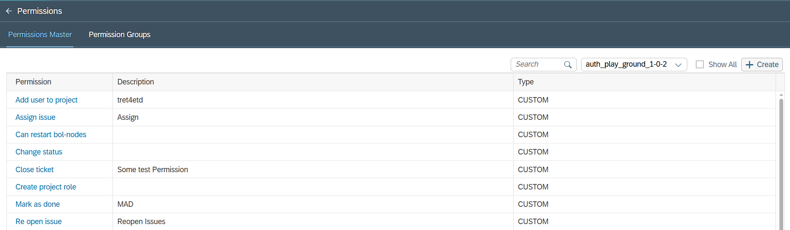
>
> **<u>Show All: Checked</u>**
>
> 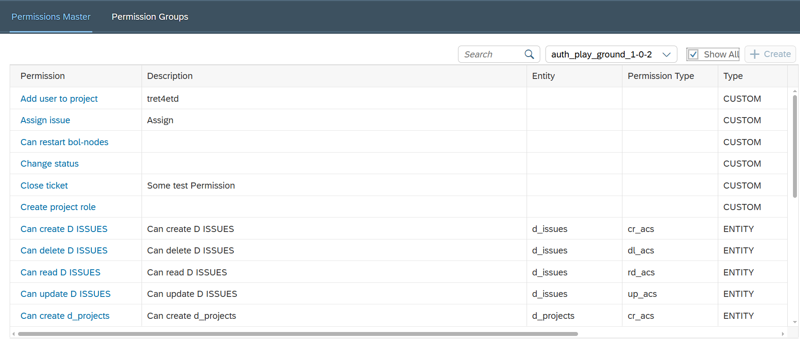

<table>
<colgroup>
<col style="width: 32%" />
<col style="width: 67%" />
</colgroup>
<thead>
<tr class="header">
<th><strong>Columns</strong></th>
<th><strong>Description</strong></th>
</tr>
<tr class="odd">
<th>Permission</th>
<th>It will show the permission name.</th>
</tr>
<tr class="header">
<th>Description</th>
<th>It will show the description of the respective permission.</th>
</tr>
<tr class="odd">
<th>Entity</th>
<th><ul>
<li><blockquote>

This column will be visible if showAll is checked.

</blockquote></li>
<li><blockquote>

It will show the name of the entity for which the permission is enabled.

</blockquote></li>
</ul></th>
</tr>
<tr class="header">
<th>Permission</th>
<th><ul>
<li><blockquote>

This column will be visible if showAll is checked.

</blockquote></li>
<li><blockquote>

It will show what entity type of permission it is.

</blockquote></li>
<li><blockquote>

For crud permissions, it will show their type.

</blockquote></li>
</ul></th>
</tr>
<tr class="odd">
<th>Type</th>
<th>
It will show in overall what type of permission it is

<ul>
<li><blockquote>

CUSTOM: Custom Permission.

</blockquote></li>
<li><blockquote>

ENTITY: CRUD Permission.

</blockquote></li>
</ul></th>
</tr>
</thead>
<tbody>
</tbody>
</table>

### 12.2.5. Create

- The create button is visible after the app is selected by the user.

- Users can use this button to create a custom permissions

- **NOTE:** Users can use this action only if the showAll checkbox is false.

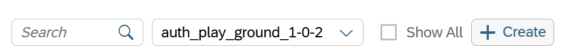

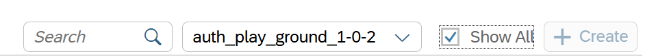

## 12.3 Create Custom Permissions

- It only accepts Uppercase, Lowercase, “\_”, “-” ,numbers and spaces up to 28 characters.

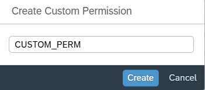

- After clicking the “Create” button, it will open the detail subscreen:

1.  **<u>Detail:</u>**

> 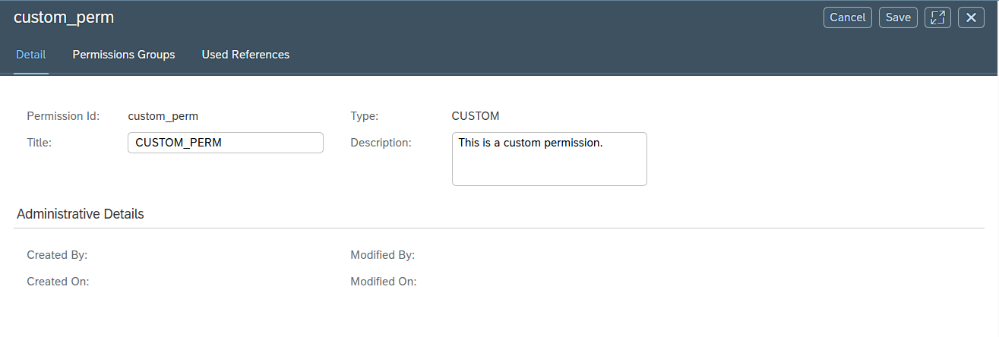
>
> **NOTE: Values of created fields and modified fields will get updated after navigating to an already created Permission or Permission group.**

2.  **<u>Permission Groups:</u>**

- After adding this custom permission in any Permission Group, it will show the lists of Permissions Groups in this tab.

- It is a view-only subscreen.

| **Columns** | **Description**                                                  |
|-------------|------------------------------------------------------------------|
| Group ID    | It will show the permission group name.                          |
| Description | It will show the description of the respective permission group. |

3.  **<u>Used References:</u>**

- It will show the permissions used in the menu for an application.

- It is a view-only subscreen.

| **Columns** | **Description**                                                       |
|-------------|-----------------------------------------------------------------------|
| Menu ID     | It will show the menu id where this permission is being used.         |
| Menu Group  | It will show the menu group name where this permission is being used. |

## 12.4 Permissions Groups

### 12.4.1 Toolbar Options & List

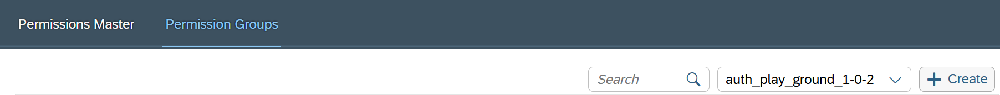

### 12.4.2 Fuzzy Search

Users can search for any particular valid value to filter the list data.

### 12.4.3 . App & List

- Users can use this app combobox to select an app.

- It will list down the app which is assigned as DEVELOPER to the logged in user.

- If an app is already selected in either of the tabs, it will reflect the same app in the other also.

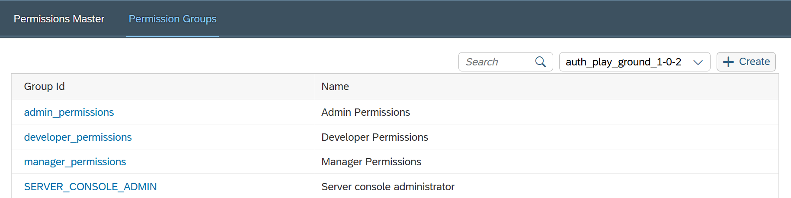

| **Columns** | **Description**                                |
|-------------|------------------------------------------------|
| Group ID    | It will show the id of the permission group.   |
| Name        | It will show the name of the permission group. |

### 12.4.4. Create

Users can use this button to create a permissions group.

### 12.4.5 Create Permissions Group

- It only accepts Uppercase, Lowercase, “\_”, “-” ,numbers and spaces up to 28 characters.

> 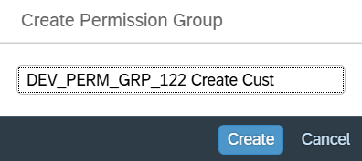

- After clicking the “Create” button, it will open the detail subscreen. Click save to save it.:

1.  **<u>Detail:</u>**

> 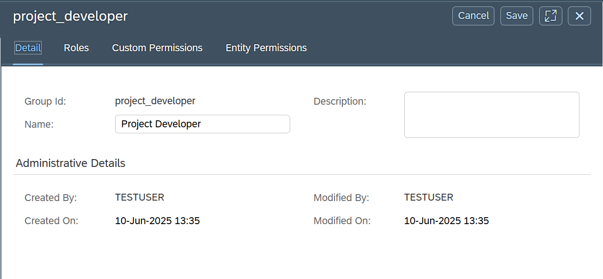
>
> **NOTE: Values of created fields and modified fields will get updated after navigating to an already created Permission or Permission group.**

2.  **<u>Roles:</u>**

- Click the “Add” button to add a role for this permissions group.

- On clicking the “Delete” button, it will delete a role from this permissions group.

> 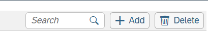

- After clicking the “Add” button, a dialog will open to select the application role available in the application:

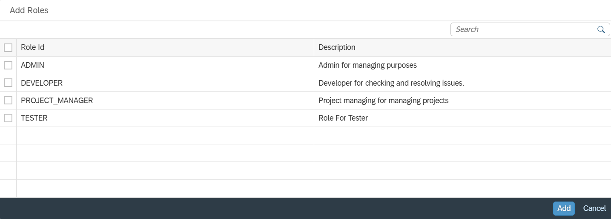

\- Select any role id and click on the “Add” button to add that role.

\- Similarly, go to the Custom Permissions tab, click the “Add” button from the section toolbar and it will open a dialog to add the custom permissions.

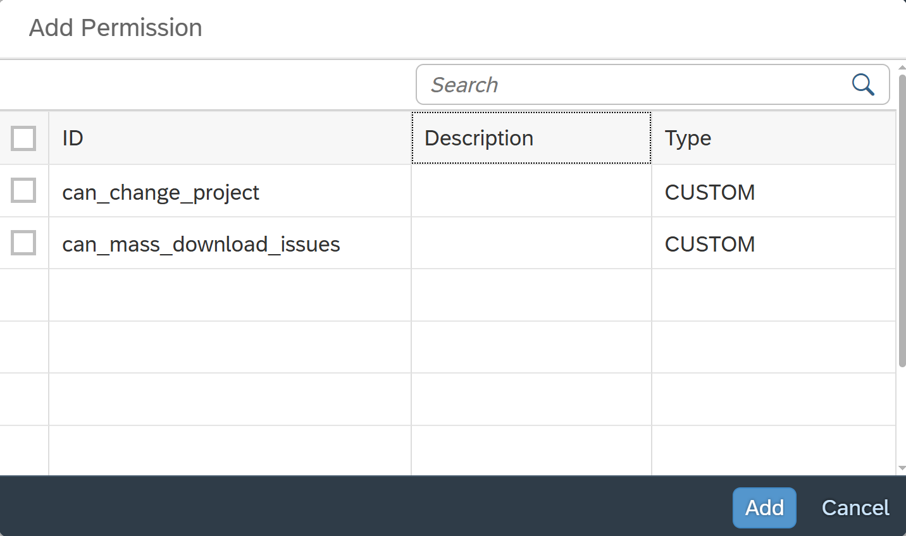

\- Select the required permissions and click “Add”.

\- Click “Save” (from the detail header) to save the roles and permissions added for this Permissions Group.

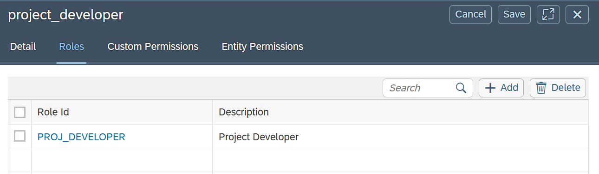

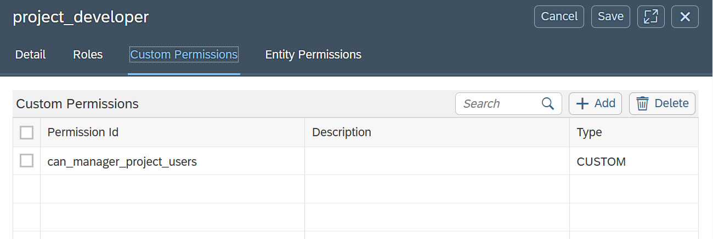

\- For adding entity permissions, navigate to the entity permission section,

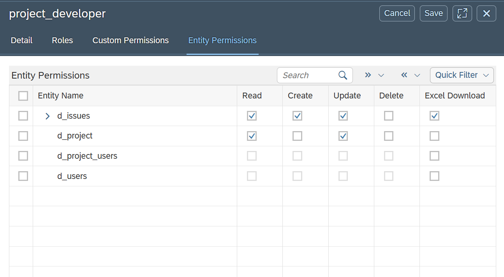

Search for the entity you want to provide permission of in the search,

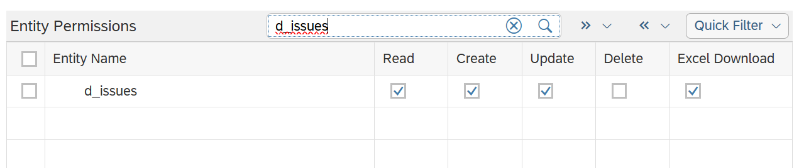

Check the permission to be provided and save.

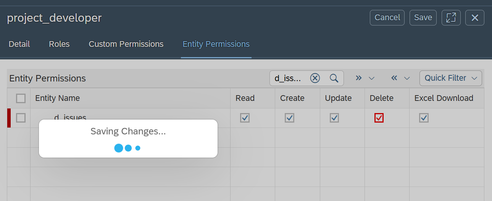

#### Note:

After save a popup will be shown indicating that Permission Recalculation is triggered.  
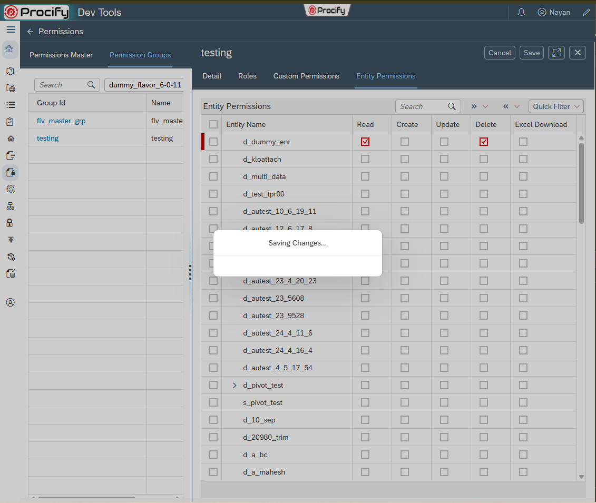

Upon clicking ok Permission recalculation will be handled in the background and the user will be able to continue

User can go to [**<u>Permission Logs</u>**](https://docs.google.com/document/d/1__Rcfffn_eBJxM3WPwjL6vsq1UY6Q4UAUl1jpGhdcZc/edit?usp=sharing) screen in **App Lifecycle**  
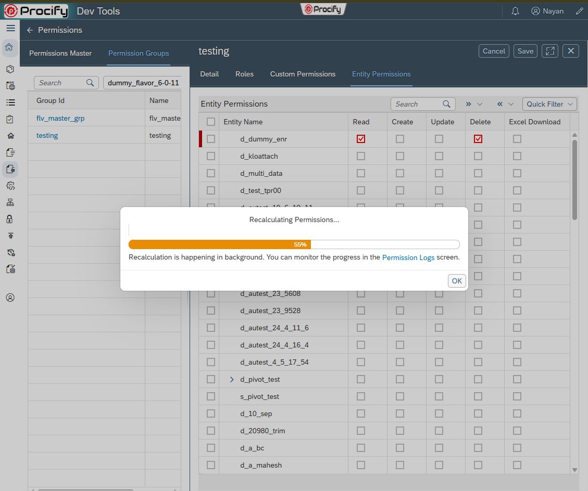
