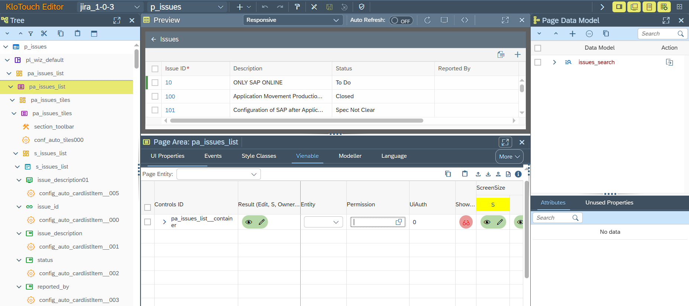
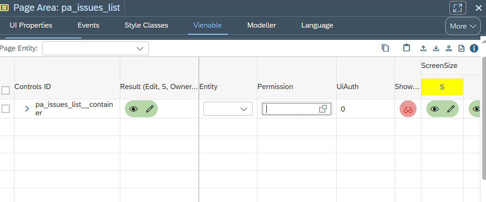
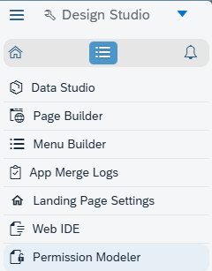
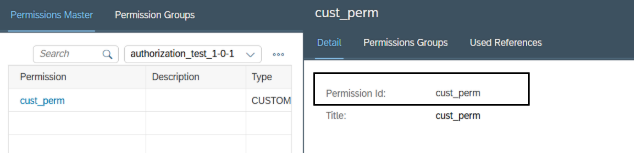
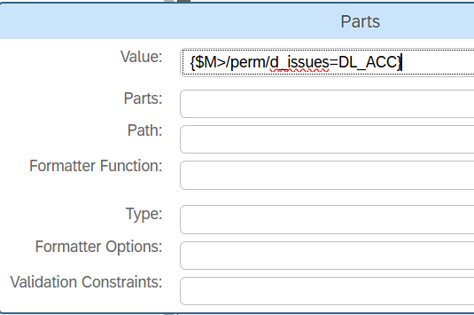

# Controlling UI Components based on Permission

There are 3 approaches to use Permissions in UI:

1.  Viniable (Recommended)

2.  Binding with permission model

3.  Custom Logics

## 12.1. Viniable (Recommended)

In Permission Viewer viniable section,

Here you can select the desired permission for the control. This will only control the visibility, i.e. After a permission is provided in the viniable,

1.  If permission is present, it goes forward to check the rest of viniable.

2.  If permission is not present, the control will be hidden.

For more information, refer to the Permission Viewer user guide.

The permission can be selected from the VH, or the permission ID can be manually typed in the field as explained in the binding section.

## 12.2. Binding with permission model

For more refined control, that cannot be achieved with Viniable, the UI property where binding is supported, the permission ID can be directly bound / used in expression binding.

The binding has to be done with the permission proxy present in the path

**\$M\>/perm/\<permisison_ID\>**

The permission ID should be provided as explained below.

### 12.2.1. Custom Permissions

Copy the ID from the Permission Designer screen ( Page Builder - Permission Designer )

Eg : **\$M\>/perm/cust_perm**

### 12.2.2. Entity Permissions

Entity permission ID should be provided in the below structure,

\<entity_name\>=\<Action\>

Actions are

1.  Create = CR_ACC

2.  Read = RD_ACC

3.  Update = UP_ACC

4.  Delete = DL_ACC

5.  Excel download = DW_ACC

Eg : For delete permission of d_issues, the permission ID should be, **d_issues=DL_ACC**

## 12.3. Custom Logics

There are [<u>APIs</u>](#apis-for-checking-permissions.) for checking whether a user has permission or not. This can be used in a controller to control the flow / UI elements.
