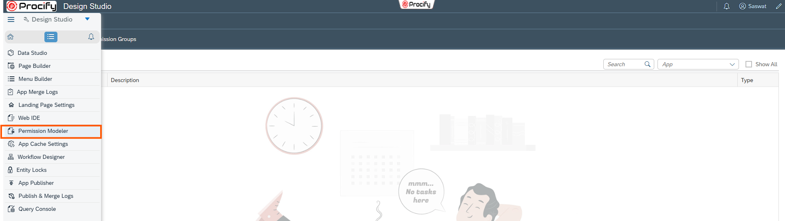
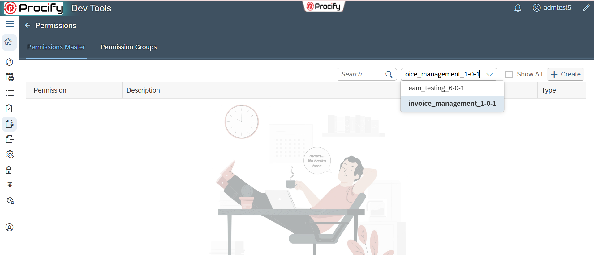
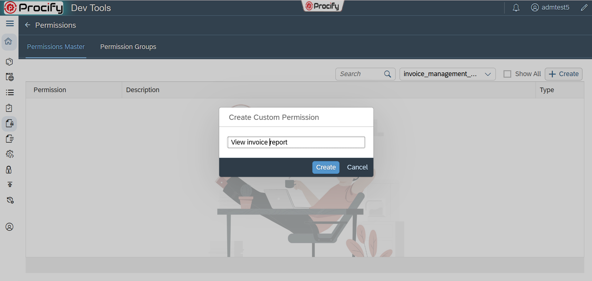
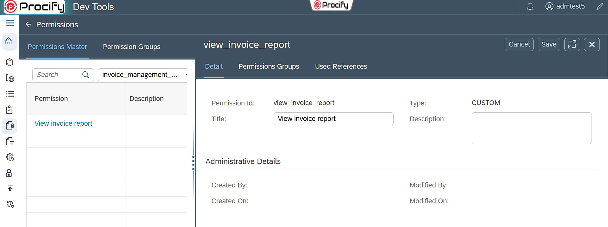
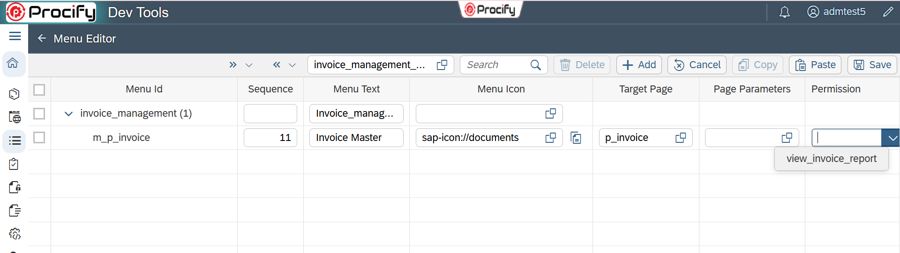
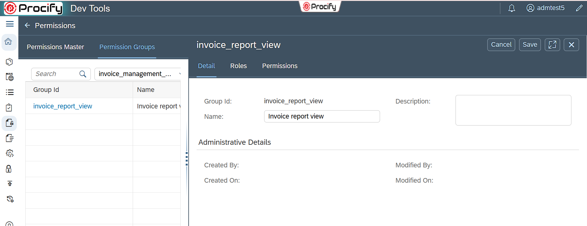
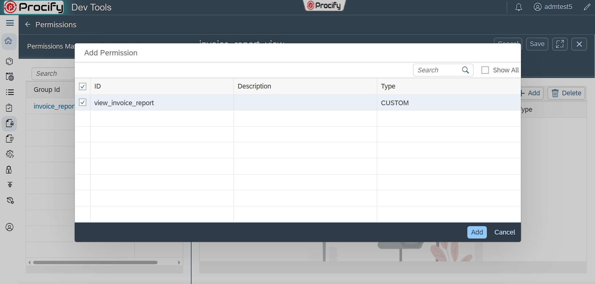
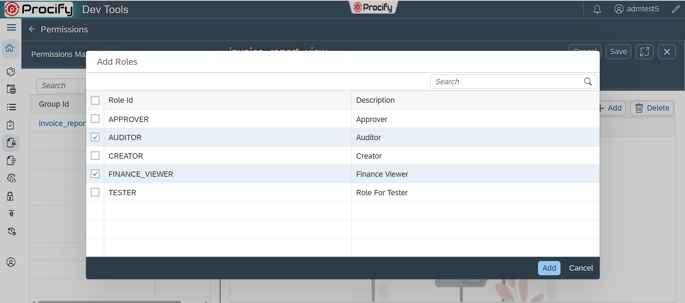

# How to use the feature?

## 4.1. What can the feature do ?

The feature can be used to control access application resources. supported for authorizing CRUD operations in entities. By default CRUD permissions to all entities is allowed if the application is assigned to the user. Once the CRUD operations are permission restricted from Data Studio, the operations can only be performed by users with respective permission. Requests from any other users to perform a restricted operation who does not have respective permission will be rejected by the server.

## 4.2. What is a permission ?

Permissions are used to permit who can access what resources of the application. The permissions are owning app specific and will inherit to child Apps.

There are two types of permissions;

### 4.2.1. CRUD Permissions

Entity permissions are used to restrict CRUD operations by users for an entity. For every entity, entity CRUD permissions are auto generated by a system based on Permission flags maintained by the developer at an entity level using the Data Studio in the Authorization section except for the download access (It is enabled for all entities).

1.  Entity CRUD flags

    - For each flag 1 permissions will be created for example,

      1.  d_no_hdr=CR_ACC - Can Create Notifications,

      2.  d_no_hdr=UP_ACC - Can Update Notifications,

      3.  d_no_hdr=DL_ACC - Can Delete Notifications,

      4.  d_no_hdr=RD_ACC - Can Read Notifications.

      5.  d_no_hdr=DW_ACC - Can Download Notifications as Excel.

If an entity is managed by external systems like SAP and it is available in Procify only for reporting purposes then the developer can disable the Create, Update and Delete for this entity. Then the system will only generate d_no_hdr=RD_ACC permission.

### 4.2.2 Custom Permissions

Developers can create custom permissions for their own and use it for controlling menu & home page visibility. It can also be used in application logic to make decisions based on whether the current user has the particular permission or not.

## 4.3. Quick starts:

### 4.3.1. Use Permission Designer in menu :

**Step 1 :** Go to Page Builder Menu, Go to the Permission Designer Screen (If not visible, kindly get Page Builder_klotouch flavor assigned if not already), In Permission Master section, Select a flavor.

**Step 2 :** Create a permission by clicking the Create Button. And fill in the details and save.

**Step 3 :** Go to the Menu Builder and assign permission to the desired menu item and save.

**Step 4 :** Go back to the Permission Designer menu in Page Builder. Go to the Permission Groups Section. And create a permission group

**Step 5 :** Go to the Permissions tab and add the newly created permission.

**Step 6 :** Go to the Roles tab and add the desired roles to which menu should be visible.

**Step 7 :** Assign the application to a user with one of the roles. And the user assigned with the roles used in permission groups will get the menu. And others will not.

### 4.3.2. Entity permissions:

Entity permissions are similar to menu permissions, instead of creating a custom permission, the Permission flags in the entity have to be enabled. And rest can follow the same process (Have to click the show_all flag in all places where permissions are listed.).

**Where to next ?**

1.  Managing permission groups in QA / Production.

## 4.4. What are permission groups ?

Permission groups are groups of permissions. They can be used to club permissions together so they can be assigned to appropriate users. In DEV environments permission groups can be assigned to application roles. Based on the role with which application is assigned to the user, the permission groups will be assigned in runtime.

Furthermore, admin can manipulate the permissions assigned to users in runtime by changing the permissions present in permission groups & assignments of permission groups to users. For more information on how to manage permission groups in runtime. Runtime permission group and permission changes can be done via [<u>Permission Group screen in</u> <u>Security & Permissions.</u>](#navigation-to-permission-groups)

## 4.5. Menu

Permissions can be used to control visibility of the menu based on the permissions assigned to the user. Refer to the [<u>quickstart</u>](#use-permission-modeler-in-menu) on how to use the feature.

## 4.6. How to use it ?

<table>
<colgroup>
<col style="width: 6%" />
<col style="width: 93%" />
</colgroup>
<thead>
<tr class="header">
<th><strong>SN</strong></th>
<th><strong>Steps</strong></th>
</tr>
<tr class="odd">
<th>1</th>
<th>
<em><a href="https://docs.google.com/document/d/1TZCiIbpOLvFzD4Qp6HrLiJafHC3OOKDvIcDAtmGRHbA/edit?tab=t.0#heading=h.y57igaslp0if"><u>Boleditor</u></a> permissions for entity</em>

<em>All (CRUD)permissions are enabled for an entity when created</em>
</th>
</tr>
<tr class="header">
<th>2</th>
<th>
<em>Configuring permission via <a href="https://docs.google.com/document/d/1iqK0kZG6YE7B-vXLHfuoqWQWV9SuAPk6cUzvPGCpq7c/edit?tab=t.0#heading=h.u8dnjjxn1l9q"><u>permission groups</u></a> screen.</em>

<em>Create permission groups and add required permissions in the permission group. Assign the permission group to the appropriate application role. Once done, test the application in development by performing the restricted operations by users with &amp; without permissions.</em>

<em>In addition to this, permissions can be assigned to the menu via Menu Builder to control their visibility based on the users’ permissions.</em>
</th>
</tr>
<tr class="odd">
<th>3</th>
<th>
<em>Transport the application to QA / PROD.</em>

<em>Once the application is transported to QA / PROD, the permission groups &amp; permissions will be filled in the runtime. After rollout, for existing users of the application, the permission groups will be auto assigned based on their roles. If new users are onboarded, the permission groups will be assigned during their first registration.</em>
</th>
</tr>
<tr class="header">
<th>4</th>
<th>
<em>Managing permission groups in runtime (On-demand)</em>

<a href="#navigation-to-permission-groups"><em><u>Tool Reference :</u></em></a>

<em>Permission groups that are configured in DEV cannot be modified. Permissions cannot be added / removed in those permission groups. They can only be enabled &amp; disabled. Similarly for permission groups that are assigned automatically to users based on roles also cannot be unassigned, but can be marked disabled.</em>

<em>But, new permission groups can be created and permission can be added to those groups by admin. Those admin created groups can be assigned to users.</em>
</th>
</tr>
</thead>
<tbody>
</tbody>
</table>

## 4.7. What is expected ?

### 4.7.1.How are permissions assigned to a user?

Users have permission groups assigned to them, and each permission group has one or more permissions in it. So, permissions that are present in the permission groups assigned to the user are considered as the permission that user has*.*

### 4.7.2. CRUD Operation:

When a CRUD operation is performed on an entity and access restriction is enabled on that operation, the system checks if the user has permission to perform that operation. If the user doesn’t have permission, the request will be rejected before executing any server side callbacks. If the user has permission, then the request will be processed further.

In the DEV landscapes the permission can be assigned via the Permission Designer screen in Page Builder & Controlled in QA / PROD system via Role Permissions screen in Security & Permissions. Explain further below in the document.

Each CRUD permission allows performing a specific operation,

1.  Read - Read permission allows the user to fire a query to that entity. This is validated on the server side.

2.  Create - Create permission provides the assigned access user to create entries in that entity. This is validated on the server side.

3.  Update - Update permission provides the assigned user access to update existing entries in that entity. This is validated on the server side.

4.  Delete - Delete permission provides the assigned user access to delete existing entries in that entity. This is validated on the server side.

5.  Download - Download permission is a template permission and doesn’t come with any validation by default. It controls the download excel button visibility in wizard created screens.

Similarly in case of online query fired from client also, the query will be rejected if sufficient permissions are not found. Incase a query from entity A inner joins entity B. The user executing the query is expected to have permissions for both entity A & entity B. Consider a modelled query belongs to entity A, and it has inner join to entity B.The cases are as follows,

1.  The user has permission to A & B - The query will be executed and the result set will be returned as usual.

2.  The user doesn’t have permission to A / B - The query will be rejected at entry point and no server side query callbacks will be executed.

3.  The user has permission to read B, but not A - The query will be rejected at entry point and no server side query callbacks will be executed.

4.  The user has permission to read A, but not B - The query will be rejected while parsing the query, but before query callback will get executed.

Middleware messages are also validated against the permission of the user who created the message. If the user who generated that message doesn’t have required permissions, the message will fail to process and will be moved to error q.

This is not applicable for CRUD operation performed inside the server. Once the request reaches the server, and is validated, any further CRUD operations performed in the rules are not validated.

Similarly for any server side triggered activities i.e. CRUD performed in the scheduler, appservices will not be restricted.

### 4.7.3. Menu :

In the current Menu Builder both roles & permission can be added to a menu. But, if permission is provided, the visibility will be followed based on the permission. If not provided, it follows the old behaviour*.*

### 4.7.4. What to expect in versioning ?

Permission groups, their permissions and assigned roles can be changed in the ongoing versions. When the newer version is transported. During the transport, the permission groups & permissions in the groups of the newer version will be copied to runtime, overriding the older version configuration.

All the users who got upgraded to the new version will get permission groups assigned based on their application role and the users permissions will be adjusted based on their new permission groups.

In case of minor version deployment, where there are users who are running on older versions, Permission groups assignment will not be changed for those users. Permission adjustments will not be triggered for those users i.e. If new permissions were added to an existing group / removed from the existing group in dev, will not reflect. Permissions will be adjusted when there is a change detected in the application assignment that is relevant to permissions i.e. version upgrade, role changes, application assignment removal, admin changing assignment / permission group permissions ..etc.

### 4.7.5.How to debug ?

The list of permissions assigned to a particular user against a flavor can be viewed for support purposes via the Permission Viewer screen in the Security & Permissions menu (Workspace Hub application should be assigned).

In Browser / Device, the list of permissions assigned to the user (OFFLINE) can be checked by running the below snippet.

<table>
<colgroup>
<col style="width: 100%" />
</colgroup>
<thead>
<tr class="header">
<th>
res = await testdb("select r_flavor, r_permission_id from madm_user_permissions")

console.log(res[0].rows.map(a=&gt;"Flavor : " + a[0] + " . Permission ID : " + a[1]).join("/n"))
</th>
</tr>
</thead>
<tbody>
</tbody>
</table>

## 4.7. APIs for checking permissions.

### **Checking Permissions Programmatically**

To check whether a user has specific permissions (CRUD or custom) in code, use the permission APIs available on the KloTransaction object.

#### **1. Checking CRUD Permissions**

Use the following method to check if a user has permission to perform a **Create**, **Read**, **Update**, or **Delete** operation on an entity:

<table>
<colgroup>
<col style="width: 100%" />
</colgroup>
<thead>
<tr class="header">
<th>hasCRUDPermission( 
entityName: string, 
crudAccessType: ENTITY_OPR_TYPE, 
r_user_id?: string, 
r_flavor?: string 
): Promise&lt;boolean&gt;</th>
</tr>
</thead>
<tbody>
</tbody>
</table>

- **entityName**: Name of the entity.

- **crudAccessType**: The operation to check.

- **r_user_id (optional)**: The user ID to check permission for. Defaults to the user of the current transaction.

- **r_flavor (optional)**: Flavor context, if applicable. Defaults to the flavor of the current transaction.

**Note :** If permission is not enabled in that entity, but checked via the API, it will return true.

#### **2. Checking Custom Permissions**

Use the following method to check a specific custom permission by its ID:

<table>
<colgroup>
<col style="width: 100%" />
</colgroup>
<thead>
<tr class="header">
<th>hasPermission( 
permissionId: string, 
r_user_id?: string, 
r_flavor?: string 
): Promise&lt;boolean&gt;</th>
</tr>
<tr class="odd">
<th></th>
</tr>
</thead>
<tbody>
</tbody>
</table>

- **permissionId**: The ID of the custom permission to check.

- Other parameters are the same as in **hasCRUDPermission**.

#### **Environment Support**

- Both APIs can be used in **client-side and server-side** environments.  
  > If **r_user_id** or **r_flavor** is not provided, they default to the user and flavor of the current transaction.

Note : Performing any validation on the client side doesn’t provide protection against requests directly made to the server. For any security validation, make sure to add the validation on the server side.
