# How to use Role Permissions

## 8.1. Navigation to Role Permissions

**Step 1:** Select the **Security & Permissions** menu header.

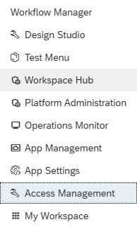

**Step 2:** Select the **Role Permissions** menu item.

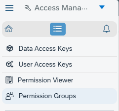

## 8.2. Advanced Search

- Entering the permissions group screen, shows a message toast to select an app using advanced search.

> 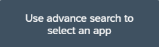

- To view the Permission Groups, users need to first use the advanced search and fill in the required fields. **App** is the mandatory field.

- Users can get the permissions group for the Apps assigned to them as Manager.

- Users can filter the Permission Groups based on Enabled and Source for a Selected App.

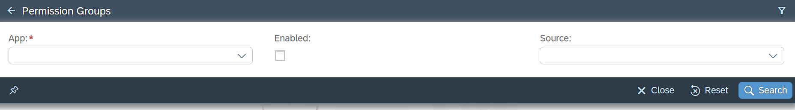

<table>
<colgroup>
<col style="width: 32%" />
<col style="width: 67%" />
</colgroup>
<thead>
<tr class="header">
<th><strong>Fields</strong></th>
<th><strong>Description</strong></th>
</tr>
<tr class="odd">
<th>App</th>
<th><ul>
<li><blockquote>

It will allow the users to select an application. (Mandatory Field)

</blockquote></li>
</ul></th>
</tr>
<tr class="header">
<th>Enabled</th>
<th><ul>
<li><blockquote>

It will show the Permission Groups which are enabled for that application.

</blockquote></li>
</ul></th>
</tr>
<tr class="odd">
<th>Source</th>
<th><ul>
<li><blockquote>

It will filter the data based on SYSTEM / USER.

</blockquote></li>
<li><blockquote>

SYSTEM: It means system generated Permission Groups i.e. Permission Groups created in DEV Landscape.

</blockquote></li>
<li><blockquote>

USER: It means the Permission Groups created in the PROD Environment. Created by the User.

</blockquote></li>
</ul></th>
</tr>
</thead>
<tbody>
</tbody>
</table>

## 8.3. Role Permissions List & Details

### 8.3.1. Role Permissions List

After using the advanced search, users can view the list of permissions groups of the selected application on the screen.

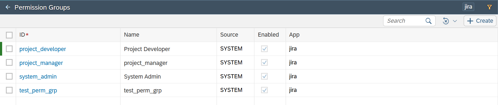

| **Fields** | **Description**                                                    |
|------------|--------------------------------------------------------------------|
| ID         | Shows the Permission Group ID.                                     |
| Name       | Shows the Permission Group Name.                                   |
| Source     | Shows the Source Type of the Permission Group i.e. SYSTEM or USER. |
| Enabled    | It shows whether the Permission Group is enabled or not.           |
| App        | It shows the Application Name for the respective Permission Group. |

### 8.3.2. Detail

- After clicking on the permissions group Id Link from the list, users can check more its details.

- Users can additionally see the created and modified fields under this “Detail” tab.

- **Permissions Group can be enabled/disabled: Enabled:** Shows whether the selected Permissions Group enabled (is being used) or not.

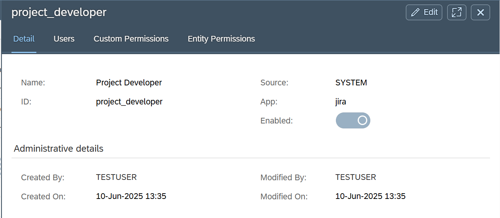

<table>
<colgroup>
<col style="width: 32%" />
<col style="width: 67%" />
</colgroup>
<thead>
<tr class="header">
<th><strong>Fields</strong></th>
<th><strong>Description</strong></th>
</tr>
<tr class="odd">
<th>ID</th>
<th>Shows the Permission Group ID.</th>
</tr>
<tr class="header">
<th>Name</th>
<th><ul>
<li><blockquote>

Shows the Permission Group Name.

</blockquote></li>
<li><blockquote>

It is editable for permissions group having source as USER.

</blockquote></li>
</ul></th>
</tr>
<tr class="odd">
<th>Source</th>
<th><ul>
<li><blockquote>

Indicates whether the permission is user created or not.

</blockquote></li>
<li><blockquote>

Can be USER or SYSTEM.

</blockquote></li>
<li><blockquote>

Not editable.

</blockquote></li>
<li><blockquote>

SYSTEM: if the permissions group is moved along with the App from another Landscape.

</blockquote></li>
<li><blockquote>

USER: If the permission is created by the user using the Permission Group screen.

</blockquote></li>
</ul></th>
</tr>
<tr class="header">
<th>Enabled</th>
<th><ul>
<li><blockquote>

It shows whether the Permission Group is enabled or not.

</blockquote></li>
<li><blockquote>

Indicates whether it is being used or not.

</blockquote></li>
</ul></th>
</tr>
<tr class="odd">
<th>App</th>
<th>It shows the Application Name for the respective Permission Group.</th>
</tr>
<tr class="header">
<th>Administrative Details</th>
<th>Shows the created and modified details.</th>
</tr>
</thead>
<tbody>
</tbody>
</table>

### 8.3.3. Users

- Under the “Users” tab, users can see the list of users assigned to the selected Permission Group.

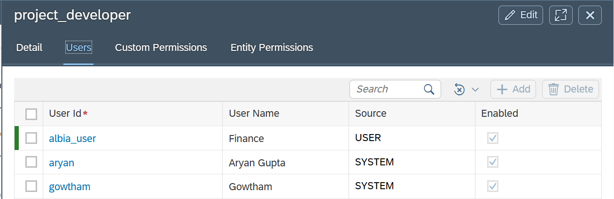

| **Fields** | **Description**                                                                                                                                                                                                   |
|------------|-------------------------------------------------------------------------------------------------------------------------------------------------------------------------------------------------------------------|
| UserId     | Shows the User ID.                                                                                                                                                                                                |
| User Name  | Shows the User Name.                                                                                                                                                                                              |
| Source     | Indicates whether the user is user created or not. Can be USER or SYSTEM.                                                                                                                                         |
| Enabled    | It shows whether the User is enabled or not. That is, if it is not checked i.e. disabled, then it means that that particular user is not being permitted for the added Permissions actions in a Permission Group. |

- **Enabled: Checks if the added users are allowed to do the actions (i.e. Permissions) included in the selected Permission Group.**

<!-- -->

- “Delete” button is present in the section toolbar to remove the added users from this permissions group.

- “Add” button is present in the section toolbar to add new users to the selected permissions group. A dialog box will appear to add new users.

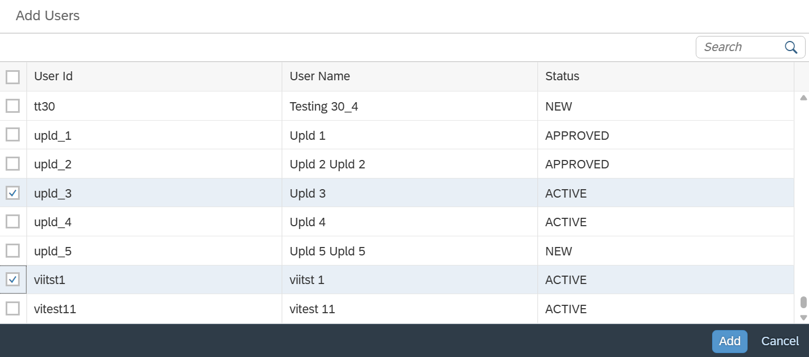

- After selecting the users, on click of “Add” it will add the selected users.

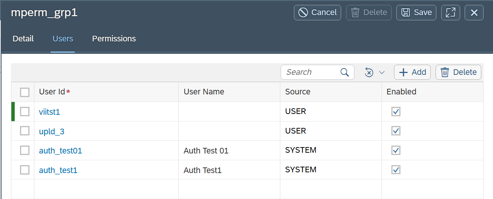

- On Click of “Save”, it will save the changes.

### 8.3.4. Custom Permissions

- It shows the list of custom permissions added to the selected permissions group.

- Permissions can be enabled/disabled.

- **Permissions can be added / deleted to Permission Groups having source as USERS.**

<!-- -->

- “Delete” button is present in the section toolbar to remove the added permissions from this permissions group.

- “Add” button is present in the section toolbar to add new available permissions to the selected permissions group. A dialog box will appear to add new permissions.

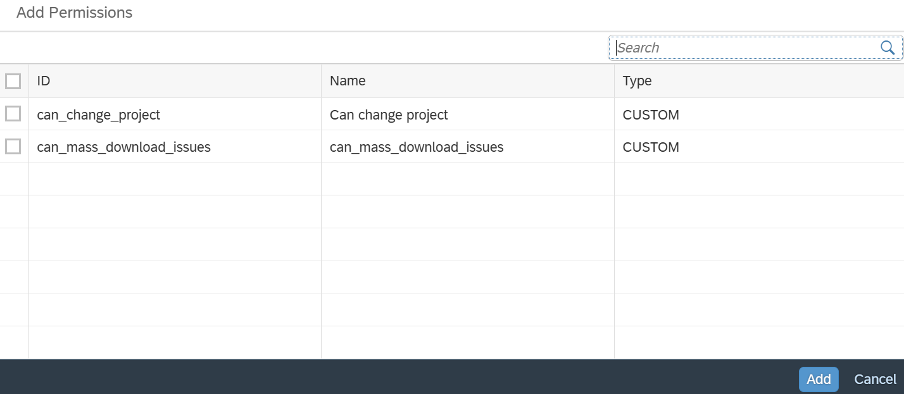

- After adding it, click “Save” to save the changes,

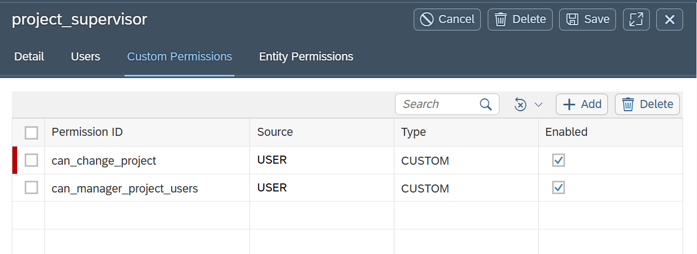

- For adding entity permissions, navigate to the entity permission screen.

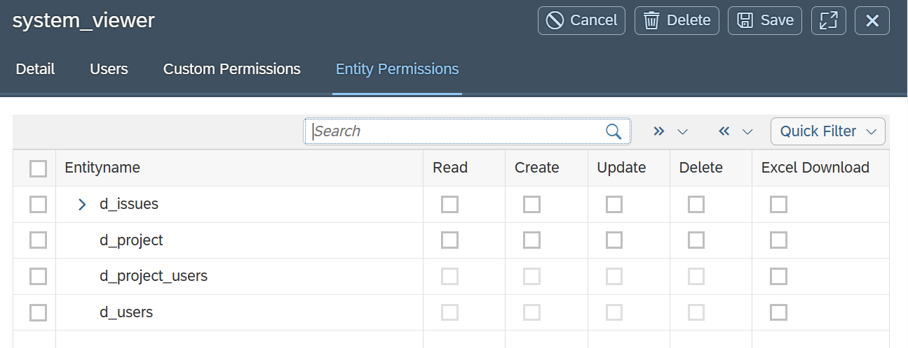

- Search for the entity you want to provide permission of in the search,

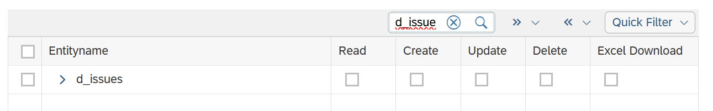

- Check (select) the permission to be provided and save.

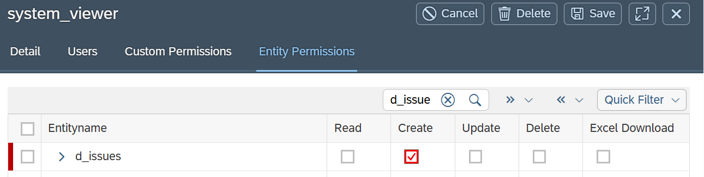

## 8.4. Create a Permissions Group

- Click the “Create” button present in the section tollbar on the main screen.

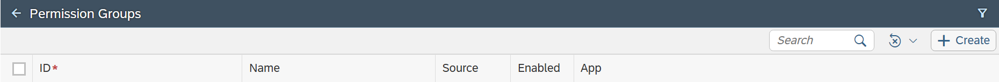

- The “Detail” subscreen will open. Users can enter the Permissions Group Name and click “Save”.

- Only Permission Group’s name can be filled/edited.

- It only accepts Uppercase, Lowercase, “\_”, “-” ,numbers and spaces up to 28 characters.

- Only the detail tab is visible unless the created Permission group is saved.

- Navigation to other Permission group is restricted unless the created permissions group is saved.

- Permission group id is autogenerated after the created permissions group is saved.

- 

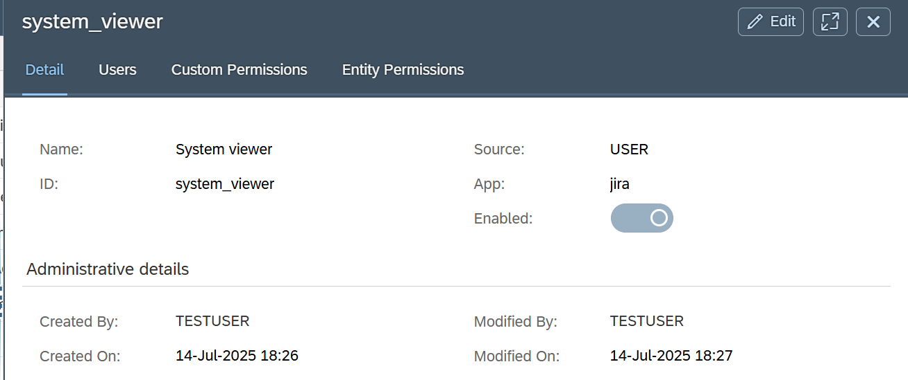

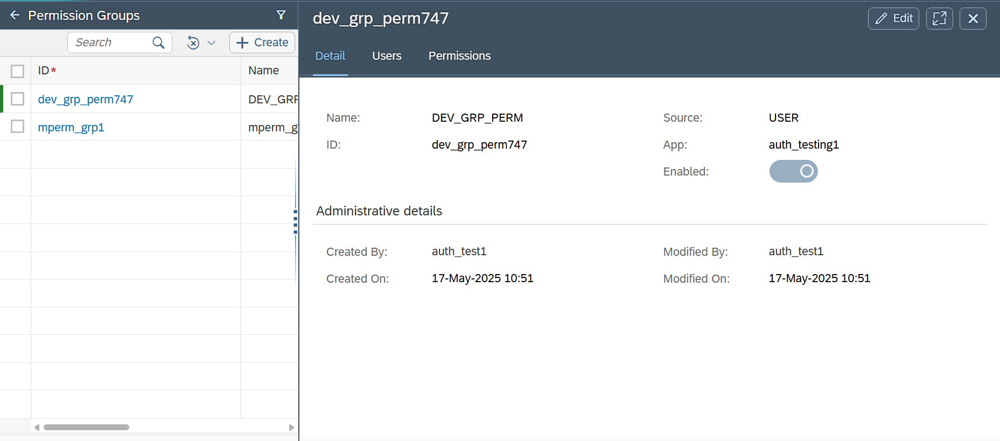

## 8.5. Delete a Permissions Group

- Edit: For editing the permissions group.

- Cancel: For reverting the changes.

- Delete: For deleting the permissions group having source as USER. **Will be disabled for the Permission group not having source as USER.**

- After clicking the delete, it will ask for confirmation. And after clicking OK from the confirmation dialog, it will delete the selected Permission Group and automatically Save it.

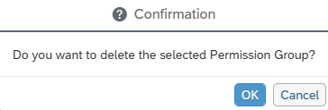

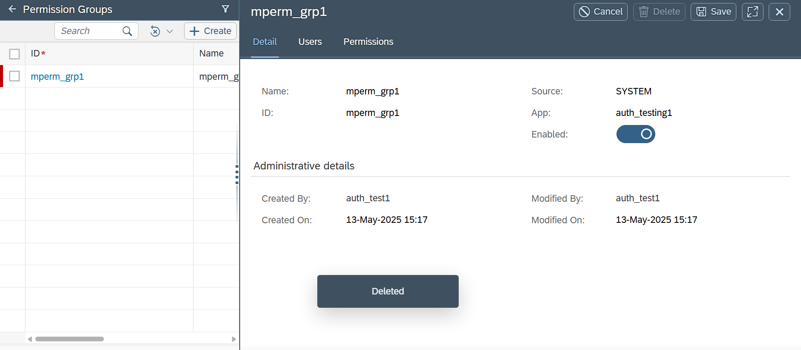

## Note:

After save a popup will be shown indicating that Permission Recalculation is triggered.  
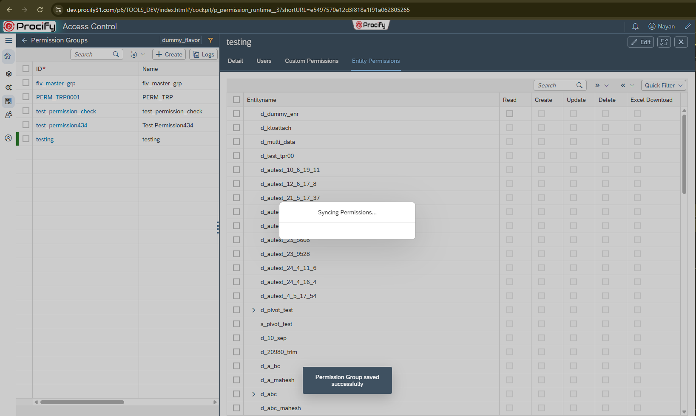

Upon clicking ok Permission recalculation will be handled in the background and the user will be able to continue  
  
User can go to [**<u>Permission Logs</u>**](https://docs.google.com/document/d/1__Rcfffn_eBJxM3WPwjL6vsq1UY6Q4UAUl1jpGhdcZc/edit?usp=sharing) screen in **App Lifecycle**  
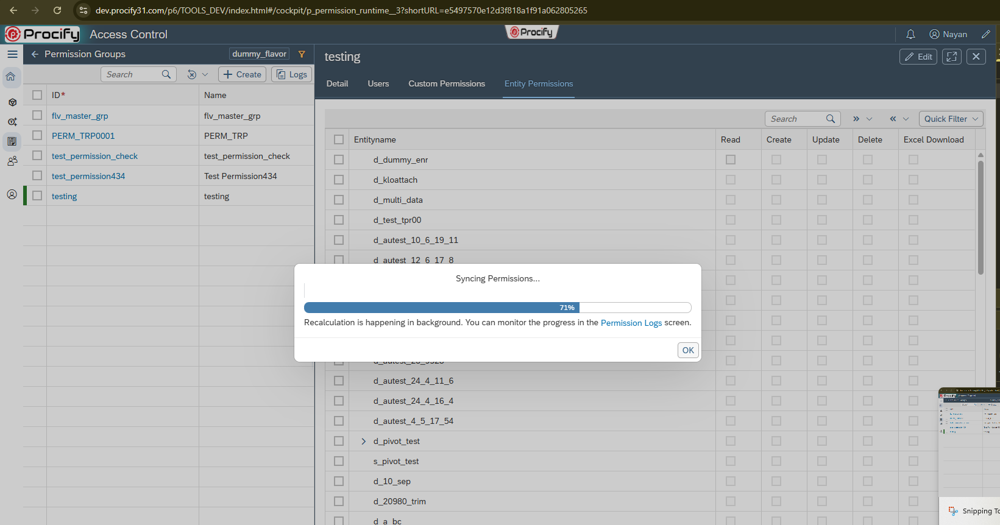
