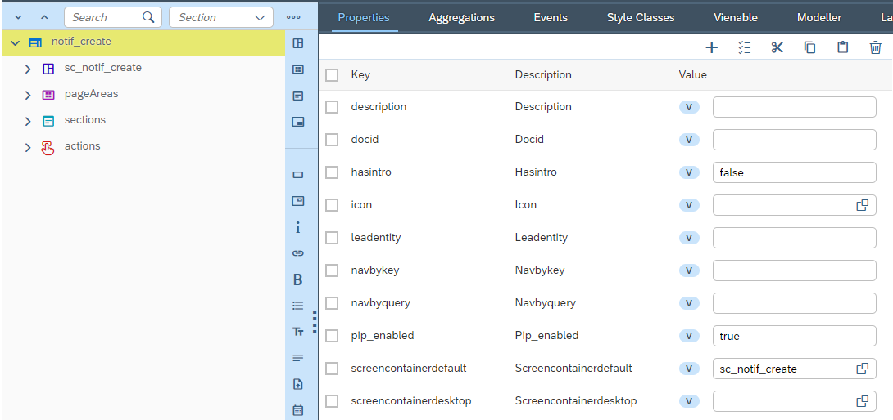
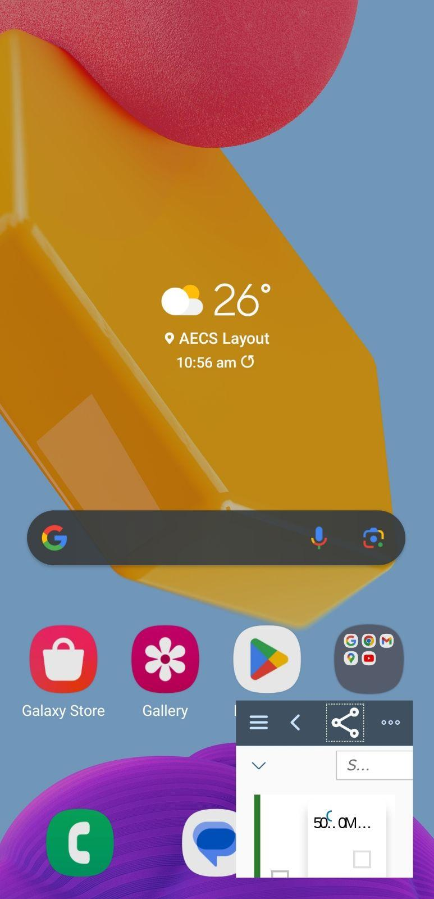
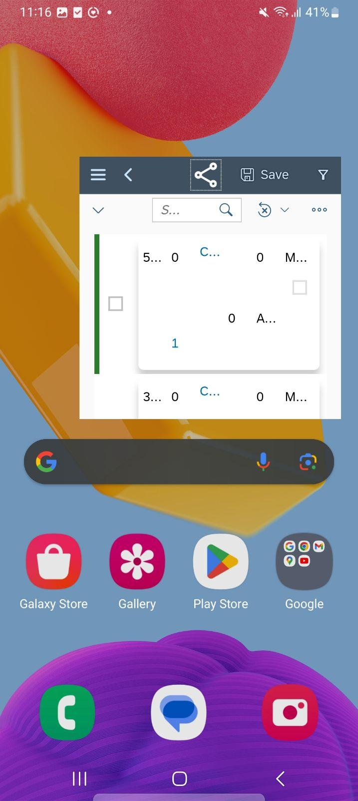

# Steps

- Select the screen for which the developer wants pip mode and in the properties section mark pip_enabled as true.

- Now, for this screen, PiP mode will be available on mobile. The developer needs to make sure that the PictureInPicture plugin is added.

