# Implementation of Modeller

Two actions are required to be added in the KloSectionToolbar (**showViewSelection** and **pivotModellerButton**).

Once the above actions are added during the design time, the modeller button and view selection will appear in the toolbar of the table during runtime.

> 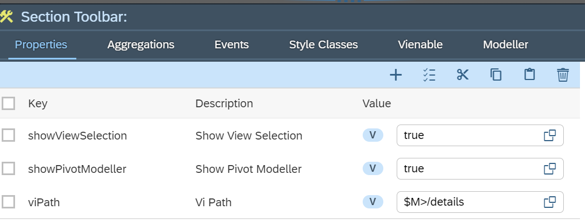

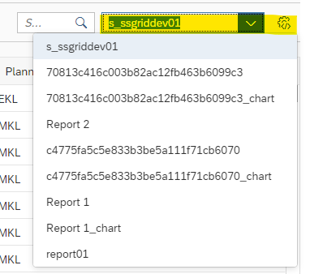

In **Runtime**, on click of the modeller button, as shown in the above screenshot, Pivot Modeller opens.

If the report is selected from the selection view of the modeller, it will be available and selected automatically. The details can be seen in the left section.

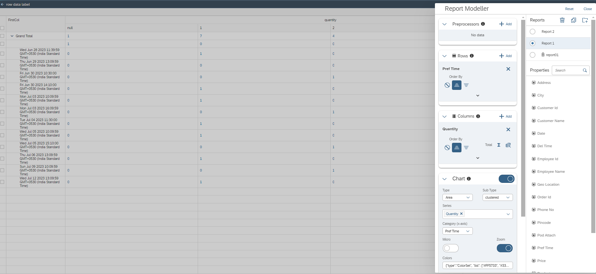

If no report is selected when the modeller has opened, it will look like the following image:

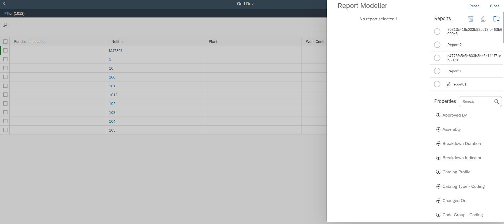

**Pivot Modeller Sections -**

In the left section, respective report details are shown:

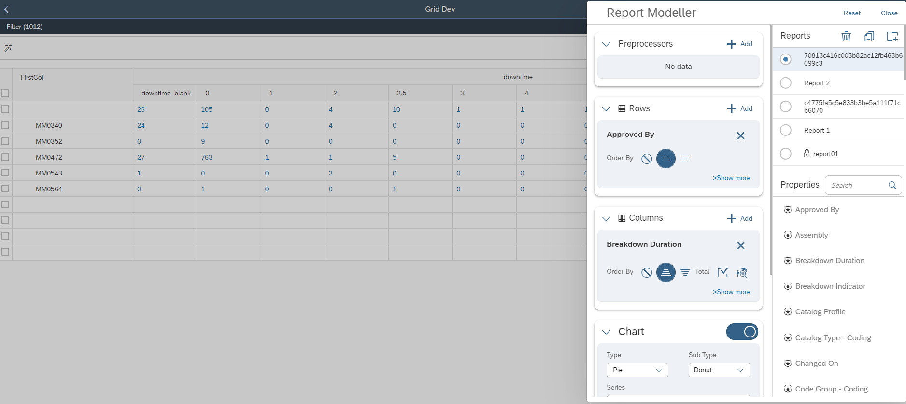

During **design time**, only one report can be modelled in a single instance whereas during runtime, users can work on multiple reports in a single instance.

Report listed above the properties are shown only in runtime.

On the right side, two list is available i.e **Report List** and **Properties List**

### Report List (For runtime only) -

It contains the reports created by the user during **runtime** i.e. Transactional Reports, as well as the reports created during **design time** i.e. Metadata reports.

Metadata reports are locked, users can not modify them. They can only select the report to see the output on their pivot table.

This list has four actions i.e. Create, Delete, Copy, Rename on a report.

1.  **Create** - On click of the create button, a blank report gets created with a default name as GUID (GUID, in general, signifies a unique ID).

2.  **Copy** - On click of copy, it copies the selected report with a default name as GUID.

3.  **Delete** - On clicking the delete button, the selected report gets deleted.

4.  **Rename** - This can be achieved by opening the right-click context menu over a report item. On the right click, the report also will be selected and details will be reflected on the left section.

All those actions of reports will be saved on close of the modeller.

### Properties List -

This list is visible at both **runtime** and **design time**.

It contains all the properties of the entity in the transnode which is bound with the table/grid.

There is a fuzzy search provided in the toolbar of the property list.

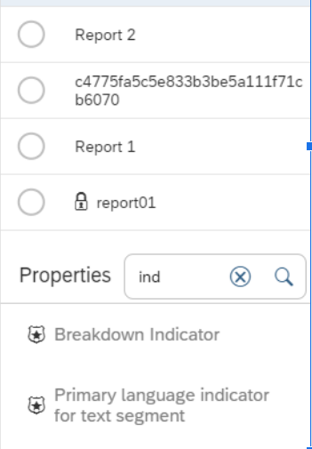

Here the properties have a drag and drop option.

They can be dragged and dropped to the following lists - **Rows**, **Columns**, **Preprocessors**, **Chart** (**Series** and **Category** dropdowns only).

### Report Detail -

This is the left section of the modeller. It contains **five** panels :

- Preprocessor

- Rows

- Columns

- Chart

- Setting

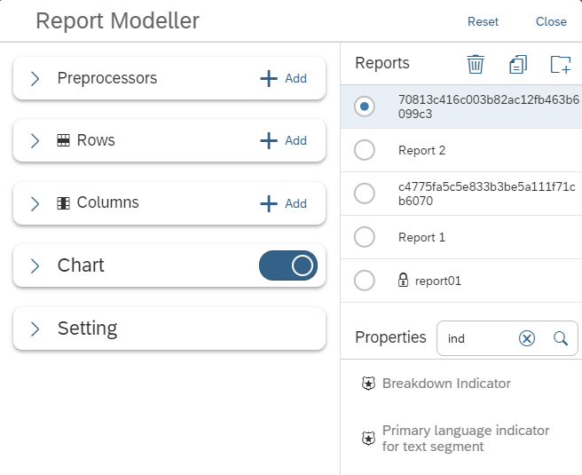

#### **Preprocessors** -

To add preprocessors, properties can either be dragged/dropped from the Property list, Rows, Columns list or the add button itself.

Properties can be dragged and dropped in the preprocessor list.

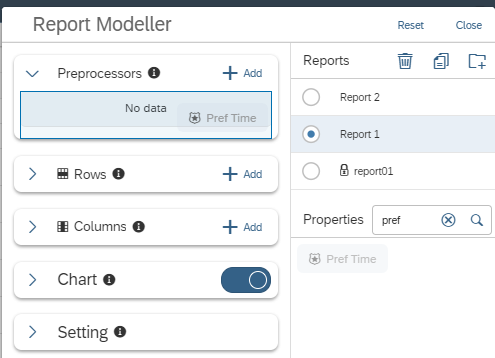

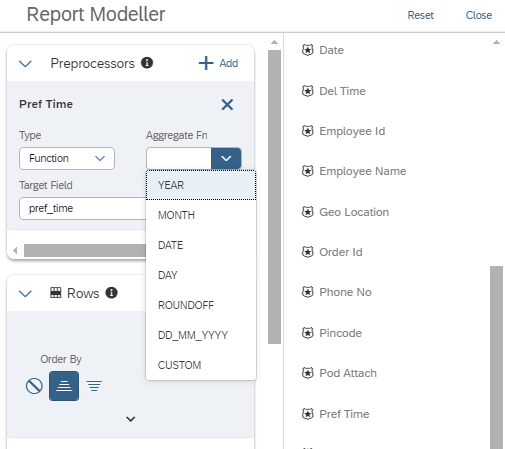

Selecting a function will show data showing that kind of value,  
**YEAR:** will show values in each Year.(2023,2024)  
**MONTH:** will show value in each Month(Jan, Feb,.., Dec)

**MONTH_YEAR** : will show value in each Month with Year (Jan 2023, feb 2023, Jan 2024,feb 2024).  
**DATE:** will show value in each Date(1 to 31)

**DAY:** will show value in each Day.(Monday - Sunday)  
**DD_MM_YYYY:** will show value in the DD-MM-YYYY format (24-05-2024)  
**ROUNDOFF:** will show rounded values such as, if 24.5- value will be shown as 25  
CUSTOM: isn’t working Currently

Mapping:  
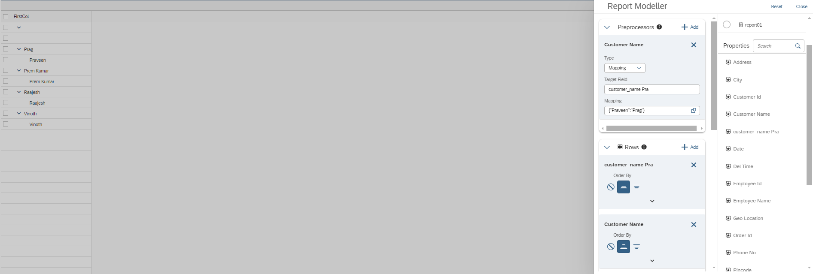  
Mapping can be used to show a different value for a particular value.

#### **Rows** -

To add rows, properties can either be dragged/dropped from the Property list, Pre-processor, Columns list or the add button itself.

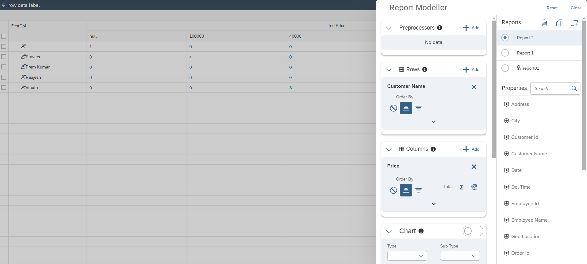

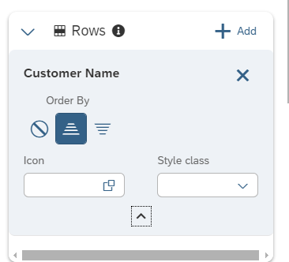

**Rows Details -**

It contains three icons for sorting i.e. No Sort, Ascending, Descending.

There is a button - to show more/less, to expand and collapse the advanced fields.

The user can paste the icon uri from the [<u>sapIcons</u>](https://ui5.sap.com/test-resources/sap/m/demokit/iconExplorer/webapp/index.html#/overview) in the rows section as shown below:(Currently value help is not shown.)  
Style doesn’t work as for now

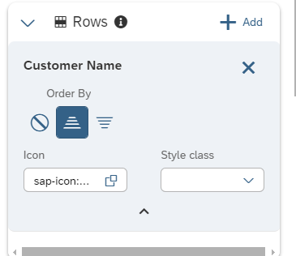

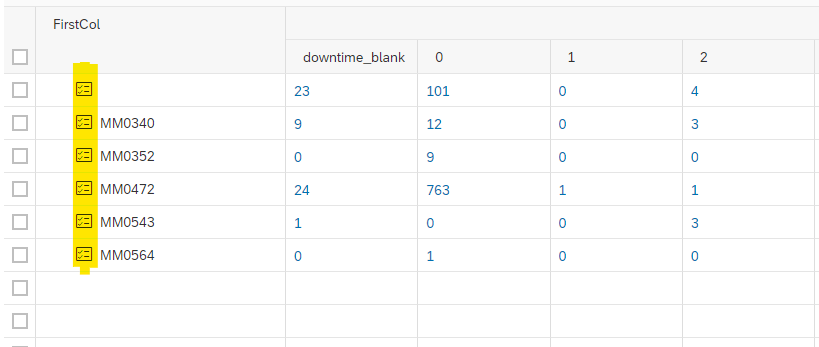

#### **Columns** -

To add columns, properties can either be dragged/dropped from Property list, Preprocessor, Rows list or the add button itself.

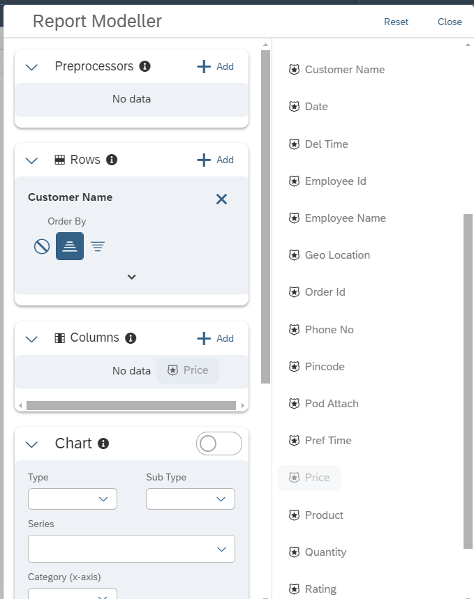

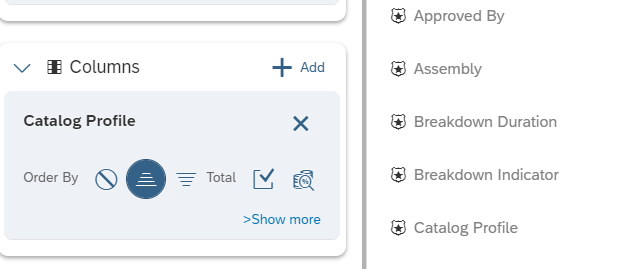

**Column Details -**

It contains three icons for sorting i.e. No Sort, Ascending, Descending and two icons for showing Total and Total Percentage.

There is a button - to show more/less, to expand and collapse the advanced fields.

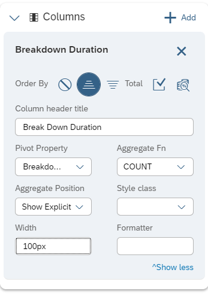

The figure above shows advanced column options. The column header title is the grouped pivot columns title.

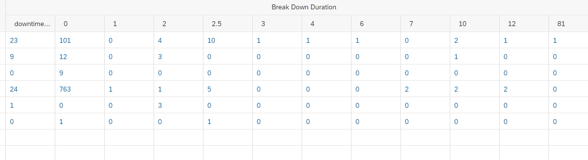

The pivot property is the entity property on which the data is pivoted.

The aggregate function is the aggregate function of the columns. The default value is count.

The aggregate position is the position of the Total column.

The possible values are **Show Explicit, Show in Tree, Don’t Show.**

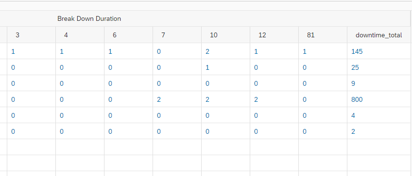

The above figure show the aggregate position: Show Explicit

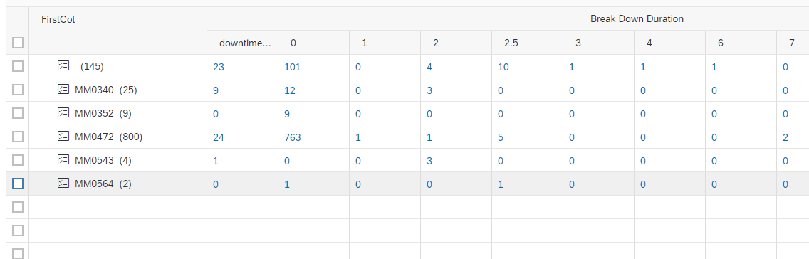

The above figure shows the aggregate position: Show In Tree

#### **Chart -**

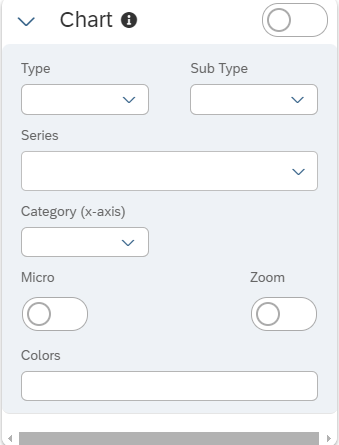

The chart panel itself contains a switch button, which defines where the Chart is required for the selected report that you are working on.

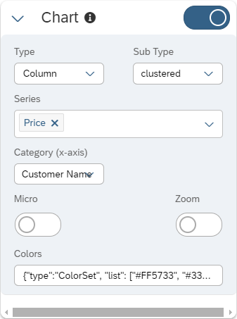

**Chart Details -**

In the chart section, two dropdowns are droppable i.e. Series and Category.

**Category (x-axis)** - Properties which are added in the Rows, among them one can be added in category by either drag/drop or by selecting from the dropdown.

**Series** - Properties which are added in the Columns, can be added in Series multi-dropdown, either by drag/drop or by selecting from the multi-dropdown.

There is a toggle button in the header of the chart section. It Enables the Chart view in the view selection field of the KloSectionToolbar.

An entry with a label of the report with \_\_chart is made in the viewSelectionDield.

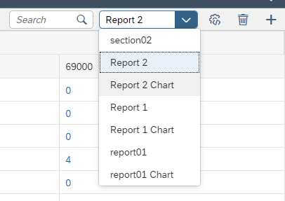

Once you select the chart we get the view as shown below:

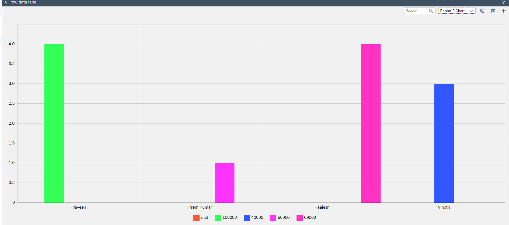

You can further configure the chart with the help of options available in the chart section of the KloPivotModeller.

Options are available to enable the zoom of the chart. To enable micro charts there is an option zoom.  
  
Colors of the chart can be changed by using the Colors property

Colors e.g: {"type":"ColorSet", "list": \["#FF5733", "#33FF57", "#3357FF", "#FF33FF"\]}

Or  
{"type":"ColorSet", "step": 5 }

Fore more detail check [<u>KloChart User Guide</u>](https://docs.google.com/document/d/1UeSJM1mbrJIAbr9lGTs9KNrWkhJwiYO3ZIZNDzza8u8/edit?usp=sharing)

#### **Setting** -

Setting Detail -

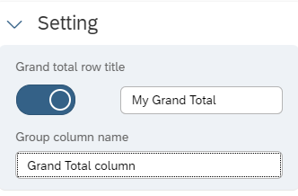

There is a settings section at the bottom of the left container of KloPivotModeller.

The toggle button shown above enables the grand total row for the report.

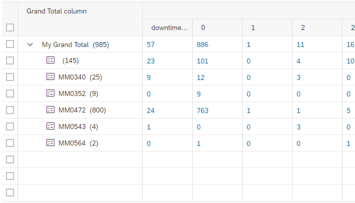

The other options rename the grandTotal row and column title.

**Section Toolbar Properties**  
  
Three new bindable properties are available on Section Toolbar. They control pivot execution behaviour and link or text rendering — set them in the Properties panel during design time.

| **Property**            | **Type** | **Default** | **Description**                                                                                                                                                                                                                   |
|-------------------------|----------|-------------|-----------------------------------------------------------------------------------------------------------------------------------------------------------------------------------------------------------------------------------|
| PivotExecutionMode      | string   | "client"    | Controls where pivot aggregation runs. "client" — computed in the browser. "server" — SQL generated by PivotQueryGenerator and run on the database. Switch to "server" for large datasets to avoid browser memory pressure.       |
| PivotValuesAsLinks      | boolean  | true        | When true, pivot cell values are rendered as clickable links. The destination of each link is determined by the application's navigation configuration. Set to false to render plain text values.                                 |
| PivotValuesAsLinksScope | string   | "both"      | Limits where the link rendering is active. "designTime" — links appear only in the designer. "runTime" — links appear only at runtime. "both" — links appear in both contexts. Only takes effect when PivotValuesAsLinks is true. |
