# Publish Or Validate Flavor Screen

This screen is used to either publish or validate apps without doing procify registration.

Use the screen to build an App. (Do not use any other url to Publish/Build an App).

NOTE: Use **app_util_6-0-10 or above** for publishing apps as publishing Apps depends on the default bol version of the landscape.

The screen can be accessed using the following URL :
app_util_ver=app_util\_+latest version.(app_util_6-0-12)

**https://*\<your_domain\>*/p6/*\<your_landscape\>*/closedmodules/\<*app_util_ver*\>/buildandvalidate.html**

**OR**

App Publisher menu

## Navigation to screen

1.  Navigate to **Design Studio** and select **App Publisher.**

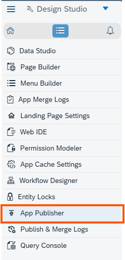

Note: Menu will only be shown if app_util flavor is assigned to the user.

## Process to Use the screen

> **Step 1:**
>
> On accessing the above-mentioned url, **the login** page will open as shown in the image below.
>
> Give the username and password (Developers have their **Developer ID** and **password**) for sign-in. (This process is skipped if navigated through menu)

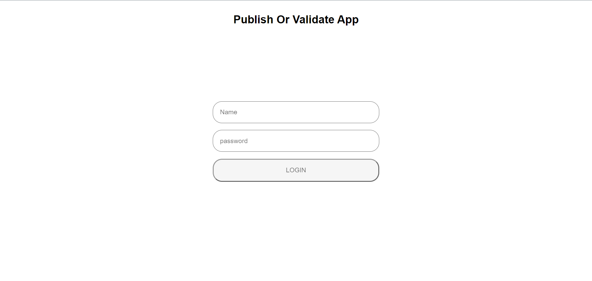

> **Step 2:** - After signing in, a **Publish or Validate App** screen will open.
>
> 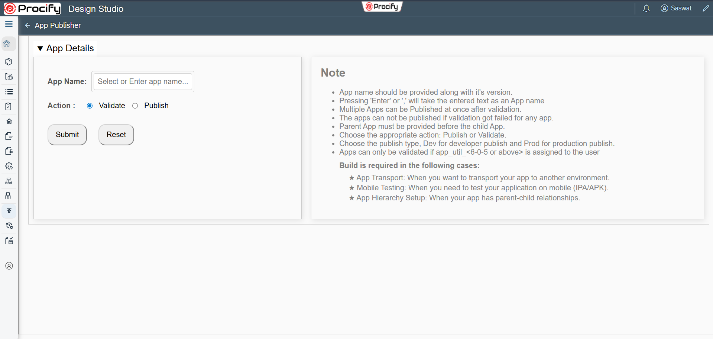

**Step 3:**

Write the **app** with its app version and then select the **action** to either **Publish** or **Validate** **app.**

- Dropdown will be shown when the page is opened from the menu.

- On pressing enter or comma it takes the string as an entry.

- Even if enter or comma is not pressed, on submit it will take the string as an entry.

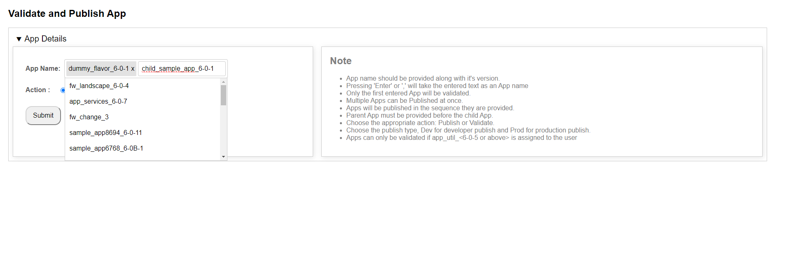

#### For Publish

- Choose the Build Type from the given option to Publish the App.

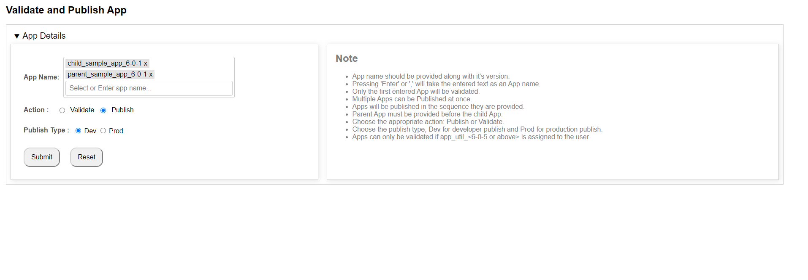

-

- **Publish action** will show the response for that flavor as shown below. And status can be checked using the Refresh button provided below App details.

#### Dependencies changes Suggestion

On click of submit option for publishing a suggestion popup will be shown to the users in case there are any changes detected in the provided apps dependencies. The popup will not be shown incase of no changes detected.

These suggestions are determined based upon calculating the time difference between the last metadata save and the last publish time, if the last metadata save time is latest then the dependent app will be considered for suggestions.

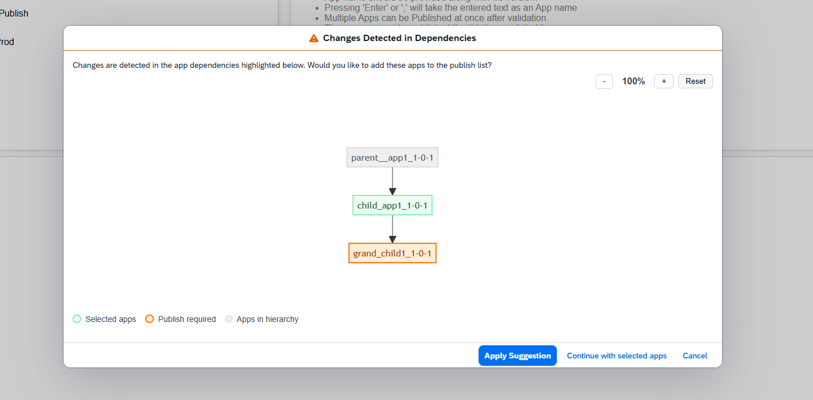

Actions

- Apply suggestions - will include the suggestion apps to the publish list

- Continue with selected apps - will skip the suggestions and continue with the user provided apps list

- Cancel - will close the popup & publish will not be triggered.

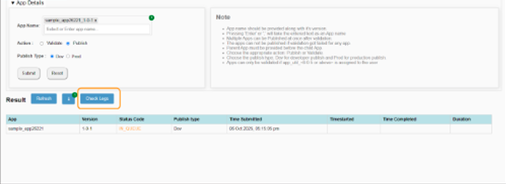

The **Build History** screen allows users to view and filter logs related to various app builds.Refer for more details-[*Build History Screen*](https://docs.google.com/document/d/1_T5hfybzKXufUxvsDC_snudhraolv-NDL5UNnne3AfM/edit?tab=t.0)
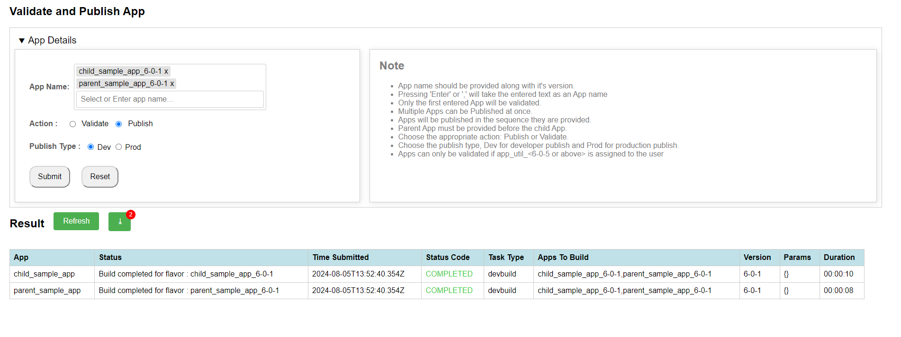**

**

- Single or multiple apps can be published.

- Before Publish, it will validate all the selected apps.

- If validation fails for any of the flavors, no apps will be published.

- Selected apps will be published only when all the apps will be validated and there will be no errors.

- If some of the apps are already IN-QUEUE and Publish is triggered for the same apps again. The completed apps will go to publish again but for IN-QUEUE apps one message will be shown that some of the apps are already IN-QUEUE.

##### Validation failed scenario during publish

Before initiating the build, all flavors are validated. If any application has a validation error, the build will be blocked and an error list will be displayed, as shown in the screenshot below:

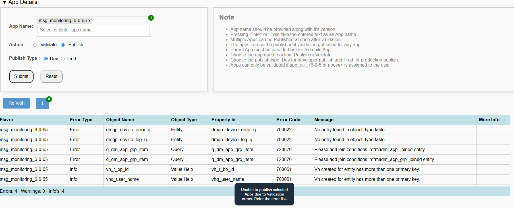

However, if a flavor contains only warnings or informational messages, a dialog box will appear, allowing the user to choose whether to view the messages or proceed with the build as shown in the screenshot below:
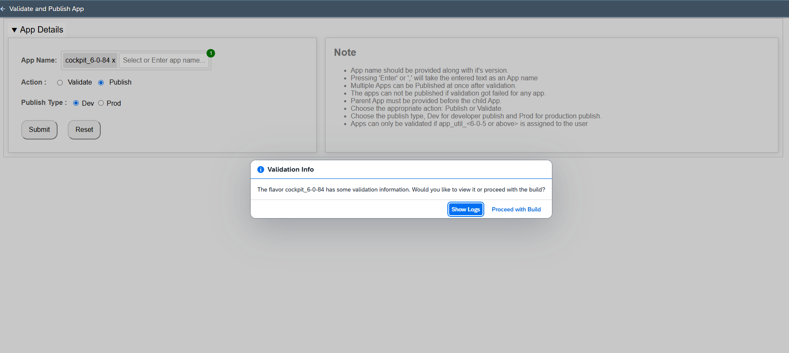

If the user selects Show Logs, it will show all the info as:

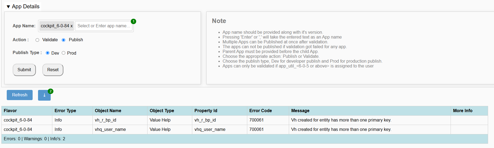

Else if user selects Proceed with build, the flavor will be published.

#### For Validate

- Choose the validate option in order to validate the flavor.

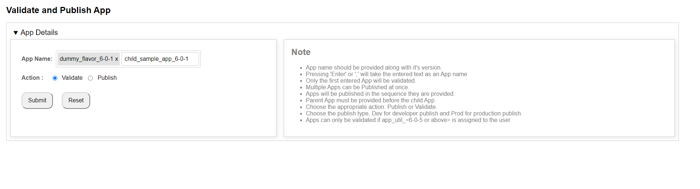

- Press Submit, It will show if there is any error.
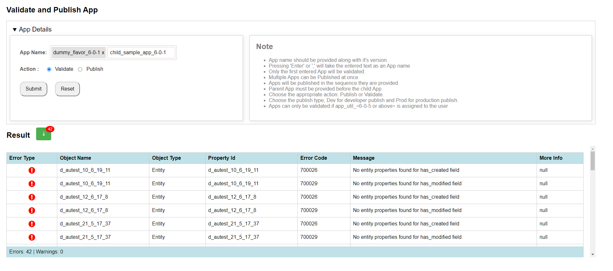

- Validation for multiple flavors is possible.

Step 4 - Downloading the result as xlsx

- Press the download button for downloading the result.

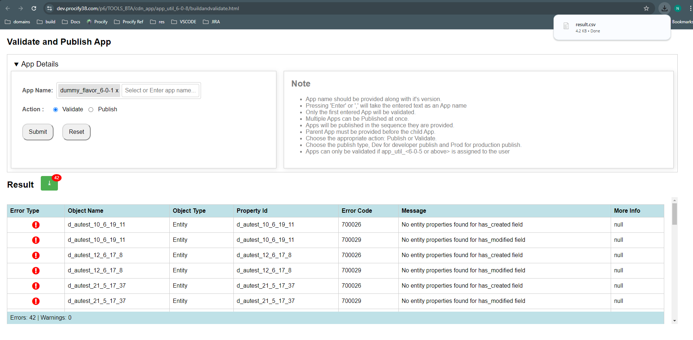

## Using the URL for Build

In order to build the application using the URL directly (in case login is not working), the URL should be as below. Replace the placeholders with values as per your requirement.

https://\<your_domain\>/p6/\<your_landscape\>/closedmodules/\<app_util_ver\>/buildandvalidate.html?appName=\<AppNames\>&action=\<Action\>&environment=\<Environment\>

| **Place holder** | **Description**                                                                                                                                                                                |
|------------------|------------------------------------------------------------------------------------------------------------------------------------------------------------------------------------------------|
| your_domain      | E.g.: dev.procify31.com                                                                                                                                                                        |
| your_landscape   | E.g.: CTOOLS_DEV                                                                                                                                                                               |
| app_util_ver     | E.g.: app_util_6-0-13                                                                                                                                                                          |
| AppNames         | E.g: sample_app7637_2-0-1                                                                                                                                                                      |
| Action           | **Following actions are possible“publish” Use this action if you want to Build the application“validate” Use this action if you want to validate the application and see the errors.** |
| Environment:     | **dev** OR **prod.**(if action is publish)                                                                                                                                                     |

**Note:** In case you want to build multiple applications, specify the same separated by comma ‘,’

Example: https://dev.procify31.com/p6/CTOOLS_DEV/closedmodules/app_util_6-0-13/buildandvalidate.html?appName=sample_app7637_2-0-1,bol_test_1,tpr_test_6-0-3&action=publish&environment=dev

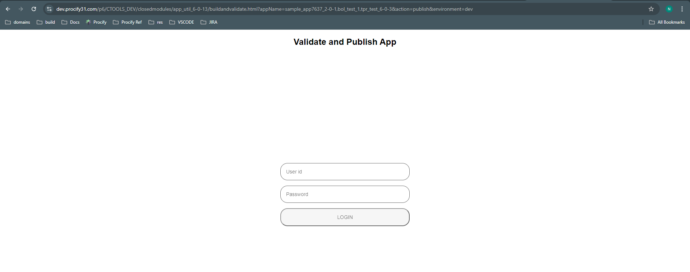

It will ask for credentials if the url is directly entered.

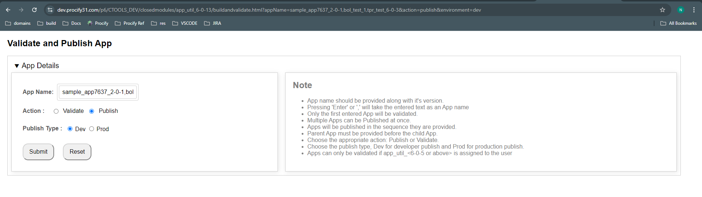

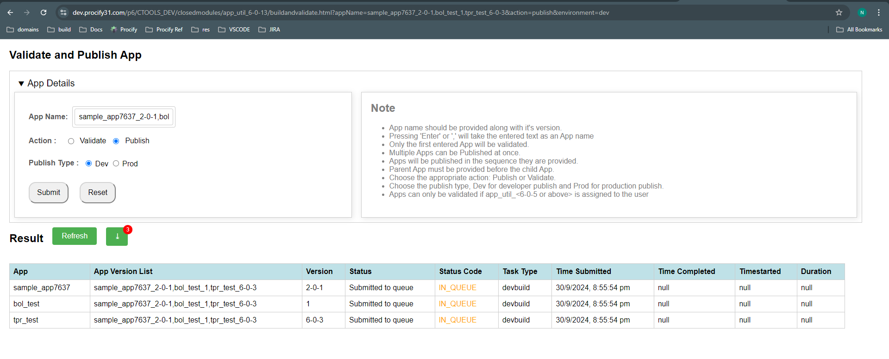

**Note**: During the build process, it is mandatory for the parent app to be built first, followed by the child app. However, if the users do not follow this build sequence, the app sequence will be automatically corrected during the build even if the user uses the app utility screen or build url.
