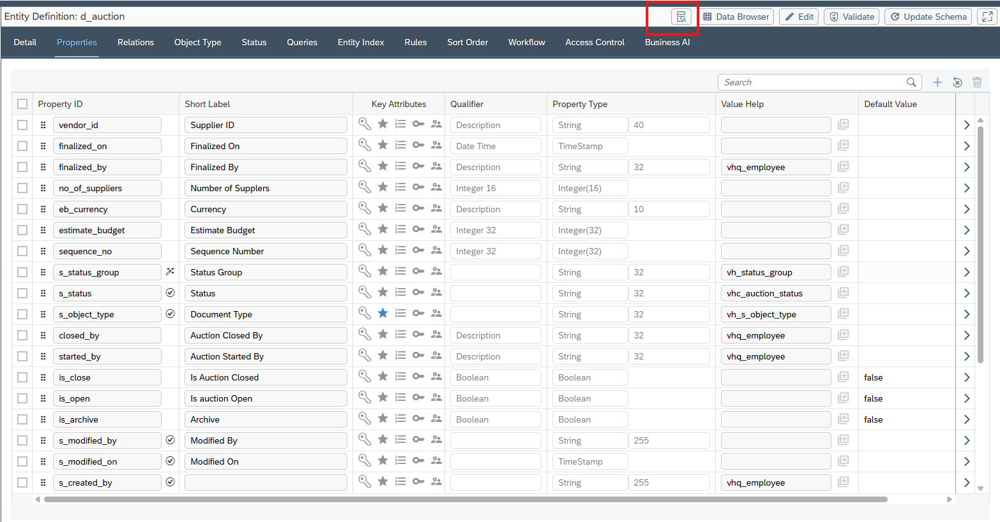
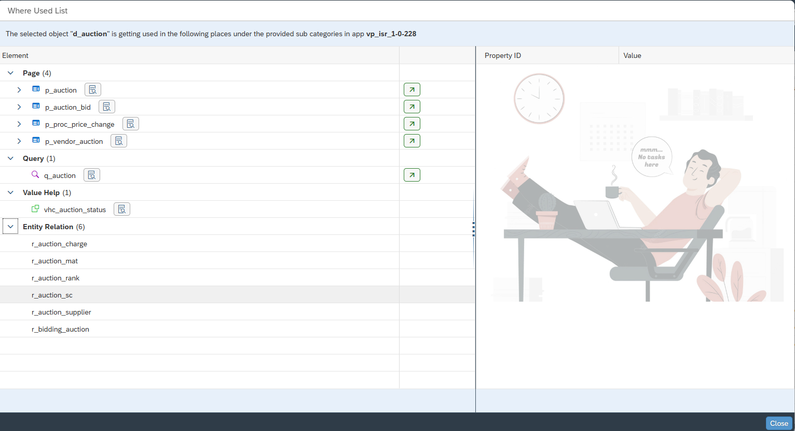
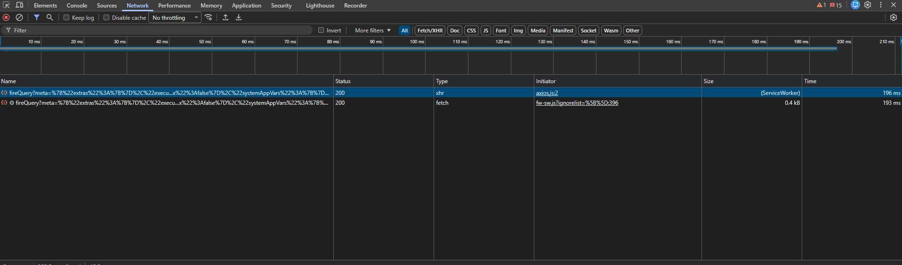
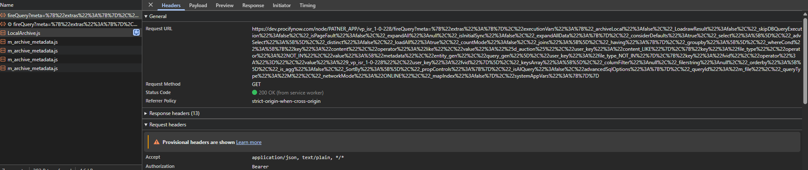
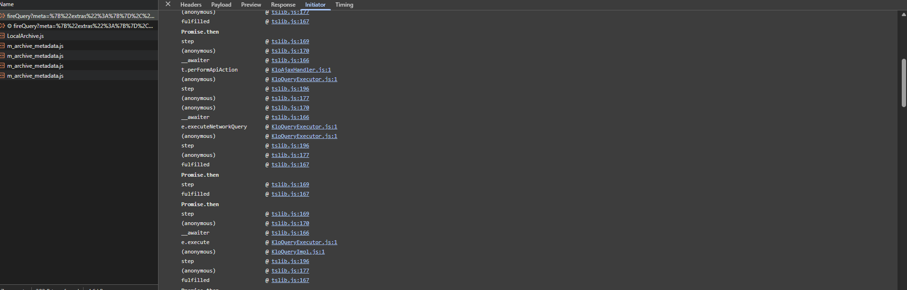
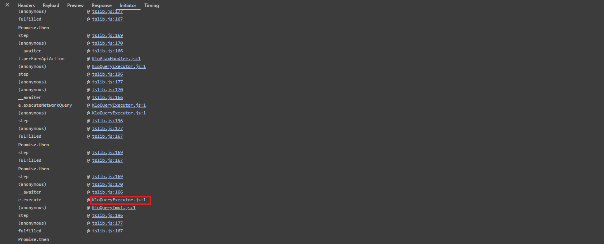
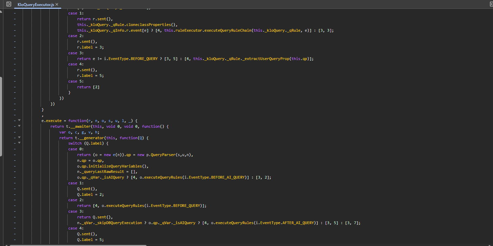
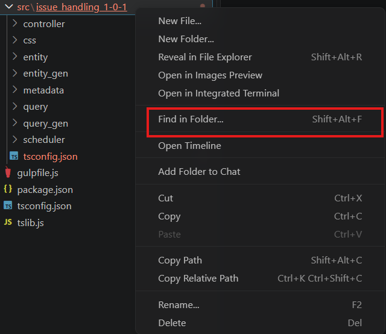
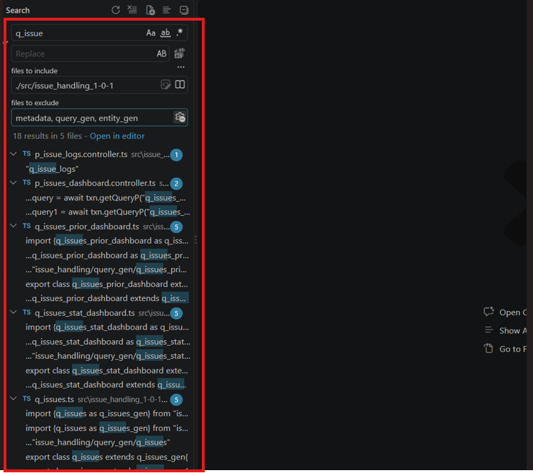
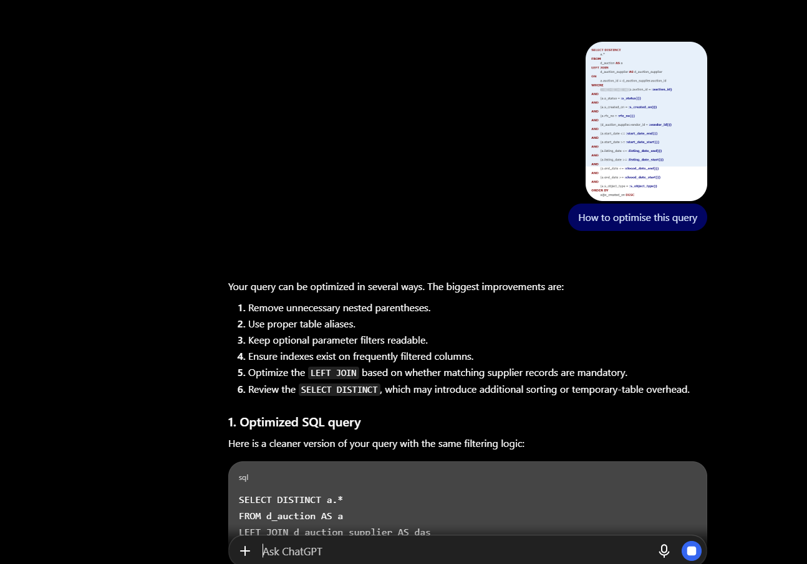

# Query Analysis — How to enable the feature

Not Applicable — the methods in this guide (Where Used List, Network Initiator, Private Node search, query logging) are built-in platform capabilities and do not require separate enablement. The optional logging flags are listed under Configurations below and [Google Cloud Logging](https://docs.google.com/document/d/1CSOdWFmiOjwtPTyDCY--v_2_UQA31wBZ3JXKRLhcTU8/edit?tab=t.0) guide.

## 3.1 How to use the feature

### A. Finding the source of a query — Where Used List (Procify Data Studio)

1. Open Procify Data Studio and select the App/Flavor that owns the entity or query in question.

2. In the entity/query tree, locate the Entity, Query, Property, Value Help, or Event Exit you want to trace.

3. Open the “Where Used List” option for that object. It lists every screen, query, rule, or event exit that references it, along with the property type / value help used where applicable.

   

   

4. Use this list to narrow down which module(s)/screen(s) could be responsible for firing the query, before checking Network calls or code.

### B. Finding the source of a query — Chrome Network Initiator

1. Open the application in Chrome and press F12 (or right-click → Inspect) to open DevTools.

2. Switch to the Network tab, make sure recording is on, and clear existing entries for a clean trace.

   

3. Reproduce the action in the application so the request fires.

4. Find the relevant XHR/Fetch request (filter by “Fetch/XHR”).

   

5. Click the request, then open the “Initiator” tab — it shows the call stack (exact file and line) that issued the request.

   

6. Click any frame in the Initiator stack to jump to that source line in the Sources panel.

   

   

### C. Finding the source of a query — Private Node (Find in Folder)

1. Set up / start your Private Node for the flavor in question.

2. Open the application’s source checkout in VS Code, e.g. the src folder under the flavor’s workspace.

3. In the Explorer, right-click the src folder → Find in Folder.

   

4. Search for the query ID / entity ID / property name. Use “Match Whole Word” to avoid false positives.

   

5. Review every places where this query/entity is used

### D. Optimizing the query

1. Paste the query definition and surrounding code into an AI assistant (**Recommended : Claude AI with Procify Knowledge Assistant**) and ask for unnecessary joins, unused columns, and missing filters/indexes. Never paste real customer data or credentials.

   

2. Apply setPartialSelect([...]) to return only the needed entity properties.

3. Set setLoadAll(false) unless full-row data is genuinely required.

4. Apply setLimit(n)

6. Push filters into the query (setColumnFilter) instead of filtering in code afterward.

7. **Important**: Expand All and an INNER JOIN on the same relation are not supported together — confirm which is configured before removing either.

8. Re-run the optimized query in the Query Console and compare row counts / execution time.

   [Query Console- User Guide](https://docs.google.com/document/d/1xxTD902y0f_WHlcfPJRPq095EzjmCDaBRcFBzesMYSs/edit?tab=t.0#heading=h.gjdgxs)

9. Re-run the screen end-to-end on Private Node and capture a before/after timing as evidence.

### E. Using addEndpoint and other apis efficiently

| **SN** | **Steps**                                                                                                                    |
|--------|------------------------------------------------------------------------------------------------------------------------------|
| 1      | Call addEndpoint once per Business Object, not once per child entity — it already sends the full BO tree by default.         |
| 2      | Leave onlydirtyobject at its default (true) to send only changed children; set false only when every child must be included. |
| 3      | Leave onlyRootEntity at its default (false) so children are included automatically.                                          |
| 4      | Consolidate repeated addEndpoint calls against the same BO’s children into one call.                                         |
