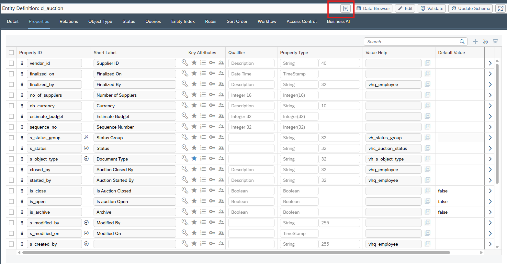
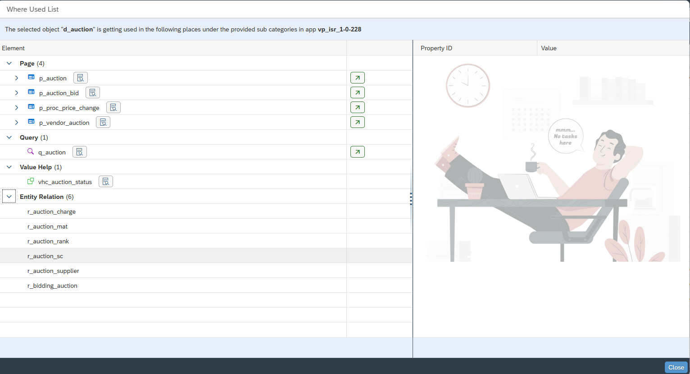
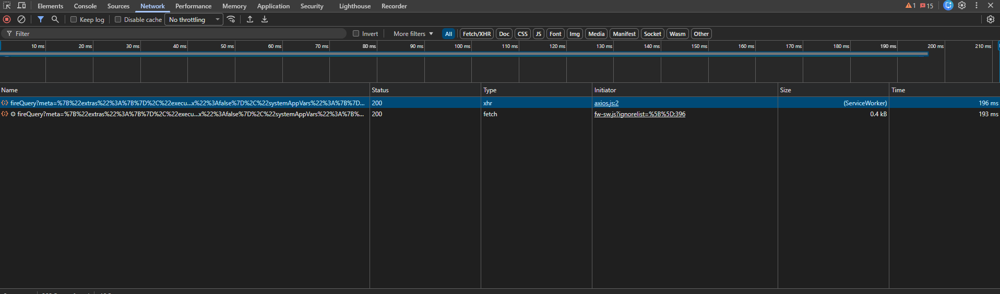
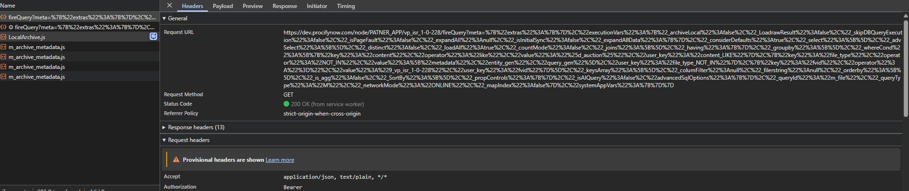
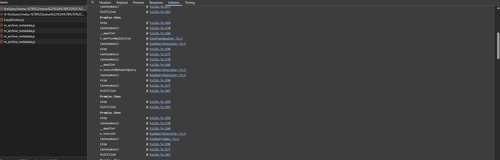
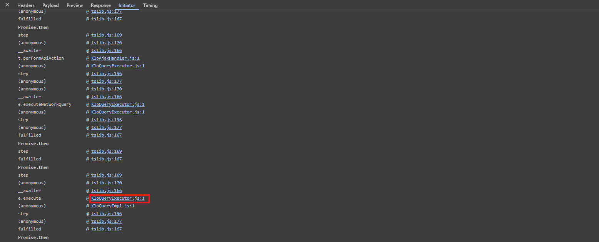
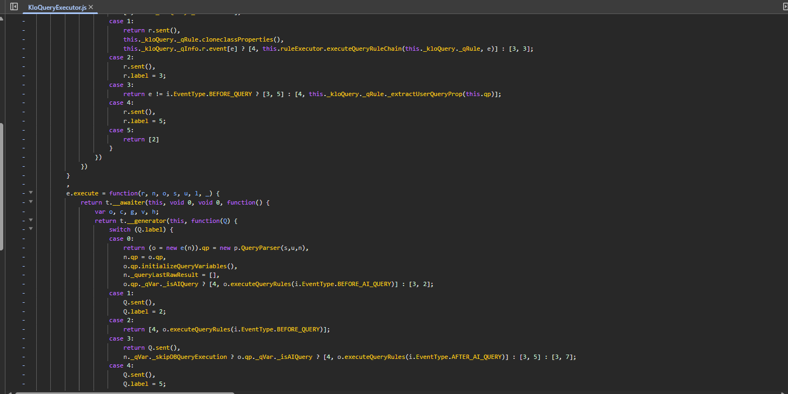
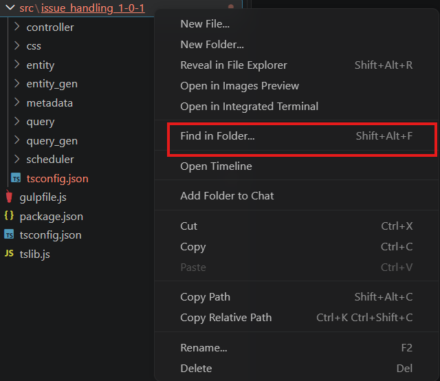
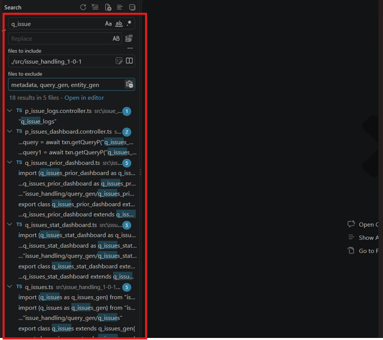
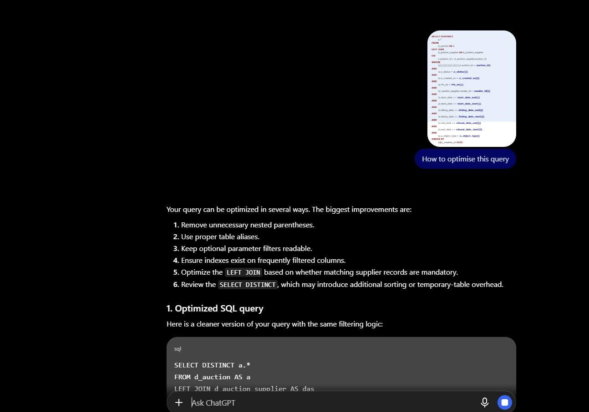

> **Query Analysis User Guide**

**Date of Issue: 30 October 2026**

**Target Audience: Application Developers, Consultants, Trainees**

**Prepared by: [Raman Kumar Gupta](mailto:raman@procifynow.com)**

**Platform Version: 7.2.x**

*A User Manual for application creation, knowledge and work reference.*

Copyright

Copyright © 2023 Procify Innovations Pvt. Ltd. All rights reserved.

No part of this publication may be reproduced or transmitted in any form or without purpose the permission of **Procify Innovations Pvt. Ltd.** The information contained in this document might change on the basis of new developments without prior notice.

Disclaimer

THESE MATERIALS ARE PROVIDED BY PROCIFY INNOVATIONS PVT LTD, ON AN "AS IS" BASIS, AND EXPRESSLY DISCLAIMS ANY AND ALL WARRANTIES, EXPRESS OR APPLIED, INCLUDING WITHOUT LIMITATION WARRANTIES OF MERCHANTABILITY AND FITNESS FOR A PARTICULAR PURPOSE, WITH RESPECT TO THESE MATERIALS AND THE SERVICE, INFORMATION, TEXT, GRAPHICS, LINKS, OR ANY OTHER MATERIALS AND PRODUCTS CONTAINED HEREIN. IN NO EVENT SHALL PROCIFY INNOVATIONS PVT LTD BE LIABLE FOR ANY DIRECT, INDIRECT, SPECIAL, INCIDENTAL, CONSEQUENTIAL, OR PUNITIVE DAMAGES OF ANY KIND WHATSOEVER, INCLUDING WITHOUT LIMITATION LOST REVENUES OR LOST PROFITS, WHICH MAY RESULT FROM THE USE OF THESE MATERIALS OR INCLUDED SOFTWARE COMPONENTS.

# Overview

This document helps the Application Team find the exact source of a query fired from a Procify application, optimize that query, trace the generated SQL, and use the relevant framework (FW) APIs efficiently.

Details about

- Covers: locating the query source, query optimization techniques, enabling sufficient logging to inspect the generated query, and using FW APIs (e.g. addEndpoint) optimally.

# Pre-requisites

- Access to Procify [Data Studio](https://sites.google.com/procifynow.com/procifyhelpcenter/application-development/toolseditors-user-guide#h.k0fvpz8is6zx) for the app/flavor under investigation.

- A working Private Node checkout of the application source (see the [Private Node Setup](https://sites.google.com/procifynow.com/procifyhelpcenter/application-development/installation-guide#h.x9olvjb5nmok) guide).

- Access to Design Studio → [Query Console](https://docs.google.com/document/d/1xxTD902y0f_WHlcfPJRPq095EzjmCDaBRcFBzesMYSs/edit?tab=t.0#heading=h.gjdgxs) (formerly SQL Executor).

- Access to [Google Cloud Logging](https://docs.google.com/document/d/1CSOdWFmiOjwtPTyDCY--v_2_UQA31wBZ3JXKRLhcTU8/edit?tab=t.0) for the environment under investigation.

# How to enable the feature

Not Applicable — the methods in this guide (Where Used List, Network Initiator, Private Node search, query logging) are built-in platform capabilities and do not require separate enablement. The optional logging flags are listed under Configurations below and [Google Cloud Logging](https://docs.google.com/document/d/1CSOdWFmiOjwtPTyDCY--v_2_UQA31wBZ3JXKRLhcTU8/edit?tab=t.0) guide.

## 3.1 How to use the feature

### A. Finding the source of a query — Where Used List (Procify Data Studio)

1. Open Procify Data Studio and select the App/Flavor that owns the entity or query in question.

2. In the entity/query tree, locate the Entity, Query, Property, Value Help, or Event Exit you want to trace.

3. Open the “Where Used List” option for that object. It lists every screen, query, rule, or event exit that references it, along with the property type / value help used where applicable.

   

   

4. Use this list to narrow down which module(s)/screen(s) could be responsible for firing the query, before checking Network calls or code.

### B. Finding the source of a query — Chrome Network Initiator

1. Open the application in Chrome and press F12 (or right-click → Inspect) to open DevTools.

2. Switch to the Network tab, make sure recording is on, and clear existing entries for a clean trace.

   

3. Reproduce the action in the application so the request fires.

4. Find the relevant XHR/Fetch request (filter by “Fetch/XHR”).

   

5. Click the request, then open the “Initiator” tab — it shows the call stack (exact file and line) that issued the request.

   

6. Click any frame in the Initiator stack to jump to that source line in the Sources panel.

   

   

### C. Finding the source of a query — Private Node (Find in Folder)

1. Set up / start your Private Node for the flavor in question.

2. Open the application’s source checkout in VS Code, e.g. the src folder under the flavor’s workspace.

3. In the Explorer, right-click the src folder → Find in Folder.

   

4. Search for the query ID / entity ID / property name. Use “Match Whole Word” to avoid false positives.

   

5. Review every places where this query/entity is used

### D. Optimizing the query

1. Paste the query definition and surrounding code into an AI assistant (**Recommended : Claude AI with Procify Knowledge Assistant**) and ask for unnecessary joins, unused columns, and missing filters/indexes. Never paste real customer data or credentials.

   

2. Apply setPartialSelect([...]) to return only the needed entity properties.

3. Set setLoadAll(false) unless full-row data is genuinely required.

4. Apply setLimit(n)

6. Push filters into the query (setColumnFilter) instead of filtering in code afterward.

7. **Important**: Expand All and an INNER JOIN on the same relation are not supported together — confirm which is configured before removing either.

8. Re-run the optimized query in the Query Console and compare row counts / execution time.

   [Query Console- User Guide](https://docs.google.com/document/d/1xxTD902y0f_WHlcfPJRPq095EzjmCDaBRcFBzesMYSs/edit?tab=t.0#heading=h.gjdgxs)

9. Re-run the screen end-to-end on Private Node and capture a before/after timing as evidence.

### E. Using addEndpoint and other apis efficiently

| **SN** | **Steps**                                                                                                                    |
|--------|------------------------------------------------------------------------------------------------------------------------------|
| 1      | Call addEndpoint once per Business Object, not once per child entity — it already sends the full BO tree by default.         |
| 2      | Leave onlydirtyobject at its default (true) to send only changed children; set false only when every child must be included. |
| 3      | Leave onlyRootEntity at its default (false) so children are included automatically.                                          |
| 4      | Consolidate repeated addEndpoint calls against the same BO’s children into one call.                                         |

# Configurations

The following flags and settings control how much query/transaction detail is captured for debugging, without needing extra code.

| **Parameter**                        | **Description**                                                                                                                                                                                     |
|--------------------------------------|-----------------------------------------------------------------------------------------------------------------------------------------------------------------------------------------------------|
| txn.enableStackTrace                 | Boolean on the transaction (default false). Set true to record a stack trace of all activities of the transaction, including queries executed. Switch off again once captured.                      |
| enableQueryStats                     | Framework-internal flag (default true) driving query statistics collection. Do not disable unless instructed by platform engineering.                                                               |
| "enableReqDump": true (klarion.json) | Captures full incoming request payloads into the req_dump folder. Disabled by default. Turn off again after the investigation — req_dump folders have previously grown to multiple GB when left on. |
| Select Distinct (Query → Detail)     | Set loadAll = true only when true column-level distinctness is required; otherwise leave Select Distinct off.                                                                                       |

# [API Details](https://sites.google.com/procifynow.com/procifyhelpcenter/application-development/api-document-links/beta-versions/beta-v7-1-3)

### setPartialSelect

| setPartialSelect(entityPropertyNames: string\[\]): KloQueryForRule |
|--------------------------------------------------------------------|

| **Parameter**       | **Description**                                                                                |
|---------------------|------------------------------------------------------------------------------------------------|
| entityPropertyNames | Array of return-entity property IDs to select, instead of every property on the return entity. |

### setLoadAll

| setLoadAll(val: boolean): KloQueryForRule |
|-------------------------------------------|

| **Parameter** | **Description**                                                                                                         |
|---------------|-------------------------------------------------------------------------------------------------------------------------|
| val           | Whether to load all fields of the return entity at execution time. Set false to skip properties/relations not required. |

### setLimit

| setLimit(limitValue: number): KloQueryForRule |
|-----------------------------------------------|

| **Parameter** | **Description**                                                                 |
|---------------|---------------------------------------------------------------------------------|
| limitValue    | Maximum number of records to fetch — use for pagination on list/search screens. |

### setExpandAll

| setExpandAll(relations: string): string |
|-----------------------------------------|

| **Parameter** | **Description**                                                                                         |
|---------------|---------------------------------------------------------------------------------------------------------|
| relations     | Comma-separated relation IDs to expand. Not supported together with an INNER JOIN on the same relation. |

### addEndpoint

| addEndpoint(endpoint, type, channel, object?, onlydirtyobject?, onlyRootEntity?): EndPointBean |
|------------------------------------------------------------------------------------------------|

| **Parameter**   | **Description**                                                                         |
|-----------------|-----------------------------------------------------------------------------------------|
| endpoint        | Endpoint ID(s) to notify — meaning depends on type (BP_USER, ENDPOINT, USER).           |
| type            | EndpointType — determines how endpoint is interpreted.                                  |
| channel         | ChannelType filter on qualifying endpoints (default DEVICE).                            |
| object          | The KloEntity whose full BO tree is sent. Defaults to the event object.                 |
| onlydirtyobject | Default true — only dirty child entities are included. Set false to force all children. |
| onlyRootEntity  | Default false — children already included. Set true to send the root entity alone.      |

*Note: A single addEndpoint call already messages the root entity and its (dirty) children — avoid a separate call per child entity.*

### getExecutedQuery

| getExecutedQuery(queryid, saveQueryObj, flavor?): Promise\<KloEntitySet\<KloEntity\>\> |
|----------------------------------------------------------------------------------------|

| **Parameter** | **Description**                                     |
|---------------|-----------------------------------------------------|
| queryid       | Query name or entity name.                          |
| saveQueryObj  | Saved query parameters to apply.                    |
| flavor        | Optional — flavor to resolve the query/entity from. |

# 6. References

- [Query Console- User Guide](https://docs.google.com/document/d/1xxTD902y0f_WHlcfPJRPq095EzjmCDaBRcFBzesMYSs/edit?tab=t.0#heading=h.gjdgxs)

- [Data Studio- User Guide 7.0](https://docs.google.com/document/d/1TZCiIbpOLvFzD4Qp6HrLiJafHC3OOKDvIcDAtmGRHbA/edit?tab=t.0#heading=h.omrc2q54ofg7)

- [BOL- Reference Guide](https://docs.google.com/document/d/1_aI6AqRua_tkdhe35M7y6xUhUfcCUJ64FOraeseGa-c/edit?tab=t.0#heading=h.gjdgxs)

- [Slow Query Log](https://docs.google.com/document/d/1Z4Mt0CS5xONQsk_OqAcIc0yPsyTfOFuDS_On4XfT3Co/edit?tab=t.0#heading=h.lf28x0aminyl)

- [Logging 6.0](https://docs.google.com/document/d/1CSOdWFmiOjwtPTyDCY--v_2_UQA31wBZ3JXKRLhcTU8/edit?tab=t.0)

- [Message Monitoring 7.0 - User Guide](https://docs.google.com/document/d/1Q8nr-_BNUYdOos91QoDUa671kPXF1fgyYI4K8meNAwY/edit?tab=t.0)

- [API Documentation Links](https://sites.google.com/procifynow.com/procifyhelpcenter/application-development/api-document-links/beta-versions/beta-v7-1-3)
