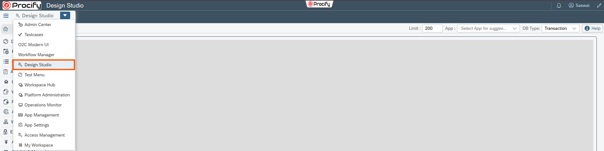
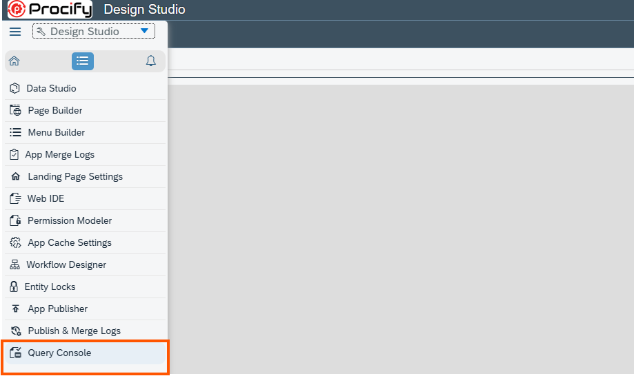
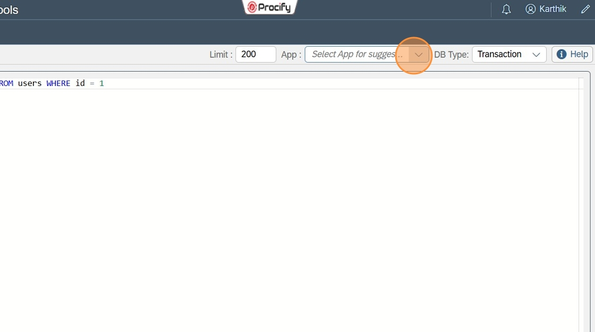
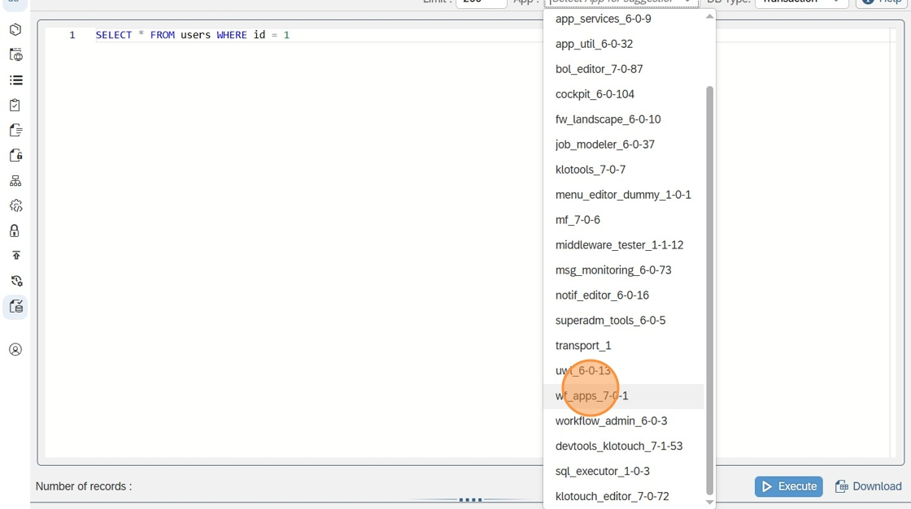
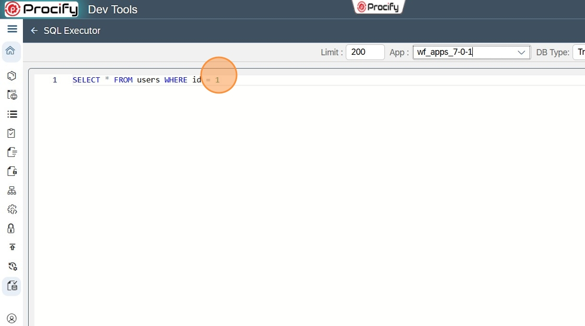
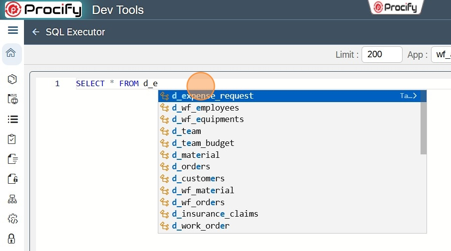
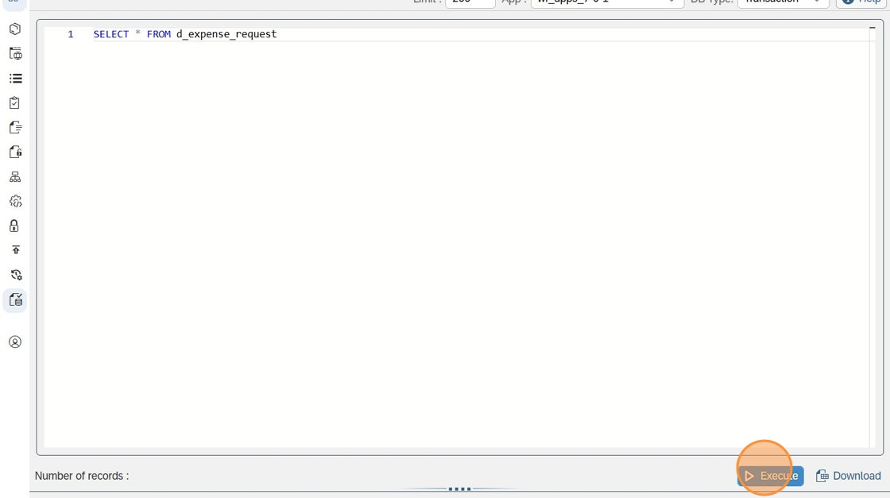
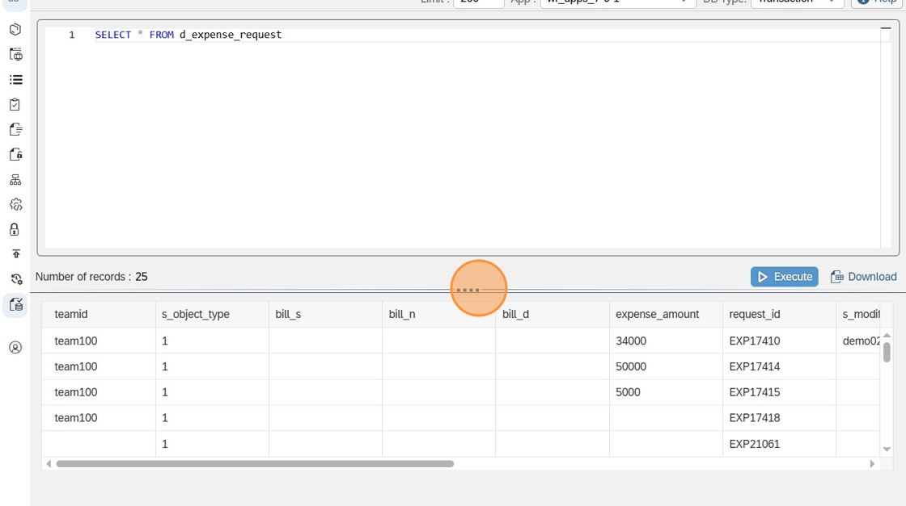
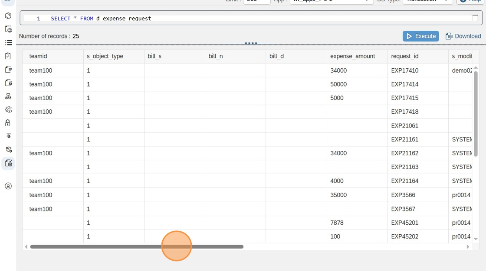
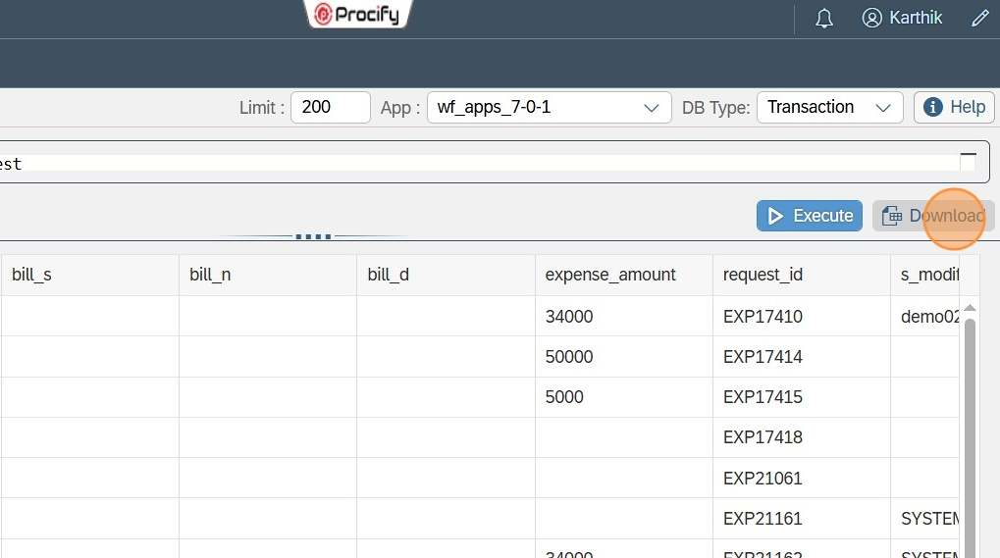

# Query Console — Steps to Use

1\. Select Page Builder header from the menu

2\. Select "Query Console" menu item to navigate to the SQL Executer application

3\. Use the app selection dropdown to select your application

4\. From the apps dropdown select your application

5\. Use the SQL Editor section to write the SQL statements

6\. Auto complete suggestions will also be shown based upon the selected application

7\. Click "Execute" to execute the query

8\. Use the splitter to expand the result section

9\. Use the horizontal scrollbar to navigate through all the table columns

10\. Click "Download" to download the results in a xlsx file

