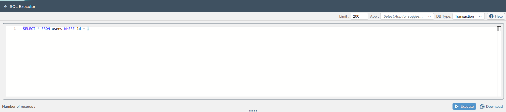
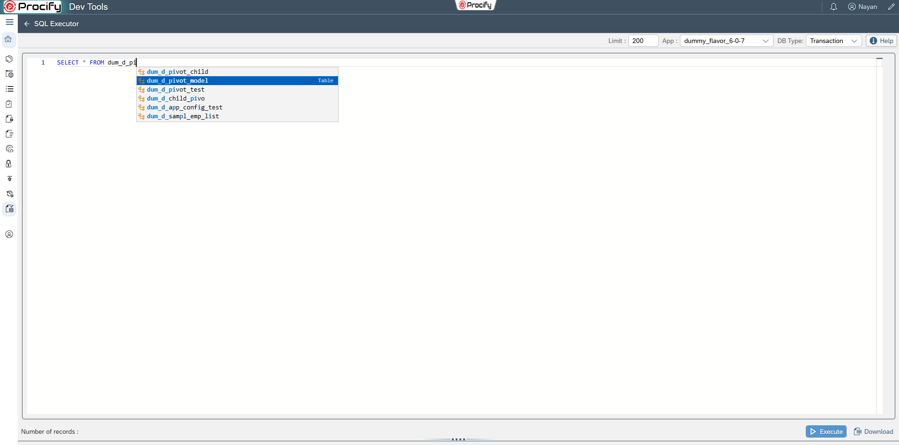
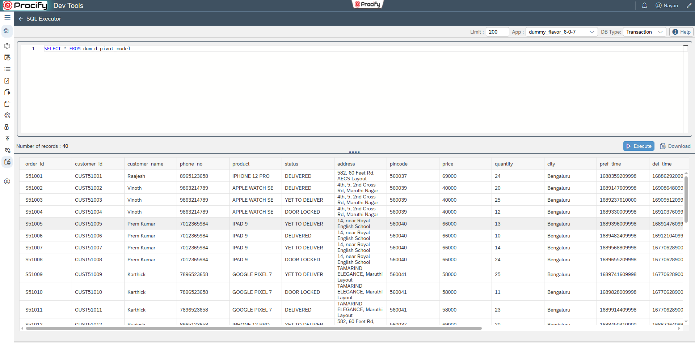
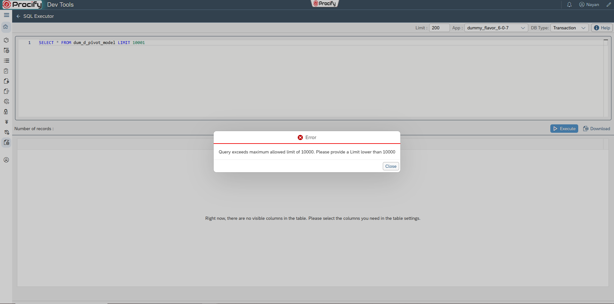
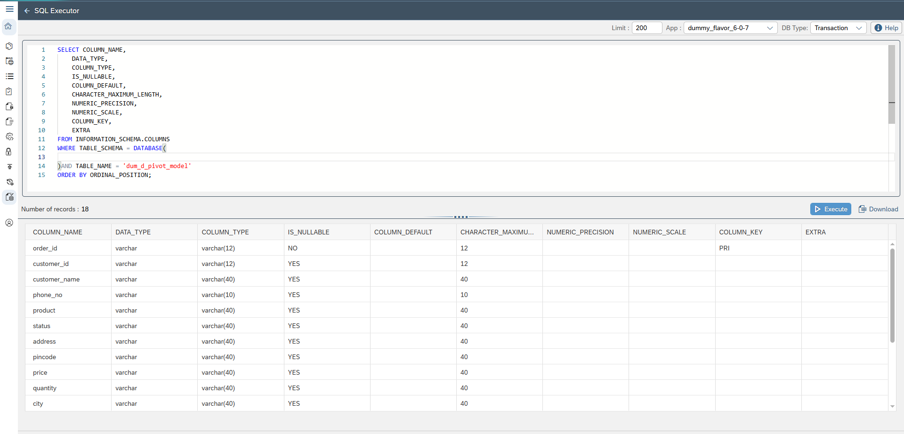
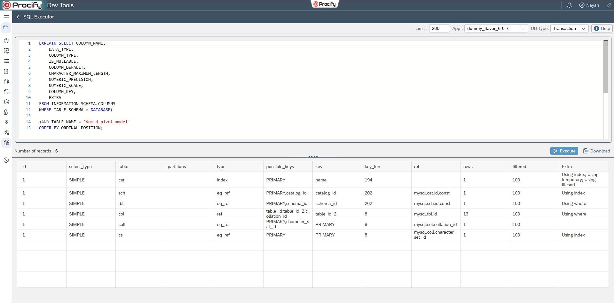
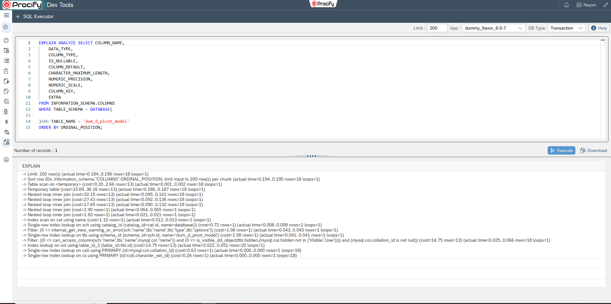

# Query Console — Functionalities

There is a panel of fields and buttons on the top-right-hand side of the Query Console screen as highlighted in the image below:

The following are the functionalities of these:

[TABLE]

## Examples

### Table Suggestions:

### Execution Results:

### Exceeding Limit:

### Getting Column details:

### Explaining a query:

### Analyze a query:

