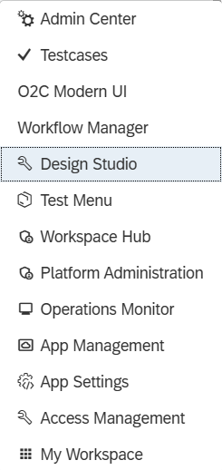
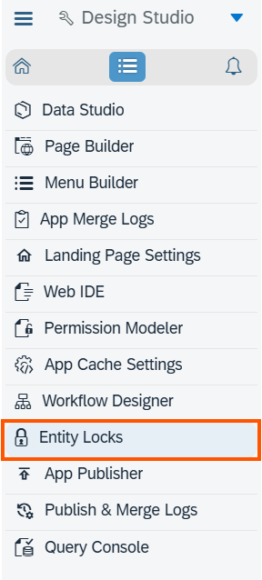
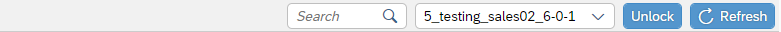
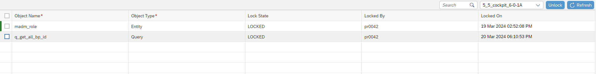
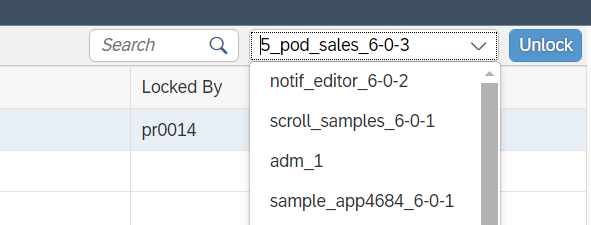
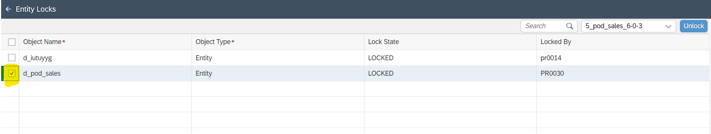
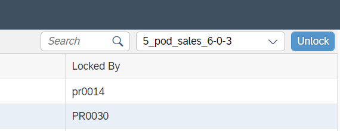
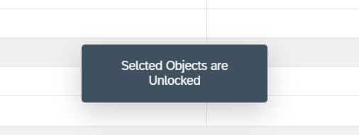

# Overview

In the Data Studio, when a user is working on any particular entity/query/value help then that object will be locked. Hence, other users will be restricted to modify the locked objects. Those objects will be unlocked as soon as the user clicks on the save button. If the user forgets to click on save and log off, in the meantime if someone wants to modify that object, then they can use the Unlock entity page to unlock the locked object.

## Navigation to Record Lock Manager

**Step 1:** Select the **Design Studio** menu header.

**Step 2:** Click the **Record Lock Manager** menu item.

## Toolbar Options

### Fuzzy Search

Users can search for any particular object with the object name (**Example:** d_no_items, q_notifications) in that particular app.

### App Selection

Assigned apps for the users will be listed in the dropdown, users can select the app in which they want to unlock an entity.

### Unlock

With a click of the unlock button, the selected objects from the list will be unlocked.

### Refresh

With a click of the Refresh button, the list of entities of selected apps is refreshed.

## List

| **Columns** | **Description**                                                                                              |
|-------------|--------------------------------------------------------------------------------------------------------------|
| Object Name | It will list the names of the objects(entity, query, value help) that have been locked for the selected app. |
| Object Type | It will display the type of the objects(Entity / Query / Value Help).                                        |
| Lock State  | It will show the current state of the object.                                                                |
| Locked By   | It will show the user ID by whom the object has been locked.                                                 |
| Locked On   | It will show the entity-locked date and time                                                                 |

## Unlocking an Object

To unlock an object follow the below steps:

**Step 1:** Select the app from the dropdown.

**Step 2:** Select the objects

**Step 3:** Click on the unlock button.

On clicking on unlock the selected objects will be unlocked and a success message toast will be shown.

