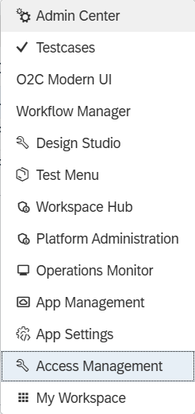
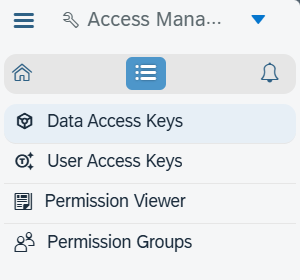
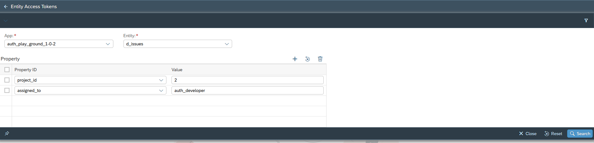
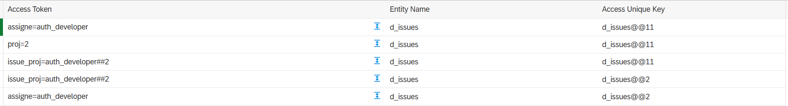
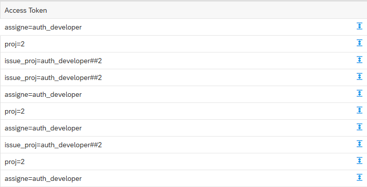
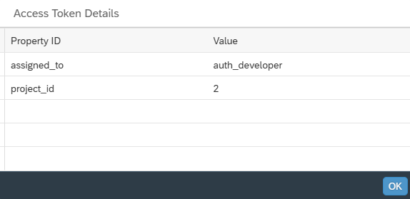
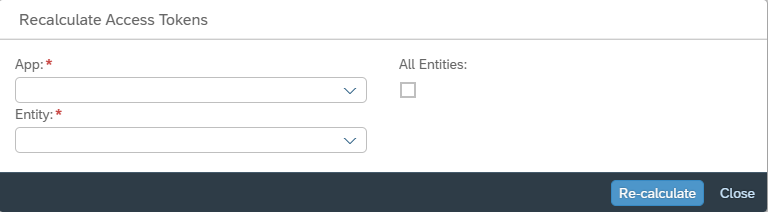
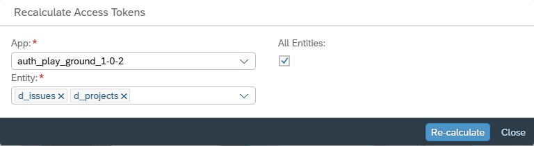
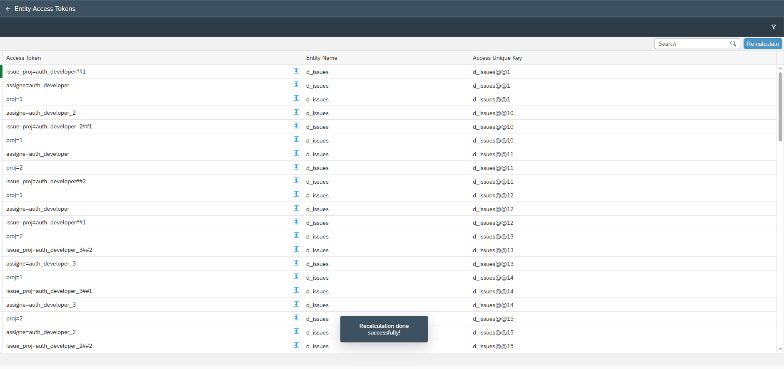

# How to use Data Access Rules

## 12.1 Navigation to Data Access Rules;

**Step 1:** Select the **Security & Permissions** menu header.

**Step 2:** Select the **Data Access Rules** menu item.

## 12.2 Search and List

### 12.2.1. Advanced Search

- To view the token list, users must first use the advanced search and fill in the required fields. The **App** and **Entity** fields are mandatory.

**Note :** This action will fetch tokens present for each record in the entity. It may result in huge data loading. Make sure to apply respective filter click search.

- After entering the data and clicking the **Search** button, the system will load the available access tokens for the selected application’s entity, including its properties if they are added in the advanced search.

<table>
<colgroup>
<col style="width: 32%" />
<col style="width: 67%" />
</colgroup>
<thead>
<tr class="header">
<th><strong>Fields</strong></th>
<th><strong>Description</strong></th>
</tr>
<tr class="odd">
<th><strong>App</strong></th>
<th><blockquote>

It will allow the users to select an app. (Mandatory Field)

<strong>It will list down the flavors assigned to the logged in user as MANAGER.</strong>

</blockquote></th>
</tr>
<tr class="header">
<th><strong>Entity</strong></th>
<th><blockquote>

It will allow the users to select an entity to view its tokens. (Mandatory Field)

<strong>It will list down the entities which are row wise authorized.</strong>

</blockquote></th>
</tr>
<tr class="odd">
<th><strong>Property</strong></th>
<th><blockquote>

A grid screen where users can add multiple properties and their values to filter access tokens.

<strong>Duplicate properties cannot be added.</strong>

</blockquote></th>
</tr>
</thead>
<tbody>
</tbody>
</table>

### 12.2.2. Data Access Rules List

After using the advanced search, users can view the list of available tokens for the selected entity on the screen.

<table>
<colgroup>
<col style="width: 32%" />
<col style="width: 67%" />
</colgroup>
<thead>
<tr class="header">
<th><strong>Fields</strong></th>
<th><strong>Description</strong></th>
</tr>
<tr class="odd">
<th><strong>Access Token</strong></th>
<th><blockquote>

Displays the access token.

The "blue" icon in this column opens a dialog to view the relevant property(ies) and value(s).

<strong>Note :</strong> This button might not work for access tokens added via callback, or if the access key is used in more than one access token templated in boleditor.

</blockquote></th>
</tr>
<tr class="header">
<th><strong>Entity Name</strong></th>
<th><blockquote>

Displays the entity name associated with the respective tokens.

<strong>Note :</strong> All tokens are stored against BO. But, some are generated by the root objects, and some are generated from child objects.

</blockquote></th>
</tr>
<tr class="odd">
<th><strong>Access Unique Key</strong></th>
<th><blockquote>

Displays the entity unique key of the object due to which the access token is generated.

</blockquote></th>
</tr>
</thead>
<tbody>
</tbody>
</table>

#### 12.2.2.1 Property Dialog

- Clicking the 'blue' icon will display the access token details for that specific token.

## 12.3 Toolbar Options

### 12.3.1. Fuzzy Search

Users can search for any particular valid value to filter the list data.

### 12.3.2. Re-calculate

Users can use this action to recalculate the access tokens of an application’s entities. Multiple entities can be selected. This feature can be used to re-calculate the Data Access Keys.

| **Fields**       | **Description**                                                                  |
|------------------|----------------------------------------------------------------------------------|
| **App**          | Allows users to select an app.                                                   |
| **Entity**       | Lets users select entities for recalculation. Multiple entities can be selected. |
| **All Entities** | Clicking this will select / deselect all entities for the selected app.          |

Once the recalculation is successful, the list on the screen will update, and a success message will appear: “**Recalculation done successfully!**”.

**Note** : This is a heavy process depending upon the volume of data and complexity of row wise authorization implementation. i.e. It will re-generate all the tokens which internally calls the [<u>onAccessTokenCalculate</u>](#entity-token-callback-onaccesstokencalculate) for all existing data. Avoid triggering this during active hours in Production.

