# How to use the feature?

How does Row-wise authorization work ?

Row wise authorization works by filtering records on the server level by matching tokens (strings that are used to create a mapping) between user and data.

A simple illustration like:

**Entity Data:**

data1 -\> \[token1, token2\]

data2 -\> \[token2, token3\]

data3 -\> \[token4, token5\]

**User tokens:**

user1 -\> \[token1\] -\> \[data1\]

user2 -\> \[token1, token2\] -\> \[data1, data2\]

user3 -\> \[token3, token4\] -\> \[data2, data3\]

user4 -\> \[\] -\> \[\]

Consider an entity ENT_A, where row wise authorization is enabled, and each record in ENT_A has a set of tokens assigned to it. Consider user USER_A, who has a set of tokens for that entity assigned to him. When USER_A fires a query, he will get only the records in the entity ENT_A which have at least of the tokens that USER_A has.

Eg : Consider entity d_no_hdr

<table>
<colgroup>
<col style="width: 7%" />
<col style="width: 32%" />
<col style="width: 20%" />
<col style="width: 20%" />
<col style="width: 20%" />
</colgroup>
<thead>
<tr class="header">
<th>S.no</th>
<th>k_notif_id</th>
<th>work_center</th>
<th>plant</th>
<th>Access Tokens</th>
</tr>
<tr class="odd">
<th>1</th>
<th>10005154</th>
<th><mark>ELEC</mark></th>
<th>2000</th>
<th>
wc=elec

pl=2000
</th>
</tr>
<tr class="header">
<th>2</th>
<th>M10236914</th>
<th><mark>CIVIL</mark></th>
<th>2000</th>
<th>
wc=civil

pl=2000
</th>
</tr>
<tr class="odd">
<th>3</th>
<th>M10236913</th>
<th><mark>AIW</mark></th>
<th>2000</th>
<th>
wc=aiw

pl=2000
</th>
</tr>
<tr class="header">
<th>4</th>
<th>10005141</th>
<th><mark>AIW</mark></th>
<th>2000</th>
<th>
wc=aiw

pl=2000
</th>
</tr>
<tr class="odd">
<th>5</th>
<th>10005140</th>
<th><mark>CIVIL</mark></th>
<th>2000</th>
<th>
wc=civil

pl=2000
</th>
</tr>
<tr class="header">
<th>6</th>
<th>10005142</th>
<th><mark>CIVIL</mark></th>
<th>2002</th>
<th>
wc=civil

pl=2002
</th>
</tr>
</thead>
<tbody>
</tbody>
</table>

In the above example we have two tokens assigned for each record of data, as listed in the access token column.

Now consider a set of users and the token assigned to the users as listed below.

<table>
<colgroup>
<col style="width: 50%" />
<col style="width: 50%" />
</colgroup>
<thead>
<tr class="header">
<th>User Id</th>
<th>Access Tokens</th>
</tr>
<tr class="odd">
<th>asset_manager_01</th>
<th>wc=aiw</th>
</tr>
<tr class="header">
<th>elec_manager_01</th>
<th>wc=elec</th>
</tr>
<tr class="odd">
<th>plant_head_01</th>
<th>pl=2000</th>
</tr>
<tr class="header">
<th>elec_civil_user_01</th>
<th>
wc=elec

wc=civil
</th>
</tr>
</thead>
<tbody>
</tbody>
</table>

Now when query is fired by,

1.  asset_manager_01, record 3rd & 4th will be returned as the user has only **wc=aiw** token assigned to him and only the 3rd & 4th record have the **wc=aiw** tokens.

2.  elec_manager_01, has token **wc=elec**, so records 1st will be returned as that is the only record with token **wc=elec**.

3.  plant_head_01, has token **pl=2000**, so all records from 1-5 will be returned as all those records have token **pl=2000.**

4.  elec_civil_user_01, has tokens **wc=elec, wc=civil**, so, records 1,2,5,6 will be returned. As record 1 has token **wc=elec** and record 2,5,6 has token **wc=civil.**

## 4.1.Quick start:

### 4.1.1 Quick start for row wise authorization.

**Step 1** : Enable row wise authorization on the entity via Data Studio.

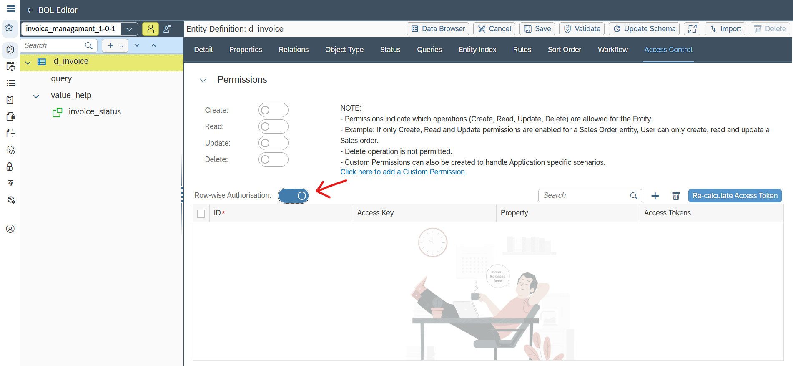

**Step 2 :** Create an access token template, enter a readable ID and Key (can be the same).

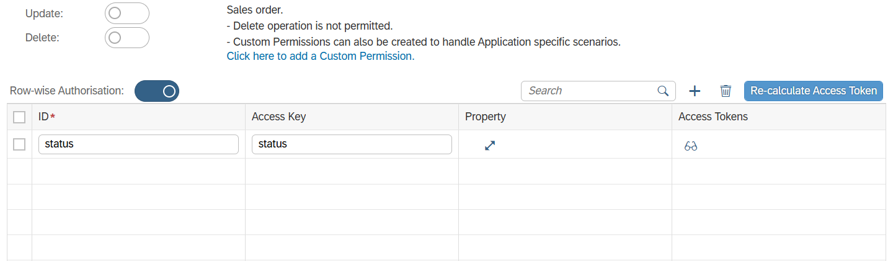

**Step 3 :** Click on the property expand icon, click on + - add property, and select the property with which you want to control data access.

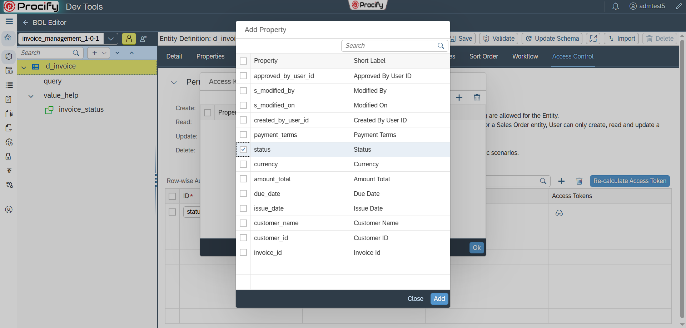

**Step 4 :** Save the entity. You will see a dialog asking to recalculate the access token. (This dialog won’t be shown if the entity was newly created). Click OK.

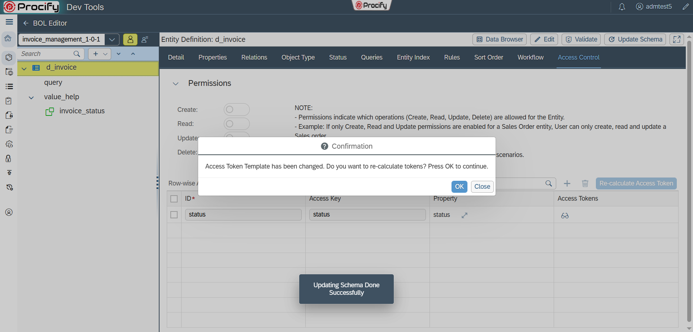

**Step 5 :** After recalculation is done, another dialog will appear to build the flavor (This dialog won’t be shown if the entity was newly created). Build the flavor.

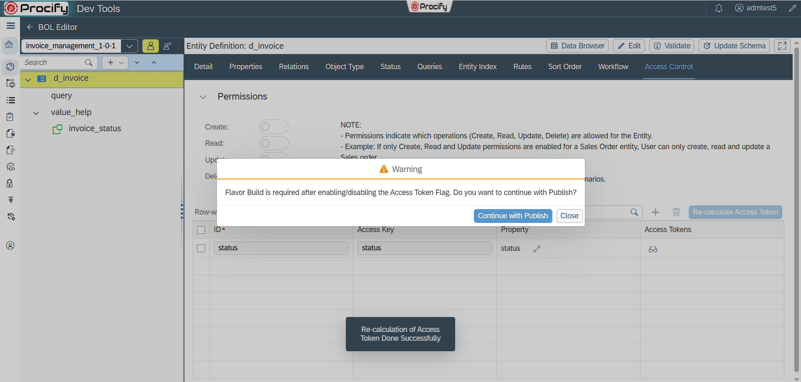

**Step 6 :** Add some data in the Data Studio. And make sure to fill the property used for row wise authorization. (Optional if data is already present.)

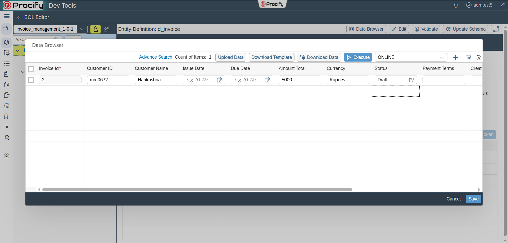

**Step 7 :** Click on the navigate icon 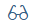 in the access token. It will navigate to the Data Access Rules screen in the Workspace Hub (Workspace Hub should be assigned to the user).

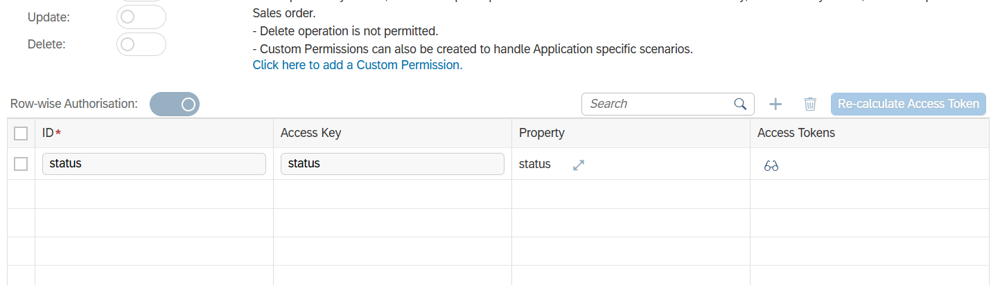

- In the Data Access Rules screen, check the generated Data Access Keys. For each record where the access token property is not null, a token should be generated.

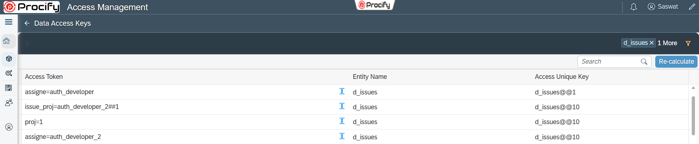

- Now we have successfully generated the Data Access Keys. Now, we have to generate matching User Access Keys to provide access.

**Step 8 :** Now we have to add access tokens to users based on what data they should have access to. Go to the Workspace Hub and create some roles in the application.

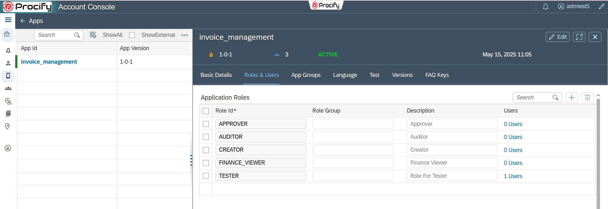

**Step 9 :** Create [<u>entity.ts</u>](http://entity.ts) file for the row wise authorized entity. And add a method as shown below and correct the logic to match your application requirement. Fire query to application entities, if access is dependent upon application data. Copy this code to a temporary file for clearer view.

<table>
<colgroup>
<col style="width: 100%" />
</colgroup>
<thead>
<tr class="header">
<th>import { d_invoice as d_invoice_gen } from "invoice_management/entity_gen/d_invoice"; 
import { KloTransaction } from "kloBo/KloTransaction"; 
import { AccessTokenHelper, EntityAccessTokenCallbackReturnType } from "kloBo/KloEntity"; 
 
export class d_invoice extends d_invoice_gen { 
static async getAccessTokensForUsers(txn: KloTransaction, flavor: string, version: string, userAppRoleMap: { [user_id: string]: string }, accessTokenHelper: AccessTokenHelper): Promise&lt;EntityAccessTokenCallbackReturnType&gt; { 
let userIdList = Object.keys(userAppRoleMap); 
 
let accessTokensMap: EntityAccessTokenCallbackReturnType = {}; 
debugger; 
for (let user_id of userIdList) { 
/** 
* Building the EntityAccessTokenCallbackReturnType map. 
* { 
* user_id1 : { 
* access_token: [ token1, token2 ] 
* }, 
* user_id2 : { 
* access_token: [ token3, token4 ] 
* } 
* } 
*/ 
if (!accessTokensMap[user_id]) accessTokensMap[user_id] = { access_tokens: [] }; 
 
if (userAppRoleMap[user_id] == "FINANCE_VIEWER") { 
accessTokensMap[user_id].access_tokens.push( 
await accessTokenHelper.getAccessToken( 
"status" /** ID from access token screen - not the property*/, 
{ 
status: "approved", 
} /** Object with property : value for properties used in access token.*/ 
) 
); 
} else if (userAppRoleMap[user_id] == "CREATOR") { 
accessTokensMap[user_id].access_tokens.push(await accessTokenHelper.getAccessToken("status", { status: "draft" })); 
} else if (userAppRoleMap[user_id] == "APPROVER") { 
accessTokensMap[user_id].access_tokens.push(await accessTokenHelper.getAccessToken("status", { status: "pending" })); 
} else if (userAppRoleMap[user_id] == "AUDITOR") { 
accessTokensMap[user_id].access_tokens.push(await accessTokenHelper.getAccessToken("status", { status: "paid" }), await accessTokenHelper.getAccessToken("status", { status: "approved" })); 
} 
} 
 
return accessTokensMap; 
} 
}</th>
</tr>
</thead>
<tbody>
</tbody>
</table>

**Note :** This example considers a use where each role has access to a set of data, but cases where the User Access Keys should be generated based on application data are also possible.

**Step 10 :** Go to the User Data Access in the Security & Permissions and click on re-calculate, select flavor, entity name and click recalculate.

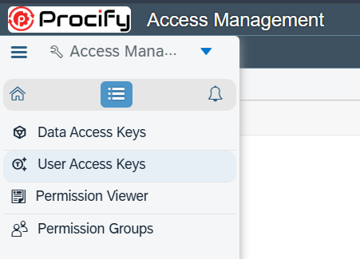

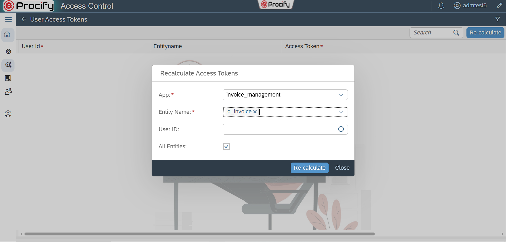

- Once done, it should generate access tokens for all the users who the application is assigned, based on the logic. (No token will be generated if the application is not assigned with an Application Role). This method can be debugged by triggering re-calculate from private node registration.

**Step 11 :** Now assign the application to some user, and configure based on the logic written in the getAccessTokensForUsers callback. After assigning the flavor, a token should be generated for the user based on the callback logic.

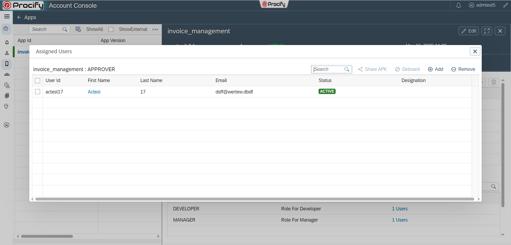

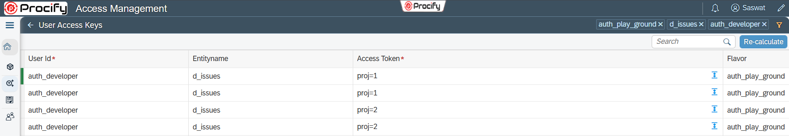

**Step 12 :** Create a screen with the entity and add it to the menu, and build the flavor.

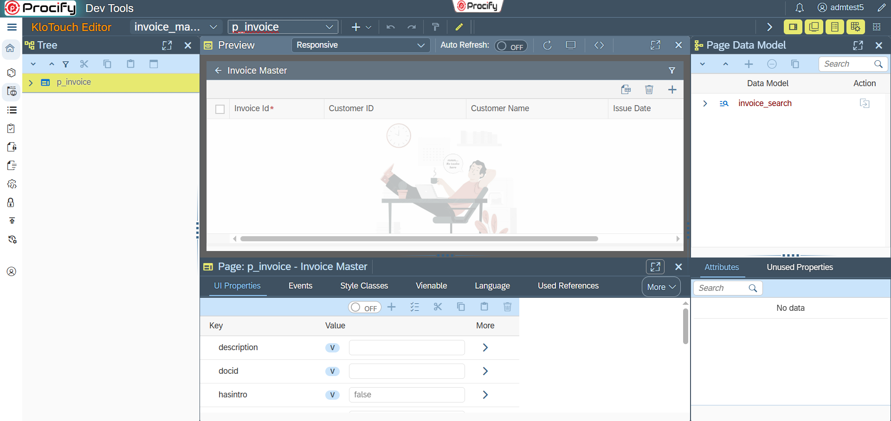

**Step 13 :** Register with the assigned user. Only the data that has access to should be listed.

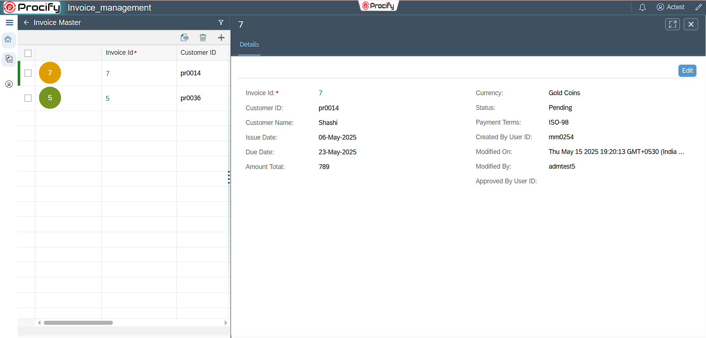

Thus row wise authorization can be configured.

### 4.1.2. Where to next ?

- [<u>Data Access Keys callback, onAccessTokenCalculate</u>](#entity-token-callback-onaccesstokencalculate)

- [<u>ME tokens - simpler implementation for providing access with properties like assigned_to, created_by</u>](#me-user-tokens)

- [<u>All data access token</u>](#all-data-access-tokens)

## 4.2.What is Access Token ?

Access token is a string, which acts as a link between the data and user to define which data set the user has access to. Consider the above example. There are access tokens for each record of data (Data Access Keys), and below that there is a set of access token(s) assigned to each user (User Access Keys).

## 4.3.What are Data Access Keys ?

Tokens which are present for each record of data in a row wise authorized entity. Entity access for an BO can be checked in the [<u>Data Access Rules Screen.</u>](https://docs.google.com/document/d/1iqK0kZG6YE7B-vXLHfuoqWQWV9SuAPk6cUzvPGCpq7c/edit?tab=t.0#heading=h.be4d0scr1x1a)

## 4.4. What are User Access Keys ?

Tokens which are assigned to users, which provide them access to data from row wise authorized entities. User Access Keys are not common among entities or flavors, it will be maintained separated for each flavor and entity.

## 4.5.Behaviour of root entity & child entities ?

Row wise authorization can be enabled only in root entities. Not on child entities. If BO is row wise authorized, all the child entities will also follow the same authorization.

If a user has access to the root object, then the user can access all the child objects belonging to that root object.

## 4.6.How Data Access Keys are generated ?

Data Access Keys can be added in two ways.

1.  By adding an access token template in the entity.

2.  Via callback.

### 4.6.1.Access token templates

Access token template can be defined in the entity metadata via bol-editor, Look into [<u>quickstart</u>](#quick-start) for step wise guidance*.* For each record of the entity all templates will be used to generate access tokens. A template can be defined with access key and access properties. The access key is a custom string and can contain alpha numeric characters. The access properties are a list of properties which should be added to build the token. The access token will be constructed as explained below.

Structure : {access key}={property 1’s value}#{property 2’s value},...

The generated access token will start with access key with an equal (“=”) symbol, followed by entity property(s) in the sequence mentioned in access properties separated by comma (“#”).

**For example** : Consider the above example of **d_no_hdr** where there are properties work_center, planner_group, is_flagged & plant,

We have created token templates as explained below,

1.  **Access key :** wc. **Access properties :** work_center.

2.  **Access key :** pg_pl. **Access properties :** planner_group & plant (*In same seq.*)

3.  **Access key :** flagged. **Access properties :** is_flagged.

Access tokens will be generated as described below,

<table>
<colgroup>
<col style="width: 15%" />
<col style="width: 17%" />
<col style="width: 9%" />
<col style="width: 15%" />
<col style="width: 42%" />
</colgroup>
<thead>
<tr class="header">
<th>work_center</th>
<th>planner_group</th>
<th>plant</th>
<th>is_flagged</th>
<th>access tokens</th>
</tr>
<tr class="odd">
<th>ELEC</th>
<th>PG01</th>
<th>2000</th>
<th>true</th>
<th>
wc=elec

pg_pl=pg01#2000

flagged=1
</th>
</tr>
<tr class="header">
<th>MECH</th>
<th>PG02</th>
<th>2000</th>
<th>false</th>
<th>
wc=mech

pg_pl=pg02#2000

flagged=0
</th>
</tr>
<tr class="odd">
<th>CIVIL</th>
<th>PG01</th>
<th>2001</th>
<th>false</th>
<th>
wc=elec

pg_pl=pg01#2001

flagged=0
</th>
</tr>
</thead>
<tbody>
</tbody>
</table>

In case of null values, if all the access properties have null values, then access tokens will not be generated. If any one of the properties has value, access token will be generated with null in place of other properties’ values.

**For eg:** Consider same set of tokens as explained for above example with this new set of data

<table>
<colgroup>
<col style="width: 17%" />
<col style="width: 8%" />
<col style="width: 8%" />
<col style="width: 12%" />
<col style="width: 26%" />
<col style="width: 25%" />
</colgroup>
<thead>
<tr class="header">
<th><strong>work_center</strong></th>
<th><strong>planner_group</strong></th>
<th><strong>plant</strong></th>
<th><strong>is_flagged</strong></th>
<th><strong>access tokens</strong></th>
<th></th>
</tr>
<tr class="odd">
<th>null</th>
<th>PG01</th>
<th>2000</th>
<th>true</th>
<th>
pg_pl=pg01#2000

flagged=1
</th>
<th>wc token is not generated as work center is null</th>
</tr>
<tr class="header">
<th>MECH</th>
<th>null</th>
<th>2000</th>
<th>false</th>
<th>
wc=mech

pg_pl=null#2000

flagged=0
</th>
<th>Since planner_group is null, access token is generated as pg_pl=<strong>null</strong>#2000</th>
</tr>
<tr class="odd">
<th>CIVIL</th>
<th>null</th>
<th>null</th>
<th>false</th>
<th>
wc=elec

flagged=0
</th>
<th>pg_pl access token is not generated as both planner_group and plant are null.</th>
</tr>
</thead>
<tbody>
</tbody>
</table>

**Note :** Boolean properties will return **false** even if the field is not filled (is null). But, since the underlying data is null, access tokens generation will consider it as null and won’t generate tokens. So, if required, add the default value as false to generate a token.

### 4.6.2. Entity token callback (onAccessTokenCalculate )

In the Entity file the **<u>onAccessTokenCalculate</u>** method can be overridden and application logic for manipulating the Data Access Keys can be written. This method will be called whenever the access token is getting calculated / re-calculated.

| public async onAccessTokenCalculate(tokenHandler: TokenHandler): Promise\<void\> |
|----------------------------------------------------------------------------------|

The method will be invoked with the *tokenHandler* instance as the first parameter. tokenHandler

<table>
<colgroup>
<col style="width: 100%" />
</colgroup>
<thead>
<tr class="header">
<th>public async onAccessTokenCalculate(tokenHandler: TokenHandler): Promise&lt;void&gt; { 
let existingTokens = await tokenHandler.getTokenArray(); 
let watchers = await this.txn.getExecutedQuery("d_watchers", { selectclause: ["user_id"] }); 
for(let watcher of watchers){ 
existingTokens.push("WATCHER:" +watcher.user_id); 
} 
return null; 
}</th>
</tr>
</thead>
<tbody>
</tbody>
</table>

#### 4.6.2.1. How to debug?

This method can be debugged in a private server similar to how rules are debugged. To trigger this, kindly check the following section on when tokens will be recalculated.

## 4.7. When Data Access Keys gets calculated.

Data Access Keys will get calculated when it has to be filled / corrected. It is triggered when,

1.  A new record is getting created.

2.  In existing records, any of the access properties are getting modified.

3.  **<u>recalculateAccessTokens</u>** is called by application logic to manually trigger access token recalculation on an existing record.

4.  Recalculate is triggered from the [<u>Data Access Rules screen</u>](https://docs.google.com/document/d/1OHZh7CW4pmsm-AJHfWdEHsQm09UoZCSIb78NbFGfoJQ/edit?tab=t.0#heading=h.bvsj0bh80vku). (Will not trigger debugging in private nodes.)

## 4.8. Child Data Access Keys.

As explained in previous sections, row wise authorization on child entities will be applied based on the root entity, so that if a user has access to the root object, they will have access to all the child objects of those root objects.

But, the access token templates can be added to child entities. The access tokens generated by the child objects will be added to the root object.

**For example :**

Consider example similar to before :

<table>
<colgroup>
<col style="width: 7%" />
<col style="width: 32%" />
<col style="width: 20%" />
<col style="width: 20%" />
<col style="width: 20%" />
</colgroup>
<thead>
<tr class="header">
<th><strong>S.no</strong></th>
<th><strong>k_notif_id</strong></th>
<th><strong>work_center</strong></th>
<th><strong>plant</strong></th>
<th><strong>Access Tokens</strong></th>
</tr>
<tr class="odd">
<th>1</th>
<th>10005154</th>
<th><mark>ELEC</mark></th>
<th>2000</th>
<th>
wc=elec

pl=2000

<strong>assign=user001</strong>

<strong>assign=user002</strong>
</th>
</tr>
</thead>
<tbody>
</tbody>
</table>

For that notification, d_no_user is a child entity which says, which are users are this assigned to,

And an access token template is added with **access key** as *<u>"assign”</u>* and **access property** as *<u>user_id</u>*

| **S.no** | **k_notif_id** | **user_id**                       |
|----------|----------------|-----------------------------------|
| 1        | 10005154       | user001 |
| 2        | 10005154       | user002 |

Now, due to two d_no_user entries for that notification, access tokens of **assign=user001** and **assign=user002** are assigned to the notification. This can be used to provide notification access to the involved users.

## 4.9. Recalculate Data Access Keys for all data in dev:

On multiple occasions the Data Access Keys have to be completely re-calculated. Such as

1.  The entity callback logic for generation of tokens *(onAccessTokenCalculate)* is changed.

2.  New access token templates are added / existing ones are modified.

3.  Primary keys of the entity are changed.

The changes (2) & (3) are detected by FW and will be prompted to re-calculate from the Data Studio. So, the recalculate [<u>access tokens button is provided in boleditor</u>](https://docs.google.com/document/d/1TZCiIbpOLvFzD4Qp6HrLiJafHC3OOKDvIcDAtmGRHbA/edit?tab=t.0#heading=h.waf0l81a3e30) to trigger when application developers want to recalculate the access tokens.

## 4.10. How is a User Access Keys assigned to a user ?

User Access Keys are stored in the user access table maintained by FW. An application callback in the entity file will be called for collecting the access tokens for that entity in that flavor. User Access Keys assignment has the following important fields.

| **User ID** | **Flavor** | **Entityname** | **Type** | **Access token** |
|-------------|------------|----------------|----------|------------------|
| USER001     | o2c        | d_o2c_employee | ROW_AUTH | emp=user001      |

This implies any access token assigned to a user is specific to entity and flavor. So, the application developer has to provide a list of access tokens for each user for each row wise enabled entity for each flavor. The parameters and expected return type is explained below.

### 4.10.1. User Access Keys callback (getAccessTokensForUsers):

This callback has to be overridden in the entity file. It is a static method.

| public static getAccessTokensForUsers(ring, version: txn: KloTransaction, flavor: ststring, userAppRoleMap: {\[user_id:string\]: string}, accessTokenHelper: AccessTokenHelper): Promise\<EntityAccessTokenCallbackReturnType\> |
|---------------------------------------------------------------------------------------------------------------------------------------------------------------------------------------------------------------------------------|

This method will be called,

1.  When the application is transported to FW, User Access Keys will be recalculated for all the upgraded users.

2.  When an application is newly assigned to some users.

3.  When *recalculateUserAccessToken* is triggered by application logic.

4.  When *recalculateUserAccessToken* is triggered from the [<u>User Data Access screen</u>](https://docs.google.com/document/d/1iqK0kZG6YE7B-vXLHfuoqWQWV9SuAPk6cUzvPGCpq7c/edit?tab=t.0#heading=h.cf757pmnt190).

**Params :**

txn - Application transaction.

flavor - Application flavor

version - Application version

userAppRoleMap - Map of users, with key as users & value as application role with which they were assigned.

**Expected return type:**

Map of users and their tokens. With Key as User ID and value as JSON Object with

{ access_tokens?: string\[\]; org_accesses?: OrgConfig\[\] } as value.

<table>
<colgroup>
<col style="width: 100%" />
</colgroup>
<thead>
<tr class="header">
<th>{ 
[user_id: string]: { 
access_tokens?: string[]; 
org_accesses?: OrgConfig[] 
} 
};</th>
</tr>
</thead>
<tbody>
</tbody>
</table>

For example :

<table>
<colgroup>
<col style="width: 100%" />
</colgroup>
<thead>
<tr class="header">
<th>{ 
"USER001": { 
access_tokens: [ 
"wc=ELEC", 
"pl=2000" 
] 
}, 
"USER002": { 
access_tokens: [ 
"wc=MECH", 
"pl=2002" 
] 
}, 
}</th>
</tr>
</thead>
<tbody>
</tbody>
</table>

Considering only USER001 & USER002 came in the userAppRoleMap for access token recalculation.

Note : Here in all the places user id refers to the FW stored user's id. It is application responsibility to map between application user id and FW user id.

Make sure you have written the implementation in the root entity and not in any child entities.

If a user is not assigned with an application role i.e. only assigned as DEVELOPER / MANAGER, this callback will not be called for that user.

### 4.10.2. How to debug:

For debugging [<u>User Access Keys callback</u>](#user-access-keys-callback-getaccesstokensforusers) in the entity file, Workspace Hub flavor should be assigned to the user, and the application that Developer is working on should be assigned as Manager.

**Step 1 :** Set-up private nodes and check out the flavor in which the entity callback is written. Compile the application files.

**Step 2 :** Register in browser and navigate to Security & Permissions menu, User Data Access Screen. If this menu is not visible, make sure the Workspace Hub flavor is assigned to your user.

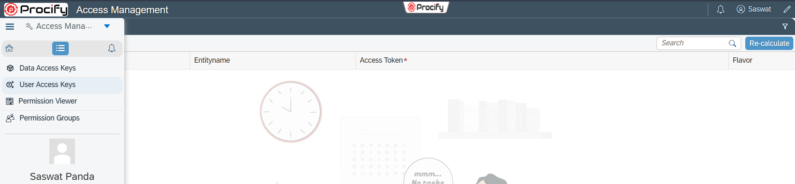

**Step 3 :** Start the private node in debugger-mode and place debuggers inside the entity file, getAccessTokensForUsers method.

**Step 4 :** Go back to the browser, and click on the recalculate button, select the flavor, select the entity that you want to debug, and click Re-calculate.

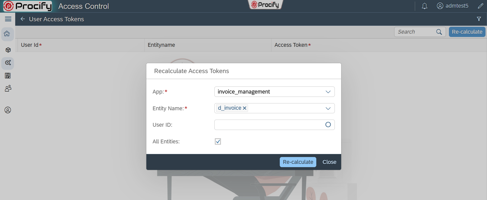

Now the debugger should reach the private node, you can debug the method. If the debugger is not getting attached / not getting triggered, try adding an inline debugger in code.

**Note :** After 1-2 mins the request will fail from the UI and the returned access tokens will not be added to the User Access Keys list. So, after debugging, re-trigger without debugging to generate correctly.

Make sure users are assigned with an application role. If not assigned with the application role, the user will be sent for access token generation.

### 4.10.3. Special access tokens:

#### 4.10.3.1 “Me” (\$USER) Tokens

By default, all the users are internally provided the access token me=\${userid} for all queries they are firing on row wise authorized entities. Consider the below example.

Entity d_so_hdr, where access to the sales order (entry) should be provided to the user ID filled in the responsible field. An access token template should be created with, access key as “me” and property as “responsible”.

| **S.no** | **k_notif_id** | **responsible**                  | **description** | **Access Tokens** |
|----------|----------------|----------------------------------|-----------------|-------------------|
| 1        | SO10001001     | MM0672 | Sales order 1   | me=mm0672         |
| 2        | SO10001002     | MM0472 | Sales order 2   | me=mm0472         |

And the users MM0672 & MM0472, don't need explicit User Access Keys assigned to them via the callback. But, when the query is fired by MM0672, the first record will be returned, as that record has “me=mm0672” access token assigned to it and the user MM0672 by default is provided with the me=mm0672 token by Framework.

#### 4.10.3.2. How to configure a “me” token for an entity ?

**Step 1** : Go to the entity in Data Studio and navigate to Access Management, and click on Edit

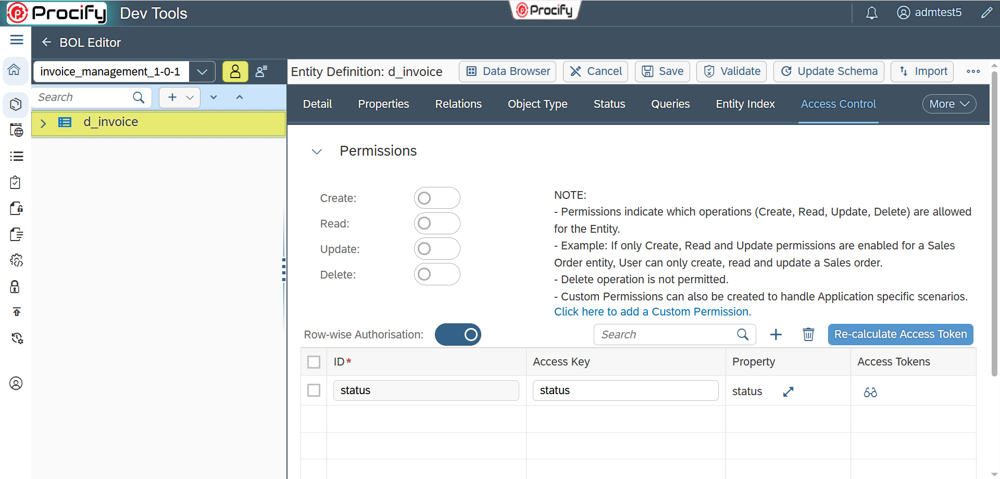

**Step 2 :** Add an access token template by clicking the  button in the row wise authorization section. Provide any id of your desire, in the access key, provide the value - me. And select the property where the user_id of the user who access should be provided is filled.

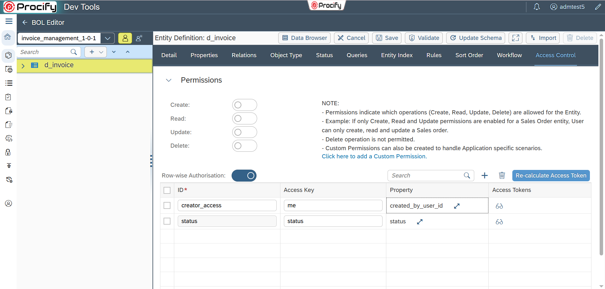

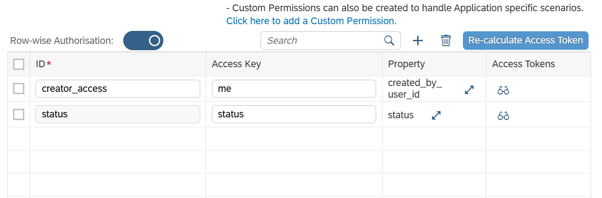

After saving, the editor will prompt to recalculate access tokens, click on OK.

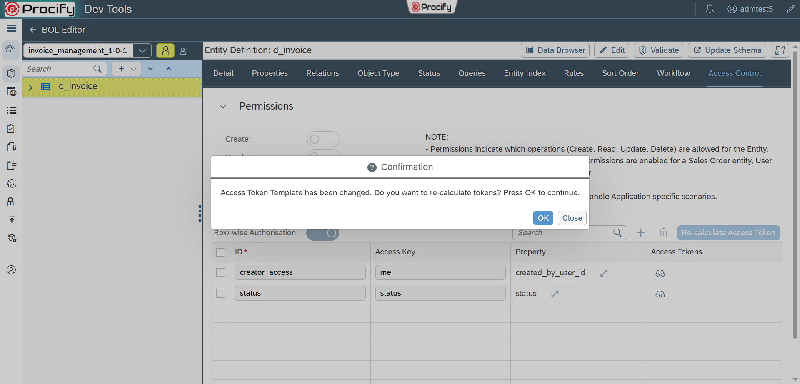

After recalculation is complete. Click on the navigate button 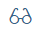 to check the recalculated access tokens.

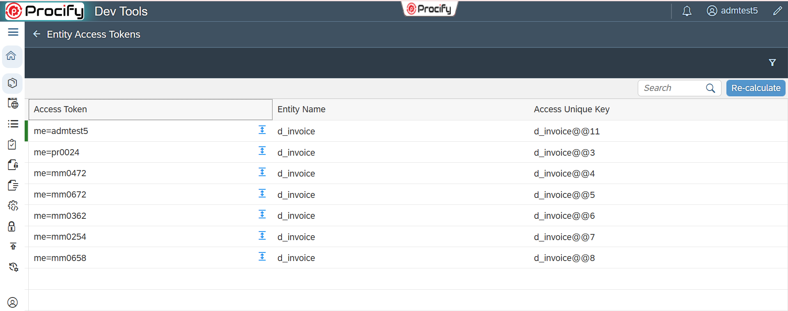

Search again to get all the tokens present in the entity.

**Step 3 :** Login with one of the users, and navigate to the application screen which uses this entity, whose user_id is present in the access token field. Or create a record and check. The records where the current logged in user_id is filled should be visible to the user.

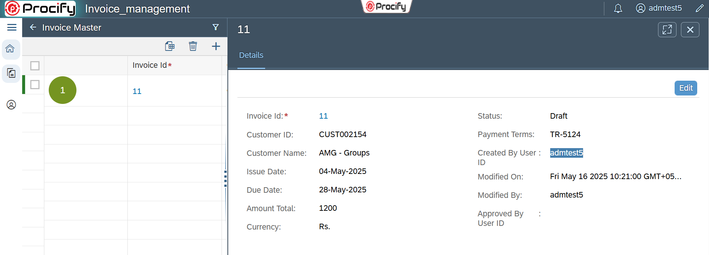

When an access token is generated with me=\${user_id}, no changes in the User Access Keys callback (getAccessTokensForUsers) for providing access to users.

Note : me token provides access without User Access Keys logic. Thus, it is generic and cannot be controlled on user level. So, if restriction is mandatory on user level, **DON’T USE “ME” TOKEN,** generate own tokens with that field and handle assigning only to require users in the User Access Keys callback (getAccessTokensForUsers).

#### **4.10.3.3.** “ \* ” (All data access) Tokens

When a user has **<u>\*</u>** - ( asterisk with no space in the front / back ) access token assigned to them. All the data in the entity will be accessible to that user i.e. row wise authorization will not be applied when the user fires a query of that entity.

So, to provide all data access for that entity return \* in the access token array.

Eg :

<table>
<colgroup>
<col style="width: 100%" />
</colgroup>
<thead>
<tr class="header">
<th>{ 
"USER001": { 
access_tokens: [ 
"*" // This provides all data access to USER001 
] 
}, 
"USER002": { 
access_tokens: [ 
"wc=MECH", 
"pl=2002" 
] 
}, 
}</th>
</tr>
</thead>
<tbody>
</tbody>
</table>

## 4.11. Org hierarchy and access tokens:

Org hierarchy is a feature by which access to data can be provided based on the hierarchy of users in the organization.

### 4.11.1. Building the org hierarchy tree:

1.  Users can be grouped based on management hierarchy and access can be provided relative to the user’s position in the hierarchy.

2.  Org structure can be defined with a tree structure (org tree), built of org units as elements of tree.

3.  An org unit can have only one parent, but multiple org units can have the same parent. (Strictly tree)

4.  Users can be assigned to org units. One user can be assigned to multiple org units.

5.  When assigning a user to an org unit, the user will be assigned with a designation (Will be used for access management, explained below).

### 4.11.2 Access management with org structure:

1.  Placing the user in an organisational structure alone will not provide any extra access.

2.  Org auth config should be assigned to the user (in User Access), if he/she should get access to other users’ access in the same org unit or org unit relative to theirs. (Eg : Manager needs access to all data in the child org units).

3.  The scope of org authorization is defined using two flags:

    1.  includePeers. If true, provides access to all the users’ access tokens in the same org unit as the target user.

    2.  includeChildren. If true, provides access to all the users’ access tokens in the org unit below the target users’ org units.

    3.  Both can be used together.

4.  In the org units that are collected based on the above mentioned flags, users can be included or excluded based on designation. As explained below.

    1.  considerDesignations : Token from users with the list of designation mentioned will be only taken.

    2.  ignoreDesignations : Token from users whose designation is not in the list of designation mentioned will be only taken.

    3.  Only one of the above can be used. Both are not supported.

Consider userA, he is present in org unit teamGlue with a designation Bottle, and there are other members in org unit teamGlue, whose data access you want to share with userA. Data can be maintained as follows,

<table>
<colgroup>
<col style="width: 10%" />
<col style="width: 16%" />
<col style="width: 15%" />
<col style="width: 12%" />
<col style="width: 44%" />
</colgroup>
<thead>
<tr class="header">
<th><strong>User id</strong></th>
<th><strong>entityname</strong></th>
<th><strong>flavor</strong></th>
<th><strong>type</strong></th>
<th><strong>Access token</strong></th>
</tr>
<tr class="odd">
<th>userA</th>
<th>targetEntity</th>
<th>targetFlavor</th>
<th>Org auth</th>
<th>
{

includePeers: true

}
</th>
</tr>
</thead>
<tbody>
</tbody>
</table>

Now we have a member in the org unit teamGlue, userR with designation : approver, whose data we don’t want to share with userA.

<table>
<colgroup>
<col style="width: 10%" />
<col style="width: 14%" />
<col style="width: 15%" />
<col style="width: 12%" />
<col style="width: 48%" />
</colgroup>
<thead>
<tr class="header">
<th><strong>User id</strong></th>
<th><strong>entityname</strong></th>
<th><strong>flavor</strong></th>
<th><strong>type</strong></th>
<th><strong>Access token</strong></th>
</tr>
<tr class="odd">
<th>userA</th>
<th>targetEntity</th>
<th>targetFlavor</th>
<th>Org auth</th>
<th>
{

includePeers: true,

ignoreDesignations : approver

}
</th>
</tr>
</thead>
<tbody>
</tbody>
</table>

Now we have the org unit teamPaper and teamPhoto, who are child org units of teamGlue. And we want userA to be able to access data of all users of org unit teamPaper and teamPhoto also.

<table>
<colgroup>
<col style="width: 10%" />
<col style="width: 14%" />
<col style="width: 15%" />
<col style="width: 12%" />
<col style="width: 48%" />
</colgroup>
<thead>
<tr class="header">
<th><strong>User id</strong></th>
<th><strong>entityname</strong></th>
<th><strong>flavor</strong></th>
<th><strong>type</strong></th>
<th><strong>Access token</strong></th>
</tr>
<tr class="odd">
<th>userA</th>
<th>targetEntity</th>
<th>targetFlavor</th>
<th>Org auth</th>
<th>
{

includeColleagues: true,

ignoreDesignation: approver,

includeChildren: true

}
</th>
</tr>
</thead>
<tbody>
</tbody>
</table>

#### 4.11.2.1. How to add org config to users ?

In the User Access Keys callback [<u>refer</u>](#user-access-keys-callback-getaccesstokensforusers), along with the access_token for each user, org_access can also be provided in the returned object.

**Eg :**

<table>
<colgroup>
<col style="width: 100%" />
</colgroup>
<thead>
<tr class="header">
<th>{ 
"USER001": { 
access_tokens: [ 
"wc=ELEC", 
"pl=2000" 
], 
org_accesses: [ 
{ 
include_children: true, 
}, 
{ 
include_peers: true, 
ignore_designations: ["SUPERVISOR"] 
} 
] 
}, 
"USER002": { 
access_tokens: [ 
"wc=MECH", 
"pl=2002" 
], 
org_accesses: [ 
{ 
include_children: true, 
consider_designations: ["TECHNICIAN"] 
} 
] 
}, 
}</th>
</tr>
</thead>
<tbody>
</tbody>
</table>

## 4.12. Data Access Keys Recalculation after transport

Data Access Keys will not be recalculated automatically after transport as it is a heavy process. This has to be triggered by the deployment team. So, any changes in the Data Access Keys logic should be notified to the deployment team and deployment team should trigger the recalculation of Data Access Keys using screen [<u>(link)</u>](https://docs.google.com/document/d/1iqK0kZG6YE7B-vXLHfuoqWQWV9SuAPk6cUzvPGCpq7c/edit?tab=t.0#heading=h.jy75kjq9hi8u) once after deployment of the app.

## 4.13. Value help behavior with ROW wise authentication

An entity is secured with **row-wise authorization**, meaning users can only see rows assigned or accessible to them. However, there are cases where users may need to see **all rows** in the value help suggestion items. This requirement is addressed with the **"Ignore Row-wise Auth"** toggle.

#### **Key Highlights:**

- **Ignore Row-wise Auth toggle** allows users to **view all rows** in the value help suggestions.

- This **does not completely bypass authorization**; only properties used in the value help are visible.

- Other properties will be **undefined or null**, ensuring sensitive data remains protected.

- **Sensitive properties involved in row-wise authorization should NOT be included** in the value help when this toggle is enabled.

#### **How It Works:**

- Enabling **row-wise authorization** automatically assigns a **query to the value help (VH)**.

- This query is applied across **all value helps in the entity** that have the "Ignore Row-wise Auth" toggle enabled.

- When the **toggle is disabled**, the query is removed.

  - Users must then **assign their own query or entity** to the value help.

  - In this mode, **only authorized rows are visible** in the suggestion items.

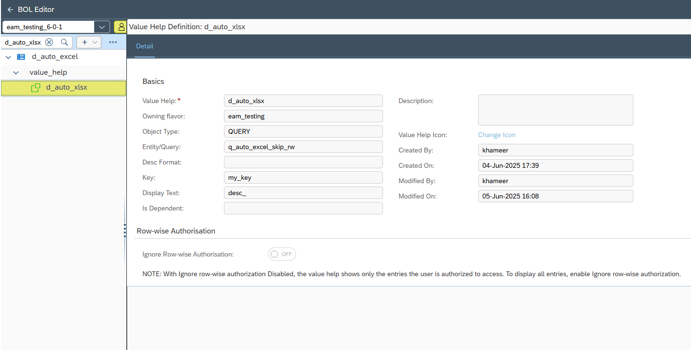

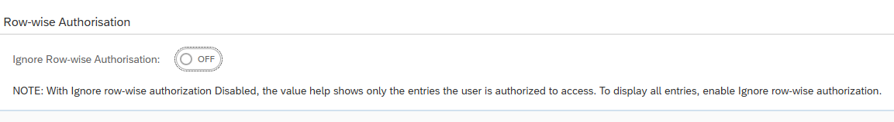

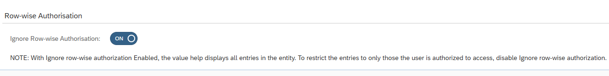

## 4.14. Server side behaviour of queries to row wise authorized entities

### 4.14.1. Applying Row-wise Authorization in Server-side Queries

By default, when a query is executed from server-side logic—such as Create/Update/Delete rules, schedulers, app service logic, or beforeQuery / afterQuery callbacks—it does not apply row-wise authorization automatically.

To enable row-wise filters in such cases, use the following API available on the **KloQuery** or **KloQueryForRule** instance:

| applyRowWiseAuthorization(userIdToImpersonate?: string): Promise\<void\> |
|--------------------------------------------------------------------------|

### 4.14.2. Usage Details:

- **userIdToImpersonate (optional)**:  
  > Pass the user ID whose row-level access you want to apply.

  - If not provided, it will default to **\$SYSTEM.userID**.

  - For system-level operations (like schedulers or unauthorized app services), **you must explicitly provide a user ID**. Calling this API without a user ID in these cases will throw an error.

- **Client-side Restriction**:  
  > This API **cannot** be used for queries executed on the client side.  
  > This restriction ensures that unauthorized data is not exposed to the client, maintaining security.
