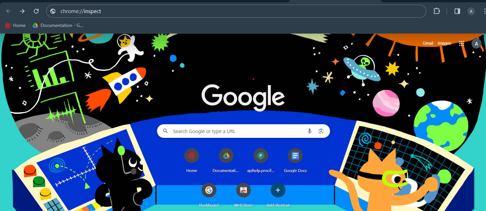
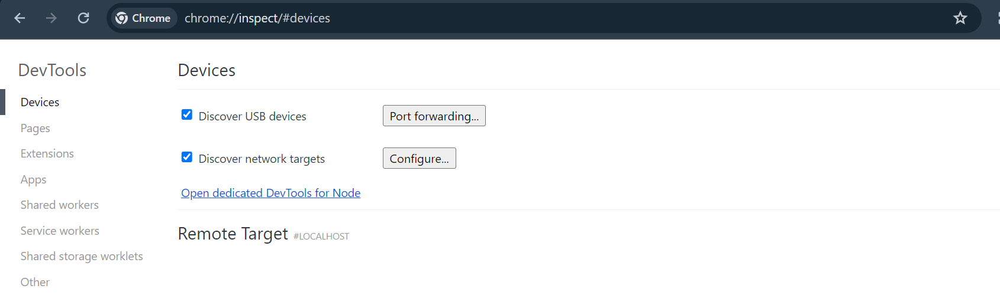
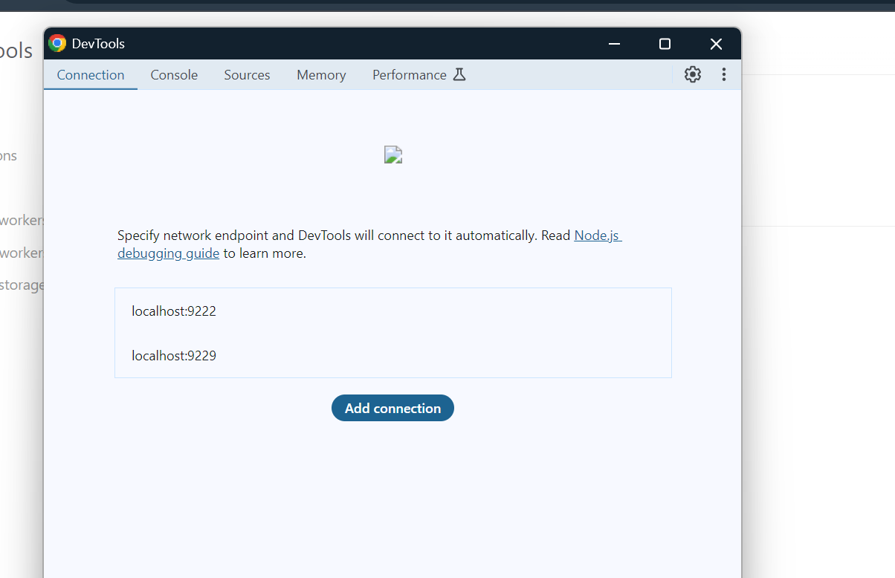
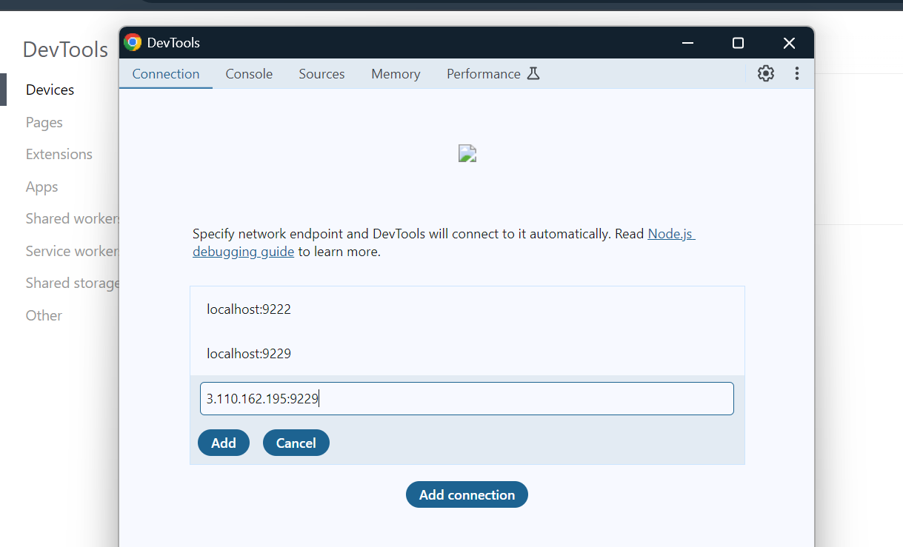
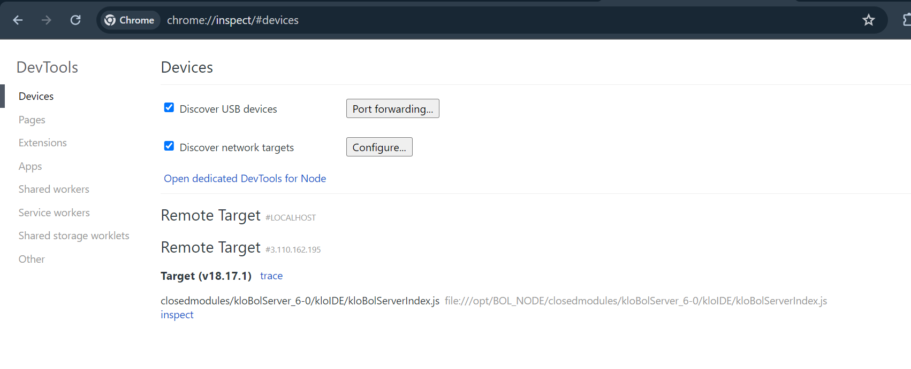

# Steps to be followed

### Start the Bol Node Server

**Step 1:** Start the landscape-specific Bol Node server with the below command: **\[Take the help of the Infra Team to start the BOL Node\]**

F:\Klarion 6.0\BOL_NODE\> node **--inspect=[0.0.0.0:9229](http://0.0.0.0:9229)** **--max-old-space-size=2048** --unhandled-rejections=none closedmodules/kloBolServer_6-0/kloIDE/kloBolServerIndex.js **servingLandscapes=APPS**

Details are given below:

| **Elements**                                                   | **Descriptions**                                    |
|----------------------------------------------------------------|-----------------------------------------------------|
| **F:\Klarion 6.0\BOL_NODE**                                    | This is the Bolnode path (public node path).        |
| **--inspect=[0.0.0.0:9229](http://0.0.0.0:9229)**       | This port 9229 for remote debugging.                |
| **--max-old-space-size**                                       | This is used for specifying the heap size.          |
| **closedmodules/kloBolServer_6-0/kloIDE/kloBolServerIndex.js** | the entry point to the node application to start.   |
| **servingLandscapes=APPS (APPS – Landscape Name )**            | provide the landscape name which you need to debug. |

- When the --inspect switch is put, a Node.js process looks for a debugging client. By default, it will look at the host and port 127.0.0.1:9229. Each process is also assigned a unique UUID.

- Inspector clients must know and specify the **host address**, **port number**, and **UUID** to connect.

> A full URL will look something like:
>
> ws://127.0.0.1:9229/0f2c936f-b1cd-4ac9-aab3-f63b0f33d55e

- If the debugger is bound to a public IP address, or 0.0.0.0, any clients that can reach your IP address will be able to connect to the debugger without any restriction and will be able to run arbitrary codes.

**Note:** By default, node --inspect binds to 127.0.0.1. You explicitly need to provide a public IP address or 0.0.0.0, etc., if you intend to allow external connections to the debugger.

Once the server is started with the above configurations mentioned, then connect to the system and open Chrome & follow the below instructions for debugging the BOLNODE server.

**Step 3:** In the Chrome search bar, type “**chrome://inspect**”

> 

**Step 4:** In DevTools \> Devices select “**Open dedicated DevTools For Node**”

> 

**Step 5:** In the new tab that will be opened in a new window, select “**Add Connection**”.

> 

**Step 6:** We will put the **Server** **IP address** and the **Debugging** **Port No.** in the Network address field and **Add** the same.

> 

**Step 7:** Refresh the page once more to find the target node.

> 
