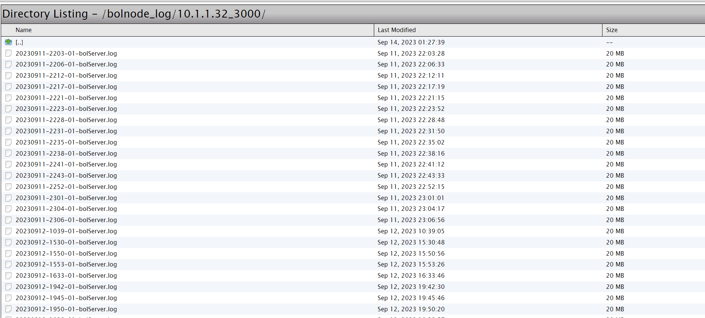
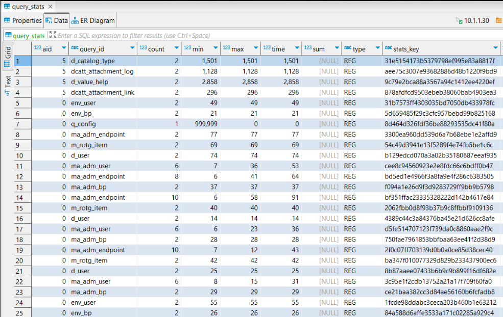

# What is a Slow Query log?

Slow queries are the queries that take a longer time to load during execution. The loading time is more than the average required time. The slow query log can be used to find queries that take a long time to execute and are therefore candidates for optimisation.

## 1.1. Process to fetch Slow Queries

Queries can be fetched in a **log file** or **server console**.

**Note:** One can get log access from the Infra team.

***This image identifies the BOLServer log file.***

The following statement will be printed in the code rendition space if SQL execution is taking more than the average time (up to or over a minute):

*“logger.error("Query Execution is taking more than a minute, Query : "\<+ sql\>); logger.error("Bindings : "+ JSON.stringify\<params\>);”*

**\<sql\>** here depicts the actual SQL that has taken more than a minute to execute.

**\<params\>** Here are the arguments supplied to the above SQL.

## 1.2. Process to enable Slow Query log

## 1.3. Query Statistics

Query statistics help developers boost the performance of the application/server by providing useful information on queries that are to be executed on the server.

Query stats contain a list of queries and the number of times they are executed on the server within a given period. It also provides information like the maximum or minimum time taken by the queries.

Application developers can find the query statistics data in the **query_stats** table in the transaction DB.

***This image shows query_stats*** ***in the database***
