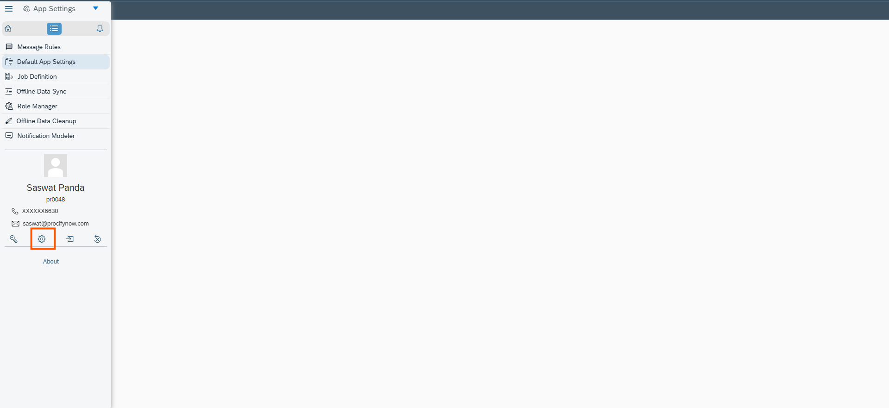
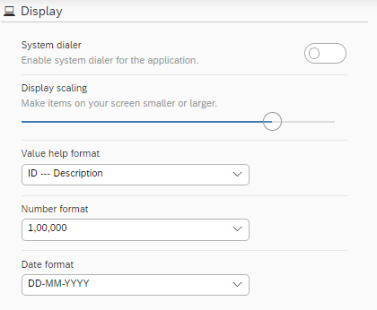
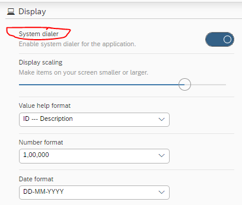
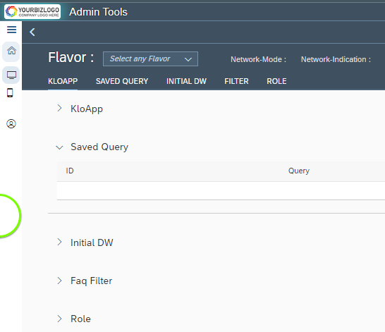
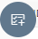
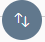
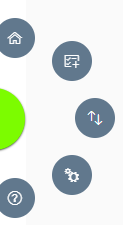
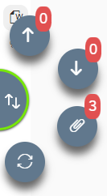

# System Dialer

A system dialer is an automated system aimed at reducing the cost of manufacturing efforts so that one can reach important screens by removing repetitive and error-prone work.

## Usage

To use system dialer users need to enable system dialer from settings.

After enabling the system dialer, it will be displayed on the left side of the screen.

With either a red or green colour border based on the network connectivity. (The screenshot is provided below)

If it is connected then the border colour will be green else the border colour will be red.

> 

On clicking the dialer it will rotate and display 5 icons in circles:

1.  On click it will navigate to the home screen.

2.  Navigate to the Add activity screen.

3.  On click it will show the upload/download count with a sync button.

4.  On click it will navigate to the settings screen.

5.  On click navigate to the web tour Screen. Preview of the system dialer.

Preview after clicking on the dialer.

On the click of the sync icon, it will show the upload/download count with a sync button, if you click on the sync button it will forcefully start syncing and the upload/download count will become 0. Attachment button shows the count of pending attachment to be uploaded to server.

