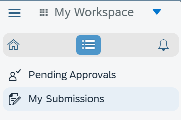

# Introduction To UWL Notification

## 1.1. What is Notification?

A notification is a message, email, icon, or another symbol that appears when an application wants you to pay attention. Notifications are a way to alert you on the various important facts that have happened in your application that are worth your attention while you are not using the application.

## 1.2. What is UWL Notification?

In the UWL (Universal Work List) notification screen, if the Workflow contains user tasks, those tasks will be shown on the screen. It mainly has 2 screens, **Approver** and **Requester**.

- The approver (**Pending Approvals**) can see and take necessary actions (those actions are defined in the workflow during design time) by reviewing the tasks.

- In the Requester (**My Submissions**) screen, whatever tasks have been created or assigned will reflect, and the users can see the update of the task on this screen.

