# Process to Use

## 3.1. UWL Approver Screen

**Step 1:** In the application menu, go to **My Workspace**.

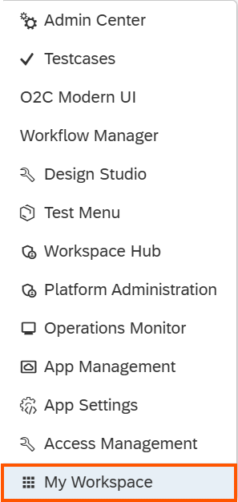

**Step 2:** Under the Admin Tool you will find Approver and Requester. Click on the **Pending Approvals** screen.

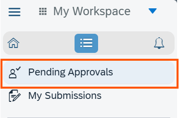

The Pending Approvals screen will open as shown below:

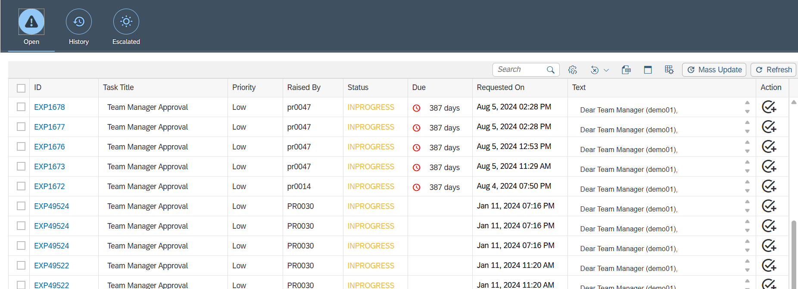

**Advanced Search** : Advanced search has few fields(Task ID, Workflow ID, Initiator, Priority and Due IN), Based on the value provided it will filter the list data.

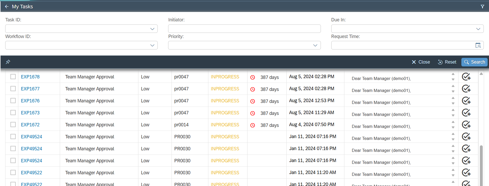  
  
**Navigate to detail** :-

When we click on one of the tasks from the list, it opens the details page where detailed information on the task is shown along with the task history, if any.

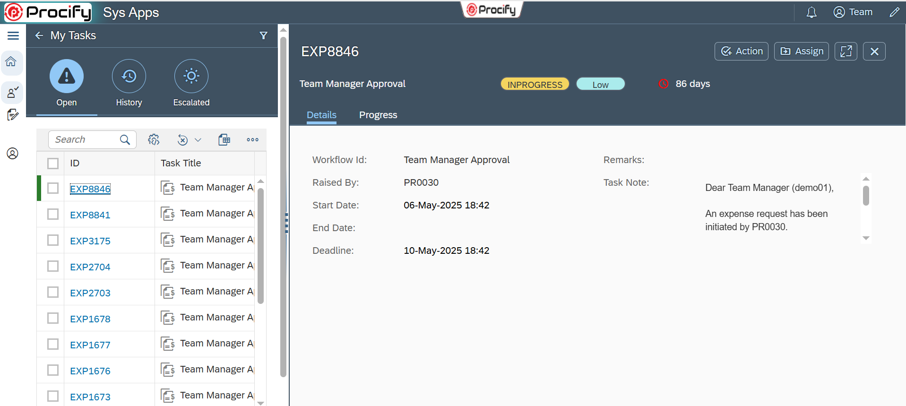

The approver can take necessary [actions](#34-steps-to-take-an-action) based on the conditions by clicking on the **Action** Button on the top right side of the detail screen.

**Assign Button :** Approver can also assign this task to another actor.

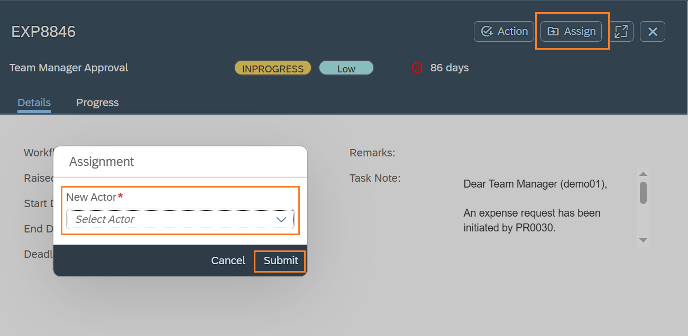

The elements on the approver screen have been explained below:

| **Elements**            | **Description**                                                            |
|-------------------------|----------------------------------------------------------------------------|
| Task                    | This is the description of the task provided in Workflow.                  |
| Lead Entity Instance ID | A reference ID of the entity object.                                       |
| Priority                | It shows the importance of a particular task.                              |
| Raised By               | Refers to the initiator of the Workflow.                                   |
| Status                  | Status shows the process of the task (ex: in progress, end).               |
| Due                     | Deadline before which approver has to take an action.                      |
| Remarks                 | Refers to the response of the Approver while taking Action.                |
| Action                  | Action (Approve/Reject etc) taken by the Approver upon one’s task/request. |

## 3.2. AWL Requester Screen

**Step 1:** In the application menu, go to **My Workspace**.

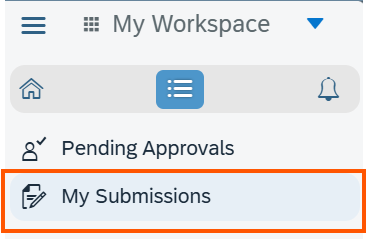

**Step 2:** Under the Admin Tool you will find Approver and Requester. Click on the **Requester** screen.

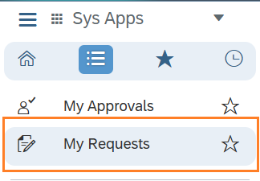

The Requester screen will open as shown below:

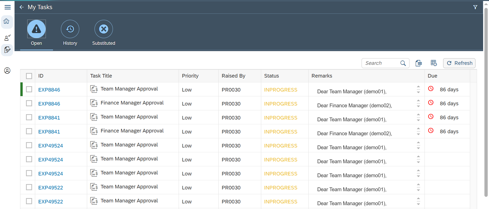

**Advanced Search** : Advanced search has few fields(Task ID, Workflow ID, Initiator, Priority and Due IN), Based on the value provided it will filter the list data.

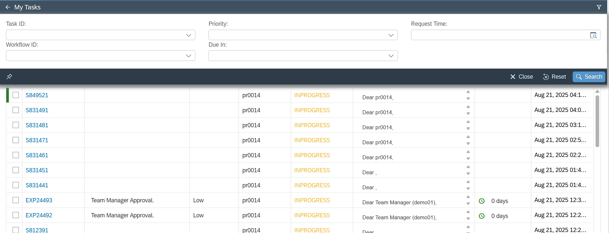

When we click on one of the tasks from the list, it opens the details page where a piece of detailed information on the task is shown along with the task history.

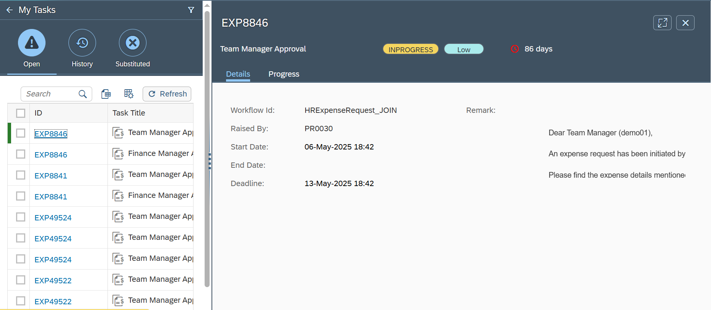

**Note:** Here we won't get any action button as this screen is for the requesters' view only.

The elements on the requester screen have been explained below:

| **Elements**            | **Description**                                              |
|-------------------------|--------------------------------------------------------------|
| Task                    | This is the description of the task provided in Workflow.    |
| Lead Entity Instance ID | A reference ID of the Entity object.                         |
| Priority                | It shows the importance of a particular task.                |
| Raised By               | Refers to the initiator of the Workflow.                     |
| Status                  | Status shows the process of the task (ex: in progress, end). |
| Remarks                 | Refers to the response of the Approver while taking Action.  |
| Due                     | Deadline before which the approver has to take the action.   |

**Note:** No action buttons as the Requester can only see the updates of the task.

## 3.3. Task Status

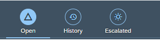

The Task status tabs can be seen on the top left corner of the screen for Approver.

**OPEN:** The Open tab refers to the tasks for which actions are pending and status are in progress. The approver can see the tasks and take necessary actions in this tab.

**HISTORY:** The History tab refers to the tasks for which actions have already been taken and the status for these tasks has been closed. History shows 3 months of data on the tasks. Here, we can also see the remark's end time and end action of a particular task.

**ESCALATED:** Tasks shown in the escalated tab refer to the tasks that have crossed their deadlines. As the actions were supposed to be done before the deadline.

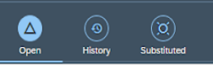

The Task status tabs can be seen on the top left corner of the screen for Requester.

**OPEN:** The Open tab refers to the tasks for which actions are pending and status are in progress. The approver can see the tasks and take necessary actions in this tab.

**HISTORY:** The History tab refers to the tasks for which actions have already been taken and the status for these tasks has been closed. History shows 3 months of data on the tasks. Here, we can also see the remark's end time and end action of a particular task.

**SUBSTITUTED:** In this tab, the task of the **substituted approver** will be displayed.

## 3.4. Steps To Take an Action

**Step 1:** Click on ( 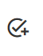) the action button from the list screen or click on (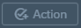) the action button from the detail screen. It will get disabled after taking one action.

**Step 2:** A popup will show, where one can write their responses to the task and take necessary actions. The popup is shown below:

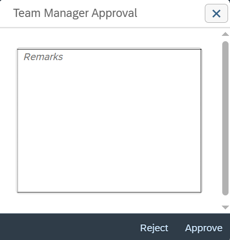

Note : remarks is mandatory for all actions

**Step 3:** Upon taking one action, on success, a popup message will appear as if the following action was successful or it will show an error message projecting the error.

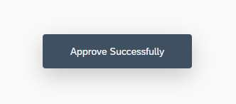

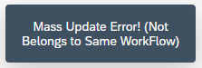

## 3.5. Process To Take Mass Update

The Mass Update ( 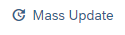) button is available on the Approver list screen.

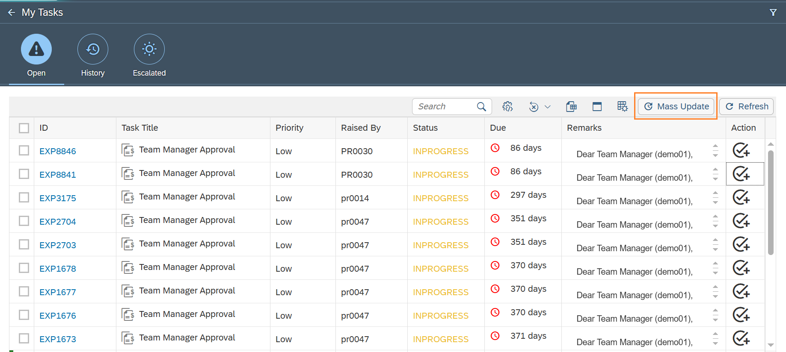

Upon clicking the mass update button the same action popup will appear, showing the necessary actions that are required to be taken for the selected tasks. But the tasks have to be in the same Workflow and their following actions should match for mass update, mass updation will fail.

**Step 1:** To Mass Update, we need to select one or more tasks.

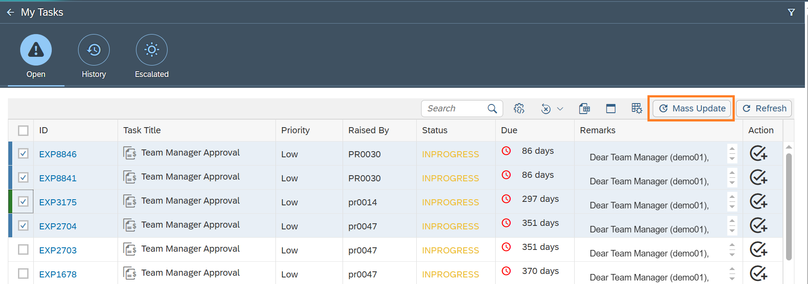

**Step 2:** After selecting the tasks we can click on the mass update button. First, it will check the necessary conditions internally. Once the conditions are satisfactory, the action popup will show up. Or else the mass update will fail.

Note : remarks is mandatory for all actions

**Step 3:** Upon clicking the action and giving approver remarks for the selected tasks, the user remarks and user action will be the same. After completing the mass update, it will show a popup displaying the requests that have been updated or that have failed with the reason for failure.

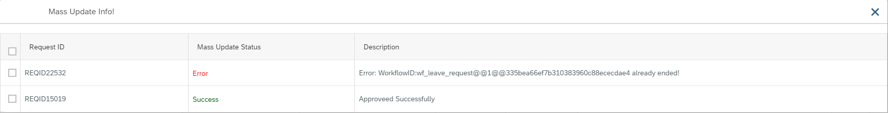

So, one can see the tasks that have been updated and the tasks that have failed.

3.6 Task Timeline Process

In the detail section, process section we will able to see the timeline progress of the task

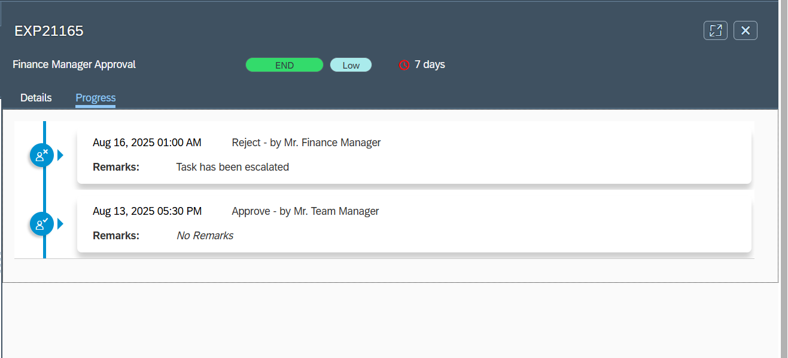

3.7 Navigating to UWL page via navTo

If application want to navigate the user to the UWL page, they use use the navTo API with the following navTo parameters

|  |  |
| --- | --- |
| S | Approval Page : p_app_screen_1 Requester Page : p_request_screen_1 |
| F | uwl |
| SS | Approval Page Open tab : “pa_open” History tab : ‘pa_history’ Escalated : ‘pa_escalated’ Requester Page Open Tab:’pa_portal_open’ History Tab:’pa_portal_history’ Substituted Tab : ‘pa_portal_escalated’ |
| AD | Using the AD parameter they can pass the queryParameters to filter the data while navigating \{queryParams:\{priority : ‘1’,wfid:<workflow ID> \} \} |
