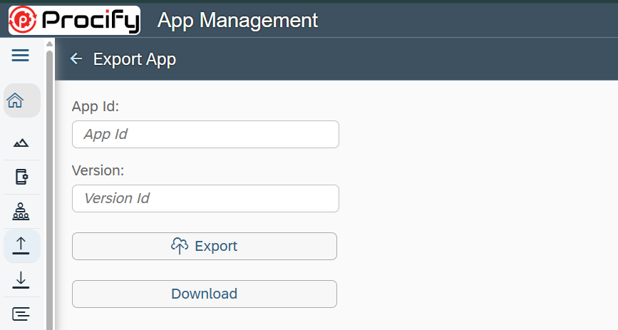

# Export App

Export App will download metadata of any given app version(eg. Myapp 6-0-1) in the form of a zip. The exported metadata zip file can now be uploaded/imported to any other application (eg. yourapp 6-0-4).

The metadata contains all of your developments like screens, entities, menu homepage etc. (except the files like controllers, util, entity file, query file etc.)

## How do we Export?

Fill in the input fields on the Export App Page and then click on the Export button. Suppose we have an app, **5-moast4_ui-1**; then the following will be the details:
1. **Account ID: 5**

2\. **Flavor ID: moast4_ui**

3\. **Version ID: 1
**After this wait for a pop-up that indicates download has started.

